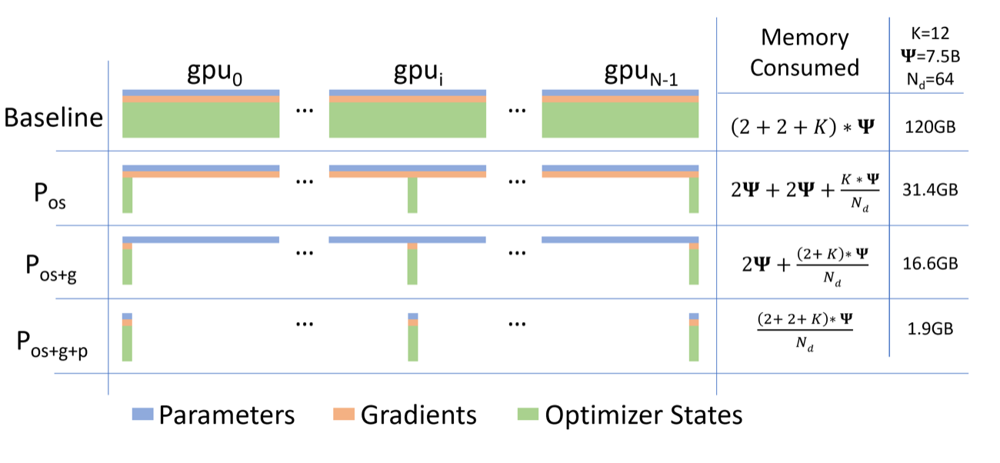
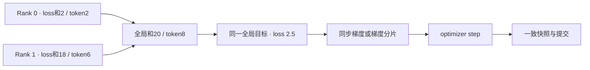
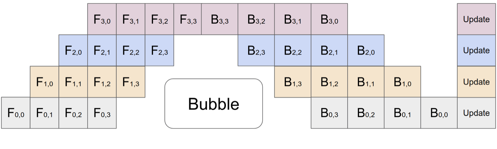

# 一次分布式参数更新怎样保持同一个目标

模型训练状态需要80GB、每卡只有40GB可用时，把完整模型复制到两卡仍然放不下。必须决定切分哪些状态或计算；等到能运行，还要确认各rank同步的是同一目标的梯度，中断时保存的是同一时刻。

## 先把显存按状态列出来

某些混合精度Adam配置可近似按每参数16字节计，包含低精度权重、梯度、高精度主副本与两个矩状态。但梯度dtype、是否存在主副本以及优化器实现都会改变这个数，激活和临时缓冲还没有算入。

数据并行复制模型以分担样本；张量并行切层内矩阵；流水线并行切模型层；状态分片切参数、梯度或优化器持有权。它们节省的是不同部分，并引入不同通信。

{ width="860" }

<small>图源：[ZeRO: Memory Optimizations Toward Training Trillion Parameter Models](https://arxiv.org/abs/1910.02054)，Figure 1。这张图说明：普通 data parallel 会复制 optimizer states、gradients 和 parameters，ZeRO 三个阶段分别把这些状态分片。</small>

## 用8卡说明组如何组合

假设TP=2、PP=2、DP=2，三组互相独立，可得到8个rank。每个DP副本内部有两个stage，每stage用两卡切层内计算。这里world size是三个独立维度的乘积。

EP或CP等配置不一定都是新增独立维度。例如专家并行可能组织在既有DP组内部，不能把所有名字后的数字不加分析地相乘。先画出每个参数分片由哪些rank持有，再核对框架的组定义。

## DDP平均之前，loss分母必须一致

假设两rank的有效token数为2和6，token loss总和为2和18。全局token平均loss为 $(2+18)/(2+6)=2.5$。先各自平均再平均得到 $(1+3)/2=2$，优化的是不同目标。

若DDP按R个rank平均梯度，令每rank局部反向目标为 $R S_r/D$，D为全局有效token数，则平均后得到正确全局token目标梯度。梯度累积时D还应覆盖相应更新包含的全部微批，具体组织要与同步次数匹配。

<!-- systems-workflow-visual -->

这里把统计口径与更新顺序分开画出。局部均值1和3直接平均会变成2，不能替代全局token平均2.5。

## 梯度何时变成新的参数

各rank完成局部backward，必要通信使它们获得所需梯度或梯度分片，优化器随后更新各自负责的状态。参数分片方案还需在下一次计算前按需收集对应参数。

Pipeline以microbatch穿过stage，启动与排空会产生bubble。增大microbatch数量可以摊薄部分bubble，但也改变激活驻留和调度。GPipe等图展示的是特定调度，不能直接代替当前框架实际时间线。

{ width="860" }

<small>图源：[GPipe: Efficient Training of Giant Neural Networks using Pipeline Parallelism](https://arxiv.org/abs/1811.06965)，Figure 2(c)。这张图说明：mini-batch 被拆成多个 micro-batch 后，不同 accelerator 可以同时处理不同模型分段，从而减少 stage 等待。</small>

## Checkpoint要落在一致提交边界

如果rank0保存更新后参数，rank1保存更新前参数，文件都能读取也不是一致快照。异步保存更要区分“内存快照已冻结”“文件写完”“整组提交完成”三件事。

除了参数，还需按恢复目标保存优化器、scheduler/scaler、RNG、数据消费位置与并行配置。nanoGPT示例保存model/optimizer等状态，但没有完整保存所有RNG和数据进度，不能据此声称精确重放。

## 用三步短跑证明恢复语义

连续运行到step3，另一路在step1保存并恢复，再跑到step3。比较两条路径实际消费的输入、loss、参数和优化器状态。改变world size时还要验证分片重组与采样语义。

如果目标只要求统计上继续训练而非逐样本重放，应明确允许哪些重复或随机差异。可加载checkpoint只是起点，恢复后的更新轨迹才验证保存协议。

## 对照源码与延伸阅读

- [DDP同步、优化器更新与示例checkpoint字段](https://github.com/karpathy/nanoGPT/blob/3adf61e154c3fe3fca428ad6bc3818b27a3b8291/train.py)
