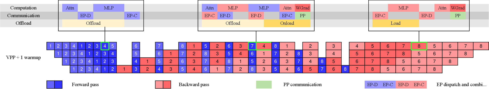

# 分布式训练与 Checkpoint

当模型规模走向几十亿、上百亿参数，训练问题很快不再只是“学习率怎么调”，而是“算力、显存、通信、数据顺序、存储和故障恢复能不能共同支撑一次长跑”。分布式训练决定训练能不能跑快，checkpoint 决定训练能不能跑完、跑坏后能不能继续、产物能不能被后训练和推理复用。

<!-- [补充] -->
| 读者 | 建议读法 | 工程落点 |
| --- | --- | --- |
| 初学者 | 先抓“分布式训练与 Checkpoint”要解决的问题、关键术语和最小例子；公式只看变量方向。 | 能说清输入、输出和常见失败信号。 |
| 工程师 | 直接对照结构、指标、成本和边界条件，必要时回到前置页补概念。 | 落到数据、算力、延迟、显存、评测和回滚检查。 |


!!! note "读法定位"
    这页先回答“分布式训练与 Checkpoint”在「训练」里的位置：它解决什么局部问题，依赖哪些前置，最后会影响哪类工程或研究判断。
    **前置**：先知道 loss、optimizer、batch、checkpoint 和评测集的基本含义。 必要时先回 [训练入口](index.md)、[基础知识](../foundations/index.md) 或 [术语表](../glossary/index.md)。
    **主线关系**：把目标函数、数据、分布式系统、评测回流和实验治理串起来，看一次训练为什么成功、为什么不稳、为什么贵。

这页建议和 [Megatron、DeepSpeed 与训练栈](megatron-lm-deepspeed-and-open-training-stacks.md)、[输入管线、Packing 与吞吐](input-pipelines-packing-and-throughput-governance.md)、[训练稳定性与故障排查](stability-numerics-and-failure-triage.md) 一起读。它们分别覆盖训练框架、数据吞吐和数值/系统异常，本页聚焦并行拓扑与恢复资产。

!!! note "合并提示"
    **note · 初学者先抓住**

    分布式训练不是把模型随便切到多张卡上。你要同时管理显存、通信、pipeline bubble、数据顺序和 checkpoint 恢复语义。

    **example · 有趣例子：多人接力搬家**

    人多不一定快。如果楼道太窄、箱子交接混乱、有人中途离开还没人记录进度，整体反而慢。分布式训练也要设计分工、通信和恢复点。

<!-- [补充] -->
> **踩坑原因**：这类工程问题通常不是单点公式错，而是 shape、资源预算、并发路径和观测指标之间有一个假设没对齐；先把触发条件、监控信号和回滚边界拆开查。

## 一、为什么单卡思维会失效

单卡训练里，主要矛盾通常是模型结构、batch size、优化器和数据质量；分布式训练里，会额外遇到一组硬约束：参数、梯度、优化器状态和激活放不下，通信吞吐会吃掉理论 FLOPs，pipeline bubble 和 micro-batch 设计会影响利用率，数据顺序与随机状态必须可恢复，任意一台机器故障都可能拖垮整个作业，而 checkpoint 的保存、恢复、迁移和归档也会变成系统工程。

设模型参数量为 $P$，每个参数字节数为 $b_p$，优化器状态倍数为 $c_{\text{opt}}$，仅模型状态所需显存约为：

$$
M_{\text{state}} \approx P \cdot b_p \cdot (1 + c_{\text{opt}}).
$$

<!-- [补充] -->
| 符号 | 含义 | 取值范围 |
| --- | --- | --- |
| \(M_{}\) | 公式中的变量或中间量 | 按上下文定义 |
| \(P\) | 概率、转移分布或预测量 | 概率分布或任务定义的张量 |
| \(b_p\) | 公式中的变量或中间量 | 按上下文定义 |
| \(c_{}\) | 公式中的变量或中间量 | 按上下文定义 |


对 Adam/AdamW 来说，参数本身往往不是最大头，梯度、master weights、一阶动量、二阶动量和混合精度状态会一起放大内存压力。再叠加长上下文激活、MoE dispatch buffer 和通信 bucket，真实峰值通常高于纸面估算。

分布式设计的目标不是“把所有并行开关都打开”，而是让模型结构、序列长度、全局 batch、硬件拓扑、网络带宽和恢复策略匹配。一个好的设计应同时回答：单卡峰值显存是否安全，高频通信是否留在高速互联域，pipeline bubble 是否可接受，checkpoint 是否能在目标时间内保存和恢复，world size 或节点故障变化后是否还能续训，以及训练产物是否能直接服务 SFT、评测和推理导出。

## 二、并行维度：从 DP 到 ND Parallelism

现代大模型训练通常把 world size 拆成多个正交维度：

$$
N_{\text{world}}
=
N_{\text{DP}}
\times
N_{\text{TP}}
\times
N_{\text{PP}}
\times
N_{\text{CP}}
\times
N_{\text{EP}}.
$$

<!-- [补充] -->
| 符号 | 含义 | 取值范围 |
| --- | --- | --- |
| \(N_{}\) | 公式中的变量或中间量 | 按上下文定义 |


这行式子表示：总 world size \(N_{\text{world}}\) 是数据并行、张量并行、流水线并行、上下文并行和专家并行这些维度的乘积。每个 \(N_{\text{DP}}\)、\(N_{\text{TP}}\)、\(N_{\text{PP}}\)、\(N_{\text{CP}}\)、\(N_{\text{EP}}\) 都是对应并行维度上的切分份数。

这些维度分别解决不同瓶颈：

| 并行维度 | 主要解决什么 | 主要代价 | 常见约束 |
| --- | --- | --- | --- |
| `DP` 数据并行 | 横向扩展 batch 和吞吐 | 梯度同步 | 大 batch 稳定性、AllReduce |
| `TP` 张量并行 | 单层 GEMM/Attention 太大 | 层内高频通信 | 尽量放在 NVLink 等高速域 |
| `PP` 流水线并行 | 模型层数太深、单卡放不下 | bubble、调度复杂 | micro-batch 数和 stage 切分 |
| `SP/CP` 序列/上下文并行 | 长序列激活和注意力内存 | 注意力通信复杂 | 依赖长上下文 kernel 与拓扑 |
| `EP` 专家并行 | MoE 容量扩展 | token dispatch/gather | 负载均衡、容量因子、路由稳定 |

### 数据并行与 ZeRO/FSDP

普通 DP 每张卡保存完整模型副本，通过 AllReduce 同步梯度。它概念简单，但会完整复制参数、梯度和优化器状态。ZeRO 和 FSDP 的核心思想是减少这种冗余：平时只保存自己负责的状态分片，需要计算时再 gather，用完释放。

可以粗略理解为：ZeRO Stage 1 先分片优化器状态，Stage 2 继续分片梯度，Stage 3 连参数也分片；FSDP 更贴近 PyTorch 原生 module wrapping 和按需 gather。

ZeRO 论文里最值得记住的一笔账是 mixed precision Adam 的 \(16\Psi\)：fp16 参数 \(2\Psi\)、fp16 梯度 \(2\Psi\)、fp32 master parameters \(4\Psi\)、Adam momentum \(4\Psi\)、Adam variance \(4\Psi\)。因此一个 1.5B 模型的 fp16 权重约 3GB，但训练态模型状态至少约 24GB。ZeRO/FSDP 省的不是数学计算，而是 DP ranks 之间重复保存这些状态的显存。

{ width="860" }

<small>图源：[ZeRO: Memory Optimizations Toward Training Trillion Parameter Models](https://arxiv.org/abs/1910.02054)，Figure 1。原论文图意：比较普通数据并行和 ZeRO-DP 三个阶段的单设备模型状态显存；\(\Psi\) 表示参数量，\(K\) 表示优化器状态的显存倍数，\(N_d\) 表示数据并行度。</small>

!!! note "图解：ZeRO 省的是重复模型状态"
    图里的 `optimizer states`、`gradients`、`parameters` 是训练态显存的三大常驻部分。普通数据并行会在每张卡上完整复制这些状态；ZeRO Stage 1 先把优化器状态按 DP 组切开，Stage 2 再切梯度，Stage 3 连参数也按需分片。它不是减少数学计算量，而是把“每张卡都存一整份”的冗余改成“每张卡只长期保留一部分”，代价是训练过程中需要更多 gather、scatter 和 checkpoint 元数据。

两者的共同代价是状态管理、通信和 checkpoint 复杂度上升。显存不是免费省出来的，而是用更多 gather/scatter、元数据和恢复逻辑换来的。

### 张量并行、序列并行与上下文并行

TP 把单个线性层、注意力投影或 MLP 矩阵拆到多卡。它适合 hidden size 很大、单层 GEMM 太大的模型，但通信非常频繁，通常应优先限制在节点内高速互联域。

Megatron-LM 的 TP 直觉可以更具体一点：MLP 第一层按列切，让每个 rank 本地做 GeLU；第二层按行切，只在输出处 all-reduce。Attention 则按 heads 切 Q/K/V，让每个 rank 本地完成部分 heads 的 attention，再在 output projection 后同步。这样做的重点是减少 nonlinear 或 attention 中途的同步点，把高频通信留在少数明确位置。

SP 常和 TP 搭配，把一部分原本重复保存的序列维激活分摊到不同 rank。CP 更直接面向超长上下文，把上下文片段切到多个设备，并在注意力阶段做必要通信。序列长度从 `4k` 走向 `32k`、`128k` 以后，长上下文训练往往必须联合使用 CP、activation checkpointing、FlashAttention 变体和通信重叠。

### 流水线并行与专家并行

PP 按层切模型，微批次像流水线一样流过不同 stage。若 pipeline 段数为 $K$，micro-batch 数为 $m$，理想利用率可近似写成：

$$
\text{utilization} \approx \frac{m}{m + K - 1}.
$$

<!-- [补充] -->
| 符号 | 含义 | 取值范围 |
| --- | --- | --- |
| \(m\) | 公式中的变量或中间量 | 按上下文定义 |
| \(K\) | 时间步、索引或计数 | 整数索引或归一化时间区间，见正文 |


{ width="860" }

<small>图源：[GPipe: Efficient Training of Giant Neural Networks using Pipeline Parallelism](https://arxiv.org/abs/1811.06965)，Figure 2(c)。原论文图意：将一个 mini-batch 拆成多个 micro-batch，使不同 accelerator 能在同一时间处理不同 micro-batch 的不同模型分段，并在末尾同步应用梯度。</small>

!!! note "图解：micro-batch 是为了填流水线空泡"
    如果只有一个大 batch 顺序通过所有 stage，很多 GPU 会在等待前后 stage 时空转。GPipe 图中的 \(F_k\) 表示第 \(k\) 段前向，\(B_k\) 表示对应反向；micro-batch 让 stage 1 处理下一小批时，stage 2/3/4 同时处理前面小批的后续层。micro-batch 越多，流水线越容易被填满，但也会增加激活保存、调度和优化器语义的复杂度，所以它不是越大越好。

micro-batch 太少会有大量 bubble，太多又会影响激活保留、优化行为和调度复杂度。`1F1B` 和 interleaved pipeline 的目的都是减少空泡，但会增加调试和恢复复杂度。

EP 主要服务 MoE。它让 token 只经过部分专家，解耦参数规模和单 token 计算量。但 token dispatch/gather、专家负载均衡、容量因子、token drop 和路由稳定性会成为新瓶颈。MoE 的并行设计通常比稠密模型更依赖拓扑和通信实现。

### 从技术报告看 pipeline bubble 和通信重叠

技术报告里的训练系统图经常看起来像“彩色甘特图”，但它们讲的其实是同一个基础问题：GPU 不应花太多时间等通信、等前后 stage、等 checkpoint。DeepSeek-V3 的 DualPipe 和 Kimi K2 的训练基础设施都在围绕这个问题做不同折中。

{ width="920" }

<small>图源：[DeepSeek-V3 Technical Report](https://arxiv.org/abs/2412.19437)，Figure 5。原论文图意：8 个 PP ranks、20 个 micro-batches 的 DualPipe scheduling 示例，两个方向的 micro-batches 对称推进，黑框表示互相 overlap 的计算和通信。</small>

!!! note "这张图帮你补哪块基础"
    Pipeline parallelism 像多段生产线。前几拍和后几拍必然有人空等，这就是 pipeline bubble。DualPipe 的思路是从 pipeline 两端同时推进 micro-batches，并把 forward/backward 中的通信和计算互相压在一起。图里真正重要的不是颜色本身，而是黑框代表的 overlap：同一段墙钟时间里，GPU 尽量同时做计算和通信。

{ width="920" }

<small>图源：[Kimi K2: Open Agentic Intelligence](https://arxiv.org/abs/2507.20534)，Figure 7。原论文图意：展示不同 PP phases 中 computation、communication 和 offloading 的 overlap。</small>

!!! note "为什么 Kimi K2 不直接照搬 DualPipe"
    Kimi K2 是 1T 级 MoE，报告强调 DualPipe 会带来参数和梯度内存翻倍，对超大模型不一定划算。它选择在 interleaved 1F1B 中重叠 EP all-to-all、PP communication、weight-gradient computation 和 activation offload。这个例子提醒我们：训练系统不是“哪个 schedule 最先进就用哪个”，而是看模型规模、内存、通信拓扑和 checkpoint 目标能否一起闭合。

读训练系统图时，可以按三层问：

| 图里看到的东西 | 基础概念 | 应该追问 |
| --- | --- | --- |
| 空白或等待段 | pipeline bubble | micro-batch 数和 stage 切分是否合适 |
| all-to-all / dispatch | MoE 专家通信 | expert 是否跨节点，通信是否被计算隐藏 |
| offload / recomputation | 显存换时间 | CPU/重计算是否真的不拖慢主链 |
| async checkpoint | 恢复资产写入 | manifest、一致性和恢复时间是否可验 |

这也是为什么大模型训练论文越来越像系统论文。模型结构决定要通信什么，parallelism 决定在哪里通信，kernel 和调度决定能不能把通信藏起来，checkpoint 决定长跑失败后能不能继续。

## 三、训练系统栈：Megatron、DeepSpeed、FSDP 与重计算

从工程定位看，常见训练栈可以粗略拆成四层：Megatron-LM / Megatron Core 负责模型并行与 Transformer 构件，DeepSpeed / ZeRO / FSDP 负责运行时和内存优化，NCCL / Transformer Engine / FlashAttention / 融合算子负责通信与 kernel，checkpoint、日志、数据进度、实验配置和恢复流程则负责作业资产管理。

### Megatron 路线

Megatron 更像“大规模 Transformer 训练参考系统”。它的价值不只是 TP/PP，而是把 TP、PP、DP、EP、CP、通信重叠、混合精度和 checkpoint 放在同一套训练管线里考虑。适合超大稠密模型、MoE、长上下文和对 MFU 有高要求的场景。

代价是系统复杂度更高。它不是“最轻量训练脚手架”，而是更偏大规模训练工程底座。

### DeepSpeed 与 ZeRO 路线

DeepSpeed 更偏训练运行时和内存优化平台，代表能力包括 ZeRO、offload、pipeline runtime、异步 I/O 和配置化训练引擎。它适合在 DP 放不下、但又不想立刻进入重 TP/PP 设计时，先通过状态分片和 offload 把模型训起来。

`Megatron + DeepSpeed` 常一起出现，是因为二者擅长的层面不同：Megatron 负责模型怎么拆，DeepSpeed 负责拆完以后如何更省内存、更好调度、更容易接入运行时能力。

### FSDP 与原生生态

FSDP 更贴近 PyTorch 原生 distributed stack，适合模型结构定制较多、希望减少特定训练引擎依赖、或更重视与 PyTorch 生态集成的团队。它同样不是“打开就稳”的按钮，wrap 粒度、参数 gather、通信重叠、mixed precision 和 checkpoint state dict 策略都需要联调。

### Activation Checkpointing

Activation checkpointing 用重计算换显存：前向时只保存边界激活，反向时局部重算。它与 PP、ZeRO/FSDP、长上下文 attention 和混合精度都耦合。开启 checkpointing 会改变前后向时序、参数 gather 节奏和 pipeline stage 峰值，因此应作为训练拓扑的一部分一起设计，而不是后期临时补一个开关。

## 四、通信、拓扑与容量预算

分布式训练的实际吞吐常由通信而不是理论 FLOPs 决定。常见通信包括 DP 梯度 AllReduce / Reduce-Scatter、ZeRO/FSDP 参数 AllGather 和状态分片通信、TP 层内 AllReduce / AllGather、PP stage 间点对点传输、EP token dispatch / combine，以及 CP 长上下文 attention 通信。

一个实用原则是：通信越频繁，越应该放在越近的拓扑域内。常见设计是 TP 留在单机 NVLink 域，PP 跨少量节点扩展，DP 在更外层复制，ZeRO/FSDP 在 DP 组内分片。MoE 还要考虑专家放置、热门专家负载和 dispatch 路径。

### 通信重叠

通信重叠的目标是让 GPU 不要在等待网络时空转。典型手段包括梯度 reduce 与反向计算重叠、参数 gather 与前向计算重叠、TP 通信与 kernel 执行重叠、PP 点对点传输与 micro-batch 调度重叠，以及异步 checkpoint 与训练主链解耦。

但重叠不是无风险收益。它会增加调度复杂度，使 trace 更难读，也可能让失败恢复更复杂。评估通信优化时，应同时看吞吐提升、显存峰值、可调试性和恢复一致性。

### 设计文档里应有通信预算表

训练启动前建议写一张通信预算表：

| 项目 | 需要估算什么 |
| --- | --- |
| DP/ZeRO | 每步梯度和状态通信量、bucket 大小、重叠窗口 |
| TP | 每层通信次数、是否跨节点、是否能与 kernel overlap |
| PP | stage 切分、micro-batch 数、bubble 比例、激活传输量 |
| CP | 长序列 attention 通信模式、序列长度扩展后的峰值 |
| EP | token dispatch 量、专家负载均衡、all-to-all 热点 |
| Checkpoint | 保存窗口、后台写入带宽、恢复时间目标 |

这张表的作用不是精确预测每一毫秒，而是提前暴露“方案在什么地方最可能爆”。

## 五、Checkpoint 应按训练资产设计

很多人把 checkpoint 理解成“权重文件”，这在大规模训练里是不够的。一个可恢复训练状态至少要覆盖模型参数、梯度或梯度累积状态、优化器、学习率调度器、AMP/loss scaler、随机数状态、数据加载进度、sampler 与 packing 状态、全局 step / epoch / consumed tokens、并行拓扑与分片元数据，以及 tokenizer、数据版本、代码版本和关键配置。

缺少其中任何一类，都可能导致“权重恢复成功，但训练轨迹已经不连续”。

### Full、Sharded、Async 与 Portable

| 类型 | 优点 | 风险 |
| --- | --- | --- |
| Full checkpoint | 恢复和导出直观 | 保存体积大，落盘慢 |
| Sharded checkpoint | 适配 ZeRO/FSDP，单 rank 压力小 | 依赖 manifest 和拓扑重组 |
| Async checkpoint | 减少训练主链停顿 | 一致性、失败回滚、I/O 峰值更难管 |
| Incremental checkpoint | 节省空间 | 恢复链条复杂，任一环损坏风险高 |
| Portable checkpoint | 便于后训练/推理/评测复用 | 导出成本高，需要格式治理 |

生产系统通常需要双层策略：高频保存 sharded 训练态，用于故障恢复；低频导出 portable/full weights，用于归档、SFT、评测和推理转换。

### Manifest 是关键文件

Checkpoint manifest 应像训练资产目录一样记录：每个 shard 属于哪个 rank、哪个并行维度、哪个参数范围，模型、优化器、调度器和数据状态的版本，world size 与 DP/TP/PP/CP/EP 配置，consumed tokens、sampler offset、packing 配置，保存开始和提交完成时间，校验和、文件大小、对象存储路径，以及是否可用于 full weight 导出。

没有 manifest，checkpoint 只是“一堆文件”；有 manifest，才是可恢复、可迁移、可审计的训练资产。

## 六、恢复、一致性与故障演练

恢复训练最常见的坑不是“文件读不回来”，而是读回来以后状态不一致：数据重复或跳样、学习率调度不连续、梯度累积边界错位、随机数状态改变、loss scaler 重置、拓扑变化后分片映射错误、world size 变化后 batch 语义改变，以及 packing 后的 sample/token 边界恢复不准。

因此 checkpoint 验收不能只看“能 load”。更实用的是短跑一致性验证：从同一个 checkpoint 启动两条短训练，一条按原拓扑恢复，一条按目标恢复路径恢复，比较若干 step 内的 loss、grad norm、参数 checksum、consumed tokens 和关键指标是否一致或在可解释范围内。

### World Size 变化恢复

能否在 world size 变化后恢复，是分布式训练成熟度的重要分水岭。真实集群中，节点故障、资源抢占、训练阶段切换和成本优化都可能要求从不同拓扑继续训练。难点在于 sharded state 需要重映射，global batch 语义可能变化，数据顺序也要保持一致。

如果暂时做不到任意 world size 恢复，至少要明确支持矩阵：哪些并行配置可以恢复，哪些只能导出 full weights 后重启，哪些会改变训练轨迹。

### 异步与对象存储

异步 checkpoint 不是“后台写盘”这么简单。可靠实现至少需要主链快照和后台写入之间有一致性边界，manifest 最后提交以避免半成品被当成可用 checkpoint，后台失败能告警并阻断错误清理，对象存储路径、分片命名和生命周期策略可审计，并且定期做恢复演练。

对象存储 checkpoint 还要考虑 list consistency、跨区域带宽、权限、生命周期、冷热分层和删除策略。它不是把路径从本地盘换成 `s3://` 就结束。

## 七、选型与落地清单

选型时可以先按瓶颈判断，而不是按框架名判断：

| 主要瓶颈 | 优先考虑 |
| --- | --- |
| 模型副本和优化器状态太大 | ZeRO/FSDP、optimizer state sharding |
| 单层太宽或 GEMM 太大 | TP，尽量放在高速互联域 |
| 层数太深、整模型放不下 | PP，重点设计 stage 和 micro-batch |
| 上下文太长 | CP/SP、activation checkpointing、长上下文 attention kernel |
| MoE 容量扩展 | EP、专家放置、负载均衡与 all-to-all 优化 |
| 保存太慢或故障损失太大 | Async/sharded checkpoint、分层保存、恢复演练 |
| 训练产物要被多阶段复用 | Portable checkpoint、manifest、导出流程 |

### 训练前验收

正式长跑前至少做一次短跑验收：单步吞吐、MFU、显存峰值要符合预期，各并行维度的 rank mapping 要和物理拓扑一致，通信热点和 pipeline bubble 要能解释，checkpoint 要能保存、列举、校验和恢复，恢复后的 consumed tokens、LR、loss scaler、数据顺序要一致，异步保存失败要能被发现，full/portable 导出要能服务后训练或推理转换，关键配置、代码版本和数据版本也要进入实验记录。

### 排障顺序

分布式训练出问题时，不建议一开始就改模型。更稳的排查顺序是：先确认数据输入吞吐和 batch/packing 是否稳定，再看单卡显存峰值和 OOM 是否来自参数、激活还是通信 buffer，再看 NCCL、AllReduce、all-to-all、TP/PP 通信热点，然后检查 checkpoint 是否阻塞训练主链，最后再看 loss spike、grad norm、NaN、混合精度状态，并判断是否需要改并行拓扑或训练超参。

### 最小恢复脚本形态

<!-- [补充] -->
下面代码块优先看 shape、缓存、状态更新或资源申请相关行；这些行通常决定故障是语义、并发还是容量问题。
```python
def load_training_state(path, model, optimizer, scheduler, dataloader_state):
    manifest = load_manifest(path)
    assert manifest["topology"].is_compatible(current_topology())

    load_model_shards(model, manifest)
    load_optimizer_shards(optimizer, manifest)
    scheduler.load_state_dict(read_state(path, "scheduler"))
    restore_rng_state(read_state(path, "rng"))
    dataloader_state.restore(read_state(path, "data_progress"))

    return manifest["global_step"], manifest["consumed_tokens"]
```

这段伪代码的重点不是 API，而是恢复顺序：先验证拓扑和 manifest，再恢复模型、优化器、调度器、随机状态和数据进度。只恢复权重不叫续训，只能叫从某个权重重新开始。

!!! tip "下一站"
    - 回到本专题入口：[训练](index.md)，确认这页在整条路线中的位置。
    - 按导航顺序继续：[训练稳定性与故障排查](stability-numerics-and-failure-triage.md)。
    - 概念或符号卡住时，先查 [术语表](../glossary/index.md)，再回到当前页。
