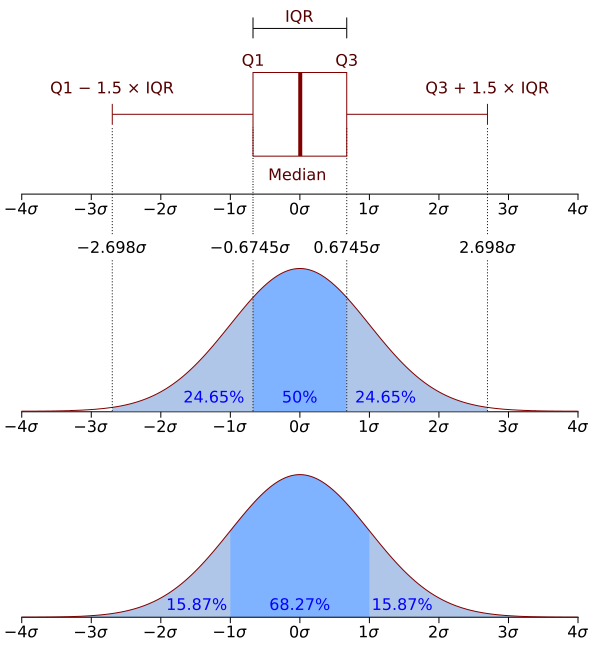

# 训练评测与消融设计

训练系统做大之后，最容易出现一种表面繁荣：实验很多、曲线很多、表格很多，但结论并不可靠。模型变好了，是因为目标函数有效，还是因为数据更多、batch 更大、训练更久、judge 偏好改变？训练评测与消融设计的目标，就是把“看起来变了”和“确实因这个改动变了”尽量区分开。

训练评测要把离线实验、训练稳定性、数据质量和线上证据接在一起，判断一个改动是否真实、可归因、值得上线。

{ width="760" }

<small>图源：站内训练统计图素材，基于常见统计教学图重绘。原图表达均值、分布和离群点不能混为一谈；读图重点是提醒消融结论必须同时看均值、方差、分桶和失败样本。它不能替代真实多种子实验。</small>

## 一、先定义评测对象和证据链

一次训练改动可以看成对系统函数 $f$ 的扰动。我们真正关心：

$$
\Delta = \mathbb{E}[M(f_{\text{new}})] - \mathbb{E}[M(f_{\text{old}})],
$$

其中 $M$ 是指标，现实中看到的只是有限样本上的 noisy estimate。评测方法学要回答：这个差异是否可靠、是否可归因、是否值得上线。

评测对象至少拆成四层：

| 层级 | 看什么 | 常见误区 |
| --- | --- | --- |
| 建模层 | loss、perplexity、稳定性、收敛速度 | 把 loss 改善等同最终能力改善 |
| 能力层 | 推理、代码、长上下文、VLM、工具使用 | 只看总分，不看分桶 |
| 系统层 | 吞吐、显存、恢复一致性、成本、尾延迟 | 只看质量，不看预算 |
| 业务层 | 任务完成率、人工修正率、用户反馈 | 只看线上结果，难以定位根因 |

预训练、SFT、偏好优化、系统优化和线上灰度不能混成一张总表。每一层都要有自己的指标，同时用同一套样本分桶和版本记录串起来。

## 二、消融：一次只问一个清楚问题

好的消融不是“列很多配置”，而是每组实验都回答一个明确问题：新损失是否有效，新数据是否优于增加训练步数，新 schedule 只是改变收敛速度还是改变最终质量，某个 kernel 或低精度路径是否改变数值收敛，某个 judge 提升是否只是偏好更长回答。

若一次同时改模型、数据、超参、训练时长和评测脚本，结果通常不可解释。现实中不一定能完全控制变量，但至少要记录哪些固定、哪些变化、哪些结论只是相关而非因果。

### 常见消融形态

| 形态 | 用途 | 风险 |
| --- | --- | --- |
| Remove-one | 从完整系统移除组件，看是否必要 | 不代表组件独立上限 |
| Add-one | 从基线逐步增加组件，看增益路径 | 成本较高，交互项容易漏 |
| Factorial design | 同时考察多个因素交互 | 实验数增长快 |
| Budget-matched | 固定 token、GPU-hour、wall-clock 或推理成本 | 预算口径必须写清楚 |

高质量消融表至少包含：实验问题、基线配置、唯一变化项、训练预算、评测集、分桶结果、成本、稳定性和失败样本摘要。

## 三、统计纪律：方差、显著性与预算口径

大模型实验贵，所以很多团队只跑一次。但如果自然波动接近收益幅度，单次好结果不能支撑强结论。若同一配置多次结果为 $y_1,\dots,y_n$，应至少报告均值和标准误差：

$$
\bar{y}=\frac{1}{n}\sum_i y_i,
\qquad
\mathrm{SE} = \frac{s}{\sqrt{n}}.
$$

并不是所有实验都能多种子复现，但关键结论、小幅提升和高风险变更应尽量重复验证。

预算口径同样必须写清楚。常见对齐方式包括同参数规模、同训练 token、同 wall-clock、同 GPU-hour、同峰值显存和同推理成本。

一个方法同 token 更强但每步更慢，一个系统方案同 wall-clock 更优但每 token 更贵，结论完全不同。统计显著性和预算口径必须一起报告，否则“提升”没有工程含义。

## 四、评测集：公共榜单、私有桶、污染控制

完整评测体系通常不是一个榜单，而是一组分层集合：公共 benchmark 用于外部对齐和基础能力检查，内部主线任务集覆盖真实业务核心任务，长尾失败集积累高价值失效样本，线上回流挑战集来自真实问题和投诉，不可触碰 holdout 防止长期过拟合，发布门槛集则用少量但极关键的样本做上线判定。

分桶评测应是主结构，不是附表。常见桶包括长度、难度、语言、任务、模态、风险、业务价值和失败类型。平均分很容易掩盖长尾退化，例如长文档、复杂表格、多轮工具调用、安全边界和高价值客户场景。

### 数据污染与泄漏

污染来源包括 benchmark 原题进入预训练网页、题目被论坛和教程改写传播、合成数据间接蒸馏 benchmark 风格、SFT/偏好/回流数据混入测试近邻样本、去重只做精确匹配。

现实目标不是宣称零污染，而是对核心 benchmark 做 n-gram / hash / 语义近邻检查，维护 contamination watchlist，记录污染假设和检查方法，并用私有真实集降低对单一公开榜单的依赖。

## 五、Judge、校准与在线接口

后训练越来越依赖 judge model，但 judge 本身也只是模型。它至少要单独验证与人工偏好的一致性，对长度、格式、语言和风格的偏差，在不同任务桶上的稳定性，对安全、事实性、代码执行和工具调用的错误类型，以及是否容易被 prompt hacking 或格式操控。

更稳的做法是把 judge 拆成 factuality、helpfulness、format、safety、execution success 等维度，再按业务权重合成，而不是一开始就做一个总分。

校准也是评测对象。模型或路由器输出置信度后，会影响是否调用工具、升级大模型、拒答、人工复核或回退。应看 reliability diagram、置信度分桶正确率、ECE、质量-成本曲线和不同风险桶的校准差异。

### 离线到在线的接口

离线评测不能和线上割裂。更稳的接口是：线上失败样本回流到离线长尾桶，离线关键分数映射到上线门槛，canary 和 A/B 复用离线样本分类法，judge、route、fallback 在线线下使用一致口径，线上实验记录模型、prompt、检索、工具、路由、采样、缓存和请求分桶版本。

这样能减少“离线很好，线上一般”的断层。

## 六、系统实验也要评测质量

训练系统改动不只是吞吐问题。loader、packer、tokenizer、checkpoint 恢复、mixed precision、fused kernel、compiler pass 都可能改变最终质量或稳定性。

系统变更至少应做数值一致性检查、短跑 loss 对齐、长跑 spot-check、下游核心评测回归，以及显存、吞吐、成本、恢复一致性和异常桶记录。

一个 fused kernel 可能吞吐更高，但在特定长度桶上放大数值误差；一个 packer 改动可能提升 tokens/s，但改变样本边界和长上下文训练分布；一个 checkpoint 恢复 bug 可能不影响 load，却改变数据顺序。系统实验必须同时看性能和模型行为。

## 七、流程模板与发布门槛

验证一个训练改动时，可以按一条紧凑流程推进：写清实验假设和唯一变化项，固定预算口径，跑训练内指标和稳定性检查，再跑公共 benchmark、自建任务集和长尾失败集；随后分桶看收益与退化，校验 judge 和评分脚本版本，记录成本、吞吐、显存和恢复风险；关键样本需要做人审或执行验证，小流量灰度时沿用同一套桶，失败实验也要沉淀为方法学资产。

发布门槛集要小而硬，覆盖最不能退化的能力：关键业务任务、高风险失败样本、安全/合规场景、组织最在意的长尾问题。它不是完整评测的替代品，而是快速阻止明显有问题版本进入主线。

### 一个训练改动怎么写成可决策实验卡

假设你想验证“给世界模型加入 near-miss 回流数据是否值得”。不要只写“加入数据后效果提升”，而是把实验卡写成：

| 字段 | 内容 |
| --- | --- |
| 假设 | near-miss 回流会提升风险排序和恢复动作，不应伤害主分布任务 |
| 唯一变化项 | 训练 mixture 中加入 `8%` near-miss / recovery 数据 |
| 固定项 | 模型结构、token budget、batch、LR schedule、训练步数、评测脚本 |
| 预算口径 | 同 token、同 GPU-hour 双口径都报告 |
| 主要指标 | counterfactual ranking、risk recall、closed-loop success |
| 退化门槛 | 主分布 success 下降 `>1%` 或 P95 rollout latency 上升 `>8%` 则拒绝 |
| 人审样本 | 每个高风险桶抽 `50` 条视频-action 对照 |

结果表也要按桶，而不是只看平均：

| Bucket | Baseline | + near-miss | 判断 |
| --- | ---: | ---: | --- |
| 常规 pick-place success | `93.4%` | `93.1%` | 可接受，未超过退化门槛 |
| 反光物体 risk recall | `61.0%` | `76.8%` | 目标桶明显提升 |
| 人工接管前 `2s` 预警 | `48.2%` | `63.5%` | 恢复窗口变大 |
| rollout P95 latency | `410ms` | `437ms` | 成本上升 `6.6%`，仍在门槛内 |
| 长任务状态一致性 | `72.5%` | `71.9%` | 轻微退化，需要观察 |

这张实验卡能支持一个明确结论：near-miss 回流值得进入下一轮，但需要继续监控长任务状态一致性。它也说明什么结论不能下：不能说模型“整体更强”，只能说在固定预算下，高风险恢复相关桶收益超过延迟代价，且主分布未明显退化。

最终判断是：训练评测与消融设计不是实验报告装饰，而是训练系统的证据基础设施。只有当每个重要结论都能说明“改了什么、固定了什么、收益在哪些桶、代价是什么、是否可复现、能否上线”，实验才真正支持决策。

## 外部材料

- [PyTorch Distributed 文档](https://pytorch.org/docs/stable/distributed.html)。
- [DeepSpeed ZeRO 教程](https://www.deepspeed.ai/tutorials/zero/)。
- [Weights & Biases 文档](https://docs.wandb.ai/)。
