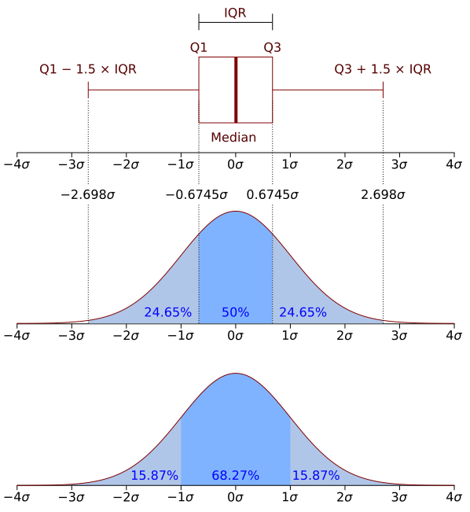

# 多对两道题，能证明一次训练改动有效吗

模型在同一批100道题上从80分变成82分，可以确认这批题多答对两道。要判断目标分布上的改善，还需看两版具体错在哪些题、训练随机性，以及改动是否只发生在一个因素。

## 配对结果比两个总分多一层信息

设旧错新对有8题、旧对新错有6题，其余86题结果相同。净提升是2题，但改动影响了14题，包含6个退化。若另一组结果只有2题改对、没有改错，两个总分相同，不确定性结构却不同。

把每题差值记为d，可能为-1、0、1，平均差为0.02。本例样本差值标准差约0.376，均值标准误约0.0376，远大于0.02。这个近似计算说明样本量不足以轻易下“稳定提升”结论，实际统计方法需适配任务和抽样。

{ width="760" }

<small>图源：站内训练统计图素材，基于常见统计教学图重绘。原图表达均值、分布和离群点不能混为一谈；读图重点是提醒消融结论必须同时看均值、方差、分桶和失败样本。它不能替代真实多种子实验。</small>

## 固定测试集还不够控制训练随机性

不同初始化、数据顺序和采样可能得到不同模型。若只训练旧方案一次、新方案一次，观察到的差异同时包含方法与随机变化。预算允许时重复种子，或至少报告这一限制。

模型输出也可能随机。相同prompt与解码设置下重复采样，和只用贪心输出测一次，回答的是不同问题。不要把随机文本差异全归因到训练改动。

## 用四组实验辨认交互

假设研究数据改动A与优化器改动B，教学结果分别为基线70、仅A74、仅B73、A+B80。若效果可加，预期组合为77；实际80，多出3分交互。

只比较基线与A+B，无法知道各自贡献。2×2设计能暴露交互，但仍需要相同预算和不确定性分析。这些数字是构造例子，不代表真实实验。

## 质量比较必须固定数据边界

公共榜单、私有heldout与线上任务覆盖不同输入。训练数据近重复、按题调prompt或反复根据测试集选配置，都可能让结果偏乐观。将配置选择用的验证集与最终测试分开，并按文档、任务或事件组隔离相关样本。

若系统优化改变了量化、截断或生成长度，即使模型权重相同也可能改变质量。比较速度时同时检查这些条件，避免通过少做任务换来吞吐数字。

## 报告结论时限定因果范围

记录模型、数据、预算、评测输入、评分器和解码版本，给总结果与关键分桶。Judge评分还应检查与人工或可执行标准的对齐，尤其是长度、风格与候选顺序偏差。

“在这批固定输入上净提升2题”是直接观察；“对目标人群普遍更好”需要代表性抽样与不确定性证据；“由某组件导致”还需要受控消融。把这三层分开，结论反而更容易使用。

## 对照源码与延伸阅读

- [训练与评测模式分离的基础实现](https://github.com/pytorch/tutorials/blob/5672cd98a7671eda4d9122b10f8eec580f74d03e/beginner_source/basics/optimization_tutorial.py)
