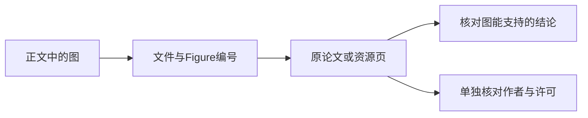

# 训练专题图片来源索引

这里保留图片文件、原始出处和当前解释用途，方便从正文追到证据。来源链接不等于许可已核验，原论文图也只支持其自身实验设置。该页是资源索引，计算机制请回到相应正文阅读。

## 文件清单

1. `gradient-descent.svg`
   来源：https://commons.wikimedia.org/wiki/File:Gradient_descent.svg
2. `neural-network.svg`
   来源：https://commons.wikimedia.org/wiki/File:Neural_network.svg
3. `precision-recall.svg`
   来源：https://commons.wikimedia.org/wiki/File:Precisionrecall.svg
4. `amdahls-law.svg`
   来源：https://commons.wikimedia.org/wiki/File:AmdahlsLaw.svg
5. `boxplot-vs-pdf.svg`
   来源：https://commons.wikimedia.org/wiki/File:Boxplot_vs_PDF.svg
6. `mapreduce.svg`
   来源：https://commons.wikimedia.org/wiki/File:MapReduce.svg
7. `pid-loop.svg`
   来源：https://commons.wikimedia.org/wiki/File:PID_en.svg
8. `normal-distribution.svg`
   来源：https://commons.wikimedia.org/wiki/File:Normal_distribution_pdf.svg
9. `histogram-example.svg`
   来源：https://commons.wikimedia.org/wiki/File:Histogram_example.svg
10. `pareto-chart.svg`
    来源：https://commons.wikimedia.org/wiki/File:Diagrama_pareto.svg
11. `p-control-chart.svg`
    来源：https://commons.wikimedia.org/wiki/File:P_control_chart.svg
12. `gantt-diagram.svg`
    来源：https://commons.wikimedia.org/wiki/File:Gantt_diagramm.svg
13. `roc-curve.svg`
    来源：https://commons.wikimedia.org/wiki/File:Roc_curve.svg
14. `variance-bias.svg`
    来源：https://commons.wikimedia.org/wiki/File:Variance-bias.svg
15. `confusion-matrix.png`
    来源：https://commons.wikimedia.org/wiki/File:Confusion_Matrix.png

## 训练专题论文原图

这些图片位于 `files/assets/images/paper-figures/training/`，用于替换原先的概括图。

| 文件 | 来源 | 用途 |
| --- | --- | --- |
| `chinchilla-isoflop-curves.png` | [Training Compute-Optimal Large Language Models](https://arxiv.org/abs/2203.15556)，Figure 4 | 解释固定 FLOP 预算下参数量和 token 数的配平 |
| `chinchilla-tokens-vs-params.png` | [Training Compute-Optimal Large Language Models](https://arxiv.org/abs/2203.15556)，Figure 15 | 解释 compute-optimal tokens / parameters scaling |
| `zero-memory-stages.png` | [ZeRO: Memory Optimizations Toward Training Trillion Parameter Models](https://arxiv.org/abs/1910.02054)，Figure 1 | 解释数据并行状态冗余和 ZeRO 三阶段分片 |
| `gpipe-pipeline-parallelism.png` | [GPipe: Efficient Training of Giant Neural Networks using Pipeline Parallelism](https://arxiv.org/abs/1811.06965)，Figure 2(c) | 解释 micro-batch 如何填充 pipeline bubble |
| `instructgpt-rlhf-pipeline.png` | [Training language models to follow instructions with human feedback](https://arxiv.org/abs/2203.02155)，Figure 2 | 解释 SFT、reward model 和 PPO/RLHF 的训练数据接口 |
| `instructgpt-labeler-likert.png` | [Training language models to follow instructions with human feedback](https://arxiv.org/abs/2203.02155)，Appendix Figure 19(a) | 解释单条模型输出评分和元信息标注 |
| `instructgpt-labeler-ranking.png` | [Training language models to follow instructions with human feedback](https://arxiv.org/abs/2203.02155)，Appendix Figure 19(b) | 解释同题多答排序数据如何训练 reward model |
| `instructgpt-main-preference.png` | [Training language models to follow instructions with human feedback](https://arxiv.org/abs/2203.02155)，Figure 1 | 解释 RLHF 后训练需要看人类偏好胜率 |
| `instructgpt-preference-facetted.png` | [Training language models to follow instructions with human feedback](https://arxiv.org/abs/2203.02155)，Figure 4 | 解释不同 prompt 分布和 labeler 分组下的偏好结果 |
| `ppo-clipped-surrogate.png` | [Proximal Policy Optimization Algorithms](https://arxiv.org/abs/1707.06347)，Figure 1 | 解释 clipping 如何截断部分目标激励；它不构成更新后概率比的硬边界 |

## 强化学习专题论文原图

这些图片位于 `files/assets/images/paper-figures/reinforcement-learning/`。

| 文件 | 来源 | 用途 |
| --- | --- | --- |
| `decision-transformer-architecture.png` | [Decision Transformer: Reinforcement Learning via Sequence Modeling](https://arxiv.org/abs/2106.01345)，Figure 1 | 解释 return-to-go、state、action 如何被组织成 GPT-style trajectory token |
| `decision-transformer-results-summary.png` | [Decision Transformer](https://arxiv.org/abs/2106.01345)，Figure 2 | 对比 Decision Transformer、TD Learning 和 Behavior Cloning 的总体表现 |
| `decision-transformer-retcond-plots.png` | [Decision Transformer](https://arxiv.org/abs/2106.01345)，Figure 4 | 解释 return conditioning 与实际性能的关系 |

训练页还复用了一些其他专题的论文图：

| 文件 | 来源 | 用途 |
| --- | --- | --- |
| `../quantization/qlora-figure-1-memory.png` | [QLoRA](https://arxiv.org/abs/2305.14314)，Figure 1 | 解释低比特微调的显存构成 |
| `../foundations/fp8-formats-figure-1-training-loss.png` | [FP8 Formats for Deep Learning](https://arxiv.org/abs/2209.05433)，Figure 1 | 解释 FP8 训练需要通过收敛曲线验证 |
| `../foundations/sublinear-memory-figure-1-computation-graph.png` | [Training Deep Nets with Sublinear Memory Cost](https://arxiv.org/abs/1604.06174)，Figure 1 | 解释 activation checkpointing 的重计算换显存 |
| `../foundations/data-cards-typology.png` | [Data Cards](https://arxiv.org/abs/2204.01075)，typology figure | 解释数据治理和数据文档的多角色视角 |
| `../foundations/loss-landscape-figure-resnet56.png` | [Visualizing the Loss Landscape of Neural Nets](https://arxiv.org/abs/1712.09913) | 解释优化路径和稳定性排查 |
| `../inference/specinfer-workflow.png` | [SpecInfer](https://arxiv.org/abs/2305.09781)，Figure 3 | 解释投机推理和 token tree verification |

<!-- systems-workflow-visual -->

出处、证据含义与许可是三项独立核对，来源存在不自动完成另外两项。

## 怎样使用这份索引

查论文图时核对标题、Figure编号、实验对象及原始图注，再判断正文推论是否超出图能支持的范围。查Commons资源时进入具体文件页核对作者和许可；公开可读不能自动推导任意转载授权。当前表未声称完成全部许可复核。

引用时保留出处，注明原图、裁剪或站内重绘。若替换资产，保持已有URL稳定或同步更新引用，并复查新图是否仍支持旧图注。文件存在、页面能显示和解释正确需要分别确认。

继续核对：[外部教程的来源、改编与证据边界](../roadmap/source-and-adaptation-guidelines-1110-0106.md)说明正文、代码、公式和图片怎样分开记录；[研究与工程学习路线](../roadmap/research-and-engineering-study-plan.md)把图像证据接回实验和复现流程。
