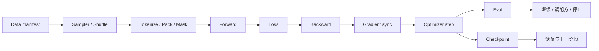

# 训练系统：让数据稳定地变成可验证的模型

训练系统管理一条长时间运行、状态持续变化的计算流程：数据被采样和打包，模型完成前向与反向传播，优化器修改参数，分布式运行时同步状态，评测与 checkpoint 保存证据。模型能力、训练稳定性和集群效率都来自这条链路，单独用 loss 或 tokens/s 无法代表。

## 训练系统的统一接口

一次可复盘训练至少要固定五类接口。

| 接口 | 必须明确的内容 | 常见故障 |
| --- | --- | --- |
| Data contract | 数据版本、采样权重、tokenizer、mask、packing | 重复曝光、边界泄漏、评测污染 |
| Objective contract | loss、权重、正则项、奖励与监督位置 | 代理目标改善，真实能力退化 |
| Update contract | global batch、学习率、优化器、梯度裁剪、精度 | loss spike、NaN、恢复后曲线漂移 |
| Execution contract | 并行策略、拓扑、通信、激活重算 | OOM、bubble、通信等待、吞吐回退 |
| Evidence contract | checkpoint、评测、数据桶、运行日志、代码配置 | 无法恢复、无法比较、结论不可复现 |

这五份合同共同定义一个 run。只保存模型权重或超参数表，无法回答模型看过什么、更新了多少次、是否按同一顺序恢复，以及能力变化来自数据、目标还是系统。

## 一次训练怎样运行

单个 step 负责把一个 batch 变成一次参数更新，完整 run 还要处理数据阶段切换、学习率日程、周期评测、保存与恢复。先读[模型训练的完整链路](beginner-model-training-primer.md)，再进入[目标函数、优化器与 LR 日程](objectives-optimizers-and-schedules.md)。

## 数据与训练目标

数据并不是 loss 之外的输入材料。采样概率、有效 token、上下文长度、模态比例和偏好标签共同决定平均梯度，等价于一部分隐式目标函数。

| 问题 | 页面 |
| --- | --- |
| 数据怎样清洗、去重、过滤并防止污染 | [数据质量、去重与治理](data-quality-dedup-and-governance.md) |
| tokenizer、packing、mask 和 dataloader 怎样影响有效吞吐 | [输入管线、Packing 与吞吐](input-pipelines-packing-and-throughput-governance.md) |
| 数据、优化器与系统吞吐怎样放在同一条链上 | [训练数据系统与吞吐优化](data-systems-and-optimization.md) |
| 规模、课程学习和数据混合怎样共同塑造能力 | [Scaling、课程学习与数据配比](scaling-curriculum-and-data-mixture.md) |
| 预训练、SFT、偏好学习分别改变什么 | [预训练、微调与对齐](pretraining-finetuning-alignment.md) |
| 偏好标签为什么会引入位置、长度和风格偏差 | [偏好数据与对齐失效](preference-data-and-alignment-pitfalls.md) |

比较数据配方时，应记录真实参与 loss 的 token 或动作，而不是只比较文件数、样本数或训练 step。多阶段训练还要检查新阶段是否冲刷旧能力。

## 规模化执行与稳定性

模型和 batch 超出单卡后，需要决定状态与计算怎样切分。data parallel 复制计算、切分数据；tensor parallel 切层内张量；pipeline parallel 切模型深度；context parallel 切序列；expert parallel 切 MoE 专家；ZeRO/FSDP 则切参数、梯度和优化器状态。每种并行都把显存压力换成通信、调度或恢复复杂度。

| 问题 | 页面 |
| --- | --- |
| 如何画参数、激活、梯度、优化器和通信五张账 | [分布式训练与 Checkpoint](distributed-training-and-checkpointing.md) |
| Megatron、DeepSpeed、FSDP 分别负责哪一层 | [Megatron、DeepSpeed 与开放训练栈](megatron-lm-deepspeed-and-open-training-stacks.md) |
| BF16、FP16、FP8 的误差怎样进入更新闭环 | [低比特训练与数值格式](low-bit-training-and-numerics.md) |
| NaN、loss spike、恢复漂移怎样按证据排查 | [训练稳定性与故障排查](stability-numerics-and-failure-triage.md) |
| 作业调度、节点故障和实验成本怎样管理 | [集群运维与实验治理](cluster-operations-and-experiment-management.md) |

优化顺序应从瓶颈出发：显存不够先拆常驻状态和激活；GPU 空转先看数据、通信和 bubble；长跑不稳先保留异常 batch、grad norm、数值溢出与恢复状态。把所有并行开关同时打开，只会扩大归因空间。

## 评测、治理与后训练

是否结束训练，应由证据能否支持“继续、停止或切换阶段”的决策来判断，不能只看预算是否耗尽。

| 问题 | 页面 |
| --- | --- |
| 参数、token 与计算预算怎样分配 | [Scaling Law 与训练经济学](scaling-laws-and-experiment-economics.md) |
| 怎样设计对照、消融、私有桶和污染检查 | [训练评测与消融设计](evaluation-and-ablation-methodology.md) |
| 怎样记录代码、配置、数据与指标的证据链 | [W&B 实验追踪与治理](wandb-experiment-tracking-and-governance.md) |
| 线上失败、candidate 与 judge 怎样形成后训练数据 | [后训练数据引擎与 Judge 模型](post-training-data-engines-and-judge-models.md) |
| MTP 怎样连接训练目标与投机解码 | [MTP 与投机解码](mtp-and-speculative-decoding.md) |
| 训练专题中的图片来源如何审计 | [训练图片来源与授权](image-sources.md) |

后训练仍然服从同一套系统约束：数据必须可追溯，judge 必须校准，reward 必须防止被钻空子，模型产物必须通过统一部署评测。算法名字变化，不会取消数据和证据责任。

## 按问题进入

| 当前现象 | 建议路径 |
| --- | --- |
| loss 的含义、batch 与学习率关系不清楚 | [模型训练的完整链路](beginner-model-training-primer.md) → [目标函数与优化器](objectives-optimizers-and-schedules.md) |
| 数据很多但有效训练信号很少 | [输入管线与 Packing](input-pipelines-packing-and-throughput-governance.md) → [数据质量与治理](data-quality-dedup-and-governance.md) |
| 单卡能跑，多卡效率很差 | [分布式训练与 Checkpoint](distributed-training-and-checkpointing.md) → [训练栈选型](megatron-lm-deepspeed-and-open-training-stacks.md) |
| 曲线正常但某类能力持续下降 | [数据配比](scaling-curriculum-and-data-mixture.md) → [评测与消融](evaluation-and-ablation-methodology.md) |
| 恢复后 loss、数据顺序或学习率漂移 | [分布式训练与 Checkpoint](distributed-training-and-checkpointing.md) → [集群运维](cluster-operations-and-experiment-management.md) |
| 要把线上失败变成下一轮训练数据 | [后训练数据引擎](post-training-data-engines-and-judge-models.md) → [偏好数据与对齐失效](preference-data-and-alignment-pitfalls.md) |

训练产物进入服务后的完整交接见[训练与推理系统总览](../training-and-inference-systems/index.md)。
