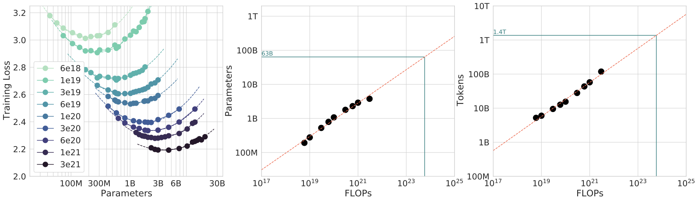
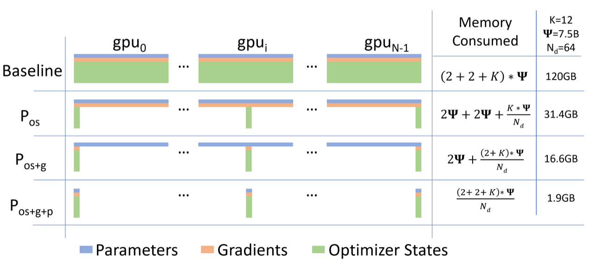
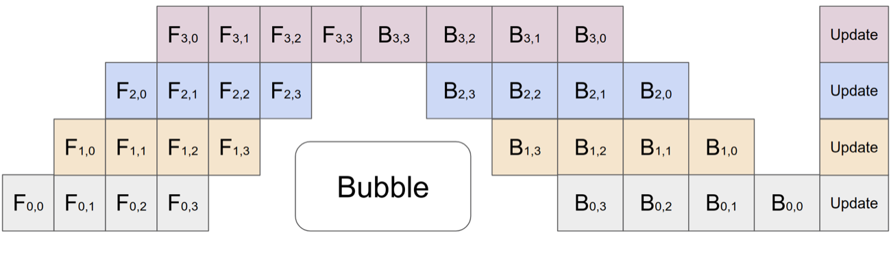

# 大模型训练路线图

<div class="atlas-hero">
  <div class="atlas-kicker">Training Systems</div>
  <p class="atlas-lead">这一专题围绕大模型训练的完整生产线展开：从预训练、SFT、对齐，到 Megatron-LM、DeepSpeed、输入管线、稳定性、checkpoint 与评测方法学。</p>
  <div class="atlas-chip-row">
    <span class="atlas-chip">预训练</span>
    <span class="atlas-chip">系统栈</span>
    <span class="atlas-chip">数据配方</span>
    <span class="atlas-chip">稳定性</span>
  </div>
</div>

## 专题定位

<div class="atlas-meta-grid">
  <div>
    <strong>核心问题</strong>
    <p>如何在给定数据、模型和算力预算下，把训练做成稳定、可恢复、可解释且能迁移到真实任务的系统。</p>
  </div>
  <div>
    <strong>适合读者</strong>
    <p>适合正在做预训练、后训练、数据治理、分布式训练或训练基础设施的人。</p>
  </div>
  <div>
    <strong>阅读方式</strong>
    <p>建议先读总览与系统栈页，再进入数据、优化器、并行、评测和回流体系。</p>
  </div>
</div>

!!! note "在全站主线里的位置"
    训练专题是工程支撑，不是“从 VLM 到世界模型”的概念主线本身。只有当你需要解释一个世界模型、VLA 或多模态模型为什么训不稳、数据不够、显存不够、吞吐不够、checkpoint 不可恢复时，再从这里下钻。主线读者优先抓住数据、目标函数、分布式状态和评测回流四件事。

## 先看训练生产线地图

训练章节容易显得重复，是因为许多页面都在围绕同一条生产线的不同位置展开。建议先按下面这张表定位：

| 位置 | 负责的问题 | 典型页面 | 不要混淆 |
| --- | --- | --- | --- |
| 阶段目标 | 预训练、SFT、偏好/RL、MTP 等到底让模型学什么 | 预训练/微调/对齐、目标函数、MTP、低比特训练 | 目标函数变化不等于系统吞吐问题 |
| 数据管线 | 什么样的数据进入训练，如何高效变成有效 token | 数据系统、去重治理、数据混合、输入管线、Packing | 数据质量问题不能只靠换并行框架解决 |
| 评测回流 | 怎么证明模型真的变好，以及失败如何进入下一轮数据 | Judge、偏好数据、评测消融、后训练数据引擎 | 分数上涨不等于训练信号和真实任务都变好 |
| 分布式执行 | 模型状态、激活、通信和 checkpoint 如何被组织 | Megatron/DeepSpeed、分布式训练、稳定性、集群运维 | ZeRO/FSDP 省显存，但会增加通信和恢复复杂度 |
| 经济与治理 | 预算、实验节奏、失败恢复和产物复用是否成立 | Scaling law、实验经济学、运维治理 | loss 曲线好看不代表实验资产可信 |

!!! note "难点解释：ZeRO、Megatron-LM 和 DeepSpeed 分别在管什么"
    `Megatron-LM / Megatron Core` 更偏模型并行和 Transformer 构件：TP、PP、CP、EP、通信 overlap、MoE 等。`DeepSpeed / ZeRO` 更偏运行时内存组织：优化器状态、梯度、参数如何在 DP 组里分片，是否 offload，如何和 pipeline engine 配合。`FSDP` 更贴近 PyTorch 原生生态。它们都影响训练系统，但层级不同：Megatron 先回答模型怎么拆，ZeRO/FSDP 回答状态怎么放，checkpoint/manifest 回答训练资产怎么恢复和复用。

## 推荐入口

<div class="atlas-card-grid">
  <a class="atlas-card" href="pretraining-finetuning-alignment/">
    <strong>预训练、微调与对齐</strong>
    <p>先建立训练阶段分工，明确哪些问题该回看底座，哪些问题该回看 SFT 与偏好对齐。</p>
  </a>
  <a class="atlas-card" href="mtp-and-speculative-decoding/">
    <strong>MTP 与投机解码</strong>
    <p>把多 token 预测当成训练目标来理解，并判断它何时能真正换回推理收益。</p>
  </a>
  <a class="atlas-card" href="low-bit-training-and-numerics/">
    <strong>低比特训练与数值格式</strong>
    <p>把 FP8、FP4、MXFP、NVFP、activation、optimizer states 和 kernel 放回训练稳定性里看。</p>
  </a>
  <a class="atlas-card" href="page-by-page-visual-guide/">
    <strong>论文图解索引</strong>
    <p>按训练专题每一页做白话解释、生活化例子和配图入口，适合先建立直觉再看细节。</p>
  </a>
  <a class="atlas-card" href="megatron-lm-deepspeed-and-open-training-stacks/">
    <strong>Megatron、DeepSpeed 与训练栈</strong>
    <p>理解 TP、PP、ZeRO、FSDP、CP 等系统栈如何决定训练规模上限。</p>
  </a>
  <a class="atlas-card" href="input-pipelines-packing-and-throughput-governance/">
    <strong>输入管线、Packing 与吞吐</strong>
    <p>快速定位 GPU 为什么吃不满，以及有效 token 利用率为什么经常比显存更早出问题。</p>
  </a>
</div>

## 从论文专题回填的训练知识点

最近几篇技术报告把训练章节里的抽象概念落到了真实系统。回看训练页时，可以按下面这张表把论文结论放回对应知识点：

| 专题来源 | 训练层面的补充 | 应接到本章哪里 |
| --- | --- | --- |
| [DeepSeek-V3](../paper-deep-dives/technical-reports/deepseek-v3.md) | FP8 mixed precision、DualPipe、auxiliary-loss-free routing 和 MTP 说明训练收益往往来自“架构、低精度、并行和后训练”的共同设计 | [低比特训练与数值格式](low-bit-training-and-numerics.md)、[Megatron-LM / DeepSpeed](megatron-lm-deepspeed-and-open-training-stacks.md)、[MTP 与投机解码](mtp-and-speculative-decoding.md) |
| [Qwen3](../paper-deep-dives/technical-reports/qwen3.md)、[DeepSeek-R1](../paper-deep-dives/technical-reports/deepseek-r1.md) | thinking / non-thinking、RLVR、GRPO、rejection sampling 和强到弱蒸馏说明后训练不是单阶段 SFT，而是能力塑形和行为约束的多阶段链路 | [预训练、微调与对齐](pretraining-finetuning-alignment.md)、[后训练数据引擎](post-training-data-engines-and-judge-models.md)、[偏好数据与对齐失效](preference-data-and-alignment-pitfalls.md) |
| [Kimi K2](../paper-deep-dives/technical-reports/kimi-k2.md) | MuonClip、agentic data synthesis、tool-use SFT、RL checkpoint engine 说明 agent 模型训练要同时管理优化器稳定性、数据生成和恢复语义 | [分布式训练与 Checkpointing](distributed-training-and-checkpointing.md)、[训练评测与消融设计](evaluation-and-ablation-methodology.md) |
| [Nemotron 3 Super](../paper-deep-dives/technical-reports/nemotron-3-super.md) | NVFP4 预训练、敏感层 BF16/MXFP8 保留、shared-weight MTP 和异步多环境 GRPO 说明训练配方要和目标硬件、rollout 成本、推理路径一起设计 | [低比特训练与数值格式](low-bit-training-and-numerics.md)、[MTP 与投机解码](mtp-and-speculative-decoding.md)、[后训练数据引擎](post-training-data-engines-and-judge-models.md) |
| [GPT-4o System Card](../paper-deep-dives/technical-reports/gpt-4o-system-card.md)、[Qwen3.5-Omni](../paper-deep-dives/technical-reports/qwen35-omni.md) | 端到端语音/视觉/文本训练使后训练扩展到 voice consistency、speaker ID refusal、streaming safety 和模态专项评测 | [预训练、微调与对齐](pretraining-finetuning-alignment.md)、[训练评测与消融设计](evaluation-and-ablation-methodology.md) |

## 图解预览

如果你只是打开了“大模型训练路线图”页，先用论文原图建立“训练预算不是只堆参数”的直觉。Chinchilla 的 scaling law 图说明：在固定 FLOP 预算下，模型参数量和训练 token 数需要一起配平，过大的模型如果训练 token 不够，反而不是 compute-optimal。

{ width="920" }

<small>图源：[Training Compute-Optimal Large Language Models](https://arxiv.org/abs/2203.15556)，Figure 4。原论文图意：在固定 FLOP 预算下比较不同模型大小的最终 loss，并从 IsoFLOP 曲线谷底外推 compute-optimal 的模型参数量和训练 token 数。</small>

!!! note "图解：训练预算要同时分给参数和 token"
    这张图的重点不是某条曲线的具体数值，而是“固定算力下存在最优模型大小”。模型太小会容量不足，模型太大又会因为训练 token 不够而欠训练。训练专题里讨论数据配方、packing、吞吐和 scaling law，本质上都在服务同一个问题：有限 GPU 小时应该怎样转化成最多有效学习信号。

并行训练和训练系统部分先看 ZeRO 与 GPipe 的两张原论文图：一张解释“状态为什么放不下”，一张解释“流水线为什么要 micro-batch”。这比概括性教学图更贴近原始方法逻辑。

{ width="860" }

<small>图源：[ZeRO: Memory Optimizations Toward Training Trillion Parameter Models](https://arxiv.org/abs/1910.02054)，Figure 1。原论文图意：比较普通数据并行和 ZeRO-DP 三个阶段的单设备模型状态显存，展示优化器状态、梯度和参数分片如何降低单卡常驻状态。</small>

!!! note "图解：训练系统先要解释显存账"
    训练页后面会反复出现 DP、FSDP、ZeRO、activation checkpointing、低精度和 checkpoint。它们不是孤立技巧，而是在处理同一张显存账：参数、梯度、优化器状态、激活和通信 buffer 谁常驻、谁按需 gather、谁可以重算、谁必须保存用于恢复。

{ width="860" }

<small>图源：[GPipe: Efficient Training of Giant Neural Networks using Pipeline Parallelism](https://arxiv.org/abs/1811.06965)，Figure 2(c)。原论文图意：将 mini-batch 拆成多个 micro-batch，使不同 accelerator 能同时处理不同 micro-batch 的不同模型分段，并在末尾同步应用梯度。</small>

!!! note "图解：吞吐问题还要解释时间账"
    如果 ZeRO 图解释的是“状态放在哪里”，GPipe 图解释的就是“设备什么时候空转”。micro-batch 能填充 pipeline bubble，但会牵动激活保存、反向时序、梯度累积和优化器更新语义。训练系统优化必须同时看显存账和时间账。

**训练的核心是**：给定数据、模型和算力预算，如何让损失稳定下降，并最终迁移到真实任务。

**一个统一抽象是经验风险最小化**：

\[
\min_\theta \mathbb{E}_{(x,y)\sim \mathcal{D}}[\ell(f_\theta(x), y)]
\]

但在大模型时代，训练从来不只是目标函数。真正影响结果的是一整套系统：数据清洗、采样混合、优化器与学习率、batch 组织与 packing、分布式训练与容错、后训练与对齐，以及算子、kernel 与编译栈。

也就是说，训练不是“把样本喂给模型”这么简单，而是把能力目标、数据生产线、优化过程和系统资源组织成一条长期运转的生产线。

!!! tip "基础知识入口"
    如果你对 loss、backprop、optimizer、mixed precision 或 checkpoint 的角色还不稳，先看 [优化与训练入门](../foundations/optimization-and-training-basics.md) 和 [自动微分与激活显存](../foundations/autograd-activation-checkpointing-and-memory.md)。如果问题涉及显存、带宽和 kernel，再接着看 [数值、显存与运行时](../foundations/numerics-memory-and-runtime-basics.md)。

## 1. 训练要解决的不是一个问题，而是三层问题

### 能力问题

模型能不能学到足够强的基础表示。

这一层讨论的是模型的**知识边界、抽象能力和迁移上限**。它通常和预训练数据覆盖、tokenizer、上下文长度、模态接口、参数规模以及训练 token 总量直接相关。一个模型如果在代码补全、长文档理解、跨语言迁移或多模态对齐上始终上不去，很多时候不是“回答风格不对”，而是底层表示空间本身还没有长出足够好的结构。

能力问题还有一个特点：它往往**不能靠局部修饰补回来**。SFT 可以把已有能力组织得更像样，对齐可以把行为边界收得更稳，但如果底层世界知识、结构先验或长程依赖能力本来就弱，后训练通常只能做有限修补。

### 行为问题

模型会不会按任务要求输出。

这一层更关注**能力如何被调动出来**。同样一个底座模型，可以因为提示格式、SFT 数据风格、偏好目标、拒答策略和工具调用协议不同，而表现出截然不同的外部行为。也就是说，行为问题不一定意味着模型“不会”，也可能意味着它**不会以你希望的方式表现出来**。

这也是为什么很多团队会把“模型答非所问”“格式不稳定”“工具调用漏步”“拒答过多或过少”归到 SFT 和对齐阶段去处理。行为问题的关键，不是继续堆更多无差别预训练，而是把任务接口、期望输出和风险边界写清楚，再用更贴近任务的数据和目标去塑形。

### 系统问题

训练能不能稳定、可复现、高吞吐地跑完。

这层决定的是**训练资产能否成立**。一个模型即使目标函数合理、数据也不错，如果吞吐波动极大、checkpoint 语义不清、恢复后统计口径变了、低精度数值路径频繁出错，最终得到的结论也很难信。大规模训练里，很多最贵的问题并不是 loss 没降，而是花了很多 GPU 小时之后才发现实验其实不可比。

系统问题还决定了团队能否进行有效迭代。只有当数据版本、配置版本、并行策略、恢复逻辑和评测流水线足够稳定时，训练结果才会从“偶然跑成一次”变成“可复验、可迁移、可复用的能力生产线”。

后面的训练页面基本都落在这三层里：预训练主要处理能力边界，SFT / 对齐主要处理行为塑形，数据、优化和分布式系统主要处理训练资产是否可信。

### 1.1 为什么这三层必须拆开看

因为很多问题表面相似，但成因完全不同。比如“模型表现不好”可能来自基础表示没学够、后训练行为边界没立住、数据混合比有偏，也可能来自 packing、去重、checkpoint 恢复、分布式配置或 kernel 路径让你根本没有高效看到足够有效 token。

如果不先拆层，优化方向很容易跑偏。

一个很常见的误区是，把所有问题都抽象成“再加一点数据”“再训久一点”或者“再做一轮对齐”。但现实中，不同层的问题对应的证据完全不同。能力问题更看重预训练损失、跨任务迁移和长上下文/新领域泛化；行为问题更依赖任务样本、拒答样本、格式约束和 judge 评测；系统问题则需要看吞吐、稳定性、重试率、恢复一致性和资源效率。证据链不同，解决方式也必然不同。

因此，训练分析最重要的习惯之一就是**先分层再归因**。只要这一步做得不稳，后面无论是加数据、改目标还是换并行策略，都容易在错误层面上用力。

## 2. 一个直观例子：训练代码模型

真正影响效果的往往不只是 loss 公式。GitHub 代码去重是否干净、文档和代码比例是否合理、长文件是否被截断、指令数据是否破坏代码风格、loader 能否高效处理大文件，以及分布式训练是否允许足够长上下文，都会改变最终能力。

这说明“训练效果”常常是数据工程和优化工程共同作用的结果。

### 2.1 再看一个多模态例子

训练文档 VLM 时，效果不仅取决于模型架构，还取决于 OCR 稳定性、文本与图像对齐、表格与图表保留、合成数据模板偏差、后训练是否过度追求对话流畅，以及多模态 batch 和 packing 是否高效。

这说明训练并不是“换个 backbone”就能解释的单变量问题。

## 3. 从大图景看训练流程

**很多现代模型训练可以概括成**：

\[
\text{Pretraining} \rightarrow \text{SFT} \rightarrow \text{Preference Alignment}
\]

**同时整条链路又依赖**：

\[
\text{Data} + \text{Optimization} + \text{Systems}
\]

也就是说，训练不是一个阶段，而是一条生产线。

### 3.1 这条生产线为什么越来越长

因为模型不再只是“学会预测下一个 token”，而是被要求会对话、会遵循格式、会调用工具、会拒答高风险问题、会在特定领域表现稳定，并且能在真实系统里以合理成本运行。

这些能力无法只靠单一预训练阶段自然长出来。

## 4. 一个够用的判断框架

当模型出现问题时，可以先按下面的口径定位：

| 现象 | 优先回看 |
| --- | --- |
| 能力边界不够 | 预训练数据、规模、tokenizer、上下文和目标函数 |
| 输出格式和任务行为不对 | SFT 数据、提示协议和任务接口 |
| 风格、保守性、拒答边界异常 | 偏好数据、对齐目标和安全评测 |
| loss、吞吐、稳定性异常 | 优化、数据系统、数值路径和恢复语义 |
| 大规模训练成本太高 | 并行、checkpoint、kernel、通信和输入管线 |

### 4.1 再往下追问三件事

对每个问题，再继续追三件事：这是数据问题还是目标函数问题，是训练阶段问题还是评测口径问题，是模型能力问题还是系统实现问题。

很多“模型不行”的结论，经不起这三问。

## 5. 为什么训练里最难的是资源分配

训练系统最终总会落回“有限资源如何分配”：算力分给更大模型还是更长训练，数据预算分给更多样本还是更高质量标注，系统工程时间分给吞吐优化还是评测重建，后训练时间分给偏好对齐还是工具使用，算子优化时间分给主干 GEMM、attention，还是 loader 和数据系统。

这也是为什么训练方向总和实验经济学、数据治理和服务成本紧紧绑定。

## 6. 为什么这组文档要拆成多页

因为训练里至少有四块逻辑明显不同：

### 训练阶段逻辑

预训练、SFT、DPO 等，是“模型学什么”。

这部分回答的是能力和行为如何被分阶段塑造。预训练负责打底，SFT 负责让模型更贴近任务接口，偏好对齐负责在多种候选输出之间学会“更像人想要的那一种”。把这些阶段拆开，不是为了制造流程复杂度，而是为了避免把不同目标硬塞进同一个损失里，最后谁都学不好。

### 优化与系统逻辑

batch、packing、学习率、checkpoint、并行、恢复，是“训练怎么跑”。

这一层更偏执行语义。模型同样大、数据同样多，训练曲线和最终能力也可能因为 batch 组织、effective token 利用率、恢复语义、梯度缩放和分布式通信策略而显著不同。很多“方法创新”最后之所以能跑出来，前提恰恰是系统层先把吞吐和稳定性做对了。

### 数据与评测逻辑

去重、混合、回流、ablation、judge、数据版本，是“训练凭什么可信”。

训练不是把样本倒进去就结束，真正困难的是决定**哪些样本应该进来、按什么比例进来、出了问题该回流什么**。而评测则决定团队能否分辨“看起来更好了”和“实际上更有用了”之间的差别。没有数据与评测逻辑，训练很容易变成一组无法解释的曲线和 checkpoint。

### 算子与实现逻辑

kernel、通信、Triton、CUDA、量化与编译栈，是“训练为什么能跑得动”。

这层经常被误以为只是底层细节，但在大规模训练里，它直接影响能否开更长上下文、能否压低显存、能否把 overlap 做实，以及能否在同样预算下看到更多有效 token。很多训练设计之所以成立，并不是因为论文公式更优雅，而是因为底层算子和运行时真的支撑住了它。

把这几块混在一起，会让很多工程判断失真。

## 7. 训练文档在本知识库里的位置

这里的训练章节不是只讲神经网络教科书，而是围绕基础模型的系统化训练问题组织：先解释预训练、微调、对齐和 `MTP` 等目标如何塑造能力，再进入 `FP8 / FP4 / MXFP / NVFP`、Megatron-LM、DeepSpeed、ZeRO、TP/PP/CP、checkpoint、packing、稳定性和集群治理，最后回到数据回流、judge、评测消融、算子编译和推理服务。读者不需要把每页当孤立知识点，而应把它们看成一条训练生产线的不同工位。

## 8. 和“算子与编译器”专题是什么关系

新补进去的算子专题，并不是和训练专题平行无关的一组低层笔记。它解决的是训练里一个经常被忽略的问题：为什么某些训练吞吐上不去，为什么某些量化路径训练不稳，为什么分布式 overlap 做了仍然不快，以及为什么长上下文训练最后卡在 attention 和内存系统。

也就是说，训练专题回答“为什么要这样训”，算子专题回答“为什么这套训练系统能跑起来”。

二者之间最重要的接口，其实是**训练目标最终会被执行路径重写**。例如你以为自己在比较两套优化器，真实差异可能来自 fused optimizer kernel；你以为自己在比较不同上下文长度，真正卡住的是 attention kernel 和显存布局；你以为自己在比较不同并行策略，性能差距却是由 all-reduce overlap、通信拓扑和 runtime dispatch 决定的。

因此，把训练和算子拆成两个专题，只是为了让逻辑更清楚，不代表它们彼此独立。成熟的训练分析，最终一定会追到 kernel、编译器和通信；成熟的算子优化，也一定要回到训练目标、训练负载和训练闭环里看价值。

## 9. 推荐阅读顺序

建议从“训练阶段”读起，再进入“系统执行”，最后看“数据评测”和“成本稳定性”。如果你只想建立主线，先读 [预训练、微调与对齐](pretraining-finetuning-alignment.md)、[MTP 与投机解码](mtp-and-speculative-decoding.md)、[低比特训练与数值格式](low-bit-training-and-numerics.md)、[Megatron、DeepSpeed 与训练栈](megatron-lm-deepspeed-and-open-training-stacks.md) 和 [分布式训练与 Checkpoint](distributed-training-and-checkpointing.md)。

关注部署前的数据闭环时，继续看 [数据质量、去重与治理](data-quality-dedup-and-governance.md)、[后训练数据引擎与 Judge 模型](post-training-data-engines-and-judge-models.md)、[Scaling Law 与训练经济学](scaling-laws-and-experiment-economics.md)。开始关心训练为什么会被硬件和 kernel 塑形时，再跳到 [算子与编译器路线图](../operators/index.md)。

## 10. 一个总判断

训练不是“把数据喂给模型”那么简单，而是把能力目标、数据结构、优化过程和系统资源组织成一条长期运转的生产线。真正成熟的训练体系，不只是能把 loss 跑下去，而是能解释为什么它会下去、为什么它值得相信，以及为什么它最终能转化成真实系统中的能力与收益。

而一旦规模足够大，这条生产线就会自然延伸到更底层的问题：并行、通信、kernel、量化、编译器、缓存和部署。理解训练，最终一定会理解系统；理解系统，也反过来会帮助你重新理解训练。

## 快速代码示例

```python
import deepspeed

ds_config = {
    "train_micro_batch_size_per_gpu": 2,
    "gradient_accumulation_steps": 8,
    "bf16": {"enabled": True},
    "zero_optimization": {"stage": 2},
}

engine, optimizer, _, _ = deepspeed.initialize(
    model=model,
    model_parameters=model.parameters(),
    config=ds_config,
)

for batch in train_loader:
    loss = engine(**batch).loss
    engine.backward(loss)
    engine.step()
```

这段代码展示了 DeepSpeed 的标准训练环：`initialize` 注入并行与 ZeRO 配置，循环中用 `engine.backward/step` 管理梯度与参数更新。相比原生 PyTorch，它把通信、分片和混合精度细节统一封装到 engine 内。


## 学习路径与阶段检查

训练专题建议按“阶段 -> 系统 -> 数据评测 -> 经济学”的顺序读，不要一开始就陷入单个框架或超参。

| 阶段 | 先读 | 读完要能回答 | 下一站 |
| --- | --- | --- | --- |
| 1. 训练阶段 | [预训练、微调与对齐](pretraining-finetuning-alignment.md)、[目标函数、优化器与 LR 日程](objectives-optimizers-and-schedules.md) | 能力、行为、对齐分别由哪些数据和目标塑造 | [训练评测与消融设计](evaluation-and-ablation-methodology.md) |
| 2. 系统执行 | [Megatron、DeepSpeed 与训练栈](megatron-lm-deepspeed-and-open-training-stacks.md)、[分布式训练与 Checkpoint](distributed-training-and-checkpointing.md) | TP/PP/DP/ZeRO/FSDP、checkpoint 和恢复语义如何影响可复现性 | [算子与编译器路线图](../operators/index.md) |
| 3. 数据闭环 | [数据质量、去重与治理](data-quality-dedup-and-governance.md)、[输入管线、Packing 与吞吐](input-pipelines-packing-and-throughput-governance.md)、[后训练数据引擎与 Judge 模型](post-training-data-engines-and-judge-models.md) | 数据版本、混合比例、packing 和 judge 是否支撑同一套能力目标 | [推理系统路线图](../inference/index.md) |
| 4. 成本与稳定性 | [训练稳定性与故障排查](stability-numerics-and-failure-triage.md)、[Scaling Law 与训练经济学](scaling-laws-and-experiment-economics.md)、[低比特训练与数值格式](low-bit-training-and-numerics.md) | 一次训练失败是数值、数据、并行、硬件还是实验设计问题 | [量化路线图](../quantization/index.md) |

读完训练模块后，最重要的不是记住某个训练框架，而是能把一次实验写成可复验资产：数据快照、配置、并行策略、checkpoint 恢复口径、评测桶、回滚条件和上线前转换路径都要能对上。
