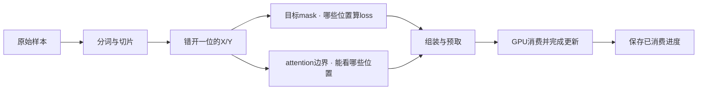
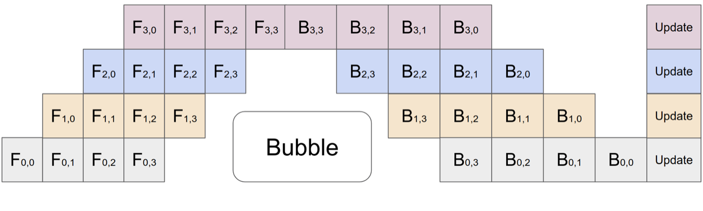

# 训练输入怎样变成 X、Y 与 Mask

模型接到一个 `[B,T]` 张量时，不知道它原先来自几篇文档，也不知道某些位置属于用户问题还是目标答案。这些含义由读取、切片、分词和 mask 构造共同决定。下面从 nanoGPT 的 `get_batch` 走到两条问答的 packing，检查每次改动怎样影响目标与吞吐。

## 从文件里读出连续窗口

nanoGPT 把预先分词的文本保存在二进制文件里，`get_batch` 使用只读 `np.memmap` 查看 `uint16` token 序列，随机抽取起点，再切出输入与目标。对这个特定存储格式，词表 ID 必须能被 `uint16` 表示；更大词表不能直接沿用相同 dtype。

下面用 Python 列表保留相同切片关系，不依赖数据文件。

```python
tokens = [8, 2, 5, 7, 3, 1, 4]
length = 4
start = 1
x = tokens[start:start + length]
y = tokens[start + 1:start + 1 + length]
print(x)  # [2, 5, 7, 3]
print(y)  # [5, 7, 3, 1]
```

目标比输入向后错开一位，所以可选起点必须为最后一个目标留出位置。先选 B 个起点，再把 B 条长度 T 的窗口 stack，得到 X、Y 都为 `[B,T]`。nanoGPT 转为 int64，是为了满足 embedding 和类别目标的张量接口；磁盘存储 dtype 与计算接口 dtype 可以不同。

这个读取器按连续 token 流抽窗口，没有实现独立问答的 segment mask，也没有逐文档 epoch 遍历语义。它很适合解释预训练数据路径，但不能原封不动充当所有 SFT 或多模态任务的读取器。

## 目标 mask 改变哪些位置获得直接监督

对一条问答，prompt 需要作为条件可见，通常只有答案位置进入监督。设模型输入对应“用户、问题、助手、答案、EOS”，答案目标外的位置可用 loss 的忽略标记屏蔽。

忽略 label 不会自动阻断 attention。答案仍需要读取问题，prompt 也通过后续预测影响梯度。反过来，attention mask 决定能看谁，并不自动决定哪些位置参与 loss。这两个 mask 的职责必须分别检查。

还要确认移位发生的位置。nanoGPT 在数据端产生已移位 Y，而某些 causal LM 接口接受未移位 labels 并在内部 shift。把两种方式叠加，位置 t 可能被训练成预测 t+2。用五个不同 token 打印输入与实际目标，比看平均 loss 更容易发现这类错误。

## 两条不同长度的样本先付出了多少 padding

设两条序列是 `a b c` 与 `d e f g h`。普通 batch 补齐成 `[2,5]`，总占 10 个输入位置，实际非 padding 为 8，利用率为

$$
\eta=\frac{3+5}{2\times5}=80\%.
$$

按长度分桶可以让同批样本更接近，从而减少 padding，但分桶后的来源与任务分布要继续统计。若长样本只在很少的桶里出现，丢弃不完整 batch 可能系统性减少它们的曝光。

非 padding 输入 token 与参与 loss 的 token 也不是同一个数。SFT 中可能有很长的 prompt、很短的答案，前向计算依然处理 prompt，只是 loss 分母不包含被忽略目标。对吞吐同时报告输入 token/s 与目标 token/s，才能理解算力用在哪里。

## Packing 必须同时搬动边界

把两条序列拼成 `[a,b,c,d,e,f,g,h]` 可以填满长度 8 的一行。若它们在训练定义里应相互独立，就需要两个独立的因果 attention 块。1 表示允许关注。

```text
      a b c d e f g h
a     1 0 0 0 0 0 0 0
b     1 1 0 0 0 0 0 0
c     1 1 1 0 0 0 0 0
d     0 0 0 1 0 0 0 0
e     0 0 0 1 1 0 0 0
f     0 0 0 1 1 1 0 0
g     0 0 0 1 1 1 1 0
h     0 0 0 1 1 1 1 1
```

对样本编号 $s_i$，加到 attention logits 的 mask 可表示为

$$
M_{ij}=\begin{cases}0,&s_i=s_j\text{ 且 }j\le i,\\-\infty,&\text{其他情况}.\end{cases}
$$

仅有这个矩阵还不够。将整条序列直接 shift，会让 `c` 位置预测另一条样本的 `d`，应排除这个跨样本目标，或按照显式 EOS 与分段规则构造。Position ID 也要符合设计，若希望与两条样本分别运行等价，通常要保留各自的位置编号，并检查所用 kernel 的变长或分段接口。

文档拼接预训练可以有意允许跨文档上下文，那是另一种训练定义。不能把任何跨文档 attention 都叫泄漏，也不能假设拼接一定无害。先写清任务要优化哪个条件分布，再实现对应 mask。

最直接的检查是分别运行两条样本，再运行 packed 版本，在关闭 dropout、位置语义一致的条件下比较对应 logits 与损失。然后只修改第一条样本，确认第二条输出是否按设计保持不变。检查全 mask、长度 1、恰好填满和超长截断边界。

<!-- systems-workflow-visual -->


目标mask和attention mask从同一批样本分出两条职责，不能用其中一条替代另一条。

## 预取让下一批与当前计算重叠

nanoGPT 在完成当前前向提交后就调用下一次 `get_batch`，然后执行当前 backward；CUDA 路径还使用 pinned memory 与 `non_blocking=True` 传输。它提供重叠的机会，但不保证 CPU、拷贝和 GPU 必然完全并行，需要检查硬件、stream 与实际 trace。

用简化生产消费模型看，准备一批需 80 ms，GPU 计算需 120 ms。串行时共 200 ms，有足够缓冲且无争用的稳态可接近 $\max(80,120)=120$ ms。若准备变成 160 ms，长期吞吐受生产端限制，队列再深也无法凭空补足每批 40 ms 的缺口。

因此先测等待 `next(loader)` 的时间，再看读取、解码、分词、组 batch 和传输。更多 worker 可能帮助 CPU 解码，也可能加剧磁盘争用。大 shard 改善顺序读取却增加重读粒度，离线分词减少 CPU 工作却绑定 tokenizer 版本，每项改动都应在相同数据与张量形状下比较。



<small>图源：[GPipe](https://arxiv.org/abs/1811.06965)。原图表达把 mini-batch 切成 micro-batch 后，pipeline 如何减少设备空泡；读图重点是：输入管线、packing 和 bucketing 也在服务同一个目标，即让每个训练 step 有稳定、可预测、可填满的工作量。它不能证明某个数据格式一定更快，只说明吞吐问题必须同时看数据、batch 形状和并行调度。</small>

这张 GPipe 图描述模型分段之间的 micro-batch 调度，并非 DataLoader。它说明输入最终还需进入模型自己的执行时间表，数据准备再快，也不能消除 stage 不均衡导致的等待。

## 中断后，恢复的是已消费进度

设流式读取器已从远端读到记录 100，但 shuffle buffer 还有 20 条未抽出，worker 还预取了下一批，而训练只消费到第 70 条。只保存“游标 100”和随机种子，无法重建剩余记录的内容和顺序。

精确恢复需要数据快照、各 worker 读取状态、随机状态、shuffle/packing buffer 与已交付状态，或采用可确定重读的提交边界。通常在完整 optimizer step 后提交训练状态与消费进度，恢复时重读未提交的预取数据更容易解释。

nanoGPT 的简单随机窗口读取依赖 RNG，它的示例 checkpoint 没有完整保存这一数据状态。读教程时应保留这种边界，自己实现恢复时再补齐所需状态。

可以用 20 条带唯一 ID 的数据运行六次更新，第三次后保存并恢复。比较连续运行与恢复运行后续的 ID、pack 边界和有效目标数。这个小测试先通过，再扩展到多 worker、对象存储和不同 world size。

## 从本页继续查代码

- [nanoGPT train.py 的 get_batch 与预取循环](https://github.com/karpathy/nanoGPT/blob/3adf61e154c3fe3fca428ad6bc3818b27a3b8291/train.py)，固定 commit `3adf61e1`，本页按其读取与移位过程展开。
- [nanoGPT model.py](https://github.com/karpathy/nanoGPT/blob/3adf61e154c3fe3fca428ad6bc3818b27a3b8291/model.py)显示 targets 已移位时交叉熵怎样使用。
- [PyTorch 数据加载文档](https://docs.pytorch.org/docs/stable/data.html)说明 worker、预取与 iterable dataset 分片边界。
- [数据系统](data-systems-and-optimization.md)继续计算来源比例与目标 token 曝光。
- [分布式恢复](distributed-training-and-checkpointing.md)继续处理梯度、数据与 checkpoint 的共同提交。
