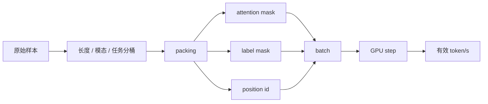

# 输入管线、Packing 与吞吐

很多训练团队把精力放在模型、优化器、并行和混合精度上，最后却发现 GPU 利用率仍然不高。原因常常在输入管线：数据切片太碎、tokenizer 太慢、packing 太差、shuffle buffer 不合理、长样本让 padding 放大、恢复训练后数据游标错位。输入系统不是后台搬运工，而是训练统计分布、吞吐和可复现性的共同塑形者。

这页建议和 [训练数据系统与吞吐优化](data-systems-and-optimization.md)、[分布式训练与 Checkpoint](distributed-training-and-checkpointing.md)、[训练评测与消融设计](evaluation-and-ablation-methodology.md) 一起读。数据系统页讲治理链路，本页聚焦训练消费路径和吞吐治理。

<small>图源：[GPipe](https://arxiv.org/abs/1811.06965)。原图表达把 mini-batch 切成 micro-batch 后，pipeline 如何减少设备空泡；本站读法是：输入管线、packing 和 bucketing 也在服务同一个目标，即让每个训练 step 有稳定、可预测、可填满的工作量。它不能证明某个数据格式一定更快，只说明吞吐问题必须同时看数据、batch 形状和并行调度。</small>

## 一、输入系统的真实职责

训练输入系统至少要正确读取、解析和解码数据，保持足够高且稳定的吞吐，维持 mixture、curriculum 和采样策略的统计正确性，支持 deterministic resume，并为不同长度、模态和任务构造有效 batch。

任何一件做不好，最后都会表现为 GPU 等数据、有效 token 利用率低、数据源曝光失真、恢复后重复/跳样、或长上下文训练成本被无效 padding 放大。

输入系统优化不应只看样本条数或原始 token/s，而要看有效 token/s、padding ratio、pack fill ratio、per-source 曝光偏差、batch ready latency、data stall ratio，以及恢复前后采样分布是否一致。

## 二、Bucketing 与 Packing：提高有效 token 利用率

如果 batch 内样本长度差异很大，padding 会浪费大量 token 位。设第 $i$ 个样本长度为 $l_i$，batch 最大长度为 $L$，有效 token 利用率可写成：

$$
\eta = \frac{\sum_i l_i}{B \cdot L}.
$$

当 $\eta$ 很低时，系统虽然“看起来 batch 很大”，但 GPU 实际上在算大量 padding。

### Bucketing

Bucketing 是第一层基本功：先按长度、模态、任务或 kernel-friendly shape 分桶，再在桶内组 batch。bucket 太少会浪费 padding；bucket 太多会降低随机性、增加调度复杂度，并让每个桶内样本不足。

一个实用原则是同时考虑数据真实长度分布、模型和 kernel 友好形状、mixture 统计稳定性，以及长尾样本是否需要专门桶。

### Packing

Packing 解决“短样本太多”的问题，把多个短 segment 放入同一序列，减少 padding。收益是提升有效 token 占比、降低浪费、让 global batch token 更可控；代价是 attention mask、label mask、segment 边界、position id 和恢复状态都更复杂。

Packing 会影响方法学。同样号称训练 `1T token`，如果一种管线 padding 浪费高，另一种管线 pack 很好，模型实际看到的有效信号并不等价。消融对比时必须报告有效 token 和 packing 策略。

这张图说明 packing 的收益和风险来自同一个地方：把样本装得更满。装得更满能提高有效 token/s，但 mask、label 和 position 只要错一处，就会变成数据泄漏或监督错位。

### Packing 事故例子

如果把两个问答样本 pack 到同一序列，却忘了阻断它们之间的 attention，第二个样本可能看到第一个样本的答案。离线 loss 会变好，真实泛化会变差。这类事故很隐蔽，必须用 toy batch 可视化 attention mask 和 label mask。

## 三、Streaming、Tokenizer 与数据格式

超大数据集通常不能简单“全量落本地再随机读”，因此会涉及 streaming、对象存储、本地缓存和离线预处理。

### Streaming 与随机性

Streaming 要在吞吐、随机性和恢复之间取平衡。shuffle buffer 太小，会让训练顺序局部化，导致 mixture 和 curriculum 失真；太大，又会增加内存、恢复状态和 worker 协同复杂度。

对象存储 streaming 真正难的不是能不能读，而是长时间稳定性。需要重点看 P95/P99 fetch latency、per-rank fetch skew、缓存命中率、重试率、429/5xx 比例和本地 fallback 次数。成熟架构常用“远端冷数据 + 本地 NVMe 热缓存 + 后台 prefetch”。

### Tokenizer 与 Pretokenization

Tokenizer 常是被忽略的瓶颈，尤其在多语种、文档解析、OCR、多轮模板和多模态占位符场景中。Pretokenization 不只是省 CPU，它还把 tokenizer 版本、normalization、特殊 token、对话模板、模态边界和长度统计固定成训练契约。

但 pretokenization 也会带来代价：tokenizer 升级困难、prompt 模板演进受限、多任务复用变麻烦、存储放大。更稳的做法是保留两层数据：基础层保存清洗后的 canonical text/multimodal references，训练层按具体 tokenizer 和模板生成消费格式。

### 数据格式取舍

| 格式 | 适合场景 | 主要风险 |
| --- | --- | --- |
| `WebDataset` | 图像、视频、音频、多文件样本和对象存储流式训练 | 样本级随机访问弱，shard 粒度影响恢复 |
| `Parquet` | 结构化字段、统计分析、过滤和治理 | 训练时可能受 row group 和远端布局影响 |
| `Indexed Dataset` | 高吞吐文本/Token 训练、随机切片和恢复 | 离线构建重，多模态复杂 schema 不够自然 |

常见成熟架构是：治理层用 `Parquet`，原始文件层用对象存储，训练消费层重打包为 `WebDataset` 或 `Indexed Dataset`，监控层记录曝光、长度和过滤日志。

## 四、多模态与长上下文的特殊问题

多模态输入不只有文本长度，还要处理图像分辨率、页数、视频帧数、OCR、音频帧、动作 token 和跨模态对齐。batch 代价取决于文本 token、视觉 token、编码器前端计算和模态混合比例。

多模态 packing 比文本更容易出事故。团队应先定义 segment contract，再写 packer，包括每种模态的边界 token、跨模态 attention mask、哪些模态之间允许信息流动、哪些 supervision 只在局部 segment 内有效、padding 对各模态如何处理，以及动作 token 是条件还是监督目标。

长上下文训练还会把输入系统推到极限。最大长度从 `4k` 到 `32k/128k` 后，packing 不只是“装满”，还要控制算子形状。理论填充率最高的 packer，可能导致 shape 高度离散、mask 构造复杂、position 处理更重、kernel cache 命中下降，最终反而更慢。

长上下文数据层要回答是否真的有足够高质量长样本，长样本采样是否改变 mixture，bucket 是否匹配 attention / kernel shape，恢复训练后长样本曝光是否连续，以及有效长上下文能力是否在评测桶里体现。

## 五、Deterministic Resume 与统计契约

恢复训练不能只恢复模型、优化器和学习率。输入系统至少还要恢复 sampler 状态、每个数据源游标、shuffle buffer 随机种子与位置、packing buffer 内未消费样本、对象存储 shard 分配状态、多模态窗口位置和字幕 / 动作偏移，以及在线过滤器状态和失败重试记录。

只恢复 `global_step` 不够。启用按长度分桶、混合数据源、packing、动态过滤、流式读取失败重试后，同一个 step 下真实曝光样本集合可能不同。恢复后曲线看似正常，但若高权重数据源被重复曝光，模型会出现隐蔽偏差：loss 更低但泛化更差。

Deterministic resume 的验收应看恢复前后采样分布、长度桶、数据源曝光、pack 行为和短跑 loss 是否一致。

## 六、监控、SLO 与排障

输入系统也应有自己的 SLO。建议监控四层：

| 层级 | 典型指标 |
| --- | --- |
| 数据源层 | 源权重与真实曝光率、解析失败率、对象存储读延迟 |
| 样本层 | token 长度、多模态 segment、超长样本、重复概率 |
| Batch 层 | padding ratio、pack fill ratio、bucket 命中、worker skew |
| 训练层 | GPU 空转、step time 抖动、有效 token/s、恢复后分布偏移 |

排障顺序建议先看 GPU 是否在等数据，再看 padding、packing 和 bucket 效率，然后看 tokenizer、OCR、图像 / 视频前处理、对象存储、NVMe cache、worker skew、sampler、mixture 和恢复状态，最后才判断是否需要改模型或并行策略。

常见失效包括：GPU 利用率低但继续加机、packing 破坏任务边界、bucket 太细导致随机性变差、只优化文本忽略多模态前处理、恢复后数据曝光偏移。

## 七、验收模板

每次改 tokenizer、pack 逻辑、bucket 配置、streaming 路径、数据源权重或长样本采样比例，都应做输入系统专项回归。

验收至少包括功能正确性、吞吐稳定性、恢复一致性、混合正确性、观测完备性和方法学记录：mask、segment、label、模态边界和 position 要正确，长跑 step time 不能周期性抖动，checkpoint 恢复后采样分布和 pack 行为要一致，数据源权重、长度桶和任务比例要符合设计，故障要能定位到数据源、worker、shard、tokenizer 或 packer，消融中也要报告有效 token、padding、packing 和数据曝光口径。

最终判断是：输入系统不是把数据喂进模型这么简单，而是把样本统计契约、吞吐契约、恢复契约和监控契约统一起来。只要进入多源混合、长上下文、多模态和对象存储流式训练阶段，这一层就会直接决定训练平台上限。

## 相关阅读与下一步

- 外部材料：[PyTorch Distributed 文档](https://pytorch.org/docs/stable/distributed.html)。
- 外部材料：[DeepSpeed ZeRO 教程](https://www.deepspeed.ai/tutorials/zero/)。
- 外部材料：[Weights & Biases 文档](https://docs.wandb.ai/)。
- 站内下一步：[训练系统专题](index.md)。
- 站内下一步：[分布式训练与 Checkpoint](distributed-training-and-checkpointing.md)。
- 站内下一步：[评测与 Ablation 方法论](evaluation-and-ablation-methodology.md)。
