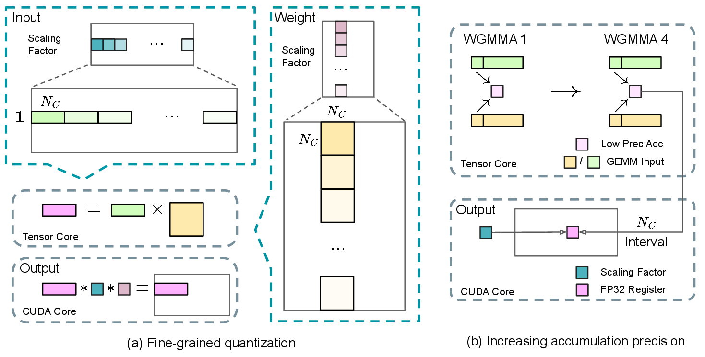
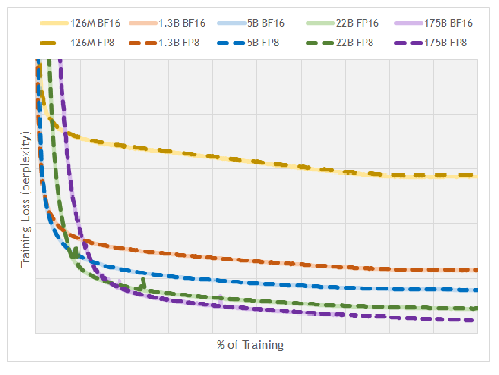

# 一个微小更新怎样在低精度训练里消失

设参数为1，优化器希望减去0.001。若把结果0.999直接写成BF16，它可能又舍入回1。训练代码已经执行step，参数却没有发生预期变化。理解低精度训练，需要沿表示、乘法、累加、梯度和写回逐段检查。

## 指数范围与有效精度承担不同作用

浮点数可表示的最大幅度主要受指数位影响，相邻值的间距受有效尾数精度影响。FP16有较窄范围，BF16范围较宽但尾数更短。范围足够大，并不保证能分辨微小差值。

BF16在1下方的相邻值约为0.99609375，0.999更接近1。使用更高精度主权重或更新状态，可以先积累这些微小变化，再生成计算所需的低精度副本。具体框架是否维护主副本，需要查优化器实现。

## 低精度操作数不等于低精度累加

矩阵乘会对K个乘积求和。即使每个操作数可表示，长归约也可能积累舍入误差。常见路径以低精度存储或乘法、高一些的精度累加，再转换输出。

为定位误差，可固定输入比较三种路径，先只降低输入精度、保持参考累加，再替换真实kernel，最后加入输出转换。这样能分开输入近似、累加顺序和输出舍入的影响。

{ width="920" }

<small>图源：[DeepSeek-V3 Technical Report](https://arxiv.org/abs/2412.19437)，Figure 6。原图展示 DeepSeek-V3 的 FP8 mixed precision training framework：GEMM 相关路径进入 FP8，部分状态、累加、embedding、MoE dispatch/combination 和 optimizer 相关路径保留更高精度或特殊处理。</small>

{ width="880" }

<small>图源：[DeepSeek-V3 Technical Report](https://arxiv.org/abs/2412.19437)，Figure 7。原图展示细粒度量化、tile/group scale 与提高累加精度的设计；读图时重点看 FP8 元素只负责输入表示，GEMM 的部分和最终累加仍要由更安全的精度路径保护。</small>

## Scale把数值送进合适范围

设反量化约定为 $x\approx s x_q$。量化时除以s，再cast；恢复时乘s。若某块大值抬高s，普通值可能失去分辨率；若s太小，大值可能溢出或截断。

Per-tensor、per-channel和per-block粒度改变了哪些数共用尺度。动态scale还增加统计与转换成本；历史scale会引入跨步状态。框架若存倒数尺度，公式中的乘除位置也应相应调整。

## Loss scaling只处理特定路径

FP16反向中一些小梯度可能下溢。把loss乘以S，会让梯度也乘S；在optimizer step前除回S，理想算术下保持原梯度。若已出现overflow，scaler可能跳过更新并调整尺度。

裁剪前必须先unscale，否则裁剪阈值作用在放大后的梯度上。nanoGPT的循环按 `unscale_`、clip、scaler.step、scaler.update组织。Loss scaling不能修复已经溢出的前向softmax，也不能恢复错误mask删除的信息。

{ width="700" }

<small>图源：[FP8 Formats for Deep Learning](https://arxiv.org/abs/2209.05433)，Figure 1。原图比较 BF16 与 FP8 路线在 GPT/BERT 类模型上的 loss 或 perplexity 曲线；读图时重点不是“FP8 也能训”，而是格式选择、scale 策略、累加精度和敏感算子保护共同成立时，曲线才可能贴近 BF16。</small>

## 误差会通过训练反馈

推理只用当前权重计算输出，训练还用近似梯度改变下一步权重。一个无偏小误差、持续偏差和偶发非有限值，会产生不同长期行为。因此一次forward对齐不足以证明训练方案稳定。

固定小数据做多步对照，记录loss、梯度范数、参数更新范数与跳步次数，再进行中断恢复。若FP8尺度历史或优化器状态影响更新，也应纳入保存。最后用独立评测判断训练结果，不能只依据短期loss曲线接近。

更低位宽的格式通常需要更强的范围、布局与kernel协同。应从已验证的局部路径逐步扩展，不把整个训练图简单改成一种dtype。

## 继续读

继续看[FP8 训练与 optimizer kernel](../operators/fp8-training-and-optimizer-kernels.md)和[QAT、kernel 与 KV cache](../quantization/qat-kernels-and-kv-cache.md)。

## 对照源码与延伸阅读

- [混合精度训练循环与unscale顺序](https://github.com/karpathy/nanoGPT/blob/3adf61e154c3fe3fca428ad6bc3818b27a3b8291/train.py)
- [低精度矩阵乘的data/scale接口](https://github.com/deepseek-ai/DeepGEMM/blob/5081f8513af57e61696de4f4f04b0e707ffb503e/README.md)

## 先画一张数值账本

低精度改造前，给每类张量写清楚四件事：存储 dtype、计算 dtype、累加 dtype、是否有 scale 或 master copy。一个简化账本可以是：

| 张量 | 存储 | 计算/累加 | 额外状态 |
| --- | --- | --- | --- |
| 激活 | BF16/FP8 | BF16/FP32 | 动态或历史 scale |
| 权重 | BF16/FP8 | BF16/FP32 | master weight 或反量化 scale |
| 梯度 | BF16/FP16 | FP32 累加 | loss scale、overflow 标记 |
| 优化器矩 | FP32 | FP32 | step、分片与 checkpoint |

不同实现会有不同组合。账本的作用是防止把“某个 GEMM 用 FP8”误写成“整个训练图用 FP8”。如果一个张量在 forward、backward 和 optimizer step 中分别采用不同精度，应把转换位置画在计算图上，并把转换时间计入 benchmark。

## AMP、FP8 和量化训练不是同一个开关

AMP 通常根据算子选择低精度计算并保留必要的高精度路径；FP8 训练还需要 scale、格式、累加和 kernel 协同；QAT 则在训练中模拟量化误差，让最终部署格式进入优化目标。三者都可能出现“低精度”字样，但优化对象和验收指标不同。

先用 [PyTorch AMP 文档](https://pytorch.org/docs/stable/amp.html)核对 autocast、GradScaler 与 unscale 顺序，再用 [torchao 量化训练入口](https://github.com/pytorch/ao/tree/main/torchao/quantization)或 [Transformer Engine 文档](https://docs.nvidia.com/deeplearning/transformer-engine/user-guide/index.html)核对具体 FP8/量化实现。官方 API 能说明支持的语义，不能替代目标 GPU 上的数值与性能测试。

## 三阶段实验比一次全图替换更可靠

1. **算子层**：固定输入，比较 FP32 参考、低精度输入加高精度累加、真实 kernel，分别记录绝对误差和非有限值。
2. **短程训练**：固定小数据和随机种子，跑 100–1000 步，比较 loss、梯度范数、参数更新范数、scale 变化和跳步次数。
3. **系统层**：加入真实数据管线、梯度累积、分片、checkpoint 恢复和独立评测，记录有效 token/s、step p95、峰值显存和任务指标。

每阶段只改变一个主要变量。若第二阶段稳定而第三阶段退化，应优先检查数据顺序、通信、保存恢复和长序列分布，而不是直接提高 loss scale。

## 自测：一次参数更新是否真的发生

给定 master weight 为 1.0、梯度为 1.0、学习率为 0.001，分别计算 FP32 master、直接 BF16 写回和“master 更新后再生成 BF16 副本”三种结果。然后说明为什么最后一种仍可能在短期观察中显示参数副本不变，却在多步训练中逐渐反映更新。这个练习能把表示精度与优化器状态的职责分开。
