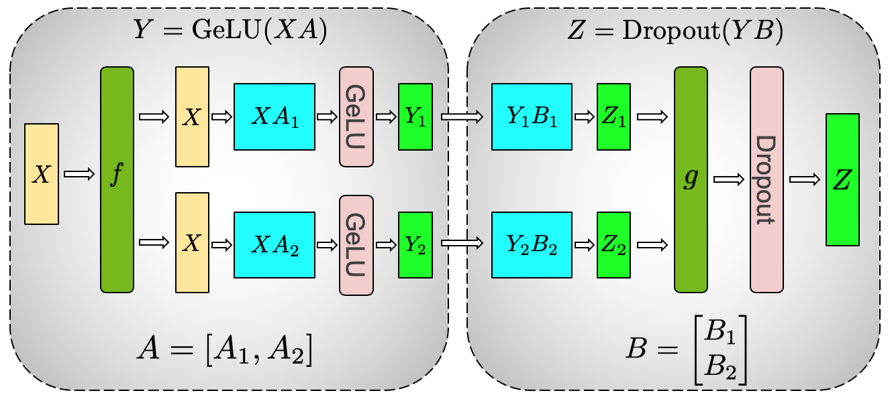
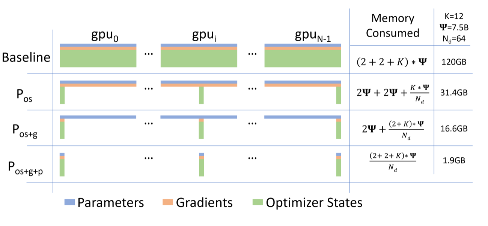

# 从一个MLP的切分理解训练框架分工

假设Transformer MLP输入X为 `[B,4096]`，先乘 $W_1$ 得到 `[B,16384]`，经过逐元素激活，再乘 $W_2$ 回到 `[B,4096]`。沿这两次矩阵乘切分，可以看清张量并行与状态分片分别改变什么。

## 先切中间通道

将 $W_1\in\mathbb R^{4096\times16384}$ 沿输出列分成两份，每rank计算8192个中间通道。激活逐元素执行，因此这一步可以保持分片。

再将 $W_2\in\mathbb R^{16384\times4096}$ 沿输入行切两份。每rank用自己的中间激活计算一个 `[B,4096]` 部分输出，两个部分相加才得到完整MLP输出。这里需要归约的是部分和，若误用拼接，shape或数学结果就不对。

这类层内切分是Megatron式张量并行的重要入口。Attention、归一化和序列并行还会带来其他通信约定，不能只凭这一个MLP推断完整模型无需额外同步。

{ width="860" }

<small>图源：[Megatron-LM: Training Multi-Billion Parameter Language Models Using Model Parallelism](https://arxiv.org/abs/1909.08053)，Figure 3a。这张图说明 MLP 中第一层 column parallel、第二层 row parallel，以及 GeLU 本地执行、输出处 all-reduce 的通信位置。</small>

## 再看另一种切分对象

若每rank执行完整MLP，但把Adam矩状态分给不同rank，减少的是优化器状态复制。进一步分片梯度或参数，会引入相应reduce-scatter和all-gather。

DeepSpeed的ZeRO与PyTorch FSDP属于这类状态管理与执行组织的重要实现路线，但具体支持范围、通信策略和checkpoint格式取决于版本与配置。张量并行和状态分片可以组合，前提是组、参数持有权与通信接口一致。

{ width="860" }

<small>图源：[ZeRO: Memory Optimizations Toward Training Trillion Parameter Models](https://arxiv.org/abs/1910.02054)，Figure 1。这张图说明 ZeRO Stage 1 切 optimizer states，Stage 2 继续切 gradients，Stage 3 连 parameters 也按需分片。</small>

## 框架选择由哪份预算超限决定

参数和优化器状态超限，可先检查分片与offload；激活超限，可检查microbatch、重计算和序列切分；单层计算需要跨卡，则研究TP；模型层太多，则评估PP及bubble。

Offload把状态移到其他存储层，减少设备驻留，但增加搬运。重计算减少保存激活，增加计算。每种方案都应写出减少了哪些字节、新增了哪些通信或FLOPs，而非只比较产品功能表。

## 迁移前固定数学与运行条件

相同模型权重不保证相同目标。核对tokenizer、目标移位、loss分母、有效batch、dropout和精度，再比较短程梯度与更新。初始loss差异可能来自接口约定，不能自动解释为框架优劣。

随后测相同数据预算下的step时间、峰值显存与故障恢复。保存模型权重用于推理，与保存可继续训练的分片优化器状态，是两种交付需求。

## 读源码时从最小训练循环向外扩展

nanoGPT提供较小的模型、DDP与optimizer循环，适合确认参数在哪里更新。再进入大型框架时，追踪同样的对象如何被包装、分片、收集和保存。本文没有逐版本验证Megatron、DeepSpeed与FSDP所有兼容组合，实际接入需以选定版本的接口和最小运行结果为准。


## 继续读

继续看[分布式训练与 checkpoint](distributed-training-and-checkpointing.md)和[集群运行与实验管理](cluster-operations-and-experiment-management.md)。

## 对照源码与延伸阅读

- [小型DDP训练循环作为状态阅读起点](https://github.com/karpathy/nanoGPT/blob/3adf61e154c3fe3fca428ad6bc3818b27a3b8291/train.py)
- [Transformer MLP与forward实现](https://github.com/karpathy/nanoGPT/blob/3adf61e154c3fe3fca428ad6bc3818b27a3b8291/model.py)

## 用“超出哪份预算”选择并行方式

先列出每张 GPU 的预算，而不是先选框架：

| 超限对象 | 首选方向 | 新增代价 |
| --- | --- | --- |
| 参数驻留 | TP、PP、参数分片 | all-gather、stage 传输或调度 bubble |
| 优化器/梯度 | ZeRO/FSDP 状态分片 | reduce-scatter、all-gather、保存重排 |
| 激活 | microbatch、activation checkpoint、序列并行 | 重计算、同步和更复杂的调度 |
| 单层矩阵计算 | TP 或 sequence parallel | 频繁 collective、shape 约束 |
| 长序列 KV/激活 | context parallel、分块或重计算 | 跨卡历史访问与负载不均 |

同一作业可以组合多个方向，但每个方向都要写出减少的字节和新增的通信。框架名称只是一种实现组织，不能替你完成预算。

## MLP 切分之外还要检查哪些层

Column/row parallel MLP 说明了局部激活和部分和的关系，但 attention 还涉及 Q/K/V 头、输出投影、mask 和 sequence parallel；归一化可能要求完整 hidden dimension；embedding 和 lm head 又可能共享权重。迁移框架时，应按层类型列出输入/输出 shard，而不是只验证 MLP。

一个最小检查表：

```text
layer -> input layout -> local compute -> collective -> output layout
```

如果下一层期望 row-sharded，而上一层输出仍是完整张量，框架可能隐式 all-gather；这会改变通信量和显存峰值。性能报告需要把隐式通信也算进去。

## 迁移框架的四个对照

固定模型、数据、有效 batch 和精度，比较：

1. 单卡或小规模参考实现。
2. 纯 DDP，确认数据并行目标。
3. 目标框架的 TP/PP 或状态分片。
4. 目标框架 + checkpoint 恢复短跑。

逐步增加复杂度能区分数学不一致、通信瓶颈和保存协议问题。每一步都比较初始 logits、loss 分母、step 时间、峰值显存和参数更新方向，不能只比较最终 loss。

## 来源与改编说明

- [Megatron-LM](https://github.com/NVIDIA/Megatron-LM)和[原始模型并行论文](https://arxiv.org/abs/1909.08053)用于核对 column/row parallel 的基本通信位置。
- [DeepSpeed ZeRO](https://arxiv.org/abs/1910.02054)说明优化器、梯度和参数分片的层次。
- [PyTorch FSDP](https://pytorch.org/docs/stable/fsdp.html)用于核对参数分片、all-gather 和状态字典边界。

## 自测

1. 为什么参数放得下仍可能被 optimizer state 或激活撑爆？
2. MLP 的第二个矩阵为什么要做部分和归约，而不是拼接？
3. 如何用四步实验区分 DDP 目标错误和 TP 通信瓶颈？
4. 改变 TP/PP 后，checkpoint 还需要核对哪些 shard 信息？
