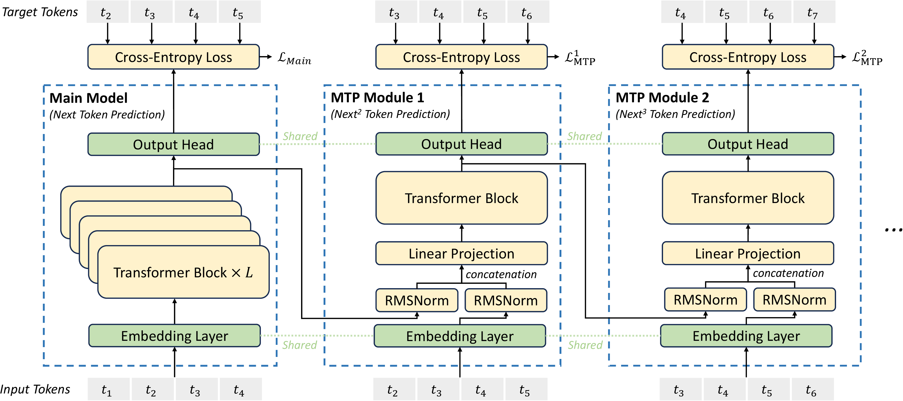

# 多token预测怎样变成可验证的生成

模型看到前缀“今天下”时，普通下一词目标预测第一个后续token。MTP可以增加更远位置的训练目标，投机解码则让便宜模型先提出一段候选，再由目标模型验证。前者改变学习信号，后者改变推理执行，两者需要明确的接口才能结合。

## 两个预测头各看到了什么

设训练序列为 `[A,B,C,D]`。普通目标在位置A预测B，在B预测C。一个额外预测头可以要求位置A预测C，但这不自动等于先采样B、再以采样出的B为条件预测C。

若第二个头只看原前缀，它学习的是更远边缘预测；若逐层条件化到前一个目标或预测，则条件信息不同。阅读MTP架构时先列每个头的输入与标签，再讨论是否能直接提出联合候选。

多头loss还会共同更新共享表示，其辅助训练收益与用于draft的推理收益是两个实验问题。

{ width="820" }

<small>图源：[DeepSeek-V3 Technical Report](https://arxiv.org/abs/2412.19437)，Figure 3。原图表达 DeepSeek-V3 的串行 MTP 模块如何融合 hidden state 与未来 token embedding；读图重点是区分“训练时的多 token 监督”和“推理时的 draft/verify 接口”。它不能证明线上一定启用 MTP，也不能替代 acceptance rate 与端到端 latency 的验证。</small>

## 投机一轮先产生候选再并行核验

设draft分布为q、目标分布为p。Draft顺序产生K个候选，目标模型通过因果前向计算各候选位置所需的条件分布。核验从第一个候选依次进行，只有前面的候选被接受，后面对应条件才仍然成立。

在标准随机投机采样中，候选x的接受概率为 $\min(1,p(x)/q(x))$。拒绝后从与 $(p-q)_+$ 成正比的残差分布采样修正token，并停止提交后续draft候选。

## 两个类别验证目标分布

令 $p=(0.6,0.4)$、$q=(0.8,0.2)$。第一类被draft提出的概率0.8，接受概率0.75，所以最终通过接受得到它的概率0.6。第二类接受概率1，通过接受贡献0.2。

剩余拒绝概率为0.2，残差只在第二类上为正，因此修正再贡献0.2。最终分布正是(0.6,0.4)。这个例子说明残差重采样的必要性，拒绝后直接随意换一个token并不保分布。

推导条件与完整算法见[Speculative Decoding](https://arxiv.org/abs/2211.17192)。确定性贪心验证、树状候选与近似策略有各自规则，不应统一套用这个接受式。

## 速度分子是实际提交的token

在简化假设下，各位置独立以a接受，K个draft候选加修正或bonus token，期望提交量为

$$
E[N]=1+a+\cdots+a^K.
$$

K=3、a=0.8时为2.952。每轮成本包含draft、目标核验、采样与状态管理；即使接受率高，draft过贵或目标核验效率差，仍可能不加速。

实际接受概率随位置和上下文变化，以上几何和只是直觉模型。测量应直接统计提交token数和整轮耗时，不能只用被接受draft数量作吞吐分子。

## 拒绝后KV状态也必须回到正确前缀

目标模型可能已经为整段候选分配或计算临时KV。后半段被拒绝后，这些状态不能当成已提交上下文继续使用。vLLM调度代码在处理投机结果时相应调整已计算token状态，具体异步路径还要考虑请求结束与取消。

MTP能否作为有效draft，最终取决于候选质量、额外计算和状态接口。训练loss下降、draft准确率提高与端到端服务更快，需分别验证。

## 对照源码与延伸阅读

- [投机输出处理与computed token回退](https://github.com/vllm-project/vllm/blob/fa3b9d1377219247060d3c8b49eae199c9e7e154/vllm/v1/core/sched/scheduler.py)
- [普通下一词目标的对照实现](https://github.com/karpathy/nanoGPT/blob/3adf61e154c3fe3fca428ad6bc3818b27a3b8291/model.py)
