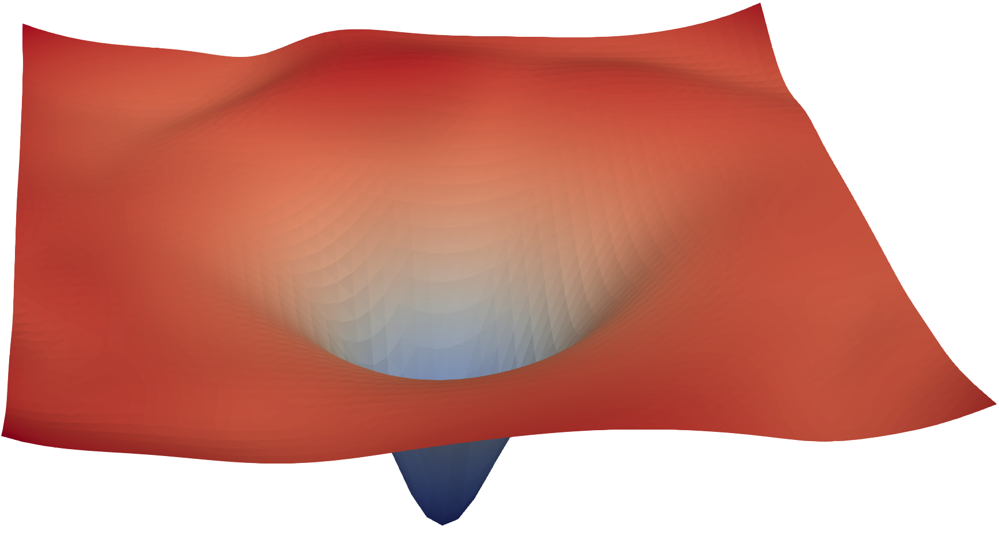
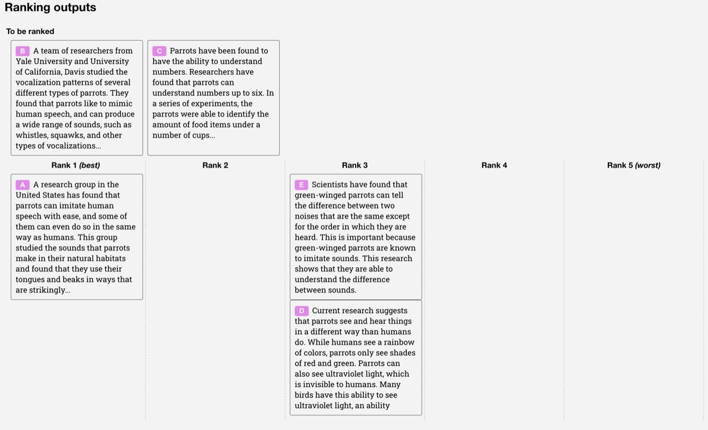
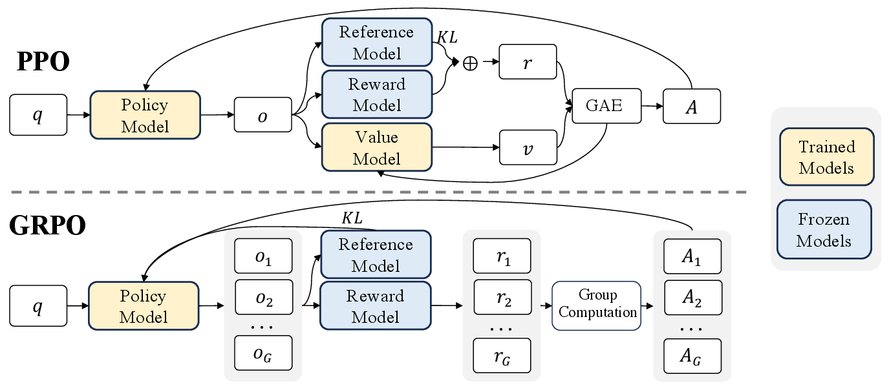

# 同一个梯度怎样变成不同的参数更新

损失给出当前预测的误差，梯度描述误差随参数怎样变化，优化器再决定实际移动多少。用一维模型把这三步算开，学习率、动量和权重衰减就有了具体位置。

## 一次线性回归的梯度

设预测为 $\hat y=wx$，x=2，目标y=3，初始w=1。平方损失 $L=\frac12(wx-y)^2=0.5$，梯度为

$$
g=(wx-y)x=-2.
$$

SGD学习率0.1时，$w\leftarrow1-0.1(-2)=1.2$。新预测2.4，loss变为0.18。Backward计算g，step才改变w；重复backward而不清空梯度，会按框架规则累加。

语言模型换成交叉熵，但优化器仍接收对参数的梯度。真实token概率0.2对应loss约1.609，概率0.4对应约0.916；这两个数字本身不能告诉我们参数更新幅度，还需看整个计算图的导数。

## Momentum保留之前的方向

用简化动量 $v_t=\mu v_{t-1}+g_t$、$w\leftarrow w-\eta v_t$。第一步v=0时与SGD相同；下一步即使当前梯度变小，历史方向仍会影响更新。

例如两步梯度为2和-1、$\mu=0.9$，动量依次为2和0.8。第二步当前梯度已反号，动量仍为正。这有助于理解平滑噪声与越过局部弯曲方向的取舍，不能把动量等同于永远更稳定。

## AdamW还按梯度平方调整尺度

Adam维护一阶矩m和二阶矩v，做偏差校正后使用

$$
\Delta w=-\eta\frac{\hat m}{\sqrt{\hat v}+\epsilon}.
$$

首步g=2、零历史时，$\hat m=2,\hat v=4$，忽略epsilon后更新约为 $-\eta$，与SGD的 $-2\eta$ 不同。后续依赖历史，不能把Adam概括成只看梯度符号。

AdamW将weight decay与自适应梯度项分离，常见写法有额外 $-\eta\lambda w$。实际参数组可排除bias或norm等参数，应查配置。恢复训练时，m/v和step计数都影响下一步。

## 两个loss相加可能抵消梯度

设 $L_A=\frac12(w-1)^2$、$L_B=\frac12(w+1)^2$。在w=0，两项loss都为0.5，梯度却分别为-1和1。等权相加梯度为0，loss数值并没有显示这种冲突。

一般 $L=\alpha L_A+\beta L_B$ 的梯度为对应加权和。比较多任务权重时，需要说明每项loss按样本、token还是序列归一化，并观察共享参数上的梯度方向与尺度。

{ width="820" }

<small>图源：[Visualizing the Loss Landscape of Neural Nets](https://arxiv.org/abs/1712.09913)，loss landscape visualization。图中把高维参数附近的损失投影到二维方向上，比较局部地形。读图时看曲面的陡峭与弯曲；它没有展示一次真实优化轨迹，也不能仅凭这两个方向判断所有方向的曲率。</small>

## 反馈先决定损失，优化器才接手梯度

一条带标准答案的数据可以直接构成交叉熵。偏好标注只比较候选回答，通常先用于奖励模型或偏好目标，无法直接充当每个位置的正确 token。下图的排序界面展示了这种监督信息的形状。

{ width="860" }

<small>图源：[Training language models to follow instructions with human feedback](https://arxiv.org/abs/2203.02155)，Appendix Figure 19(b)。这张图说明：偏好数据描述的是“哪个回答更好”，不是“每个 token 应该是什么”。</small>

假设同一问题的四个回答得到奖励 0、0、1、1。减去组内平均 0.5 后，相对信号为 −0.5、−0.5、0.5、0.5；再除以标准差会改变尺度。GRPO 把这种相对信号用于策略目标，PPO 通常借助 value 估计构造优势。下图比较的是优势信号的来源。两者仍需要通过策略的 log probability 计算梯度，再交给 AdamW 等优化器。组内奖励全部相同时，这种中心化优势为零，也说明更换优化器不能凭空制造有效反馈。

{ width="920" }

<small>图源：[DeepSeek-R1](https://arxiv.org/abs/2501.12948)，Supplementary Fig. 1。这张图说明 PPO 使用 value model 估计 advantage，而 GRPO 从同一问题的一组 sampled outputs 的 reward scores 中估计相对 advantage。</small>

关于旧策略比率、裁剪、KL 和 token 归约，见 [LLM 的 RL 目标](../reinforcement-learning/llm-rlhf-rlvr-and-grpo.md)。选择损失决定“希望改变什么”，优化器决定“怎样使用已经算出的梯度”。

## 学习率日程改变的是更新的时间尺度

Warmup逐步提高学习率，后续衰减让更新更小。若训练总步数改变，按step定义的日程也随之改变；若batch或有效token数变化，相同步数可能代表不同数据曝光。

nanoGPT用当前迭代计算学习率，反向累积后再执行一次optimizer step。移植日程时先确定计数单位。Warmup可能缓解某些起始数值问题，却不能修复数据loader阻塞或错误mask。

最终用固定小输入验证loss和梯度，再检查短程更新与恢复一致性。选择优化器的依据是当前目标与训练结果，不是把单个loss下降速度当成泛化能力。

## 对照源码与延伸阅读

- [实际学习率、累积、裁剪和AdamW执行位置](https://github.com/karpathy/nanoGPT/blob/3adf61e154c3fe3fca428ad6bc3818b27a3b8291/train.py)
- [PyTorch基础优化循环](https://github.com/pytorch/tutorials/blob/5672cd98a7671eda4d9122b10f8eec580f74d03e/beginner_source/basics/optimization_tutorial.py)
