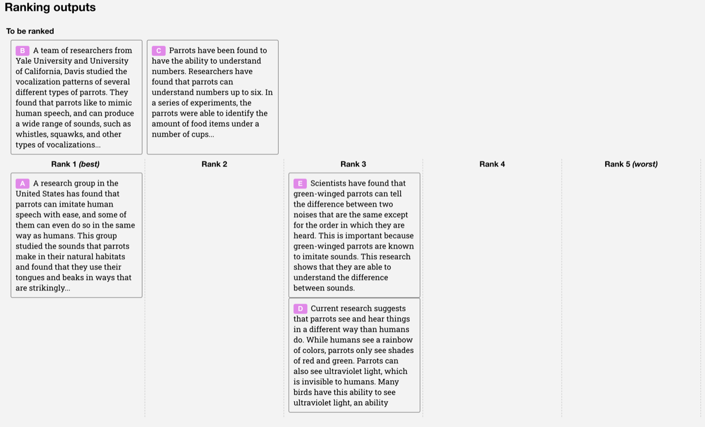

# 目标函数、优化器与 LR 日程：训练压力怎样变成参数轨迹

同一个模型、同一批数据，只要换一个 loss 配方、优化器或学习率日程，训练轨迹就可能完全不同。目标函数定义模型被什么信号推动；优化器决定梯度怎样变成更新方向；学习率日程决定什么时候大步探索、什么时候收力。

训练不是把 loss 写出来再交给 AdamW 就结束；目标、优化器和学习率日程共同决定参数轨迹。

可以先把训练配置看成三层合同：

```text
objective:   哪些输出被奖励，哪些输出被惩罚
optimizer:   梯度、历史统计和正则怎样合成更新方向
schedule:    每个阶段允许多大的更新压力
```

如果这三层合同没有对齐，loss 可能下降，真实任务却变差；训练可能稳定，关键能力却学不动；吞吐可能提高，恢复训练后轨迹却断掉。

## 目标函数不是真理，是训练压力

大多数训练问题都可以写成：

\[
\min_\theta \mathcal J(\theta)
=
\mathbb E_{(x,y)\sim p_{\text{data}}}
[\ell(f_\theta(x),y)]
+\lambda\Omega(\theta)
\]

这里 \(\theta\) 表示模型参数，\((x,y)\) 表示从训练数据分布采样的输入和目标，\(f_\theta(x)\) 表示模型预测，\(\ell\) 表示主损失，\(\Omega(\theta)\) 表示正则或约束项，\(\lambda\) 表示约束强度。

读这行公式时，重点不是背符号，而是问三件事：模型在哪些样本上犯错，错在哪里，哪些犯错方式更不能接受。交叉熵让模型拟合下一个 token；扩散损失让模型学会去噪；偏好损失让模型相对参考模型偏向 chosen；RL 目标让模型先采样，再根据 reward 调整概率。不同目标给的是不同学习信号，不能只比较 loss 数值。

## 监督学习：标准答案在数据里

自回归语言模型的 next-token objective 是：

\[
\mathcal L_{\text{CE}}
=
-\sum_{t=1}^{T}
\log p_\theta(x_t\mid x_{<t})
\]

这里 \(x_t\) 表示第 \(t\) 个 token，\(x_{<t}\) 表示前缀，\(p_\theta(x_t\mid x_{<t})\) 表示模型给真实下一个 token 的概率。真实 token 概率越高，\(-\log p_\theta\) 越小；真实 token 概率越低，惩罚越大。

SFT 仍然是交叉熵，只是输入变成指令 \(x\)，目标变成示范回答 \(y\)：

\[
\mathcal L_{\text{SFT}}
=
-\sum_{t=1}^{T}
\log p_\theta(y_t\mid x,y_{<t})
\]

这里 \(y_t\) 表示示范回答里的第 \(t\) 个 token。SFT 教模型“在这个输入下模仿这份回答”。它适合学习格式、语气、工具调用模板和领域表达，但它不直接告诉模型哪个回答更受人类偏好，也不保证真实任务风险最低。

## 偏好学习：答案变成相对比较

很多对齐信号不是 token 级标准答案，而是同一个 prompt 下多个回答的相对排序。InstructGPT 的标注界面很适合说明这一点。

{ width="860" }

<small>图源：[Training language models to follow instructions with human feedback](https://arxiv.org/abs/2203.02155)，Appendix Figure 19(b)。这张图说明：偏好数据描述的是“哪个回答更好”，不是“每个 token 应该是什么”。</small>

读这张图时，先看数据形态。标注者不是给每个 token 打标签，而是在同一个 prompt 下把多个模型输出从好到差排序。这个排序可以训练 reward model，也可以被 DPO 这类方法直接改写成偏好目标。

DPO 把 chosen / rejected pair 变成 closed-form preference objective。常见写法是：

\[
\mathcal L_{\text{DPO}}
=
-\log\sigma
\left(
\beta
\log
\frac{\pi_\theta(y^+\mid x)}
{\pi_{\text{ref}}(y^+\mid x)}
-
\beta
\log
\frac{\pi_\theta(y^-\mid x)}
{\pi_{\text{ref}}(y^-\mid x)}
\right)
\]

这里 \(y^+\) 表示更受偏好的回答，\(y^-\) 表示较差回答，\(\pi_{\text{ref}}\) 表示参考模型，\(\beta\) 表示偏好强度。读这行公式时抓住相对性：相对参考模型，提高 chosen 的概率，压低 rejected 的概率。DPO 不需要显式 reward model 和 PPO rollout，但仍然强依赖偏好数据质量、参考模型选择、长度偏置和学习率。

## RL 目标：先采样，再评价

RLHF / RLVR 的目标更间接。模型先按当前策略采样回答，再由 reward model、规则、测试、verifier 或环境给分。一个简化目标是：

\[
\max_\theta\;
\mathbb E_{y\sim\pi_\theta(\cdot\mid x)}
\left[
r(x,y)
-
\beta\,\mathrm{KL}(\pi_\theta\|\pi_{\text{ref}})
\right]
\]

这里 \(r(x,y)\) 表示完整回答或轨迹的奖励，KL 项限制当前策略不要离参考模型太远。读这行公式时，重点是 reward 不是每个 token 的标准答案。PPO / GRPO 必须把“这个回答整体更好”转成 token 概率更新，所以才需要 old log prob、advantage、clip、KL 或 group baseline 这些稳定装置。

GRPO 可以用同一 prompt 的多条采样回答构造组内优势：

\[
A_i=
\frac{r_i-\mathrm{mean}(\{r_1,\ldots,r_G\})}
{\mathrm{std}(\{r_1,\ldots,r_G\})+\epsilon}
\]

这里 \(r_i\) 表示同题第 \(i\) 个回答的奖励，\(G\) 表示同题采样数量。公式读法是：不把难题和易题直接比较，而是在同一道题内部看哪个回答更好。这样可以省掉 value model，但会增加 rollout、verifier、组内方差和长度偏置管理成本。

{ width="920" }

<small>图源：[DeepSeek-R1](https://arxiv.org/abs/2501.12948)，Supplementary Fig. 1。这张图说明 PPO 使用 value model 估计 advantage，而 GRPO 从同一问题的一组 sampled outputs 的 reward scores 中估计相对 advantage。</small>

这张图的重点不是“GRPO 一定比 PPO 好”，而是训练压力转移到了哪里：critic 少了一份，但同题多采样、reward / verifier 吞吐、答案长度偏置、组内方差和 KL 控制会变得更重要。

## 多目标训练：Loss 权重不等于梯度贡献

多模态、世界模型和 VLA 很少只有一个 loss。常见形式是：

\[
\mathcal L
=
\lambda_1\mathcal L_{\text{task}}
+\lambda_2\mathcal L_{\text{aux}}
+\lambda_3\mathcal L_{\text{align}}
+\lambda_4\mathcal L_{\text{reg}}
\]

这里 \(\lambda_i\) 表示各目标权重，但权重不是全部。一个 token 密集、尺度稳定的 video loss，即使权重只有 1.0，也可能贡献大部分梯度；一个稀疏但关键的 risk loss，即使很重要，也可能因为样本少、梯度弱而被淹没。

例如 VLA / world model 同时训练视频预测、动作重建和风险预测：

```text
L = 1.0 * video_loss + 0.2 * action_loss + 0.05 * risk_loss
```

如果 video loss 降了，真实抓取 success 和 risk recall 反而下降，根因可能不是模型“不会动作”，而是训练压力被视频预测占掉了。要看 per-loss grad norm、分桶指标、动作敏感性、风险召回和 closed-loop success。多目标训练的难点不是把公式写长，而是让每个目标的梯度贡献和任务价值匹配。

## 优化器决定梯度怎样变成更新

目标函数定义地形，优化器决定怎么在地形上移动。最抽象的一阶更新可以写成：

\[
\theta_{t+1}=\theta_t-\eta_t u_t
\]

这里 \(\eta_t\) 表示第 \(t\) 步学习率，\(u_t\) 表示由当前梯度和历史统计构成的更新方向。SGD 的 \(u_t\) 接近当前梯度；Momentum 会平滑历史方向；Adam / AdamW 会用一阶和二阶矩自适应缩放不同参数的步长。

{ width="820" }

<small>图源：[Visualizing the Loss Landscape of Neural Nets](https://arxiv.org/abs/1712.09913)，loss landscape visualization。这张图说明 optimizer 不是一步跳到最低点，而是在复杂地形里按梯度、历史统计和学习率慢慢走。</small>

常见优化器可以按“更新方向怎么被修正”来读：

| 优化器 | 更新方向的特点 | 什么时候常用 |
| --- | --- | --- |
| SGD | 直接沿梯度走 | 小模型、视觉、可控实验 |
| Momentum SGD | 用历史梯度平滑方向 | 视觉和表征训练仍常见 |
| Adam | 用一阶/二阶矩自适应缩放 | Transformer 训练基础选择 |
| AdamW | 把 weight decay 从 Adam 梯度更新中解耦 | 大模型训练默认起点 |
| Adafactor | 压缩二阶统计，省 optimizer state | 超大模型或显存受限 |

AdamW 流行不是因为它理论上永远最优，而是因为它稳定、经验丰富、和 Transformer 训练配方匹配。它的关键来自 Decoupled Weight Decay Regularization：在 Adam 这类自适应方法里，把 L2 正则直接加到 loss 里，并不等价于经典 weight decay；AdamW 把 decay 从梯度更新中解耦，使正则行为更清晰。

## LR 日程决定什么时候快走、什么时候收力

学习率不是一个常数旋钮。常见日程是 warmup + decay：

\[
\eta_t =
\begin{cases}
\eta_{\max}\frac{t}{T_w}, & t\le T_w\\
\eta_{\max}f(t), & t>T_w
\end{cases}
\]

这里 \(T_w\) 表示 warmup 步数，\(\eta_{\max}\) 表示峰值学习率，\(f(t)\) 表示 decay 函数。读这行公式时，先看两个阶段：warmup 让训练从小步开始，避免早期梯度统计、混合精度、通信和 optimizer state 还没稳定时直接大步走；decay 让后期更新变小，减少在好解附近来回震荡。

常见 schedule 不是“谁最好”，而是服务不同实验形态：

| 日程 | 直觉 | 注意点 |
| --- | --- | --- |
| Linear decay | 从峰值线性收小 | 简单稳定，常用于固定训练长度 |
| Cosine decay | 前期慢收、后期平滑靠近低 LR | 常见于大模型训练配方 |
| Constant with warmup | warmup 后保持固定 LR | 适合短跑或需要持续探索的阶段 |
| Stage-wise schedule | 数据阶段或 loss 阶段切换时调整 | 必须和数据切换、checkpoint resume 对齐 |

LR schedule 必须和 effective batch、数据阶段、loss 切换、gradient clipping、混合精度和 checkpoint resume 一起看。很多“模型突然不稳”不是 optimizer 坏了，而是数据切换点、loss 权重切换点和 LR 位置没对齐。

## 稳定项是在改训练压力

常见稳定项包括 weight decay、gradient clipping、dropout、label smoothing、KL / reference constraint、auxiliary loss、activation / logit 约束。它们都在改变训练压力。

| 稳定项 | 保护什么 | 过强时会怎样 |
| --- | --- | --- |
| Weight decay | 减少权重无约束增长 | 欠拟合或能力下降 |
| Gradient clipping | 防止异常梯度毁掉一步更新 | 掩盖真实数值异常，更新变钝 |
| KL constraint | 防止后训练偏离底座太远 | reward 学不动，模型过度保守 |
| Dropout / smoothing | 减少过拟合和过度自信 | 学习速度下降，细节能力弱 |
| Auxiliary loss | 给中间能力提供信号 | 辅助目标压制主目标 |

使用这些项时，不能只记录是否开启。要记录实际触发频率、loss scale、gradient norm、对主指标的影响，以及是否只在特定数据桶上造成退化。

## 一次配置变更应该怎样验收

改目标函数、优化器或 LR 日程时，最低限度要回答：

| 问题 | 为什么重要 |
| --- | --- |
| 主 loss 和辅助 loss 的梯度贡献是多少 | loss 权重不等于训练压力 |
| 学习率、warmup、decay 和 effective batch 是否匹配 | 决定早期稳定和后期收敛 |
| optimizer / scheduler / scaler state 能否完整 checkpoint | resume 后曲线不应断裂 |
| clipping、KL、weight decay 是否有实际监控 | 避免稳定项默默接管训练 |
| 数据阶段和 loss 阶段是否对齐 | 防止切换点造成能力冲刷 |
| 分桶评测是否同时看收益和退化 | 平均分会掩盖长尾能力损失 |

成熟训练系统会把 loss 配方、数据阶段、optimizer、scheduler、混合精度、checkpoint state 和评测分桶作为同一个配置资产管理，而不是把它们分散在不同脚本里。

## 最后判断

训练配置不是一堆默认项。目标函数决定模型被什么信号推动，优化器决定梯度怎样变成更新方向，学习率日程决定这条路径什么时候大步探索、什么时候小步收敛。真正的训练调参不是问“哪个 loss / optimizer 最好”，而是问每个训练压力是否对准任务价值、是否被正确放大、是否被稳定项压住，以及是否在关键能力桶上带来真实收益。

如果一个改动说自己更好，它至少要说明：目标函数为什么更贴近任务，更新方向为什么更稳定，LR 和 batch 为什么匹配，checkpoint 是否能恢复同一条轨迹，分桶评测是否覆盖收益和退化。否则它只是让曲线换了形状，还不能证明训练真的变好。

## 外部材料

- [Training language models to follow instructions with human feedback](https://arxiv.org/abs/2203.02155)：理解 SFT、偏好排序、reward model 和 PPO 的数据链。
- [Direct Preference Optimization](https://arxiv.org/abs/2305.18290)：理解 DPO 如何把偏好 pair 变成 closed-form objective。
- [DeepSeek-R1](https://arxiv.org/abs/2501.12948)：理解 GRPO / RLVR 在长推理任务里的动机。
- [Adam](https://arxiv.org/abs/1412.6980)：理解一阶矩、二阶矩和 bias correction 如何形成自适应更新。
- [Decoupled Weight Decay Regularization](https://arxiv.org/abs/1711.05101)：理解 AdamW 为什么要解耦 weight decay。
- [PyTorch AdamW](https://pytorch.org/docs/stable/generated/torch.optim.AdamW.html)：核对 AdamW 当前工程 API 和参数语义。
- [Hugging Face optimization schedules](https://huggingface.co/docs/transformers/main_classes/optimizer_schedules)：核对 warmup、linear、cosine、Adafactor 和 schedule API。
- [Visualizing the Loss Landscape of Neural Nets](https://arxiv.org/abs/1712.09913)：建立优化地形的直觉。

- [PyTorch Distributed 文档](https://pytorch.org/docs/stable/distributed.html)。
- [DeepSpeed ZeRO 教程](https://www.deepspeed.ai/tutorials/zero/)。
- [Weights & Biases 文档](https://docs.wandb.ai/)。
