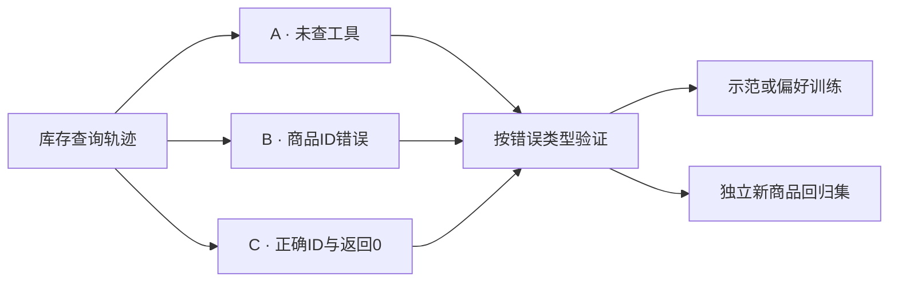
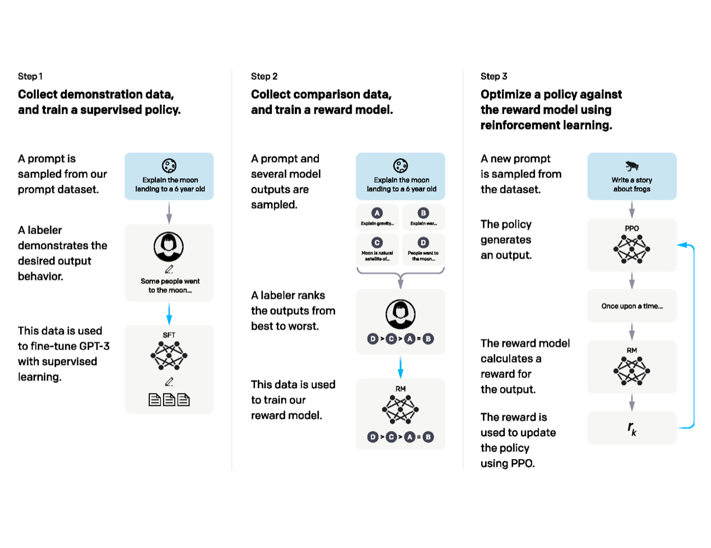

# 一次失败请求怎样变成后训练数据

设用户查询某商品库存。候选A没有调用工具，直接说“有货”；B调用库存接口却传错商品ID；C传入正确ID，工具返回0，再回答“暂时缺货”。这是构造例子，用来区分错误原因与训练信号。

## 先保留能重建错误的轨迹

只留下最终回答，会丢掉商品解析、调用参数与工具返回。应保留问题、可见上下文、工具输入输出和状态，才能判断A缺证据、B参数错误、C是否真正完成任务。

工具返回成功码也不代表用户目标完成。例如查对了接口但商品ID错，系统调用成功仍是任务失败。验证器需要明确检查哪个层次。

## 同一轨迹可以导出不同目标

C可成为SFT示范，训练正确调用与证据使用。A/C和B/C可形成偏好对，但分别针对不同缺陷。若执行结果可验证，还能提供奖励信号；某些边界样本更适合保留为独立回归测试。

同一失败同时用于训练和最终评测，会让修复看起来过于成功。应保留同类但新商品、新别名、缺失ID和超时输入，检查学到的是规则还是记住了一条答案。

<!-- systems-workflow-visual -->

先识别轨迹为什么错，再决定导出何种标签；训练样本与最终回归样本保留独立边界。

{ width="860" }

<small>图源：[Training language models to follow instructions with human feedback](https://arxiv.org/abs/2203.02155)。原图表达 SFT、reward model 和 PPO 的后训练流水线；读图重点是把现代后训练扩展成持续数据引擎：候选生成、judge、人审、回归集和线上回流。它不能证明 RLHF 是唯一后训练路线。</small>

## Judge的分数需要对应可测属性

正确性、证据引用、格式和表达可分项评分。若把它们合成总分，改进格式可能掩盖工具仍然失败。可执行结果优先用程序检查，开放偏好再用模型或人工判断。

Judge也可能受候选顺序、长度、措辞和自身能力影响。交换顺序、匹配长度、抽样复核分歧，能检查这些偏差。不要把高置信输出当成已校准概率。

## 一百条样本算清错误识别能力

教学设定中，有20条真实错误、80条正确。Judge抓到15条错误，却误报10条正确，则recall为15/20=75%，precision为15/25=60%，accuracy为85/100=85%。

85%的总体准确率看似不错，但用于自动筛出失败时，40%的报警是误报；仍漏掉四分之一真实错误。要根据后续用途选择指标，不能只用accuracy评价judge。

## 定向找错与估计总体质量要分开

优先审核模型分歧大或代价高的样本，有助于发现难题，却不代表自然流量。另留随机抽样估计总体质量，定向样本用于诊断与修复，两类结果分别报告。若知道抽样概率，可以在合适假设下做加权估计。

训练新模型后，先检查目标错误类型是否减少，再检查其他任务是否退化。Judge分数上涨只能说明该评价发生变化，不能自动推出真实任务完成率提高。

## 对照源码与延伸阅读

- [监督数据、loss与更新关系的基础入口](https://github.com/pytorch/tutorials/blob/5672cd98a7671eda4d9122b10f8eec580f74d03e/beginner_source/basics/optimization_tutorial.py)
