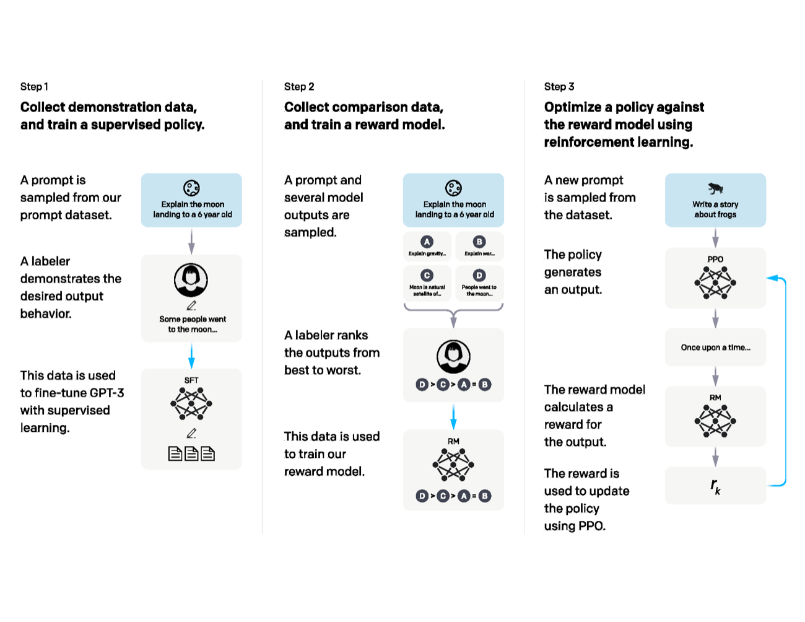
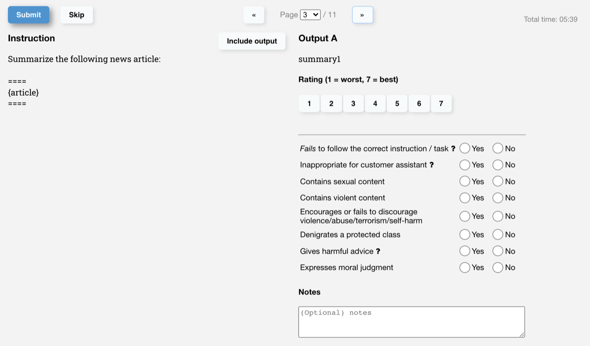
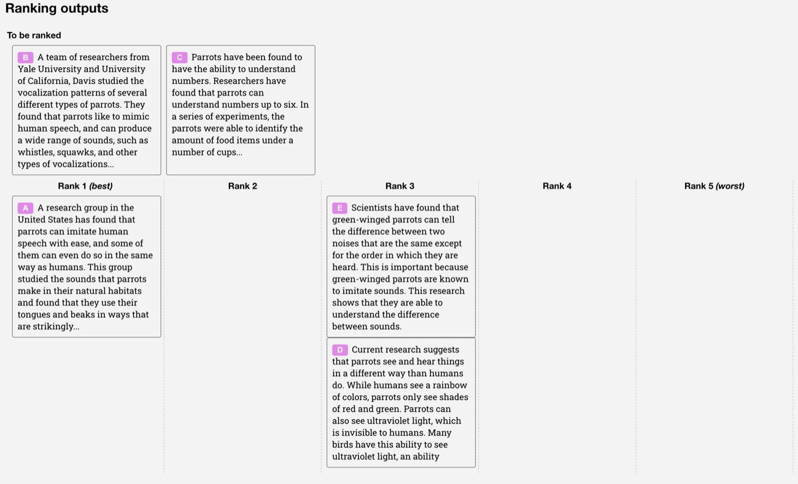
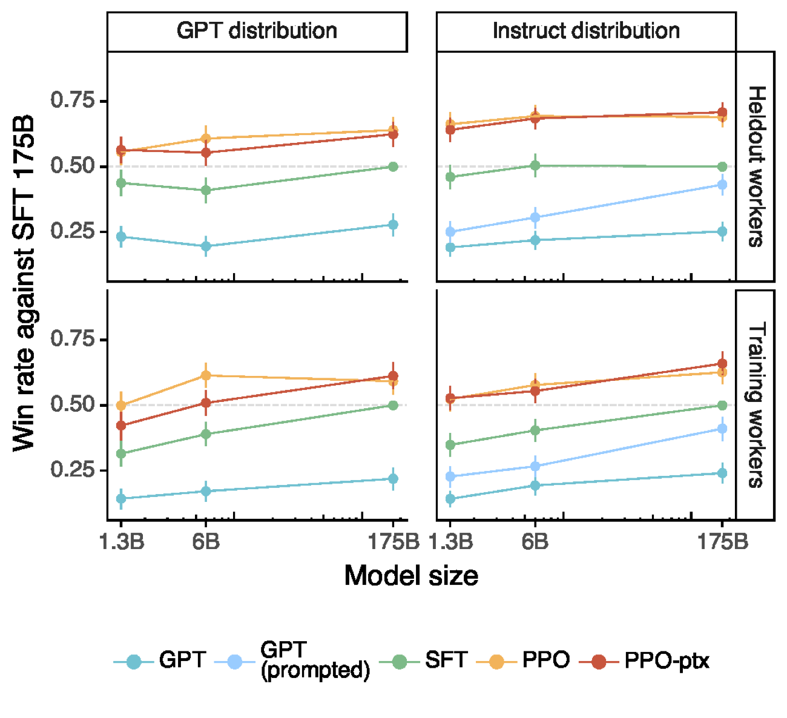
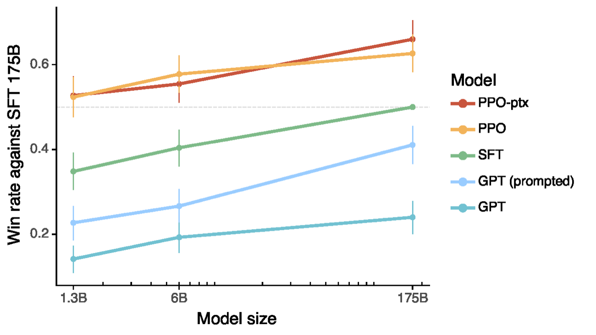

# 一对偏好回答怎样改变相对概率

对同一道题给出chosen和rejected，模型收到的是两条完整回答之间的比较。若chosen同时更正确、更长、更礼貌，偏好标签并没有自动告诉模型究竟应学习哪种差异。先看目标函数，再看数据怎样控制这些混杂。

{ width="920" }

<small>图源：[Training language models to follow instructions with human feedback](https://arxiv.org/abs/2203.02155)，Figure 2。原论文图意：展示 InstructGPT 的三步训练流程：收集 demonstration data 做 SFT，收集模型输出排序训练 reward model，再用 PPO 按 reward model 优化 policy。</small>

## 序列概率由每个token共同决定

回答y的log概率是条件token log概率之和。长回答包含更多项，因此序列长度会影响比较。某种偏好损失是否做长度归一化，是目标定义的一部分，不能在评测时随意替换。

同一prompt的chosen与rejected应共享问题条件。若两条回答使用不同检索资料或工具结果，标签可能同时比较了信息可见性，而非回答策略本身。

## DPO增加的是相对参考模型的间隔

设当前策略为 $\pi_\theta$、固定参考为 $\pi_{ref}$，chosen为 $y_w$、rejected为 $y_l$，定义

$$
z=\beta\left[\log\frac{\pi_\theta(y_w|x)}{\pi_{ref}(y_w|x)}-
\log\frac{\pi_\theta(y_l|x)}{\pi_{ref}(y_l|x)}\right],
\qquad L=-\log\sigma(z).
$$

$\partial L/\partial z=\sigma(z)-1$，所以梯度下降推动z增大。在z=0时loss为ln2，导数为-0.5。

假设参考chosen/rejected概率为0.4/0.2，当前为0.3/0.1，概率比从2变成3，偏好间隔改善，但chosen绝对概率从0.4下降到0.3。因此不能把DPO说成保证每条chosen绝对概率都上升。

原始推导见[DPO论文](https://arxiv.org/abs/2305.18290)。这个例子只解释目标，没有模拟一次完整网络更新。

{ width="860" }

<small>图源：[Training language models to follow instructions with human feedback](https://arxiv.org/abs/2203.02155)，Appendix Figure 19(a)。原论文图意：标注者先对单个模型输出做 Likert 质量评分，并标注输出是否有帮助、真实、无害、是否遵循指令等元信息。</small>

{ width="860" }

<small>图源：[Training language models to follow instructions with human feedback](https://arxiv.org/abs/2203.02155)，Appendix Figure 19(b)。原论文图意：标注者在同一个 prompt 下比较多个模型输出，并把它们从最好到最差排序；这种排序数据用于训练 reward model。</small>

{ width="860" }

<small>图源：[Training language models to follow instructions with human feedback](https://arxiv.org/abs/2203.02155)，Figure 4。原论文图意：按 prompt 来源和 labeler 分组比较不同模型相对 175B SFT baseline 的偏好胜率，用来检查偏好提升是否跨分布稳定。</small>

## 标签噪声可以系统性偏向某种表面特征

若标注者倾向长答案，正确但简短的回答可能反复被拒绝。若候选位置固定，judge还可能产生位置偏差。将候选顺序交换、构造长度匹配对、把正确性与表达分别评分，可以检查这些因素。

一对回答如果两个都错，只能提供“更偏好哪一个”的相对信息，未必教会正确解法。可执行任务尽量保留执行结果和错误原因；对于难以验证的偏好，记录分歧和不确定性，不强行把模糊判断包装成硬标签。

{ width="760" }

<small>图源：[Training language models to follow instructions with human feedback](https://arxiv.org/abs/2203.02155)，Figure 1。原论文图意：在 API prompt 分布上比较不同模型输出相对 175B SFT baseline 的人类偏好胜率，展示 InstructGPT/RLHF 后训练相对 GPT-3 和 SFT baseline 的偏好提升。</small>

## 偏好数据怎样进入训练与评测

训练集用于改变策略，独立评测集检查正确性、偏好胜率、长度、拒答和特定能力。若训练与评测共享judge，模型可能优化judge偏好而不改善目标任务，应辅以其他验证。

采集策略也影响数据覆盖。只比较当前模型容易生成的两种回答，可能遗漏严重失败或少见正确路线。记录候选生成模型、温度、上下文和过滤规则，才能解释偏好数据实际覆盖了什么。

偏好训练可以传递事实、任务与风格信号，效果取决于数据。不要预先把它限定为“只对齐风格”，也不要用一项胜率替代全部能力评测。

### 先决定长回答怎样计分

同一对回答可以用 token log-prob 总和，也可以用长度平均值。设 chosen 的四个 token log-prob 为 `[-0.2,-0.3,-0.4,-0.5]`，rejected 的八个 token 每个为 `-0.2`，则

$$
\begin{aligned}
\log p(y_w|x)&=-1.4,&\quad \frac{1}{4}\log p(y_w|x)&=-0.35,\\
\log p(y_l|x)&=-1.6,&\quad \frac{1}{8}\log p(y_l|x)&=-0.20.
\end{aligned}
$$

按总和，chosen 的数值更大；按长度平均，rejected 的每个 token 反而更容易。两种口径都可能有合理用途，但它们对应不同训练目标。记录 DPO 或 reward model 的实现时，应同时保存 response token 数、总 log-prob、平均 log-prob 和 mask 分母，不能只写“使用序列概率”。[TRL 的 DPOTrainer 文档](https://huggingface.co/docs/trl/en/dpo_trainer)可用于核对当前实现的参数和日志字段，最终仍需固定版本。

一个最小审计表可以长这样。

| 字段 | 用途 |
| --- | --- |
| `prompt_id`、来源、候选生成模型 | 检查同一问题是否重复进入不同切分，以及候选覆盖了哪些模型 |
| chosen/rejected token 数 | 分析长度差和截断 |
| 总/平均 log-prob | 重算训练间隔，识别归一化口径 |
| 候选显示顺序 | 检查位置偏差和交换实验 |
| 事实、任务、安全、风格属性 | 判断标签主要来自哪类差异 |
| 工具调用与外部证据 | 区分答案本身错误和信息不可见 |
| 标注者或 judge 版本、置信度 | 追踪标签漂移与分歧 |

按长度差、候选位置、来源模型和事实难度分桶后再计算胜率。若整体胜率上涨只发生在长回答桶，或者交换候选顺序后标签翻转，增加数据量不会修复采集流程。DPO、PPO 和 reward model 都会把这些系统偏差带进优化，只是放大的位置不同。

## 继续读

继续看[研究闭环](research-loop-from-hypothesis-to-evidence-1123-2351.md)和[数据质量与治理](data-quality-dedup-and-governance.md)。

## 对照源码与延伸阅读

- [序列token logit与目标概率的计算基础](https://github.com/karpathy/nanoGPT/blob/3adf61e154c3fe3fca428ad6bc3818b27a3b8291/model.py)

## 先把偏好标签拆成可检查的属性

对每一对回答建立属性表，而不是只保存 `chosen` 和 `rejected`：

| 属性 | chosen | rejected | 证据来源 |
| --- | --- | --- | --- |
| 事实正确 | 通过/不通过/未知 | 通过/不通过/未知 | 检索、工具或人工核验 |
| 任务完成 | 状态是否达成 | 状态是否达成 | 环境终态或程序检查 |
| 安全边界 | 是否越界 | 是否越界 | 规则或风险审查 |
| 表达偏好 | 结构、简洁、语气 | 结构、简洁、语气 | 人工或盲测 judge |

如果 chosen 在事实上更正确、同时也更长，应另造长度匹配对，或在训练报告中承认标签混杂。对工具调用任务，保留调用参数和返回结果比事后凭文本猜测正确性更可靠。

## 用小样本检查长度偏差

构造四种对照：短而正确 vs 长而正确、短而错误 vs 长而错误、同长度不同事实、交换候选顺序。分别统计人类和 judge 的偏好。如果偏好主要随长度或位置变化，先修正标注流程，再扩大数据量。DPO 或 reward model 只会放大输入标签呈现的偏差，不能自动识别它。

## 自测：DPO 间隔改变了什么

给定参考模型对 chosen/rejected 的概率为 0.4/0.2，当前模型为 0.3/0.1，计算两者的相对概率比和 DPO 的 log-ratio 间隔。然后说明为什么间隔变大不代表 chosen 的绝对概率一定上升，以及为什么长回答需要明确使用 token 总和还是长度归一化的 log-prob。答案应回到目标函数定义，而不是“chosen 被选中所以概率上升”的直觉。
