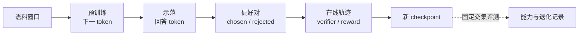

# 同一段问答在不同训练阶段受到什么监督

设输入是“2加3等于多少”，示范回答是“5”。预训练、监督微调、偏好学习和基于奖励的优化，可以使用相同模型结构，但它们从数据中提取的学习信号不同。沿这条问答看目标，能避免把阶段名字当成能力边界。

## 预训练把文本变成下一词标签

若语料写成“问题 2加3等于多少 答案 5”，自回归目标在每个允许位置预测下一个token。训练同时学习文本中的提问、表达方式与答案模式，具体曝光取决于语料分布。

模型输出词表logits，交叉熵把真实下一词的概率转成loss，再反向更新参数。[训练入门](beginner-model-training-primer.md)用bigram模型完整算过这一过程。

## SFT改变了条件与监督位置

将问题作为条件x、示范回答作为y，常见SFT只对回答token计算loss。用户问题仍参与前向并影响回答，只是它所在位置不直接贡献这项目标。

假设拼接后有10个prompt token、2个answer token。按全部12个位置平均且把prompt loss置零，与只对2个有效目标平均，数值尺度不同。训练代码必须清楚定义分母。

SFT可以学习新任务和事实，也会学习响应格式。能学多少取决于底座、示范覆盖与训练预算，不能把它简单限定为“只教说话方式”。

### 把一条示范变成 labels 和 loss mask

假设 tokenizer 把一条样本编码成

```text
[BOS] 用户 2 加 3 等于多少 [SEP] 助手 5 [EOS]
```

自回归模型的 `input_ids` 与 `labels` 要错开一格。模型看到 `[BOS] 用户 ... 助手`，分别预测后面的 token；`labels` 中对应 prompt 的位置可以填 `-100`，让 PyTorch 的交叉熵忽略它们。一个最小的形状示意如下：

```text
input_ids  [BOS] 用户 2 加 3 等于多少 [SEP] 助手
labels     -100  -100 -100 -100 -100 -100 -100 -100 5
loss mask     0    0   0   0   0   0   0   0 1
```

真实实现还要处理 padding、截断和多轮对话。如果截断刚好删掉回答，样本仍能产生形状正确的 batch，却没有任何有效监督。训练前打印几条 token、label 和 mask 的对齐结果，通常比先看一条下降曲线更快发现这个错误。

如果一个 batch 中有效回答 token 数分别为 2、20、200，按 token 总数归一化时，长回答会贡献更多梯度；按样本先求平均再聚合时，三个样本权重更接近。两种做法都可以，但要在实验记录里写清分母，否则学习率和不同数据配方无法比较。

{ width="920" }

<small>图源：[Training language models to follow instructions with human feedback](https://arxiv.org/abs/2203.02155)，Figure 2。原图展示三步流程：收集 demonstration data 做 SFT，收集模型输出排序训练 reward model，再用 PPO 按 reward model 优化 policy。</small>

## 偏好数据告诉模型两个回答的相对关系

对同一问题，提供chosen“5”和rejected“6”，偏好目标提高正确回答相对错误回答的倾向。若chosen同时更长、更礼貌，训练可能同时吸收这些相关特征，数据需要控制混杂。

以DPO为例，核心比较当前模型相对参考模型的两条序列log概率差。目标改善的是相对间隔，不保证chosen绝对概率在每一步都上升。细节见[偏好数据](preference-data-and-alignment-pitfalls.md)。

把这个“相对”写成一个小数值例更容易避免误读。设当前策略对 chosen、rejected 的序列 log-prob 分别为 `-4`、`-5`，参考策略为 `-4.5`、`-4.8`。当前策略相对参考策略的差分别是 `0.5` 和 `-0.2`，chosen 相对 rejected 的优势为 `0.7`。如果只把当前策略的两个 log-prob 都提高 1，优势仍然是 `0.7`；DPO 关注的是这类相对关系，而不是让每个 token 的绝对概率都增加。

序列长度会改变这个计算。把每个 token 的 log-prob 直接相加时，长回答更容易积累负值；改为平均后，长度偏差会变成另一种形式。chosen 和 rejected 应使用相同的 response 边界，并保留 token 数、求和方式和 reference checkpoint，后面才能解释一次偏好更新究竟改变了什么。

## 奖励优化让当前模型先产生尝试

模型可以先采样若干回答，再由可验证答案、执行环境或judge给分。训练信号依赖当前策略实际探索到的输出。若模型从不生成接近正确的尝试，稀疏奖励就很难提供有效方向；若评分器有漏洞，模型又可能学会利用它。

对数学题，检查最终数值和检查完整推导是不同验证器。对工具任务，接口返回成功也不一定表示用户目标达成。奖励定义需要与要学的行为对应。

在线奖励训练还多一条时间关系。当前策略生成轨迹时，参数版本、采样温度和工具返回都应保存；计算奖励时，记录 verifier 版本和失败原因；更新时，再把这批轨迹对应的 advantage、return 或 preference loss 写入 checkpoint 元数据。若中途换了评分器，却把旧轨迹当成同一分布继续训练，曲线的拐点无法归因。

可以用下面的记录格式把这条链串起来：

```text
policy_v17 -> traj_0042 -> verifier_v3 -> reward=0
           -> traj_0043 -> verifier_v3 -> reward=1
           -> update_091 -> checkpoint_v18
```

这里的编号不是框架规定的字段，而是一个最低限度的审计约定。它能回答三个实际问题：这次更新用了哪一版策略采样，奖励由谁给出，新的 checkpoint 是否真的包含这批轨迹。

{ width="920" }

<small>图源：[Qwen3 Technical Report](https://arxiv.org/abs/2505.09388)，Figure 1。原图展示 Qwen3 post-training pipeline：旗舰模型经过 Long-CoT Cold Start、Reasoning RL、Thinking Mode Fusion、General RL；轻量模型通过 strong-to-weak distillation 继承大模型能力。</small>

## 阶段衔接要比较同一组能力

SFT之后继续偏好或奖励优化，参数会改变，旧能力可能提高也可能退化。保留一组独立问题，分别检查正确率、指令遵循、工具执行与输入分布覆盖，才能知道改动发生在哪里。

阶段名本身不决定固定顺序。实际训练可以混合目标或分轮迭代，但每次仍要说明输入、标签、loss位置、采样分布与参数更新对象。这样读论文时才能把新名称还原成可执行训练过程。

## 一个最小后训练循环应该能被逐项关掉

下面的伪代码把不同阶段放在同一条检查线上。它没有实现分布式、混合精度或高效 packed sequence，作用是核对数据流和更新对象：

```python
for batch in loader:
    if stage == "pretrain":
        logits = model(batch.input_ids[:, :-1])
        loss = cross_entropy(logits, batch.input_ids[:, 1:], ignore_index=-100)
    elif stage == "sft":
        logits = model(batch.input_ids[:, :-1])
        loss = cross_entropy(logits, batch.labels[:, 1:], ignore_index=-100)
    elif stage == "dpo":
        chosen = sequence_logprob(policy, batch.chosen)
        rejected = sequence_logprob(policy, batch.rejected)
        ref_chosen = sequence_logprob(reference, batch.chosen)
        ref_rejected = sequence_logprob(reference, batch.rejected)
        loss = dpo_loss(chosen, rejected, ref_chosen, ref_rejected)
    else:
        trajectories = rollout(policy, batch.prompts)
        rewards = verifier(trajectories)
        loss = policy_update_loss(trajectories, rewards)
    loss.backward()
    optimizer.step()
    optimizer.zero_grad()
```

代码中的函数名是接口占位，不代表某个框架的可直接运行 API。逐阶段做 smoke test 时，先用两条样本和固定 seed，打印有效 token 数、每条序列的 log-prob、reward 以及更新前后的参数差。只有这些值与手算方向一致，才值得换成大 batch 和真实模型。


## 对照源码与延伸阅读

- [下一词交叉熵的实际forward接口](https://github.com/karpathy/nanoGPT/blob/3adf61e154c3fe3fca428ad6bc3818b27a3b8291/model.py)
- [loss与优化器之间的通用训练关系](https://github.com/pytorch/tutorials/blob/5672cd98a7671eda4d9122b10f8eec580f74d03e/beginner_source/basics/optimization_tutorial.py)

## 四种监督放在同一张数据表里

| 阶段 | 输入如何产生 | 目标/奖励 | 参数更新直接看到什么 |
| --- | --- | --- | --- |
| 预训练 | 大规模语料窗口 | 下一 token | 所有未 mask 的目标位置 |
| SFT | 人工或合成示范 | 参考回答 token | 常只对回答区域计 loss |
| 偏好优化 | chosen/rejected 对 | 相对偏好或隐式 reward | 两条回答的 log-prob 关系 |
| 在线奖励优化 | 当前策略采样 | verifier、环境或 judge | 自己探索到的轨迹 |

同一模型可以跨阶段更新，但每一阶段都可能改变数据分布和能力权衡。阶段衔接时保留 base checkpoint、数据版本、loss mask、采样策略和评测快照，才能知道新能力来自哪里。



这张图只表示一种常见的数据流。实际项目可能跳过某一步、交替更新或加入蒸馏与合成数据；每次改变顺序时，都应重新记录输入、目标和评测交集。

## Loss mask 是阶段边界的实际实现

假设 prompt 有 10 个 token、answer 有 2 个 token。只对 answer 归一化时，分母是 2；若把 prompt 的 loss 置零却仍按 12 个位置平均，梯度整体缩小 6 倍。两者都可能被实现者称为“只训练回答”，但 optimizer 看到的步幅不同。

偏好训练也要明确 sequence log-prob 是按 token 求和还是平均、是否只对 response、reference model 是否冻结。若 chosen 比 rejected 更长，未归一化的总 log-prob 可能产生长度偏差。

## 阶段评测要保留交集与专属集合

每次后训练至少保留：

- 与上一阶段相同的能力集，用来测是否退化。
- 新阶段直接优化的任务集，用来测目标是否实现。
- 未参与数据筛选的外部或新来源集合，用来测泛化。
- 安全、拒答、工具执行和长上下文等高风险桶。

一个阶段可能在专属集合上提高，但在交集或外部集合上退化。只报告新目标分数，会把目标重新定义成“最容易改善的那一组”。

## 在线奖励优化的三条证据线

当前策略采样、奖励计算和参数更新需要分别记录：

```text
policy_version -> trajectory ids -> reward/verifier result
               -> advantage/return -> update checkpoint
```

如果 reward model 或 verifier 改过，不能把前后轨迹直接合并比较。若 rollout 使用旧策略，需记录行为策略与训练策略的关系；否则 importance ratio、离线数据和在线数据的解释会混在一起。

## 来源与改编说明

- [InstructGPT](https://arxiv.org/abs/2203.02155)用于对照 demonstration、SFT、偏好排序和 PPO 的阶段关系；论文设置不能外推为所有 RLHF 流程。
- [DPO](https://arxiv.org/abs/2305.18290)用于补充 chosen/rejected 的相对 log-prob 目标。
- [Hugging Face TRL 文档](https://huggingface.co/docs/trl/)提供 SFT、偏好和 RL 训练的工程入口，参数和版本需在目标环境核对。

## 自测

1. 为什么 prompt loss 置零后仍要检查分母？
2. chosen/rejected 的长度不同会怎样影响序列 log-prob？
3. 如何设计一组评测，区分“新目标提高”和“旧能力退化”？
4. 在线奖励优化中，哪些版本信息必须跟着每条 trajectory 保存？
5. 如果截断删掉了全部 answer token，`ignore_index=-100` 后这一条样本会产生什么梯度？
6. DPO 中把 chosen 和 rejected 的 log-prob 都加同一个常数，为什么不一定改变损失？

## 训练配方和实现依据

阶段划分和 InstructGPT、DPO 的目标分别对照原论文；训练调试顺序参考 [Karpathy 的训练实践](https://karpathy.github.io/2019/04/25/recipe/)、[Stanford CS336](https://stanford-cs336.github.io/spring2025/) 和 [TRL 文档](https://huggingface.co/docs/trl/)。2 加 3 的 token、loss mask、DPO 数值和版本账本是本站构造的教学例子，不是某个公开模型的训练日志。页面没有声称运行过完整 RLHF 或 RLVR 训练。
