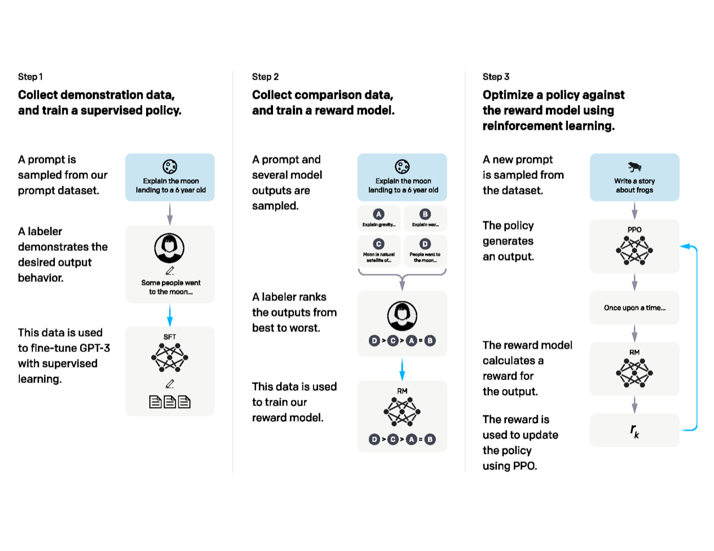
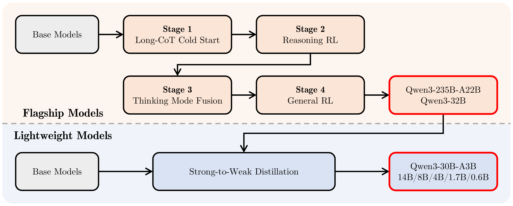

# 同一段问答在不同训练阶段受到什么监督

设输入是“2加3等于多少”，示范回答是“5”。预训练、监督微调、偏好学习和基于奖励的优化，可以使用相同模型结构，但它们从数据中提取的学习信号不同。沿这条问答看目标，能避免把阶段名字当成能力边界。

## 预训练把文本变成下一词标签

若语料写成“问题 2加3等于多少 答案 5”，自回归目标在每个允许位置预测下一个token。训练同时学习文本中的提问、表达方式与答案模式，具体曝光取决于语料分布。

模型输出词表logits，交叉熵把真实下一词的概率转成loss，再反向更新参数。[训练入门](beginner-model-training-primer.md)用bigram模型完整算过这一过程。

## SFT改变了条件与监督位置

将问题作为条件x、示范回答作为y，常见SFT只对回答token计算loss。用户问题仍参与前向并影响回答，只是它所在位置不直接贡献这项目标。

假设拼接后有10个prompt token、2个answer token。按全部12个位置平均且把prompt loss置零，与只对2个有效目标平均，数值尺度不同。训练代码必须清楚定义分母。

SFT可以学习新任务和事实，也会学习响应格式。能学多少取决于底座、示范覆盖与训练预算，不能把它简单限定为“只教说话方式”。

{ width="920" }

<small>图源：[Training language models to follow instructions with human feedback](https://arxiv.org/abs/2203.02155)，Figure 2。原图展示三步流程：收集 demonstration data 做 SFT，收集模型输出排序训练 reward model，再用 PPO 按 reward model 优化 policy。</small>

## 偏好数据告诉模型两个回答的相对关系

对同一问题，提供chosen“5”和rejected“6”，偏好目标提高正确回答相对错误回答的倾向。若chosen同时更长、更礼貌，训练可能同时吸收这些相关特征，数据需要控制混杂。

以DPO为例，核心比较当前模型相对参考模型的两条序列log概率差。目标改善的是相对间隔，不保证chosen绝对概率在每一步都上升。细节见[偏好数据](preference-data-and-alignment-pitfalls.md)。

## 奖励优化让当前模型先产生尝试

模型可以先采样若干回答，再由可验证答案、执行环境或judge给分。训练信号依赖当前策略实际探索到的输出。若模型从不生成接近正确的尝试，稀疏奖励就很难提供有效方向；若评分器有漏洞，模型又可能学会利用它。

对数学题，检查最终数值和检查完整推导是不同验证器。对工具任务，接口返回成功也不一定表示用户目标达成。奖励定义需要与要学的行为对应。

{ width="920" }

<small>图源：[Qwen3 Technical Report](https://arxiv.org/abs/2505.09388)，Figure 1。原图展示 Qwen3 post-training pipeline：旗舰模型经过 Long-CoT Cold Start、Reasoning RL、Thinking Mode Fusion、General RL；轻量模型通过 strong-to-weak distillation 继承大模型能力。</small>

## 阶段衔接要比较同一组能力

SFT之后继续偏好或奖励优化，参数会改变，旧能力可能提高也可能退化。保留一组独立问题，分别检查正确率、指令遵循、工具执行与输入分布覆盖，才能知道改动发生在哪里。

阶段名本身不决定固定顺序。实际训练可以混合目标或分轮迭代，但每次仍要说明输入、标签、loss位置、采样分布与参数更新对象。这样读论文时才能把新名称还原成可执行训练过程。

## 对照源码与延伸阅读

- [下一词交叉熵的实际forward接口](https://github.com/karpathy/nanoGPT/blob/3adf61e154c3fe3fca428ad6bc3818b27a3b8291/model.py)
- [loss与优化器之间的通用训练关系](https://github.com/pytorch/tutorials/blob/5672cd98a7671eda4d9122b10f8eec580f74d03e/beginner_source/basics/optimization_tutorial.py)
