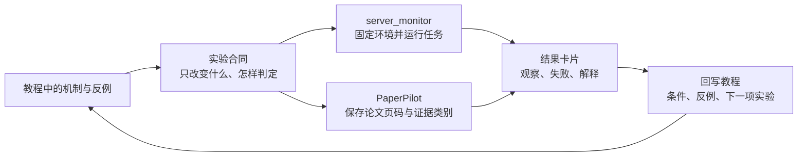

# 从教程假设到可复现实验证据

教程、实验监控和论文笔记最好各自承担一种工作。本站解释机制并提出可检验的问题，`server_monitor` 负责把实验放到合适的机器上运行并留下运行证据，PaperPilot 负责把论文、原文页码、图表、笔记版本和实验解释保存起来。最后再回到本站，补上条件、反例和下一步。

这页给出一条可以反复使用的研究闭环。它适合训练、推理、量化、世界模型和 VLA 的小规模验证，也适合把一篇博客中的直觉改造成自己的实验问题。



这条闭环有一个实际用途：读到“某方法更快”时，不必立刻把它写进结论。先把它改成一个有判定规则的问题，再让论文证据、运行日志和页面解释各自留下能复查的部分。

## 三个系统怎样分工

| 系统 | 主要问题 | 应保存的东西 | 适合的入口 |
| --- | --- | --- | --- |
| 本站 | 这个机制为什么成立，哪里可能失效 | 公式、最小例子、假设、已知边界、来源链接 | 当前板块的正文、检查点和自测 |
| `server_monitor` | 这次实验是否真的运行了，资源和日志发生了什么 | 任务配置、镜像、命令、资源曲线、容器日志、W&B Run | `http://127.0.0.1:8766` 启动后的“ACP 任务”“运行任务”“实验追踪” |
| PaperPilot | 论文原文支持什么，实验结果怎样解释 | PDF、解析产物、页码和 `source_ref`、笔记版本、图表和证据报告 | `http://127.0.0.1:18765` 启动后的文献库、阅读器和 AI 笔记 |

三个系统之间传递的是**标识和证据**，不是互相复制整套内容。教程页面不保存 W&B 的全部曲线，PaperPilot 也不替代服务器日志；每个系统保留自己最擅长、最容易核验的部分。

## 先把问题写成实验合同

不要从“我想试一下 FP8”或“这个模型应该更快”开始。先写一张只有一页的实验合同，确保运行结束后知道怎样判断结果。

```text
问题：在固定模型、输入长度和并发下，FP8 是否降低 decode 的 p95 延迟？
假设：如果权重与 KV 使用 FP8，显存压力会下降；端到端延迟只有在 kernel 和调度没有成为新瓶颈时才会下降。
只改变：数值格式与对应的校准/运行时配置。
固定：模型提交、量化校准集、硬件、软件镜像、输入集合、并发、warm-up 次数。
主要指标：首 token 延迟、decode p50/p95、tokens/s、峰值显存、任务成功率。
安全阈值：质量指标相对基线下降不超过预先设定的容差。
停止条件：出现 NaN、请求错误率上升、显存 OOM，或结果无法与基线对齐。
```

实验合同至少要有以下字段：

| 字段 | 写法示例 | 为什么必须写 |
| --- | --- | --- |
| `question_id` | `kv-fp8-latency-01` | 让教程、Run、论文笔记互相指向同一个问题 |
| `changed` | `dtype=fp8` | 说明因变量之外真正改变了什么 |
| `fixed` | `model_commit`, `hardware`, `batch`, `prompt_set_v1` | 防止把环境变化误认为方法收益 |
| `metric` | `decode_p95_ms`, `peak_memory_gib` | 预先确定分子、分母和统计分位数 |
| `budget` | `2 GPUs · 30 min · 3 seeds` | 让失败也能解释成本 |
| `decision_rule` | `p95 降低 ≥ 15%，质量下降 ≤ 1%` | 把“看起来更好”变成可复核规则 |

把 `question_id` 同时写入 W&B 的 `config`、任务名称和 PaperPilot 笔记标题。名称可以带日期，但不能只用日期，因为日期不能说明比较对象。

## 第一步：从本站提出可检验的机制

先阅读当前专题中的最小例子，把“机制”改写成一个可以测量的句子。

例如，在[推理服务系统](../inference/serving-systems.md)中，机制句子可以写成：

> decode 阶段会反复读取历史 KV；当请求变长或并发增加时，KV 占用和访存压力会改变延迟。

接着把它拆成观察量和反例：

- 观察量：输入 token 数、已生成 token 数、batch、KV 显存、首 token 延迟、decode p95。
- 反例：权重变小但 kernel 没有使用低比特路径；显存下降但请求排队增加；平均延迟下降但长请求 p95 变差。
- 最小实验：固定模型和请求集，只改变一个 KV 或权重配置，记录同一批请求的逐请求结果。

训练专题也用同样的写法。比如“学习率更大收敛更快”应改为“在相同有效 token、相同优化器和相同评测集合下，前 N 个 optimizer update 的验证损失是否更低”。具身专题则要把“视频预测更清晰”改成“候选动作的回报排序和闭环成功率是否改善”。

本站正文里的公式、手算和 smoke code 只负责验证链路是否理解正确。它们不能替代真实训练、GPU 性能或机器人闭环证据；实验合同中要明确当前证据属于哪一层。

## 第二步：在 PaperPilot 中建立证据基线

先保存基线论文和原始材料，再开始解释。这样实验结果变化时，能够回到论文中的具体条件，而不是凭记忆引用一个结论。

1. 在文献库中归档论文 PDF，等待解析完成后检查正文、公式和图表是否可读。
2. 在 PDF 阅读器中记录支持假设的段落、方法限制和关键实验表。选中文字可使用翻译、解释或公式分析，但 AI 回答只有在点击“保存到笔记”后才会写入新的 `NoteRevision`。
3. 对图表使用“框选区域”分析时，保留页码、区域和回答中的 warning；复杂图、低清图和公式仍要回看原 PDF。
4. 在笔记中把内容分成“原文事实”“我的解释”“待验证假设”三类。原文事实要留下页码或 `source_ref`，解释不能伪装成论文原话。
5. 导出当前笔记版本时，同时检查 `evidence.json`。它记录完整证据索引、笔记实际引用的证据、缺失引用、请求 telemetry、token usage 和最终质量结果。

PaperPilot 的生成成功不等于证据验证通过。`notes/status` 中的执行状态、验证状态和质量告警要分别记录；缺失 `source_ref` 的段落应回到 PDF 修正，不能用另一篇文章的相似结论补齐。

建议给每条证据附上以下最小信息：

```text
claim_id: paper-claim-03
paper: 标题 / arXiv ID / DOI
location: page 7, Figure 4, section 3.2
source_ref: PaperPilot 解析产物中的稳定引用
claim: 方法在固定 benchmark 条件下优于基线
conditions: 数据集、模型规模、训练步数、硬件或采样设置
status: 原文支持 / 我的推断 / 待复现
```

## 第三步：用 `server_monitor` 运行一组可比较的实验

`server_monitor` 的作用是把实验变成可观察的任务。页面已经提供资源总览、运行任务、容器日志、任务历史和 W&B 实验追踪；W&B API Key 由服务端读取，浏览器端不接触密钥。

### 创建任务前固定环境

在“ACP 任务”中核对以下内容，并把最终配置复制到实验合同或 Run `config`：

- 镜像地址、CUDA / PyTorch / Python 版本。
- 节点数、每节点 GPU 数、CPU、内存和显存要求。
- 启动命令、工作目录、挂载路径和数据版本。
- Git commit、依赖锁文件、随机种子和评测输入集合。
- W&B project、entity、Run 名称和 `question_id`。

总卡数是节点数乘以每节点 GPU 数；资源检查是提交时的快照，不是预留承诺。提交结果不明确时，先到“运行任务”或云控制台核对原任务，避免重复创建。

### 让每个 Run 记录同一份协议

```python
import wandb

config = {
    "question_id": "kv-fp8-latency-01",
    "model_commit": "<固定提交号>",
    "dtype": "fp8",
    "prompt_set": "prompt_set_v1",
    "batch": 8,
    "input_tokens": 2048,
    "max_new_tokens": 256,
    "hardware": "<节点与 GPU 型号>",
    "seed": 0,
}

with wandb.init(project="inference-study", config=config) as run:
    for step, record in enumerate(measurements):
        run.log(record, step=step)
    run.summary.update({
        "decode_p95_ms": decode_p95_ms,
        "peak_memory_gib": peak_memory_gib,
        "quality_delta": quality_delta,
    })
```

`config` 保存比较条件，`History` 保存逐请求或逐 step 过程，`Summary` 保存最终摘要，Console Logs 保存失败上下文。不要只记录最终一个数字，也不要把可变路径当成完整 checkpoint 证明。多卡训练时要说明 loss 的全局分母，并约定由哪个 rank 写主 Run。

### 运行中观察三条线

1. **任务线**：在“运行任务”查看 CPU、GPU、内存、显存曲线和容器日志，确认是否有 OOM、数据等待、重启或命令提前结束。
2. **实验线**：在“实验追踪”查看 project、Runs、Summary、History 和最近 Console Logs；必要时关联对应的 CCI / ACP 任务。
3. **资源线**：比较任务实际占用、排队时间和有效计算时间。吞吐下降可能来自数据管线或调度等待，不一定是模型计算变慢。

运行中只做只读诊断。停止、释放或重启是云端写操作；结果未知时先检查原任务状态。任务历史页展示结束状态和运行时长，不提供历史任务的完整曲线，因此重要曲线要在 W&B 或本地产物中保存。

## 第四步：把结果写回 PaperPilot

实验结束后不要直接把 W&B 截图粘进笔记。先保存原始曲线和逐样本结果，再写一段能被别人复核的解释。

建议使用下面的结果卡片：

```text
experiment: kv-fp8-latency-01
baseline_run: <Run ID>
variant_run: <Run ID>
changed: dtype=fp8
fixed: model_commit, prompt_set_v1, batch, hardware, warmup
observed: decode_p95 -18%, peak_memory -31%, quality_delta -0.4%
failure_or_exception: input_tokens > 8k 时 p95 反而上升
interpretation: 显存压力下降，但长上下文进入另一条访存/调度瓶颈
evidence: W&B History step range; server_monitor task log; paper page 7 Figure 4
status: 支持“在本设置下有效”，不支持“所有长度和硬件都更快”
next_test: 固定 8k 以上长度，比较 KV dtype 与 batch 的交互
```

在 PaperPilot 中将结果卡片追加为新的笔记版本，附上 W&B Run 链接、任务 ID、图表文件和论文证据。把“观察到的数值”和“为什么会这样”分开写；后者应标记为解释或待验证假设。若图表由 PaperPilot 生成或导出，保留实际引用的本地资产，避免只存一个失效的绝对路径。

## 第五步：回到本站更新知识，而不是只保存结果

实验真正改变知识库的地方有三处：

1. 在专题页的机制说明后补上**适用条件**，例如模型提交、硬件、batch、序列长度和软件版本。
2. 在“检查点”或“自测”中加入一个失败反例，让读者知道平均指标何时会误导。
3. 在“来源与改编说明”中记录原始论文/博客、实验 Run 和本地复现范围。博客可以提供直觉，论文和实际 Run 决定结论的证据强度。

不要把一次个人实验写成普遍规律。可以使用下面的三档措辞：

| 证据 | 推荐措辞 |
| --- | --- |
| 公式或最小程序 | “这个例子说明计算路径是……” |
| 单机固定条件实验 | “在模型提交、硬件和输入集合固定时，观察到……” |
| 多条件或独立复现 | “在列出的条件范围内，结果稳定支持……” |

如果实验推翻了教程中的直觉，也应保留反例。页面的下一版不是把旧结论删掉，而是说明旧结论依赖的条件以及新的边界。

## 一个博士阶段可长期维护的目录

建议为每个研究问题使用相同的三层目录和同一个 ID：

```text
research/
  kv-fp8-latency-01/
    contract.md            # 问题、假设、固定变量、判定规则
    runs.md                # server_monitor 任务 ID、W&B Run ID、状态
    results.md             # 逐次实验结果与失败记录
    evidence.md            # PaperPilot 论文、页码、source_ref、解释
    figures/               # 可复用的 PNG/SVG/CSV，文件名带 Run ID
    decisions.md           # 继续、停止或改变假设的理由
```

目录可以放在你的研究仓库或 PaperPilot 关联的写作项目中。PaperPilot 文献库负责 PDF、解析资产和笔记版本，`research/` 负责一个问题的跨系统索引；不要把 API Key、完整 W&B 凭据或服务器会话放进目录。

每周只需要维护一张索引表：

| question_id | 当前假设 | 最近 Run | 论文证据 | 结论状态 | 下一步 |
| --- | --- | --- | --- | --- | --- |
| `kv-fp8-latency-01` | 长上下文可能受访存限制 | `run-abc` | PaperPilot p.7 Fig.4 | 条件支持 | 8k+ 长度 |
| `lr-schedule-02` | warmup 减少早期不稳定 | `run-def` | PaperPilot p.3 Sec.2 | 待复现 | 3 seeds |

这种索引比单独收藏更多博客更有用，因为它把“我读过什么”“我测过什么”和“我现在相信什么”放在同一条可追溯链上。

## 最小验收清单

开始实验前：

- [ ] 问题、只改变的变量和判定规则已写出。
- [ ] 论文原文、页码或图表已在 PaperPilot 留下证据。
- [ ] 模型提交、数据版本、镜像、硬件、seed 和输入集合已固定。
- [ ] W&B `config`、History、Summary 的字段已确定。

实验结束后：

- [ ] `server_monitor` 任务状态、日志和资源曲线与 W&B Run 能互相定位。
- [ ] 失败、重试、排队和 OOM 没有被平均数覆盖。
- [ ] PaperPilot 笔记区分原文事实、实验观察和个人解释，并保存了新的版本。
- [ ] 本站页面补上了条件、反例和下一项实验，而不是只增加一句“效果更好”。

## 来源与改编说明

- `server_monitor` 的真实入口和边界来自本机项目 README 与 W&B 使用说明：任务创建、运行任务曲线、容器日志、任务历史、W&B project/Run/History/Summary/Console Logs，以及任务与 Run 的关联。
- PaperPilot 的证据和版本边界来自本机项目的 `docs/API.md`、`docs/INTERACTIVE_READING.md` 和 `docs/DECISIONS.md`：PDF 解析、`source_ref`、NoteRevision、`evidence.json`、区域视觉阅读和本地导出。
- W&B 字段语义可继续核对[官方文档](https://docs.wandb.ai/)。本站关于训练、推理和具身的机制页面仍是解释入口，实际性能与闭环结论必须以记录的条件和实验为准。

## 自测

任选本站一页，写出一个 `question_id`，并把它分别放进：

1. 一条实验合同中的 `question_id` 和 `decision_rule`；
2. 一个 W&B Run 的 `config` 和 `Summary`；
3. 一条 PaperPilot 笔记中的论文 `source_ref`、实验观察和下一步；
4. 该教程页面的一条适用条件和一条失败反例。

如果四处不能用同一个 ID 串起来，说明问题还停留在收藏或阅读阶段，尚未形成可复查的研究证据。

下一步可以把这份合同接到[评测与消融方法](evaluation-and-ablation-methodology.md)，把问题拆成可归因的对照；运行资源和失败回放则接到[集群运维与实验管理](cluster-operations-and-experiment-management.md)。
