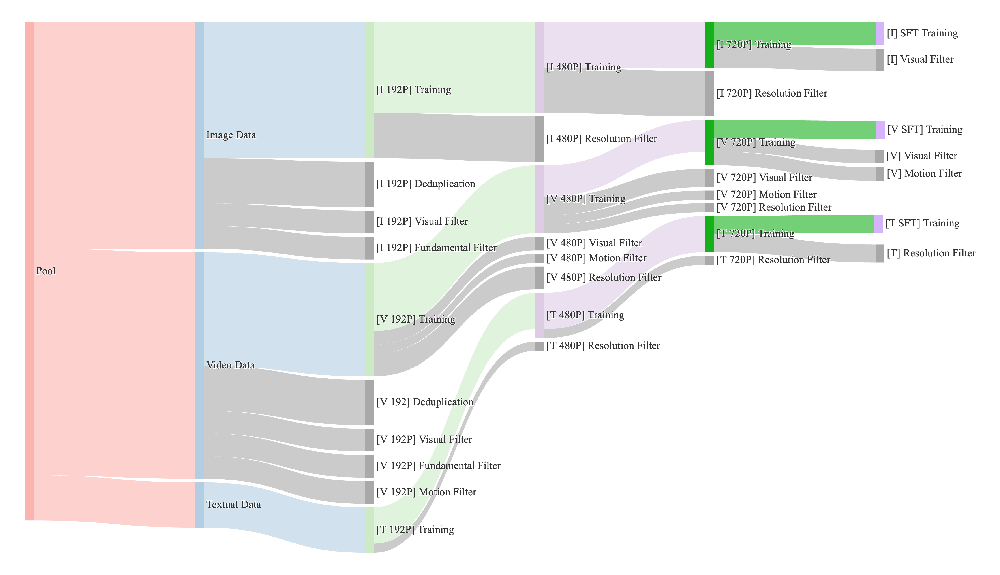

# 数据配比怎样改变每次更新的方向

从两种来源各抽一半样本，不一定让它们贡献一半训练信号。样本长度、loss归一化与训练顺序都会改变实际目标。先算曝光，再看梯度，才能判断一个数据配方是否被正确执行。

## 样本比例与token比例不同

来源A每条平均100个目标token，B每条1000个。各抽一半样本、按所有目标token平均loss时，B约占90.9%的监督位置。若希望来源损失等权，则需要分别归一化再组合，或者调整采样与长度策略。

设两个来源期望损失为 $L_A,L_B$，混合目标 $L=\alpha L_A+(1-\alpha)L_B$。梯度也是相同加权和，但只有采样器与分母实现了这一约定，配置里的alpha才真有这个含义。

## 配比可以直接转动梯度

教学设定中，A梯度为 `[2,0]`，B为 `[-1,3]`。各半混合得到 `[0.5,1.5]`；A权重提高到0.8，得到 `[1.4,0.6]`。更新方向已经明显改变。

这不意味着某种来源必然损害另一种能力。真实梯度随参数和输入变化，需要在独立子集上检查结果。标签“代码”“数学”“对话”只描述来源，不能代替当前实验的因果证据。

## 小数据源可能被反复曝光

假设总预算100B目标token，小来源有2B独立token，却按20%采样。它预计贡献20B曝光，相当于平均重复10遍；大来源80B若贡献80B，平均约1遍。

重复并不自动无效，但会改变过拟合与记忆风险。报告配方时同时给独立数据规模和实际曝光量，避免把20B曝光写成20B新数据。

## 相同数据换顺序也会走不同轨迹

每个batch的梯度在当前参数上计算。先看A再看B时，B遇到的参数已被A修改；调换顺序后不再是同一组数。学习率随时间变化时，后到的数据还可能获得不同更新幅度。

Curriculum可以先安排某类样本，再逐步改变难度或来源。它是一项需要验证的训练假设，不应预设“从易到难”必定更好。对照实验需保持总token、模型与计算预算一致，再比较顺序。

{ width="920" }

<small>图源：[Wan: Open and Advanced Large-Scale Video Generative Models](https://arxiv.org/abs/2503.20314)，Figure 3。原论文图意：不同训练阶段的数据供给策略会动态调整 motion、quality 和 category 的比例。</small>

## 用实际计数检验配方

采样器按来源记录样本数、非padding token、目标token和重复曝光。Packing、过滤和截断都可能让实际占比偏离请求的比例。分布式loader还需避免多worker重复读同一片段。

配方调整后，用固定评测子集比较收益与退化，并保留一组来源不重叠的heldout输入。若同时改模型大小、token预算与采样比例，结论就无法单独归因到配方。

## 对照源码与延伸阅读

- [固定token窗口采样与更新进度的实际接口](https://github.com/karpathy/nanoGPT/blob/3adf61e154c3fe3fca428ad6bc3818b27a3b8291/train.py)
