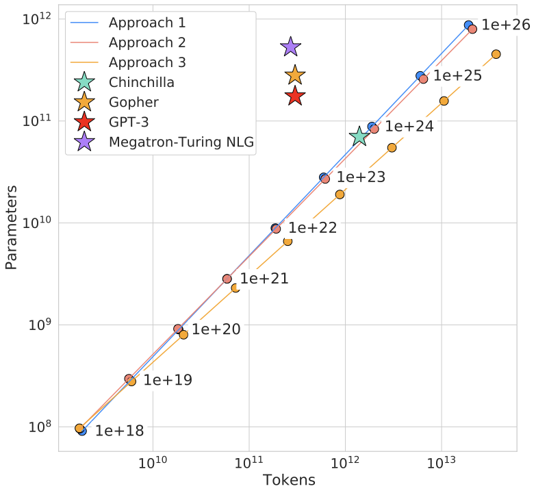

# Scaling Law 与训练经济学

大模型研究早已不是纯学术“试试看”。一次训练可能消耗大量 GPU 小时、标注预算、工程人力和评测时间。于是一个更现实的问题出现了：什么样的实验值得做，什么时候应该扩大模型，什么时候应该增加数据，什么时候该把钱花在推理优化或数据治理上？Scaling law 与实验经济学，正是帮助团队回答这些问题的框架。

## Scaling law 在回答什么

最朴素的 scaling law 试图描述损失或某项性能指标如何随参数量 $N$、数据量 $D$、计算量 $C$ 变化。常见形式如：

$$
L(N,D) \approx A N^{-\alpha} + B D^{-\beta} + L_\infty.
$$

虽然真实系统远比这个复杂，但它提供了一个核心启发：收益通常是递减的，而且不同资源维度的边际收益不一样。

Chinchilla 原论文的 IsoFLOP 图非常适合放在这里：它不是只画“模型越大越好”，而是在固定训练 FLOP 预算下，比较不同参数量和训练 token 数的组合，寻找 loss 的谷底。

{ width="920" }

<small>图源：[Training Compute-Optimal Large Language Models](https://arxiv.org/abs/2203.15556)，Figure 4。原论文图意：固定 FLOP 预算时，不同模型大小会对应不同最终 loss；曲线谷底给出该预算下更合适的参数量，并外推出参数和 token 的 scaling 关系。</small>

**为什么 scaling law 不是“大模型崇拜”。**
左图的每条 IsoFLOP 曲线都有一个谷底：模型太小会欠容量，模型太大则在同样 FLOP 下拿不到足够 token，最终也不划算。中间和右图把这些谷底外推出最优参数量和最优训练 token 数。直觉上，扩规模不是单独把 \(N\) 放大，而是要同时问 \(D\) 是否跟得上。

## 为什么实验经济学重要

在资源有限时，每个实验都不是纯学术探索，而是投资决策。若实验成本为 $K$，预期收益为 $G$，失败概率为 $p_f$，则可粗略想成：

$$
\mathbb{E}[\text{value}] = (1-p_f)G - K.
$$

当然真实收益难以量化，但这个框架提醒我们：高成本、低可解释、低复用的实验，不一定值得优先做。

## 参数扩张何时值得

扩大模型常有收益，但代价也会同时上升：训练成本、推理成本、部署复杂度和调参时间都会被放大。

若当前瓶颈主要来自数据脏噪、评测盲区或推理链路过长，盲目加参数往往不是最划算的投资。

## 数据扩张何时值得

增加数据量的收益取决于新数据是否带来新信息，是否只是重复主流分布，清洗和治理成本是否可接受，以及它更适合用于预训练还是专项微调。

对很多垂直系统而言，少量高质量长尾数据可能比海量近重复通用数据更有价值。

## 训练 token 与有效 token

总 token 数并不等于有效学习量。若重复率高、噪声大，则有效 token 数可能远低于表面规模。可用概念性量

$$
D_{\text{eff}} = D (1-\rho_{\text{dup}})(1-\rho_{\text{noise}})
$$

**去提醒团队**：堆更多数据之前，先问这些 token 是否真的新、真的有用。

## 过训练与欠训练

在给定模型规模下，训练 token 过少会欠训练，过多又会带来边际收益下降。所谓 compute-optimal 配置，就是在参数、数据和训练步数之间找到较优平衡。现实中，这种平衡还必须考虑墙钟时间、中断风险、checkpoint 成本和实验并发需求。

{ width="620" }

<small>图源：[Training Compute-Optimal Large Language Models](https://arxiv.org/abs/2203.15556)，Figure 15。原论文图意：在固定训练 FLOP 预算下，三种估计方法给出相近的最优 token 数和参数量关系。</small>

**欠训练常常藏在“模型够大”背后。**
这张图把最优 token 数和最优参数量放在同一张坐标里。它提醒你：模型规模、训练 token 和计算预算是三角关系。只报告参数量而不报告训练 token，很难判断模型是能力不足、训练不足，还是数据/优化系统没有把预算用好。

## 研究节奏的经济学

一个高成本全量实验能回答更多问题，但迭代慢；多个小规模实验迭代快，但外推风险大。成熟团队通常先用小规模快速验证假设，再用中规模验证可扩展性，最后用少量全量训练做确认。

这是一种实验投资组合，而不是单一实验哲学。

## 结果外推的风险

很多方法在小模型上有效，在大模型上未必成立；反之亦然。缩放外推必须小心：优化稳定区间会变，数据混合比例可能变化，推理成本会改变方法价值排序，某些正则在小模型有益、大模型反而多余。

因此实验经济学不仅关心“要不要放大”，还关心“放大后结论是否仍然成立”。

## 推理成本要提前计入

若一个训练方案让离线指标提升 2%，但推理成本翻倍，业务上可能并不划算。可把总拥有成本近似写为

$$
\text{TCO}
=
\text{Training Cost}
+ \text{Serving Cost}
+ \text{Maintenance Cost}.
$$

一些方法训练时略贵，但能大幅降低推理成本；另一些方法正好相反。研究决策应基于全周期成本，而不是只看训练阶段。

## 实验并发与机会成本

**研究团队经常低估机会成本**：把整套资源押在一个大实验上，意味着你失去了同时验证多个假设的机会。尤其在问题不确定、方法很多的早期阶段，高并发小实验常比单次豪赌更合理。

## 例子：扩散蒸馏路线选择

若目标是把扩散采样从 20 步压到 4 步，可以训练更大教师再蒸馏，也可以试一致性模型、优化求解器或改用分布匹配蒸馏。实验经济学要求先估计哪条路线训练成本最低、哪条最可能影响线上时延、哪条最容易集成进现有服务，以及哪条失败后仍能复用中间资产。

## 例子：VLA 数据投资

团队想提升机器人恢复能力，可以扩大模型、采集更多成功示范、专门采失败恢复数据，也可以改评测和恢复机制。

若真实瓶颈在失败分布稀缺，那么第 3 和第 4 项的回报往往高于第 1 项。Scaling law 在这里提醒你：不是所有能力都靠加模型得到。

## 何时该停止一个方向

实验经济学也关心止损。若连续几轮实验显示提升幅度持续小于噪声、成本增幅远高于收益、长尾问题不降反升，或与系统约束明显不兼容，就应考虑收缩或终止，而不是被沉没成本驱动继续投入。

## 设计建议

记录每个实验的真实成本，而不是只记结果；对大实验先做小规模代理验证；用长期价值视角比较模型扩张、数据治理、量化和系统优化；不要忽视推理与运维成本在方法选择中的权重；并为高成本方向建立明确的进入条件与止损条件。

## 读完以后怎么判断

Scaling law 给出的是“资源与效果的大致地形图”，实验经济学决定的是“你要如何在这张地形图上行军”。对现代大模型团队而言，研究不再只是提出更好的方法，也包括更聪明地配置算力、数据、人力和时间。真正成熟的团队，往往不是做了最多实验，而是用最合理的实验组合学到了最多东西。

## 工程收束

Scaling law 要和实验经济学一起读：token 预算、模型规模、数据质量、长上下文成本和实验复用率都应进入同一张账本。做大实验前先明确能力目标、GPU 小时、token 预算、吞吐下降和恢复复杂度，再设置阶段预算门槛、短跑一致性测试、失败案例和回滚条件。

## 相关阅读与下一步

- 外部材料：[PyTorch Distributed 文档](https://pytorch.org/docs/stable/distributed.html)。
- 外部材料：[DeepSpeed ZeRO 教程](https://www.deepspeed.ai/tutorials/zero/)。
- 外部材料：[Weights & Biases 文档](https://docs.wandb.ai/)。
- 站内下一步：[训练系统专题](index.md)。
- 站内下一步：[分布式训练与 Checkpoint](distributed-training-and-checkpointing.md)。
- 站内下一步：[评测与 Ablation 方法论](evaluation-and-ablation-methodology.md)。
