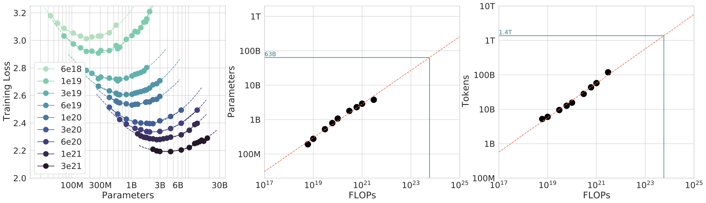
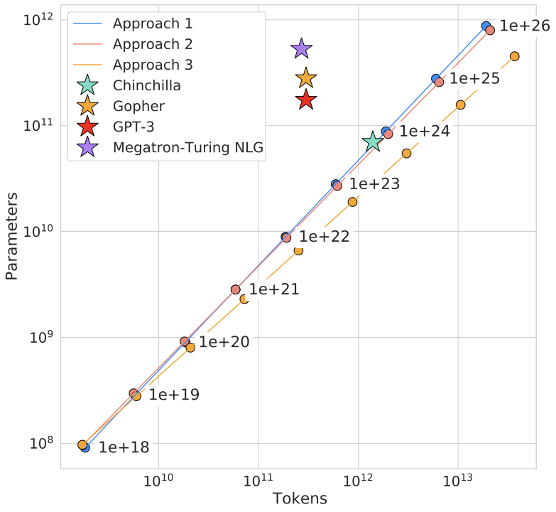

# 固定训练预算下，参数和token怎样交换

给定训练计算量，更大模型通常意味着能训练更少token。Scaling law从一组实际实验拟合这种交换关系，帮助决定下一次规模。它描述的是某个数据、架构和优化范围内的趋势，不能直接预测所有下游能力。

## 先写出可检验的拟合假设

一种常见近似为

$$
L(N,D)=A N^{-\alpha}+B D^{-\beta}+L_\infty,
$$

N为参数量，D为训练token曝光，A/B和指数由实验拟合。$L_\infty$表示该模型下的渐近项。这个式子将有限模型与有限数据的影响分开，但真实数据混合、训练不足和架构变化可能破坏假设。

[Chinchilla](https://arxiv.org/abs/2203.15556)的IsoFLOP实验在固定计算量下比较多个模型/token组合，观察损失谷底。曲线提供的是原设置下的证据，不能把某个参数/token比例永久当成所有模型的规则。

{ width="920" }

<small>图源：[Training Compute-Optimal Large Language Models](https://arxiv.org/abs/2203.15556)，Figure 4。原论文图意：固定 FLOP 预算时，不同模型大小会对应不同最终 loss；曲线谷底给出该预算下更合适的参数量，并外推出参数和 token 的 scaling 关系。</small>

## 在约束下推一次最优点

对稠密自回归模型，忽略额外attention、重计算等成本，使用 $C\approx6ND$。令 $D=C/(6N)$，代入损失后对N求导，最优点满足

$$
\alpha A N^{-\alpha}=\beta B D^{-\beta}.
$$

由此得到量级关系

$$
N_*\propto C^{\beta/(\alpha+\beta)},\qquad
D_*\propto C^{\alpha/(\alpha+\beta)}.
$$

若两个指数相等，参数与token随预算按相同幂次增长。这个结论依赖拟合式和计算约束，没有假定所有实际模型指数相同。

{ width="620" }

<small>图源：[Training Compute-Optimal Large Language Models](https://arxiv.org/abs/2203.15556)，Figure 15。原论文图意：在固定训练 FLOP 预算下，三种估计方法给出相近的最优 token 数和参数量关系。</small>

## 计算token预算时不要偷偷扣掉重复

D统计实际进入训练计算的token曝光。重复文本即使信息增量有限，也会消耗计算并贡献梯度。不能用 $D(1-重复率)(1-噪声率)$ 伪造一个通用“有效token数”，再直接代入原拟合。

数据质量变化可以单独建模或重新拟合，并用真实实验验证。独立样本规模、曝光次数和任务覆盖应分别记录。

## 拟合之前先看实验是否可比较

固定tokenizer、损失口径、数据分布、训练日程和评测集，覆盖多个N/D组合。只沿“模型越大、训练越久”一条对角线收集点，难以区分两项贡献。

保留未参与拟合的规模或预算做预测检验，观察残差与外推误差。若小模型未充分优化、某组学习率不合适，曲线可能反映训练配置缺陷而非架构容量。

## 训练最优与总成本最优可以不同

更小模型若训练更久，训练成本可能增加，但部署时每次请求更便宜。假设额外训练成本为K，每请求节省c，且质量与服务目标不变，则至少约K/c次请求才能抵回投入。

这个式子还没包含研发时间、失败实验和系统迁移。预测请求量不确定时，应展示不同场景，不把单点预算写成保证回本。

使用scaling结论时，明确它预测的是heldout loss、当前任务质量还是总成本。前者改善以后，仍需独立验证工具、长上下文或控制等具体能力。

## 对照源码与延伸阅读

- [模型规模、token曝光与实际训练循环的连接](https://github.com/karpathy/nanoGPT/blob/3adf61e154c3fe3fca428ad6bc3818b27a3b8291/train.py)
