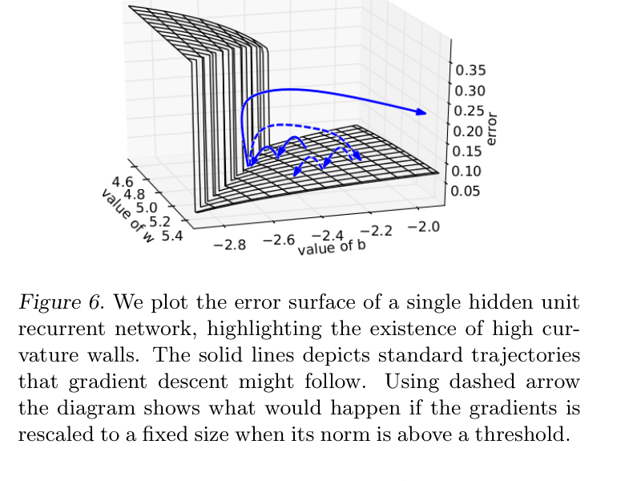

# 训练出现NaN时，怎样找到第一个坏值

Loss变成NaN通常已是传播结果。输入、某层输出、loss、梯度或优化器状态中，任何一项先出现非有限值，都可能继续污染后续计算。最有用的证据是触发batch和更新前状态。

## 先用同一个batch重放

保存可复现的输入、mask、随机状态和更新前checkpoint，检查是否在相同位置复现。若每次从新随机batch开始，故障可能暂时消失，却无法判断修复是否有效。

先检查token ID是否越界、有效目标是否为零、输入和参数是否有限。全mask样本若导致以0为分母，问题发生在目标定义，不应靠降低学习率掩盖。

## 一个softmax溢出的完整路径

对logits `[1000,1001]`直接计算指数，会超出常用浮点范围。稳定softmax先减最大值，得到 `[-1,0]`，指数约 `[0.3679,1]`，概率约 `[0.2689,0.7311]`。

```python
import math
z = [1000.0, 1001.0]
e = [math.exp(x - max(z)) for x in z]
print([x / sum(e) for x in e])
```

如果这一层已经产生NaN，后面加loss scaling不能恢复。应先修前向计算或检查输入为什么超出预期范围。

## 沿执行顺序缩小范围

比较各层输入输出，找首个由有限变为非有限的操作；若前向正常，再看loss与backward；若梯度正常但step后权重异常，检查优化器状态、学习率与更新实现。

分布式运行中，一张卡的坏梯度可能通过all-reduce传给全部rank。应记录同步前的局部状态，否则所有卡同时报错会掩盖源头。同步等待也可能只是某rank提前失败，不能自动归因到网络。

<!-- systems-workflow-visual -->


从左到右找最早异常，避免把最后传播到loss的NaN当成发生位置。

## 梯度裁剪可以限制更新信号，但不证明根因消失

全局范数裁剪将g乘以 $\min(1,c/\|g\|)$。例如g=[3,4]、阈值c=2，范数5，裁剪后为[1.2,1.6]。它保留方向并减小幅度。

若g已含NaN，范数计算也可能无效。若异常来自错误数据或损失分母，长期裁剪只是改变其后果。混合精度时先unscale，再按实际梯度裁剪。



<small>图源：[Pascanu et al., On the difficulty of training recurrent neural networks](https://proceedings.mlr.press/v28/pascanu13.html)。原图表达参数空间里的 cliff 会让梯度突然变大；读图重点是把 loss spike、`nan/inf` 和 grad norm 异常先当作可定位的数值现象，而不是直接归因于“模型太大”。它不能覆盖所有 Transformer 训练事故，只提供理解梯度爆炸和 clipping 的直觉入口。</small>

## 恢复后跳变先检查状态完整性

相同权重配上不同Adam矩、学习率计数、RNG或数据位置，会走出不同轨迹。用一个短实验对比连续运行与中断恢复后的几步，在相同容差下检查loss、更新与输入顺序。

如果运行本来含非确定性算子，逐bit相同未必是合理要求，但差异范围应可解释。修复完成的证据是触发输入与相关短程回放通过，而非长作业暂时没再报错。


## 继续读

继续看[低 bit 训练与数值](low-bit-training-and-numerics.md)和[profiling、调试与数值稳定性](../operators/profiling-debugging-and-numerical-stability.md)。

## 对照源码与延伸阅读

- [AMP、clip、step与checkpoint的真实顺序](https://github.com/karpathy/nanoGPT/blob/3adf61e154c3fe3fca428ad6bc3818b27a3b8291/train.py)
- [稳定softmax减最大值的实现](https://github.com/triton-lang/triton/blob/cd2e01c6686d6503802e6cdfac56d5a5dfdb27a1/python/tutorials/02-fused-softmax.py)

## 把首个坏值分成四类

定位时先把异常归到发生位置，而不是先选一个“常见修复”：

| 首个异常位置 | 常见原因 | 第一项证据 |
| --- | --- | --- |
| 输入/embedding | 越界 token、空目标、错误归一化 | batch、mask、dtype、范围 |
| 中间激活 | softmax/exp 溢出、归一化方差过小、错误 mask | 层输入输出 finite 检查 |
| loss | 分母为零、log(0)、标签越界 | loss numerator/denominator |
| 梯度/优化器 | overflow、学习率突变、错误状态恢复 | unscale 后 grad norm、optimizer state |

同一训练事故可能同时触发多个现象，但只要能找到第一个从 finite 变成 non-finite 的位置，排查空间就会缩小。

## AMP 的操作顺序不能交换

混合精度训练通常需要先 scale loss，反向后再 unscale 梯度，然后裁剪、检查 finite，最后执行 step：

```python
scaler.scale(loss).backward()
scaler.unscale_(optimizer)
torch.nn.utils.clip_grad_norm_(model.parameters(), max_norm)
scaler.step(optimizer)
scaler.update()
```

如果在 `unscale_` 前裁剪，裁剪阈值作用在放大的梯度上；如果梯度已经是 NaN，裁剪也不会修复它。若某个 rank overflow，应让所有 rank 遵守同一更新/跳过决定，否则参数步数会分叉。

## 二分定位比全量打印更可行

在大模型中逐层打印完整 tensor 会改变性能和日志量。可以先在模块边界记录：输入/输出的 min、max、mean、norm、finite 比例和 shape；发现异常后对该区间二分打开更细粒度 hook。记录应包含 batch ID、global step 和更新前 checkpoint。

一个最小的 hook 记录：

```python
def stats(name, x):
    x = x.detach()
    return {
        "name": name,
        "shape": list(x.shape),
        "finite": bool(torch.isfinite(x).all()),
        "abs_max": float(x.abs().max()),
        "norm": float(x.float().norm()),
    }
```

统计本身也可能溢出，所以 `norm` 可转到 FP32，且对空 tensor、稀疏值和极大值做明确处理。日志应采样保存，不要因为诊断把训练 I/O 变成新的瓶颈。

## 修复后要做最小回放矩阵

| 回放 | 目的 |
| --- | --- |
| 同一坏 batch + 更新前状态 | 验证首个坏值不再出现 |
| 相邻 batch | 检查是否只修复了单个样本 |
| 相同配置不同 seed | 检查修复是否依赖随机偶然性 |
| AMP 与 BF16/FP32 对照 | 确认精度路径而非数据问题 |
| 恢复后短跑 | 检查 scaler、optimizer、RNG 是否完整 |

学习率降低、梯度裁剪或跳过坏 batch 可能让曲线暂时稳定，但它们不自动证明数据、mask 或目标定义正确。报告修复时同时写出“首个坏值的位置”和“修复后通过的回放”。

## 来源与改编说明

- [PyTorch Automatic Mixed Precision 文档](https://pytorch.org/docs/stable/amp.html)用于核对 autocast、GradScaler、unscale 和 step 的顺序。
- [Triton fused softmax 教程](https://github.com/triton-lang/triton/blob/cd2e01c6686d6503802e6cdfac56d5a5dfdb27a1/python/tutorials/02-fused-softmax.py)用于说明减最大值的稳定 softmax 路径。
- [Pascanu et al.](https://proceedings.mlr.press/v28/pascanu13.html)提供梯度爆炸与 clipping 的理论直觉；它不覆盖所有现代 Transformer 数值故障。

## 自测

1. 为什么在 `unscale_` 前做梯度裁剪可能改变阈值语义？
2. loss 是 NaN 时，如何区分分母为零与前向激活先溢出？
3. 分布式训练只有一个 rank 首先出现 NaN 时，为什么不能只看 all-reduce 之后的梯度？
4. 设计一条最小回放矩阵，证明某个修复不是“暂时没有再次报错”。
