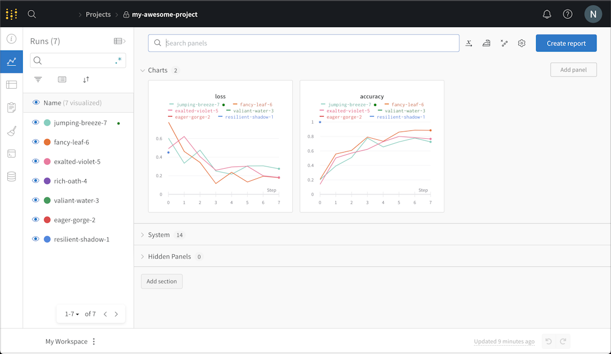

# 用 W&B 记录一次可解释的参数更新

实验平台能保存配置、曲线和产物关联，训练循环仍需自己定义每个数是什么意思。先用两条数据做五次更新，再把本地日志接到W&B，便能看清step、loss分母与恢复状态。

## 先生成不依赖平台的记录

设输入 `[1,2]`、目标 `[2,4]`，预测为wx，初始w=1，loss为两条平方误差的一半再平均。下面仅需Python标准库。

```python
xs, ys = [1.0, 2.0], [2.0, 4.0]
w, lr = 1.0, 0.1
records = []
for update in range(5):
    errors = [w * x - y for x, y in zip(xs, ys)]
    loss = sum(e * e for e in errors) / (2 * len(xs))
    grad = sum(e * x for e, x in zip(errors, xs)) / len(xs)
    records.append({'update': update, 'loss/before': loss,
                    'parameter/before': w, 'gradient': grad})
    w -= lr * grad
print(records[0], w)
```

第一条应为loss=1.25、w=1、gradient=-2.5；第一次更新后w=1.25，五次后约1.762695。`before`说明loss和参数都来自更新前状态，避免把两个时刻拼成一条日志。

## 再把同一记录送进run

已有W&B SDK时，可以用offline模式记录这组数据，不需要本例上传。以下是接在前一段之后的示例接口，需按已安装SDK验证。

```python
import wandb
with wandb.init(project='training-example', mode='offline',
                config={'lr': lr, 'updates': 5, 'data_version': 'two_points_v1'}) as run:
    for row in records:
        run.log({k: v for k, v in row.items() if k != 'update'}, step=row['update'])
    run.summary['parameter/final'] = w
```

配置记录实验条件，逐step日志记录过程，summary记录最终摘要。平台不负责替这段代码定义loss，也不会自动保存optimizer或sampler状态。官方入口见[W&B文档](https://docs.wandb.ai/)。

{ width="860" }

<small>图源：[W&B Quickstart](https://docs.wandb.ai/models/quickstart)。官方示例记录 simulated accuracy/loss，进入 W&B 后可以看到每个 run 的曲线和 runs 列表。</small>

## 多卡曲线必须先统一分子和分母

若rank0的loss总和2、有效token2，rank1总和18、token6，全局token平均为20/8=2.5。平均两个局部均值会得到2，表示另一个量。

所有rank参与必要统计规约，通常只由rank0写主run。Collective不能只由rank0单独调用，否则可能等待其他rank。梯度累积多个microbatch才更新一次时，主横轴可用optimizer update，另外记录消费token与样本量。

## Artifact关联不等于训练快照完整

可以把checkpoint与数据版本作为输入输出记录，但完整续训内容仍由训练框架产生。仅记录一个可变文件路径，无法保证未来读到相同字节；应保存固定版本或校验标识。

恢复日志与恢复训练是不同协议。模型从step400恢复，日志却已到419时，需要按SDK规则处理重叠step，或建立记录父运行与checkpoint的新run。仪表盘看起来连续，不能证明输入与优化器状态连续。

## 用记录回答一个具体比较

比较学习率时固定数据、初始权重和预算；比较吞吐时记录有效token、设备与等待时间；比较质量时保留同一评测输入的逐样本结果。工具提供的是可检索的证据载体，结论仍来自这些条件是否可比。


## 对照源码与延伸阅读

- [实际W&B记录位置与训练状态边界](https://github.com/karpathy/nanoGPT/blob/3adf61e154c3fe3fca428ad6bc3818b27a3b8291/train.py)
