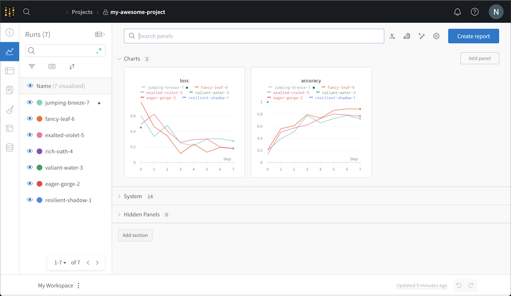

# W&B：训练实验追踪与证据链治理

Weights & Biases，常写作 W&B，不是训练框架本身，而是把训练过程里的**配置、指标、系统状态、数据版本、模型产物、报告和协作记录**组织起来的实验平台。官方站点把它称为 AI developer platform，并把 Experiments、Reports、Artifacts、Tables、Sweeps、Models Registry、Launch、Prompts 和 Monitoring 放在产品入口里。[W&B Experiments 文档](https://docs.wandb.ai/models/track)强调的是用少量代码记录 metrics、hyperparameters、system metrics 和 model artifacts；[Artifacts 文档](https://docs.wandb.ai/models/artifacts)则强调把数据和模型作为 run 的输入/输出进行版本追踪。

## 先看它长什么样

W&B 最常见的第一印象是一张项目面板：左侧是 runs，右侧是随 step 变化的 loss、accuracy 或吞吐曲线。真正有用的是这些曲线不是孤立图片，而是绑定了 config、代码版本、artifact、系统指标和评测结果。

{ width="860" }

<small>图源：[W&B Quickstart](https://docs.wandb.ai/models/quickstart)。官方示例记录 simulated accuracy/loss，进入 W&B 后可以看到每个 run 的曲线和 runs 列表。</small>

## 5 分钟跑通

先安装并登录：

下面代码块优先看 shape、缓存、状态更新或资源申请相关行；这些行通常决定故障是语义、并发还是容量问题。
```bash
pip install wandb
wandb login
```

新建 `wandb_demo.py`：

```python
import random
import wandb

config = {
    "epochs": 10,
    "lr": 0.01,
    "batch_size": 32,
}

with wandb.init(project="quickstart-demo", config=config) as run:
    for epoch in range(config["epochs"]):
        loss = 1.0 / (epoch + 1) + random.random() * 0.05
        acc = 1.0 - loss * 0.4
        run.log({"train/loss": loss, "eval/accuracy": acc}, step=epoch)
```

运行：

```bash
python wandb_demo.py
```

终端会打印 project/run 的 URL。打开后你会看到 loss 和 accuracy 曲线，左侧 runs 表里会有这次 run 的名字、配置和 summary。到这一步，W&B 已经能回答最基本的问题：这次实验是什么配置，跑出了什么曲线，结果在哪里看。

## 为什么训练板块需要 W&B

大模型训练里最常见的误判不是“完全没有日志”，而是日志各自存在但无法合并：

| 现象 | 常见后果 |
| --- | --- |
| loss 在 TensorBoard，配置在 YAML，数据版本在表格，checkpoint 在对象存储 | 实验变好时无法归因 |
| 只记最终分数，不记系统指标 | 训练变慢被误判为模型变差 |
| 只保存 checkpoint，不保存数据 artifact 和代码版本 | 复现时不知道模型吃过哪些数据 |
| sweep 跑了几十组，但没有统一报告 | 研究结论靠肉眼挑曲线 |
| 评测样本没有表格化 | 不知道新模型到底修好了哪类失败 |

W&B 适合补的是“实验治理层”：它不替代 Megatron、DeepSpeed、PyTorch、Slurm 或 Kubernetes，而是记录这些系统产生的证据。

## 一次训练实验应被定义成什么

可以把一次训练 run 记成：

\[
E =
(\text{code},\text{config},\mathcal{D},\theta_0,\text{env},\text{metrics},\text{artifacts},\text{eval})
\]

其中：

- `code`：git commit、镜像、依赖版本；
- `config`：模型结构、batch、LR、并行策略、数据 mixture；
- \(\mathcal{D}\)：训练、验证、评测数据 artifact 版本；
- \(\theta_0\)：初始化权重或恢复 checkpoint；
- `env`：GPU、CUDA、NCCL、节点拓扑、运行时；
- `metrics`：loss、grad norm、吞吐、显存、loader stall、评测分；
- `artifacts`：checkpoint、tokenizer、数据快照、生成样本；
- `eval`：离线评测、分桶结果、人工或 judge 结论。

两个实验能不能公平比较，取决于除“被测试变量”以外的关键维度是否一致。W&B 的 run、config、artifact lineage 和 report 正是用来回答这个问题。

## 核心组件怎么放进训练流程

| W&B 组件 | 在训练系统里的位置 | 主要判断 |
| --- | --- | --- |
| Experiments / Runs | 每次训练、评测、数据处理任务 | 这次运行的配置、指标、系统状态是什么 |
| Artifacts | 数据集、checkpoint、模型、评测输出 | 这个结果用了哪个输入，产出了哪个版本 |
| Tables | 样本级预测、错误案例、分桶评测 | 哪些样本变好，哪些样本退化 |
| Sweeps | 超参搜索、配方搜索、消融组合 | 哪个参数真的影响指标 |
| Reports | 实验结论和协作复盘 | 为什么继续、停止或回滚 |
| Registry | 可共享和可发布的模型/数据版本 | 哪个版本能进入下游训练或部署 |

官方文档里，W&B Sweeps 支持 Bayesian、grid search、random 等搜索方式，并可跨一台或多台机器并行；Tables 用于可视化、查询表格数据和查看样本级预测；Registry 用于在组织内管理 artifact versions、权限、血缘和审计记录。

## 接到大模型训练里怎么写

下面示例把一次世界模型训练的关键证据挂到同一个 run 下：

```python
import wandb

cfg = {
    "model": "video-world-model-1b",
    "context_frames": 16,
    "batch_size": 64,
    "lr": 2e-4,
    "data_mix": "robot_real_0.4+sim_0.4+web_video_0.2",
}

with wandb.init(project="world-model-training", config=cfg) as run:
    dataset = run.use_artifact("robot-rollouts:v12")
    dataset_dir = dataset.download()

    for step, batch in enumerate(loader(dataset_dir)):
        loss, metrics = train_step(batch)
        run.log({
            "loss/train": loss,
            "throughput/tokens_per_s": metrics["tokens_per_s"],
            "system/loader_stall": metrics["loader_stall"],
            "optim/grad_norm": metrics["grad_norm"],
        }, step=step)

    ckpt = wandb.Artifact("wm-1b-step-50000", type="model")
    ckpt.add_file("checkpoints/step_50000.pt")
    run.log_artifact(ckpt)
```

这段代码的重点不是“多画一条 loss 曲线”，而是把数据版本、配置、指标和 checkpoint 绑定在一起。之后任何人看到 `wm-1b-step-50000`，都能沿 artifact lineage 找回它来自哪个数据版本和哪个训练 run。

## 常用功能速查

| 想做什么 | 最小写法 | 什么时候用 |
| --- | --- | --- |
| 记录指标 | `run.log({"loss": loss}, step=step)` | 训练 loss、吞吐、显存、评测分 |
| 记录配置 | `wandb.init(config=cfg)` | 比较 LR、batch、数据配比、并行参数 |
| 记录模型 | `wandb.Artifact(..., type="model")` | 保存 checkpoint、tokenizer、导出模型 |
| 记录数据版本 | `run.use_artifact("dataset:v12")` | 证明模型到底吃了哪个数据版本 |
| 记录样本表 | `wandb.Table(...)` | 看 prompt、prediction、score、failure_reason |
| 超参搜索 | `wandb sweep sweep.yaml` | 小规模配方搜索和系统性消融 |
| 写实验报告 | W&B Reports | 让结论、曲线、反例和下一步在同一页 |

## 一个排查案例

```text
症状：新一轮 VLA 后训练评测平均分 +2.1，但真机长任务成功率没有提升
指标：offline success +2.1，tool-use bucket +5.8，long-horizon bucket -3.4
W&B 观察：Tables 里新增失败集中在 12 step 以上任务；Artifacts 显示这轮数据 mix 增加了短指令 correction 数据
判断：平均分被短任务拉高，长程任务因为数据分布稀释而退化
修复：把 long-horizon bucket 设为主指标之一；新增 episode_length、recovery_success、human_takeover_reason 列；下一轮 sweep 固定短任务比例
反例：如果 Tables 中长任务样本本身没退化，而系统指标显示 rollout queue 延迟上升，则应先排查评测基础设施
```

这里 W&B 支撑的是“结论证据链”：不是看到平均分上涨就继续训练，而是能定位哪个分桶、哪个数据 artifact、哪个配置改动导致了变化。

## 训练治理里的最佳实践

1. `config` 必须记录运行时实际生效配置，而不是只记录默认 YAML。
2. 数据、checkpoint、评测输出都应作为 artifact，而不是散落在对象存储路径里。
3. 每次恢复 checkpoint 都应记录祖先、恢复 step、数据游标和 RNG 状态。
4. 训练曲线要和系统指标一起看：loss、token/s、GPU util、loader stall、checkpoint pause、network retry。
5. 评测结果要用 Tables 做样本级记录，至少保留 prompt、bucket、prediction、reference、score、failure_reason。
6. Sweep 要先写清楚主指标和停止条件，否则容易把搜索变成昂贵的随机试错。
7. Report 应记录结论、反例和下一步，而不是只贴最佳曲线。

## 和 Rerun 的边界

W&B 和 Rerun 可以互补，但不要混用职责：

| 场景 | 更适合 |
| --- | --- |
| 训练 loss、吞吐、系统指标、超参对比 | W&B |
| 数据集、checkpoint、模型版本、评测输出 lineage | W&B |
| 机器人 episode 的 RGB/depth/point cloud/坐标系/动作回放 | Rerun |
| 真机失败时看抓取候选、外参、点云和末端执行器位置 | Rerun |
| 把失败样本分桶后回流到下一轮训练并比较结果 | Rerun + W&B |

一个实用组合是：Rerun 负责“看清一个 episode 为什么失败”，W&B 负责“证明一批失败回流后整体指标有没有变好”。

## 什么时候不值得上重平台

不一定需要 W&B：

1. 单人短实验，只需要本地 loss 曲线；
2. 实验不涉及数据版本、checkpoint 复用或团队协作；
3. 组织已有等价内部实验平台；
4. 安全或合规要求不允许外部服务，且没有自托管方案。

值得尽早接入：

1. 多人共享 GPU 集群和数据管线；
2. 一个模型会经历预训练、SFT、DPO/RL、评测和部署多阶段；
3. 需要比较大量配方或超参；
4. 训练成本高到一次误判就会浪费明显 GPU-hour；
5. 模型、数据和评测结果需要长期复盘。

## 阅读结论

W&B 在训练板块里的位置不是“可视化曲线工具”，而是实验证据链：它把 run、config、metrics、artifacts、tables、sweeps 和 registry 连接起来，让训练结论能被复现、比较、审计和协作复盘。对世界模型、VLA 和多模态训练来说，这往往比单条曲线更重要。

## 参考

1. [Weights & Biases](https://wandb.ai/site)
2. [W&B Experiments](https://docs.wandb.ai/models/track)
3. [W&B Artifacts](https://docs.wandb.ai/models/artifacts)
4. [W&B Sweeps](https://docs.wandb.ai/models/sweeps)
5. [W&B Tables](https://docs.wandb.ai/models/tables)
6. [W&B Registry](https://docs.wandb.ai/models/registry)
