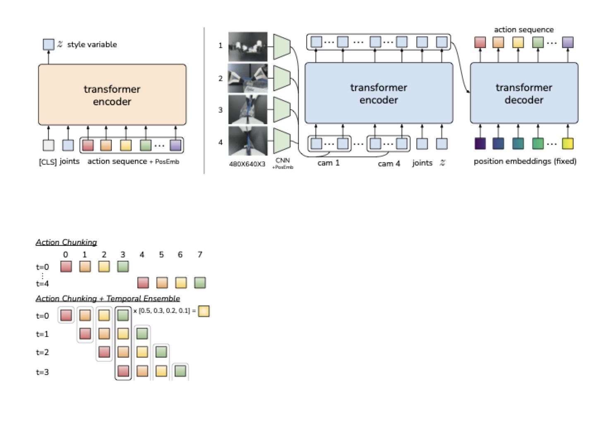
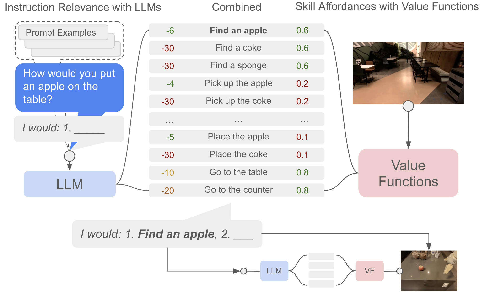

# 动作块、层级策略与潜在技能

一次预测十个动作，与执行十个动作后才重新看环境，是两项不同设计。前者规定模型输出的时间范围，后者决定新证据多久能改变行为。抓取过程中杯子已经偏了，队列却还在执行旧动作，这个场景能直接看出两者为什么必须分开。

## 预测范围和执行范围分别计时

策略根据时刻 \(t\) 的观测生成 \(\hat A_t=(\hat a_t,\ldots,\hat a_{t+H-1})\)。先忽略推理延迟，假设执行前 \(h\le H\) 步后重新观测和规划。若控制周期 50 毫秒、\(H=8,h=4\)，预测覆盖 8 个控制周期，共 0.4 秒，重规划间隔为 0.2 秒。长预测有助于表达一段协调运动，短执行让新观测更早参与决策。

还要考虑推理延迟。假设一次推理耗时 120 毫秒，在 200 毫秒执行窗口内异步准备下一块，理想情况下有 80 毫秒余量；若某次耗时 250 毫秒，队列就可能耗尽。系统必须定义等待、保持、降速还是安全停下，不能静默重放旧动作。

在抓杯场景中，一块动作可以联合描述靠近、闭合与抬升，具体能覆盖到哪一阶段取决于速度和块长。若执行整块后才更新观测，中途杯子被碰偏，后面的目标仍可能指向旧位置。缩短执行前缀能减少这段等待，但也更依赖推理及时完成。

### 把重规划写成一张时间表

继续使用 \(H=8,h=4\)。下面先画一个零推理延迟的理想情况，每个数表示一条动作的目标下发时刻，每条命令维持到下一个控制时刻。

| 观测与生成时刻 | 预测的动作时刻 | 选用的动作时刻 | 当前采用哪一块 |
| ---: | --- | --- | --- |
| 0.00 s | 0.00 至 0.35 s，共 8 条 | 0.00、0.05、0.10、0.15 s | chunk-0 的第 0 至 3 步 |
| 0.20 s | 0.20 至 0.55 s，共 8 条 | 0.20、0.25、0.30、0.35 s | chunk-1 的第 0 至 3 步 |
| 0.40 s | 0.40 至 0.75 s，共 8 条 | 0.40、0.45、0.50、0.55 s | chunk-2 的第 0 至 3 步 |

chunk-0 对 0.20 至 0.35 s 也有预测，只是在这张表中让位给了 chunk-1。同一时刻出现多个候选以后，可以选择新块、延用仍有效的旧块，或融合它们。三种选择对应不同执行规则，不能从“模型输出 action chunk”推导出唯一规则。

现在让 chunk-1 到 0.32 s 才完成。它针对 0.20、0.25、0.30 s 的建议已经过期，不能原样从第 0 步重放。如果动作是带时间戳的绝对关节位置目标，可以在检查状态偏差与运动连续性后，从仍有效的目标交接；如果动作是相对上一目标的增量，直接删掉前三项会改变后续目标，往往需要重新锚定或重新规划。速度命令还涉及持续时间，处理方式也不能照搬位置目标。

这段迟到期间，执行端也得有事先定义的行为。允许继续使用 chunk-0，就要检查它的有效期和状态偏差；不允许继续使用，就要进入规定的保持、降速或停止过程。收到一帧新观测不要求立刻取消所有旧动作，正常异步控制可以在计算新块时继续执行已承诺的前缀。需要检查的是新证据何时有机会改变动作，以及旧块最多还能执行多久。

表中的数字均为教学构造。实际回放要分开保存观测采集、推理完成、目标下发和驱动反馈时间，并给动作块附上序号、坐标系、动作含义及有效区间。这样才能分清新块没算完、算完却没交接、旧块执行超期三种故障。

## 重叠预测怎样融合

{ width="760" }

<small>图源：[Learning Fine-Grained Bimanual Manipulation with Low-Cost Hardware / ACT](https://arxiv.org/abs/2304.13705)，方法图。模型从多视角图像和关节状态预测一段动作，temporal ensembling 再汇合同一执行时刻的重叠预测。</small>

ACT 使用 temporal ensembling 融合多个预测块对同一执行时刻的建议。设对当前时刻的两个位置目标分别为 0.10 和 0.14 米，归一化权重 0.75 和 0.25，则融合目标为 0.11 米。

\[
\tilde a_t=\frac{\sum_iw_i\hat a_t^{(i)}}{\sum_iw_i}.
\]

上标 \(i\) 标记预测来自哪个时刻，不能把来自不同未来时刻的动作直接平均。[ACT 官方评测代码](https://github.com/tonyzhaozh/act/blob/main/imitate_episodes.py)在启用 `temporal_agg` 时每步查询策略，再沿 `all_time_actions[:, t]` 收集当前时刻的预测。其指数权重为 `exp(-0.01 * arange(...))`，保留的预测按生成时刻从旧到新排列，较旧预测的权重更大。这是该实现的具体选择，不能仅凭“新观测应该更重要”的直觉倒置索引，也不能把上面每 4 步重规划的教学表当作这段代码的复刻。

融合也有边界。两个可行绕障路径的均值可能穿过障碍，夹爪开闭的均值可能变成半开，四元数还需要处理归一化和符号等价。因此应只在定义良好的动作空间融合，并在接触事件、紧急停止和任务切换时清理过期预测。

停止命令需要单独测试。发出停止请求、执行端收到请求、驱动确认制动、机器人实际静止，是不同事件，通信和制动延迟都可能让它继续运动。回放应比较这些时间、停止距离和系统允许的范围，同时检查旧队列是否失效、迟到的新块是否被拒绝。不能要求“第 2 步收到信号就一定停在第 2 步”。恢复时应重新读取状态并生成或验证可用计划，避免无条件续播中断前的后半块。

## Chunk 不是自动学到的技能

固定长度动作块只切分时间。它可能横跨接近和抓取，也可能在抓取中途结束。技能则需要明确什么时候能启动、内部如何控制、何时完成或失败。

Options 框架将技能表示为 \(o=(\mathcal I_o,\pi_o,\beta_o)\)，分别对应启动集合、内部策略和终止规则。高层选择技能，技能持续 \(k\) 步后再交还控制，价值更新包含持续时间。

\[
Q(s,o)=\mathbb E\left[\sum_{j=0}^{k-1}\gamma^jr_{t+j}+\gamma^k\max_{o'}Q(s_{t+k},o')\right].
\]

构造例子取 \(\gamma=0.9\)，技能两步奖励为 0、1，结束时未来价值为 2，则回报目标为 \(0+0.9+0.9^2\times2=2.52\)。若忽略 \(k\) 而统一乘一次 \(\gamma\)，就无法正确比较持续时间不同的技能。

“拉开抽屉”的启动条件可以是已定位且接触把手，成功终止条件是开度达到阈值，异常终止条件是阻力超限或接触丢失。语言名字本身不包含这些接口。

{ width="900" }

<small>图源：[Do As I Can, Not As I Say / SayCan](https://say-can.github.io/)，方法图。语言模型给候选技能打任务相关分，价值函数给技能打可执行性分，二者结合选择下一步技能。</small>

SayCan 以语言相关性与技能可执行性共同评分。假设候选 A 的语言分为 0.8、执行分为 0.1，候选 B 为 0.5、0.6，乘积分别为 0.08、0.30，会选择 B。这个教学计算说明可执行性如何改变语言排序；两个未经校准的分数相乘不自动构成严格的成功概率。

## 潜在技能压缩了什么

学习一个 latent \(z\)，由解码器生成动作块 \(A=D_\phi(z,x)\)，可以减少高层搜索维度。训练时常同时约束动作重构与 latent 分布。若原轨迹为 \(H\times d_a\) 标量，latent 维度为 \(d_z\)，不能仅凭 \(d_z\ll Hd_a\) 推断实际运行更快，还要算编码、解码和候选数量。

低重构误差也不代表 latent 可用于规划。若相近 latent 解码成完全不同的接触行为，高层搜索会困难；若 latent 只记住具体场景，换对象后不能复用；若技能持续时间没有标注，高层无法安排下一步。可以固定观测改变 latent，检查动作模式是否稳定，再在不同观测下固定 latent，检查是否保持同一种技能含义。

## 长任务的边界应该能被观察

把整理桌面拆成“定位杯子、抓取、搬运、放置”后，每个边界都应由证据确认。夹爪闭合不等于抓取成功，末端到达托盘不等于物体已稳定放下。阶段机、技能终止和策略记忆应使用同一成功定义。

误差来源不同，改法也不同。块内高频抖动先检查控制周期、预测一致性和融合；接触后仍执行旧块先检查取消机制与反馈延迟；技能切换过早先检查终止标签。不要把所有失败都归结为 chunk 太短或太长。

接口细节见[动作表示](action-representation-and-interfaces.md)，分布训练见[策略学习](data-and-policy-learning.md)，执行取消见[部署](deployment-and-safety.md)。

## 接口和论文依据

action chunk 和 temporal ensembling 参考 [ACT](https://arxiv.org/abs/2304.13705)，层级技能的终止与切换参考 [Options](http://incompleteideas.net/papers/SPS-aij.pdf)，语言分数与可执行性共同筛选技能的例子参考 [SayCan](https://say-can.github.io/)。[FAST](https://arxiv.org/abs/2501.09747)研究动作序列 token 化，与带终止规则的 option 有不同定义。本文的 8 步预测、4 步执行、延迟和中断情形是本站构造的机制例子，未在机器人上实测。ACT 代码行为核对于 2026-11-10，源码链接指向可变的主分支。
