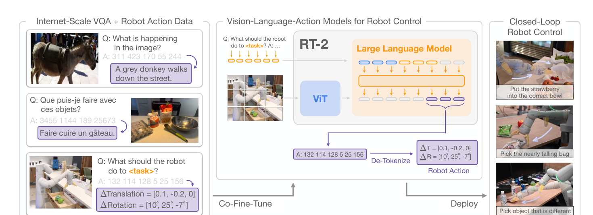
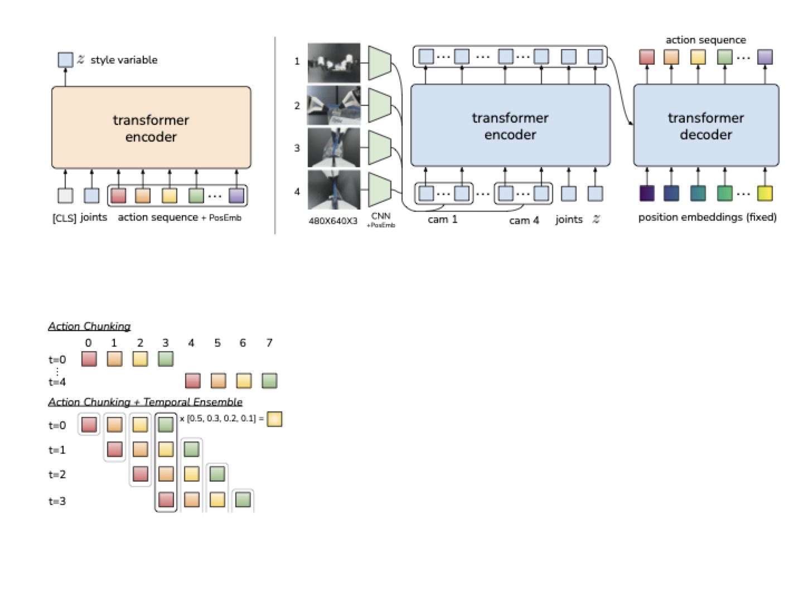
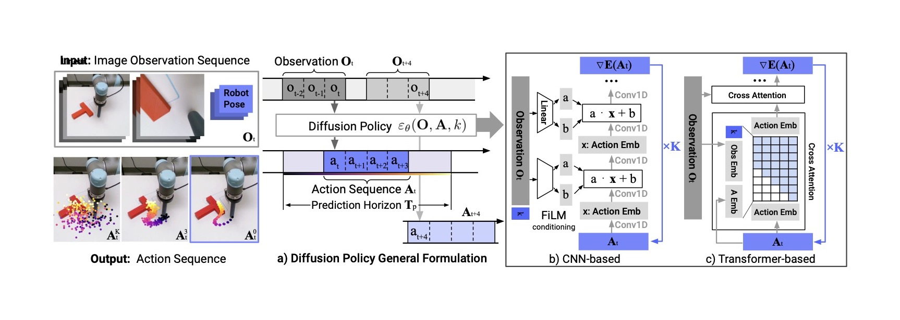

# 动作表示与控制接口

一个七维数组本身不能告诉机器人怎么动。前三项可能是米、毫米、米每秒，也可能是已经归一化的数；同一个正号在相机坐标与末端坐标中可能指向不同方向。动作表示首先是一份能由执行端解释的协议，随后才是模型输出格式。

## 一个七维动作的完整定义

本页使用教学接口 \(a=(\Delta x,\Delta y,\Delta z,\Delta\phi,\Delta\theta,\Delta\psi,g)\)。前三项是末端局部坐标中的位置增量，单位米；中间三项是约定旋转顺序下的小角度增量，单位弧度；\(g\) 表示夹爪目标开口宽度，单位米；动作周期 0.1 秒。此处用 Euler 小角度只是为了展示接口，不能据此替代任意姿态的旋转群运算。

四元数需要四个数，6D 旋转需要六个数，因此把中间三项同时称为 Euler、quaternion 或 6D rotation 是维度错误。选择不同旋转表示，输出张量、归一化和解码器都要一起改变。

若 \(\Delta x=0.01\)，10 Hz 重复这个位移命令对应理想平均速度 0.1 米每秒。未经转换改到 30 Hz，会变成 0.3 米每秒。若字段原本是速度 0.1 米每秒，30 Hz 下每周期对应位移应是约 0.00333 米。动作频率属于数据语义，不能只当运行配置。

## 局部动作和世界动作怎样相乘

设 \({}^{B}T_E\) 把末端坐标转到底座坐标。局部增量右乘，底座坐标表达的空间增量左乘。

\[
{}^BT'_E={}^BT_E\Delta T_E,\qquad
{}^BT'_E=\Delta T_B{}^BT_E.
\]

假设末端绕底座 z 轴旋转了 90 度。末端局部 x 轴的 1 厘米位移，在底座坐标下沿 y 轴；它不会仍沿底座 x 轴。用旋转矩阵计算 \(\Delta p_B=R_{BE}\Delta p_E\)，即可在下发动作前做确定性核对。包含平移和旋转的完整变换应保留乘法顺序，详见[坐标变换](../embodied-ai/coordinate-transforms-and-hand-eye-calibration.md)。

这套坐标约定要同时出现在示范标签和部署解码中。假设示范记录目标在末端局部 x 方向移动 2 厘米，训练标签是 `dx=0.02`。如果当前夹爪相对基座绕 z 轴旋转 90 度，这个局部位移在基座中对应 y 方向的 2 厘米。部署端若把同一个数当成基座 x 位移，数值误差可以为零，实际却朝另一侧走。

所以数据预处理中的坐标转换与执行端的逆转换应形成可核验的闭环。先用固定姿态和一个已知轴向动作计算预期末端变化，再对照控制器回报。旋转字段、单位、增量基准和时间区间都参与这个验证；仅比较 action tensor 的均值或形状无法暴露方向语义错误。

## 离散 action token 的误差能算出来

将一个动作维度限制在 \([a_{\min},a_{\max}]\)，均匀划为 \(K\) 个桶，桶宽为

\[
\delta=\frac{a_{\max}-a_{\min}}K,
\quad u=\operatorname{clip}\left(\left\lfloor\frac{a-a_{\min}}\delta\right\rfloor,0,K-1\right),
\quad\hat a=a_{\min}+(u+\tfrac12)\delta.
\]

在范围内且用桶中心解码，最大量化误差为 \(\delta/2\)。若位移范围是正负 5 厘米、256 桶，桶宽约 0.391 毫米，量化误差上界约 0.195 毫米。越界值被 clip 后不再满足这个界；执行器误差和感知误差也未包括在内。

RT-2 将动作离散后接入语言模型输出；OpenVLA 原论文逐维使用 256 桶，并使用训练数据第 1 到第 99 百分位确定范围。这个统计量必须在训练集上估计，并随模型保存，不能在测试集或在线单个 batch 上重新计算。

{ width="920" }

<small>图源：[RT-2](https://arxiv.org/abs/2307.15818)，Figure 1。原图表达 web-scale VQA / VLM 训练和 robot action token 如何被 co-fine-tune 到同一个 VLA 框架里。这里的重点是：VLA 的关键不是“多模态输入”，而是让动作进入可生成接口，并最终被真实机器人执行。</small>

离散概率可以按维度自回归分解为 \(p(u\mid o,l)=\prod_jp(u_j\mid o,l,u_{<j})\)。这里预测的是桶概率，不能直接把它当连续动作的概率密度。交叉熵也不显式体现相邻桶比远处桶更近，物理误差需要在解码后另算。

## 动作块与连续生成头

动作块 \(A\in\mathbb R^{H\times d_a}\) 一次预测未来 \(H\) 步。它可以由确定性回归、CVAE、扩散或 flow 模型产生；“chunk”描述时间结构，“diffusion”描述生成分布的方法，二者不是互斥选项。

{ width="760" }

<small>图源：[Learning Fine-Grained Bimanual Manipulation with Low-Cost Hardware](https://arxiv.org/abs/2304.13705)，ACT 方法图。原图表达 policy 根据当前观测输出一段 action sequence，并用 temporal ensembling 平滑执行。这里的重点是：action chunk 是短时控制接口，不是完整任务计划。</small>

部署时可以只执行前 \(h\) 步再重观测。预测长度 \(H\) 与执行长度 \(h\) 应分别配置，否则延长预测范围会被误解成必须延长开环执行。

{ width="880" }

<small>图源：[Diffusion Policy](https://diffusion-policy.cs.columbia.edu/)。原图表达 Diffusion Policy 根据视觉观测和机器人状态生成未来动作序列。这里的重点是：连续动作接口可以用生成式模型表达多峰动作分布，并通过 receding horizon 控制落到闭环执行。</small>

连续生成头避免逐维离散，但并不自动满足关节限位、碰撞与夹持约束。它生成的序列仍需按同一坐标、单位和时间协议进入执行端。

## 解码后追到实际执行

一个可复现动作链应保存四份量：模型原始输出、反归一化后的目标、过滤后命令和实际反馈。构造例子中，归一化输出 1.0 经均值 0.01、标准差 0.02 反变换得到 0.03 米；限幅器将其变为 0.01 米；反馈测得 0.008 米。若只保存最初的 1.0，后续无法区分模型、限幅与跟踪误差。

末端目标通常还需逆运动学或轨迹控制。无逆解、多个逆解、关节限位和奇异位形都可能使目标无法按原意执行。安全过滤是可执行性的一部分，但不能把逐维 clip 当成完整避障；空间中的障碍约束通常耦合多个关节。

比较跨机器人数据前，应逐个确认 state 是测量还是指令，动作是绝对量还是增量，旋转表示、夹爪方向、控制周期和坐标版本是否一致。Open X-Embodiment 是异构机器人数据集合，不能假设其中所有原始数据天然使用同一个末端坐标动作协议。

继续看[策略学习](data-and-policy-learning.md)、[分块与技能](action-chunking-hierarchical-policies-and-latent-skills.md)和[机器人 state/action 数据](../embodied-ai/state-action-robot-datasets.md)。原始实现依据见 [RT-2](https://arxiv.org/abs/2307.15818)、[OpenVLA](https://arxiv.org/abs/2406.09246)、[ACT](https://arxiv.org/abs/2304.13705)与 [Diffusion Policy](https://arxiv.org/abs/2303.04137)。[FAST](https://arxiv.org/abs/2501.09747)可进一步了解动作序列压缩；压缩后仍需检验解码误差与接触时序。
