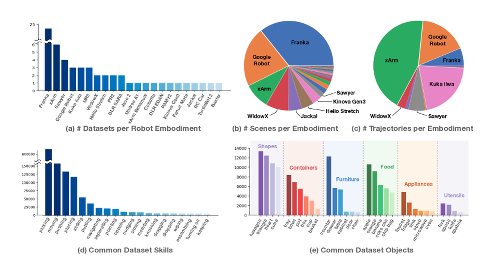

# 从闭环评测到可学习的失败数据

机器人评测中的一个样本通常是一段 episode。它包含任务、初始条件、策略产生的动作后果、终止规则和人工介入。把其中每一帧都当独立成功样本，会夸大证据数量，也会掩盖整段任务的失败。

## 成功定义先于分数

“杯子放进盒子”可以要求杯子中心位于盒内，也可以要求完整物体位于盒内、姿态稳定、夹爪释放且没有碰倒其他物体。不同判定会产生不同成功率。评测前应固定判定器、持续观察时间、超时和重试预算，避免看完结果后改变标准。

构造 100 次任务，70 次首次成功，18 次经恢复成功，12 次失败，其中 8 次需要人工接管。首次成功率是 70%，含恢复成功率 88%，接管率 8%。接管后人完成任务不能记成无辅助机器人成功，应单独记录辅助完成率。

对于连续阶段，链式概率为

\[
P(S_1,\ldots,S_k)=P(S_1)\prod_{i=2}^kP(S_i\mid S_1,\ldots,S_{i-1}).
\]

若五个阶段条件成功率都为 0.9，整段成功率为 \(0.9^5\approx0.5905\)。这不需要独立假设，因为使用的是条件概率；如果手里只有各阶段在不同重置条件下测出的边缘成功率，就不能直接相乘。

## 任务分布决定平均数

假设正常抓取占部署的 90%，遮挡恢复占 10%。模型 A 两类成功率为 0.95、0.30，B 为 0.90、0.70。按部署权重，A 为 0.885，B 为 0.88；按两类宏平均，A 为 0.625，B 为 0.80。两种排序分别回答“当前部署平均完成多少”和“能力类别是否均衡”。报告时应同时给各桶数量和加权方式。

对严重安全事件，不能用大量简单成功抵消。零次事故也不证明零风险。在独立同分布的简化条件下，零事件的 95% 单侧概率上界约为 \(3/n\)；100 次无事故仍可能对应约 3% 的上界。真实任务还可能相关，需要按部署场景解释证据。

## 切分数据时保持来源隔离

同一 episode 的邻帧、同一物体扫描产生的近重复场景、同一家庭的多个轨迹都可能共享信息。按帧随机切分会高估泛化，应按希望测试的变化轴隔离，例如 episode、物体实例、房间或机器人。

{ width="820" }

<small>图源：[Open X-Embodiment / RT-X](https://robotics-transformer-x.github.io/)，数据集总览图。原图展示多机构、多机器人、多任务和多对象数据汇聚。读图重点：跨 embodiment 评测要先核对观测、动作、任务、结果和部署语义是否一致，不能只看数据量或总成功率。</small>

跨机器人集合中的 state/action 不天然同义。关节动作与末端动作、绝对量与速度、夹爪方向和频率都需明确转换。一个模型在新机器人上失败，可能来自接口错配，也可能来自运动学与视觉分布变化；数据量不能区分两者。

## 数据引擎的核心是分流与版本

一次失败进入日志后，先检查原始传感器、时间戳和动作是否完整，再标注原因与可用监督。正确恢复动作进入策略训练；原始失败转移可以进入动力学或风险训练；固定保留的困难场景进入回归集。训练与测试集合必须有不可变来源 ID 和版本，避免一个轨迹改名后同时出现在两边。

可以将下一轮数据写为 \(D_{k+1}=D_k\cup S(F_k)\)，其中 \(S\) 包含去重、质量筛选、标注与分流。它不能只表示“把全部失败拼回去”。若没有正确动作标签，失败视频不会自动告诉行为克隆应该如何恢复。

持续查看同一个 hard set 并据此调参，也会逐步适应该集合。固定回归集用于防退化，另保留未用于设计的新评测集估计泛化；二者的角色应公开区分。

设本轮固定测试中的某个抓取失败被加入后续训练，下一轮模型在它上面成功了。这证明模型适应了这个已见场景，却不能继续把该样本视作独立的泛化证据。可以保留它作为回归用例，检查原错误是否回来，同时使用尚未参与开发的场景评价总体进步。

同样，人工接管后完成的 episode 可以提供恢复数据，但把最终成功全部归到自主策略会抬高分数。训练数据需要标明哪些动作来自模型、哪些来自人工，评测仍按首次成功、预算内最终成功与接管分别计数。数据回流与成绩统计使用同一条事件记录，才能避免一个失败在更新过程中悄悄变成“全自主示范”。

## 从失败桶设计对照实验

若怀疑腕部视角缺失导致抓偏，固定策略训练预算，对比有无腕部输入，分别看无遮挡、遮挡和接触阶段。若怀疑 action chunk 太长，分别改变预测长度与执行前缀，避免同时改变两者无法归因。若怀疑仿真摩擦不准，先用简单受控运动测参数，再评测策略，避免让策略容量替物理建模错误背锅。

同一场景种子和重置条件可以形成成对比较。保存 A 成功 B 失败与 A 失败 B 成功的案例，比两个总分更容易定位变化。实机无法精确复位时应说明随机化与人工重置方法，不把无法重复的条件描述为严格受控。

## 评测层之间不能直接换算

离线 action loss 检查数据拟合，回放检查固定历史下的输出，仿真检查仿真动力学里的闭环，实机检查具体硬件环境。没有已验证的关联模型，不能把仿真提高五个百分点换算成真实系统也提高五个百分点。

原始材料可查 [Open X-Embodiment](https://robotics-transformer-x.github.io/)、[DROID](https://droid-dataset.github.io/)、[BridgeData V2](https://arxiv.org/abs/2308.12952)、[RoboTwin](https://robotwin-platform.github.io/)与 [SimplerEnv](https://simpler-env.github.io/)。机制对应[策略学习](data-and-policy-learning.md)、[闭环恢复](closed-loop-recovery-and-failure-analysis.md)和[Sim2Real](../embodied-ai/sim2real-and-data-engines.md)。

## 从 LeRobotDataset 读懂一条 episode

LeRobot 官方文档把机器人学习过程组织为“遥操作 → 记录 → 训练 → 部署”。这个顺序适合作为入门实验的主线，但每一步都要保留数据契约：

| 层 | 至少要记录 | 常见误读 |
| --- | --- | --- |
| 视频 | 相机名、分辨率、时间戳、帧率、压缩方式 | 以为相邻帧天然同步 |
| state | 关节/末端维度、单位、坐标系、采样频率 | 把 normalized state 当成物理单位 |
| action | 绝对目标、速度、增量或离散技能、控制周期 | 只看数组维度，不看执行语义 |
| episode | 起止、任务、初始条件、终止原因、人工接管 | 把 episode 内每帧当成独立成功 |
| metadata | feature schema、stats、机器人和数据集版本 | 只保存 parquet，不保存 schema 与统计量 |

训练前先用数据可视化器逐帧对照相机、state 和 action。若 `action[t]` 的控制周期是 100 ms，而 state 在 20 ms 采样，模型输入和标签需要先明确重采样或保持方式；不能因为行数相同就认为时间已经对齐。

## 一个可运行的 ACT 起点

LeRobot 文档把 ACT 作为入门策略，原因是模型规模和训练成本相对可控，且输出动作 chunk 适合精细操作。官方命令的结构如下，具体参数、机器人端口和版本应以当前文档为准：

```bash
lerobot-train \
  --dataset.repo_id=${HF_USER}/your_dataset \
  --policy.type=act \
  --output_dir=outputs/train/act_your_dataset \
  --job_name=act_your_dataset \
  --policy.device=cuda \
  --trackio.enable=true \
  --policy.repo_id=${HF_USER}/act_policy
```

这个命令只说明训练入口，不代表数据已经满足任务要求。至少还要检查：

- 训练集和评测集是否按 episode 或场景隔离。
- 相机顺序、state 维度和 action 维度与 policy 配置是否一致。
- normalization stats 是否来自训练集，并在 rollout 时使用同一版本。
- action chunk 长度、执行前缀和重观测周期是否明确。
- 每次 rollout 是否保存原始视频、模型输出、人工接管和终止原因。

部署时要把动作从模型输出空间还原到机器人接口。若模型输出的是归一化末端增量，控制器还要应用统计量、坐标变换、速度/加速度限制和碰撞约束。只运行 `lerobot-rollout` 并看到机器人移动，不能证明动作语义正确。

## Chunk 长度与闭环频率怎样比较

设策略每次预测 (H) 个动作，但只执行前 (K) 个就重新观测，则有效反馈频率由 (K) 和控制周期决定，而不是由 (H) 单独决定。

| 对照 | 固定 | 改变 | 主要观察 |
| --- | --- | --- | --- |
| A | 数据、模型、控制周期 | (H) | 预测远期动作的稳定性与误差 |
| B | 数据、模型、(H) | (K) | 反馈频率、取消次数和延迟 |
| C | 数据、(H)、(K) | 是否加入偏离后恢复数据 | 闭环失败后的恢复成功率 |

若同时改变 (H)、(K)、相机帧率和控制器限制，成功率变化无法归因。对每个失败 episode 保存第一次偏离的时间、偏离类型、旧 chunk 是否被取消、新观测何时到达，以及最终是否由人工完成。

## 评测表需要把“成功”拆开

一个长期可维护的 benchmark 表至少应有以下列：

```text
episode_id, task_id, scene_id, robot_id, policy_commit,
first_success, recovered_success, human_takeover,
timeout, safety_stop, failure_stage, reset_type,
observation_age_ms, action_chunk, executed_prefix,
notes, video_asset, state_action_schema_version
```

汇总时同时报告：

- 首次自主成功率。
- 允许恢复后的最终成功率。
- 人工接管率和安全停止率。
- 按遮挡、接触、物体类别、场景和机器人分桶的成功率。
- 平均值之外的置信区间、失败数量和评测预算。

如果一条 episode 先失败、再由人工把杯子放好，不能把它计入自主成功。它可以进入恢复数据，但训练标签必须注明动作来源；否则数据引擎会把人工修复误当作策略示范。

## 失败数据怎样回到下一轮

将失败分为至少四类：

1. **感知失败**：对象未定位、遮挡下身份丢失、相机时间戳错位。
2. **接口失败**：单位、坐标、归一化、控制周期或动作维度不一致。
3. **策略失败**：模型提出动作使状态逐步偏离，缺少有效恢复。
4. **执行/环境失败**：控制器饱和、碰撞保护、摩擦或硬件通信异常。

每一类进入不同的数据流。感知失败需要补视角或标注，接口失败应先修 schema，策略失败才适合讨论 chunk 或恢复训练，环境失败则可能需要校准或改安全约束。把四类失败全部拼回行为克隆数据，会让模型学习到混杂且相互冲突的监督。

## 来源与改编说明

- [LeRobot 总览](https://huggingface.co/docs/lerobot/en/index)提供“Teleoperate → Record → Train → Deploy”主线、LeRobotDataset 组织方式和共享数据/模型入口。
- [LeRobot ACT 文档](https://huggingface.co/docs/lerobot/en/act)提供 ACT 的组件说明、训练命令、训练规模和 rollout 入口；这些命令依赖具体版本与机器人配置，本文不把示例参数当作普适最优值。
- [LeRobotDataset v3 博客](https://huggingface.co/blog/lerobot-datasets-v3)和本站的[机器人 state/action 数据页](../embodied-ai/state-action-robot-datasets.md)用于核对 parquet、视频、metadata、stats 与 episode 边界。

## 自测

1. `action[t]` 与 `state[t+1]` 是否能直接配对？请列出需要先核对的频率、延迟和坐标条件。
2. 为什么增大 action chunk 可能降低推理调用次数，却增加闭环失败后的恢复成本？
3. 一条人工接管后成功的 episode 应如何同时进入训练集、回归集和评测统计？
4. 请设计一个只改变执行前缀 (K) 的对照实验，并列出至少三个需要固定的变量。
