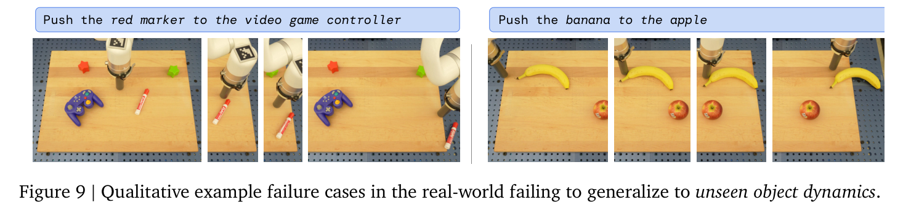

# 闭环恢复怎样发现偏差并重新执行

杯子没有被抓起，机器人仍把空夹爪移向托盘。这种失败至少有三种来源：输入里没有抓取结果，输入已有结果但策略没有改变动作，或策略生成了修正动作却被旧执行队列覆盖。先沿时间轴找到第一处偏离，通常比增加重试次数更快找到真正的修复点。

## 定义状态转移，而不只写“失败后重试”

一个抓取任务可以包含 `observe`、`approach`、`close`、`verify`、`transport`、`recover` 和 `stop`。允许从 `verify` 进入 `transport` 的条件应是确认物体随夹爪运动；夹爪已经闭合只是执行状态，不能替代任务状态。

构造的恢复流程如下。夹爪闭合后，读取最新图像和夹爪宽度；证据不足进入重观测；确认抓空后先取消旧搬运动作，再退回可观察位置；重新定位并生成不同的接近轨迹；超过预算或触发不可恢复风险则退出。每一次状态切换都记录触发证据与时间。

```text
close -> verify -> transport
             |
             +-> cancel_old_chunk -> reobserve -> recover -> verify
                                      |
                                      +-> stop_or_human
```

取消旧块很关键。恢复动作已经生成，并不意味着执行器开始执行它。队列需要 epoch 或 sequence ID，执行端拒绝旧 epoch 的命令，才能防止暂停后迟到的旧命令重新启动机械臂。

以杯子滑落为例，旧动作块后半段可能仍包含向高处移动和前往放置区。检测到滑落后，简单重新调用策略还不够，执行队列中的旧动作可能继续运行。状态机先把当前动作版本作废，执行端确认旧 epoch 已取消，随后才使用新观察判断杯子落在哪里。

恢复动作也随状态改变。杯子直立且可达时可以重新抓取，杯子侧倒时需要不同抓取姿态，掉出允许区域时则应退出当前流程。把这三种情况都写成“重试一次抓取”，会把任务状态推断藏在动作调用里。日志应能串起滑落证据、取消确认、新场景、恢复选择和最终结果，才能判断失败属于检测、取消还是恢复本身。

## 检测器的阈值怎样改变行为

令 \(p_t\) 表示“抓取失败”的预测概率。单阈值 0.5 在 0.49、0.51 之间波动时，会反复切换状态。可采用不同进入与退出阈值，例如大于 0.7 进入故障，小于 0.3 且有新证据才解除。这个滞回设计减少抖动，但阈值是教学值，部署应依据风险、误报和校准评测确定。

连续多帧确认也有代价。10 Hz 相机要求连续三帧异常，最坏情况下从异常发生到第三个异常采样约需 300 毫秒，再加处理延迟。对快速碰撞，不能依赖这么慢的视觉规则；低层保护需要独立于模型的及时响应。

检测信号可组合视觉、本体和控制器信息，但不应把同一来源的派生量当独立证据相乘。例如“图像中杯子上移”与“VLM 判断已抓起”可能来自同一张图。没有独立性与校准依据时，它们的概率相乘会制造虚假确定性。

## 先判断观测是否足够

遮挡后看不见杯子，既可能是抓起，也可能是仍留在桌上。若两种状态产生近似相同观测，原地再推理一次未必有帮助；换视角或小幅可控探测可以提供新证据。

形式上可比较观测动作的信息价值。设当前状态不确定性为熵 \(H(S)\)，获取新观测 \(O'\) 后的期望减少量为

\[
I(S;O')=H(S)-\mathbb E_{O'}H(S\mid O').
\]

这说明“先看清再动作”也可以是决策。不过信息最大化不等于安全最大化，探测动作仍应受碰撞、接触和任务约束限制。

## 恢复预算怎样影响最终成功率

构造一个简化系统，首次成功率 0.7，失败后每次独立恢复成功概率 0.5，最多恢复两次。假设失败可恢复、没有新危险且尝试互相独立，则最终成功率为

\[
0.7+0.3\bigl[1-(1-0.5)^2\bigr]=0.925.
\]

现实中的重复尝试往往不独立。若每次仍因同一错误外参抓偏，再试十次也不会按此公式改善。恢复应改变相关条件，例如刷新定位、换接近方向或修正接口，而不是只增加次数。还需统计恢复耗时、损坏风险与人工介入，不能只优化最终成功率。

## 把原论文失败与教学分析区分开

{ width="920" }

<small>图源：[RT-2](https://arxiv.org/abs/2307.15818)，Figure 9。原图展示模型在 unseen object dynamics 上的真实机器人失败案例。读图重点：语义泛化和动作执行是两层证据；失败图要进入 failure bucket 和恢复数据，而不是只作为 demo 之外的附录。</small>

这张原论文失败图说明视觉语言知识迁移仍存在动力学边界。具体归因需要原论文说明与相应轨迹，不能从静态图推断未经测量的接触力或时间延迟。本页前面的抓空状态机是教学构造，不是对该图实验过程的复现。

## 回放保留因果顺序

一次故障至少保存观测曝光时刻、模型输入截止、动作生成时刻、队列提交时刻、控制反馈和失败判定。若故障发生于 2.00 秒，而修正推理只读到了 1.90 秒观测，就不应要求模型根据尚未见到的失败调整。

一个可回放的事件记录可以写成

```json
{
  "episode_id": "pick-017",
  "state": "verify",
  "observation_id": "cam-00421",
  "observation_time": 1731200000.120,
  "inference_done": 1731200000.205,
  "action_epoch": 8,
  "queue_status": "cancel_requested",
  "failure_signal": {
    "gripper_width": 0.031,
    "object_following": false,
    "confidence": 0.82
  }
}
```

这里的 `confidence` 只是检测器输出，不能直接当成真实概率。回放程序还应读取传感器实际状态和后续人工标注，确认检测器在这个阈值附近是否校准。`queue_status` 则由执行端产生，不能由策略日志事后推断。把两类字段混在一个模型输出里，会让“策略知道失败”和“旧命令已经取消”看起来像同一个事件。

沿时间线可以把责任切成四个检查点：

| 检查点 | 需要回答的问题 | 典型修复 |
| --- | --- | --- |
| 观测 | 失败证据在模型输入中吗 | 刷新传感器、换视角、修预处理 |
| 识别 | 输入已有证据，检测器发出故障吗 | 校准阈值、重标注、增加时序信息 |
| 决策 | 检测到故障后生成了合适的恢复动作吗 | 修改状态机、恢复策略或预算 |
| 执行 | 恢复动作被执行了吗 | 取消旧 epoch、修队列和控制器 |

如果观测中根本没有杯子，继续调策略网络无法证明恢复变好；如果策略已经输出退回动作但执行端仍在搬运，训练更多失败样本也不会修好队列。每次实验应只改变一个检查点能解释的因素，并保留其余接口。

对回流样本保留原失败动作，同时单独标注修正动作。失败动作可以训练风险或价值模型；正确恢复动作可以训练模仿策略。把两者不加区分地当作正示范，会让策略同时模仿问题和解法。

恢复数据还要记录“为什么没有选择另一个恢复”。例如杯子完全遮挡时，原地重试和换视角都可能可行；如果数据只保留最终动作，后续策略学不到观测动作的价值。可以把每次恢复写成

```text
failure_type: object_not_following
evidence: gripper_width + vision_track_lost
candidate_recovery: [reobserve, retreat, retry_grasp, stop]
selected: reobserve
rejected_reason: retry_grasp_has_no_new_evidence
outcome: object_found
```

`rejected_reason` 不需要假装是模型内部思维，它只记录实验协议中可以核验的决策条件。这样可以区分“恢复动作没有效果”和“本来就没有获得新的观测”。

评测时固定扰动集合，报告检测召回、误报率、检测延迟、取消延迟、恢复率和额外安全事件。漏检的失败也必须计入分母。相关实验设计见[评测与数据引擎](benchmarks-and-data-engines.md)，执行协议见[部署与安全](deployment-and-safety.md)，状态分布依据见 [DAgger](https://arxiv.org/abs/1011.0686)。

建议把一次评测拆成四个分母，而不是只报“最终成功率”：

| 指标 | 分母 | 解释 |
| --- | --- | --- |
| 检测召回 | 所有真实失败事件 | 失败被发现了多少 |
| 取消成功率 | 已发出取消的事件 | 旧动作是否真的停止 |
| 恢复成功率 | 已进入恢复流程的事件 | 恢复是否完成任务 |
| 安全事件率 | 全部 episode 或控制时长 | 是否产生额外危险 |

例如 20 次任务中 4 次抓空，3 次被检测到，2 次成功取消旧队列，1 次最终重新抓取成功。检测召回是 75%，取消成功率是 2/3，恢复成功率是 1/2。把最后的 1/20 当作“恢复率”会把检测、取消和恢复三个阶段压成一个数字。

还应报告人工接管发生在哪个分母。人工帮忙完成的任务可以计入“任务完成”，但不能和全自主完成混在一起。接管次数、接管前的延迟和接管后的结果都应单独保留。

## 用故障注入测状态机而不是测运气

不必等真实物体掉落才开始测试。可以在仿真或安全的受限场景中注入以下事件：

| 注入事件 | 期望状态变化 | 需要检查的边界 |
| --- | --- | --- |
| 延迟一帧图像 | 进入重观测或保持 | 观测年龄和 TTL |
| 夹爪闭合但物体不随动 | `verify` 进入恢复 | 执行状态不能冒充任务状态 |
| 取消确认丢失 | 停止继续推进 | epoch 是否真的作废 |
| 恢复动作不可达 | 进入下一候选或停止 | 无可行解的 fallback |
| 新观测仍然遮挡 | 继续获取证据或人工接管 | 恢复预算和超时 |

每个注入只改变一个条件，并记录状态机是否按协议转移。测试通过只说明这条转移和接口存在，不代表真实物理失败的分布已经覆盖。真实数据仍需独立评估。

## 恢复预算要同时限制时间和风险

恢复次数上限只是一个维度。若一次重观测 0.4 秒、重新接近 1.2 秒、抓取 0.8 秒，两个恢复候选可能分别消耗 2.4 秒和 4.8 秒。移动物体或人机交互任务中，等待本身会改变状态，不能只按“最多重试两次”计预算。

可以把候选恢复的代价写成

\[
J(r)=c_tT(r)+c_sP(\text{new safety event}\mid r)+c_hC(\text{human intervention}\mid r),
\]

其中 (r) 是恢复动作，(T) 是额外时间。这个式子用于明确决策字段，不意味着三个概率和代价已经可靠估计。若没有独立数据，保留区间或排序约束比填一个看似精确的数字更诚实。

恢复也可能让状态不可逆。例如杯子已经打翻，继续尝试抓取可能增加损坏风险。状态机应有 `stop` 或 `human` 终点，不能把所有失败都送回 `approach`。终止原因要能在报告中区分风险停止、预算耗尽、任务完成和用户接管。

## 恢复策略的最小验收表

一次恢复测试至少记录：失败发生时的最新观测、检测延迟、取消延迟、旧动作是否仍在执行、恢复动作、重新成功与否，以及是否产生新的安全事件。只记录“最终成功”无法区分检测器、策略、队列和控制器的贡献。

**来源与改编说明**：[DAgger](https://arxiv.org/abs/1011.0686)提供把策略访问到的错误状态重新纳入数据的背景，[RT-2](https://arxiv.org/abs/2307.15818)提供真实机器人泛化与失败案例的参考。本文的阈值和滞回数值是教学构造，部署时需用独立失败数据校准。自测时画出“旧动作队列未取消”的时间线，说明为什么策略已经输出修正动作仍可能继续执行原计划。

记录失败时，把观测、推理、队列和执行端的时间戳放在同一条时间线上。这个做法借鉴 [DAgger](https://arxiv.org/abs/1011.0686) 对错误状态回流的思路，也保留 [RT-2](https://arxiv.org/abs/2307.15818) 真实机器人失败案例所显示的执行边界。本文的状态机、阈值和 epoch 字段是教学构造，必须用目标机器人自己的延迟和安全策略重新校准。
