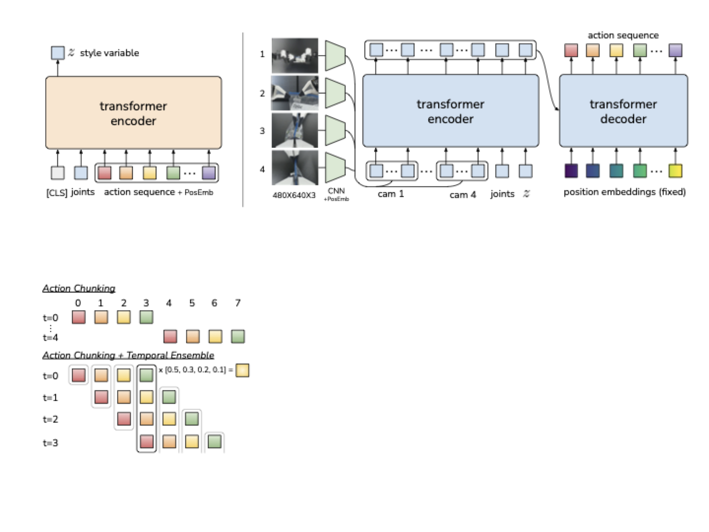
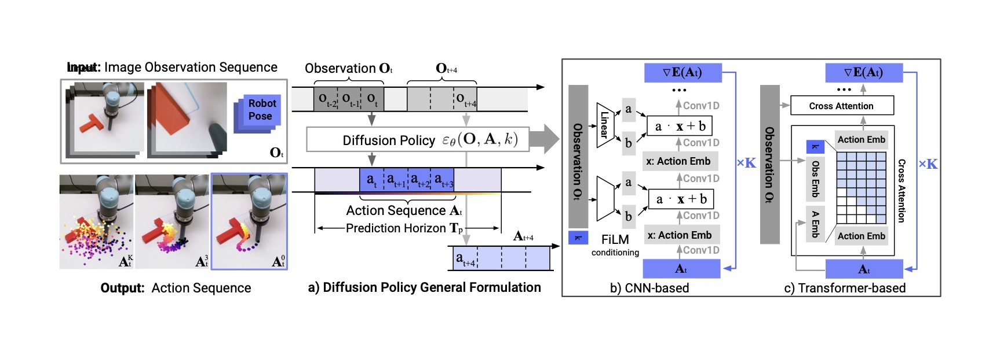

# VLA 数据与策略学习：从示范轨迹到闭环策略

想象一个开抽屉策略：离线验证时 action error 很低，演示视频也很顺。真机一跑，第一步夹爪偏了两厘米，第二帧相机看到的就是“手在把手旁边”的新状态；训练集里几乎没有这种偏差状态，模型继续输出演示分布里的动作，于是抖动、卡住、超时。

VLA 策略学习的难点就在这里。它要把“人能说清的任务”变成“机器人能从小错误中恢复的一串动作”。

## 先把轨迹对象写完整

一条机器人轨迹不只是图像和一句指令。更完整的写法是：

\[
\tau=\{(o_t, l, s_t, a_t, y_t)\}_{t=1}^{T}
\]

这里 \(o_t\) 是第 \(t\) 步观测，可以包含多视角 RGB、深度、关节角、末端位姿和力觉；\(l\) 是语言任务；\(s_t\) 是可选的机器人状态或环境状态；\(a_t\) 是动作；\(y_t\) 是成功、失败、接触、碰撞、阶段标签或人工标注。轨迹数据集就是很多条 \(\tau\) 的集合。

VLA policy 常写成：

\[
\pi_\theta(a_t\mid o_{\le t}, l)
\]

这个式子表示：给定历史观测 \(o_{\le t}\) 和语言 \(l\)，策略输出当前动作 \(a_t\) 的分布。它只是最薄的一层定义。真正决定能不能部署的，是动作 \(a_t\) 的坐标系、频率、限幅、控制器接口，以及观测 \(o_{\le t}\) 是否包含足够证据。一个只看正面 RGB 的策略，可能根本看不到盘子是否卡进洗碗机槽里；这不是模型“不会推理”，而是输入里没有可执行证据。

## 行为克隆是入口

最基础的策略学习是行为克隆。给定专家示范数据：

\[
\mathcal{D}=\{(o_t^{(i)}, l^{(i)}, a_t^{(i)})\}
\]

常见目标是最大化专家动作似然：

\[
\mathcal{L}_{\mathrm{BC}}
=-\sum_{(o,l,a)\in\mathcal{D}}\log \pi_\theta(a\mid o,l)
\]

这里 \(\mathcal{D}\) 是示范数据集，\((o,l,a)\) 是一条训练样本，\(\pi_\theta(a\mid o,l)\) 是模型在观测和语言条件下输出专家动作的概率。这个 loss 的意思很朴素：专家在这个场景这样做，模型就学着更倾向于这样做。

如果把动作分布设成高斯：

\[
\pi_\theta(a_t\mid o_{\le t},l)
=\mathcal{N}(a_t;\mu_\theta(o_{\le t},l),\Sigma)
\]

其中 \(\mu_\theta\) 是模型预测的平均动作，\(\Sigma\) 是协方差。当 \(\Sigma\) 固定时，最大似然会退化成平方误差：

\[
\mathcal{L}_{\mathrm{MSE}}=\sum_t \|a_t-\hat a_t\|_2^2
\]

这里 \(a_t\) 是专家动作，\(\hat a_t\) 是模型预测动作。MSE 小只能说明动作在演示分布上接近标签，不说明真机执行稳定。机器人任务常有多条合理轨迹：抓杯子可以从左侧接近，也可以从右侧接近；绕障可以走上方，也可以走下方。MSE 会把多峰轨迹平均成中间动作，而中间动作可能正好撞上障碍物。

所以行为克隆是入口，不是终点。它适合学“演示里经常出现的局部动作”，不擅长处理分布外状态、多峰动作、失败恢复和安全约束。

## 分布偏移会滚雪球

行为克隆最核心的问题是 covariate shift。训练时，模型看到的是专家状态分布：

\[
o_t\sim d^{\pi_E}(o)
\]

部署时，模型看到的是自己动作造成的状态分布：

\[
o_t\sim d^{\pi_\theta}(o)
\]

这里 \(d^{\pi_E}\) 表示专家策略诱导出的观测分布，\(d^{\pi_\theta}\) 表示模型策略诱导出的观测分布。两者不一样，是因为模型一旦偏了一步，后续相机画面、手爪位置和物体状态都会被这一步偏差改变。

解决这个问题的方向不是简单“再多收一点成功轨迹”。更有价值的数据包括抓偏后的重新对准、遮挡后的换视角、接触失败后的松开重抓、拉不动后的方向调整、误按风险前的停止确认。机器人数据最稀缺的不是漂亮成功视频，而是失败和恢复状态。

DAgger 的核心提醒也在这里：顺序决策不是 i.i.d. 分类。学习器自己的动作会改变以后看到的数据分布，所以训练集需要逐步覆盖学习器自己会走到的状态。真实机器人上做完整在线 DAgger 很贵，也有安全风险，但它给 VLA 数据引擎一个很清楚的方向：失败回放、人工纠正、恢复轨迹和 shadow evaluation 都不是补充材料，而是策略学习的一部分。

## 数据要有五张账

规模化数据不是把轨迹倒进模型。Open X-Embodiment、DROID、BridgeData、OpenVLA、Octo、π0.5 这些工作都在不同角度回答同一个问题：机器人数据的价值取决于观测、动作、任务、结果和部署语义是否能对齐。

| 账本 | 要对齐什么 | 错了会怎样 |
| --- | --- | --- |
| 观测账 | 相机视角、分辨率、深度、proprioception、时间同步 | 模型把传感器差异当成任务差异 |
| 动作账 | 坐标系、单位、频率、gripper 语义、末端/关节空间 | 同一个 token 在不同机器人上执行成不同动作 |
| 任务账 | 语言粒度、对象名称、阶段标签、成功定义 | 模型分不清高层目标和低层技巧 |
| 结果账 | 成功、失败、接触、碰撞、恢复、人工偏好 | 只能模仿成功样子，不会处理失败 |
| 部署账 | 延迟、控制器、限幅、安全停止、重规划频率 | 离线动作看着对，实机执行不稳 |

{ width="820" }

<small>图源：[Open X-Embodiment / RT-X](https://robotics-transformer-x.github.io/)，数据集总览图。原图展示多机构、多机器人、多任务数据汇聚。读图重点：跨 embodiment 数据的难点不是“样本更多”，而是观测、动作、时间戳、坐标系、gripper 语义和任务标签都要对齐，否则模型学到的是接口噪声。</small>

这也是为什么通用策略不能只按“用了多少数据”读。更关键的问题是：数据是否覆盖真实部署状态，动作接口是否统一，模型是否能适配新机器人，失败样本是否进入训练，评测是否真的闭环。

## 动作 chunk 降低有效 horizon

真实机器人很少适合“每一帧只输出一个孤立动作”。更常见的策略是一次输出未来一小段动作：

\[
\hat A_{t:t+H-1}=\pi_\theta(o_{\le t},l)
\]

这里 \(H\) 是 chunk horizon，\(\hat A_{t:t+H-1}\) 是从当前时刻开始的动作序列。动作 chunk 的价值有三点：第一，它让模型学到一个完整微技能，而不是每帧重新决定 2 毫米该往哪挪；第二，它减少高频视觉噪声带来的抖动；第三，它把有效决策 horizon 变短，让长任务由多个短 chunk 串起来。

{ width="760" }

<small>图源：[Learning Fine-Grained Bimanual Manipulation with Low-Cost Hardware / ACT](https://arxiv.org/abs/2304.13705)，方法图。原图展示 ACT 用 CVAE/Transformer 从多视角图像和关节状态预测动作 chunk，并用 temporal ensembling 平滑执行。读图重点：ACT 的重点不是“Transformer 更强”，而是 chunk 把精细操作从单步回归改成短时序生成。</small>

ACT 的实践很能说明这个点。插电池、穿扎带、打开杯盖这类任务需要连续、精细、接触敏感的动作。如果每一步都独立预测，策略很容易在接近接触点时抖动；如果一次输出一段动作，模型更容易学出“接近、对齐、接触、推进”的连续结构。

chunk 也不能被误读成开环计划。真实部署通常只执行 chunk 的前几步，然后重新观察，再输出下一个 chunk。多个重叠 chunk 还可以做 temporal ensembling，把不同时间预测的动作平均或加权融合，减少瞬时跳变。也就是说，chunk 服务的是低延迟闭环，不是让机器人闭眼执行很久。

## 扩散策略保留多峰动作

当同一观测下存在多条合理轨迹时，扩散策略比单一均值回归更自然。它把未来动作块 \(A\) 当成生成对象，训练时给动作加噪：

\[
A^\tau=\sqrt{\bar\alpha_\tau}A+\sqrt{1-\bar\alpha_\tau}\epsilon
\]

这里 \(A\) 是干净动作序列，\(A^\tau\) 是第 \(\tau\) 个噪声水平下的带噪动作，\(\epsilon\) 是随机噪声，\(\bar\alpha_\tau\) 控制保留多少原动作信号。训练网络学习从带噪动作中预测噪声或干净动作，再在推理时逐步去噪生成可执行动作序列。

{ width="880" }

<small>图源：[Diffusion Policy: Visuomotor Policy Learning via Action Diffusion](https://diffusion-policy.cs.columbia.edu/)，Figure 2。原图展示模型在视觉条件下通过去噪生成未来动作序列，支持 CNN-based 和 Transformer-based policy。读图重点：扩散策略的价值是建模动作分布，而不是把图像扩散照搬到机器人；它让“左绕”和“右绕”这类多峰动作不必被 MSE 平均成危险中间路径。</small>

扩散策略尤其适合软体、接触和多解任务。折毛巾时，从左侧抓和从右侧抓都可能成功；清理桌面时，先移动杯子还是先拿碗也可能都合理。一个确定性回归模型容易输出折中动作；扩散策略可以从条件分布中采样出一条完整模式。

代价也很现实。扩散推理通常比单步回归慢，需要多步去噪或蒸馏；动作序列还要经过低层控制器和安全层。它不是“更高级所以总更好”，而是适合需要多峰连续动作的任务。对超低延迟、强约束或单一轨迹任务，action token、ACT 或普通 BC 可能更简单。

## 大模型知识怎样进入动作策略

RT-2 这类 VLA 的意义是把 web-scale VLM 的语义知识接到机器人动作输出上。比如模型在网页图文里学过“垃圾”“可回收”“杯子”“抽屉”，再通过机器人数据把这些语义接到动作 token。OpenVLA 和 π0.5 则进一步强调开源训练、跨机器人数据、语义子任务、web 数据和低层动作的共同训练。

但语义知识不等于执行能力。一个模型知道“把酸奶放到上层架子靠左边”是什么意思，还必须知道上层架子的 3D 位置、可达路径、哪些物体易碎、夹爪当前是否挡住视线、动作是否会碰倒旁边盒子。大模型知识解决的是任务理解和对象语义，策略学习还要解决观测证据、动作分布和闭环控制。

可以把 VLA policy 的能力拆成三层：

| 层 | 学什么 | 典型来源 |
| --- | --- | --- |
| 语义层 | 任务、对象、关系、常识 | VLM/web 数据、语言标注、子任务预测 |
| 技能层 | 抓、放、推、拉、插、擦等动作模式 | 机器人示范、ACT、Diffusion Policy、RT-1/RT-X |
| 闭环层 | 偏差修正、失败恢复、安全停止 | 失败回放、在线数据、人工纠正、真实机器人评测 |

很多论文在语义层表现惊艳，但真正卡部署的是闭环层。读 VLA 论文时要问：模型在新场景里失败后能不能重新观察并纠偏？还是只能在演示分布附近完成漂亮片段？

## 训练目标按失败模式选择

| 方法 | 适合解决 | 主要风险 |
| --- | --- | --- |
| 行为克隆 / MSE | 演示足够一致、动作分布单峰 | 平均多峰轨迹，遇到偏差不会恢复 |
| 动作 token / 交叉熵 | 接 LLM/Transformer 训练栈，做离散序列建模 | 分桶误差、台阶感、精细控制不足 |
| ACT / CVAE chunk | 精细操作、短时连续动作、降低有效 horizon | chunk 太长会开环，太短又抖动 |
| Diffusion Policy | 多峰连续动作、接触/软体/多解任务 | 推理慢、需要控制器和安全层配合 |
| 离线 RL / value learning | 利用 reward、偏好或失败数据选高价值动作 | 分布外动作 Q 值虚高，机器人上很容易不稳 |
| 在线数据聚合 | 修复 covariate shift、补失败恢复 | 采集贵，有安全风险，需要人机流程 |

这个表的重点是：方法选择要从失败模式出发，而不是从模型名字出发。问题是多峰动作，就优先看 diffusion 或 latent mixture；问题是高频抖动，就优先看 chunk 和 temporal ensembling；问题是分布外状态，就必须收集失败和恢复数据；问题是跨机器人泛化，就先检查动作口径和观测对齐。

## 评测必须回到闭环

VLA 评测不能只看 offline action error。一个动作预测误差低的模型，可能因为一次小偏差进入训练集没见过的状态；一个视频里看起来顺滑的 policy，可能在真实机器人上因为延迟和接触误差失败。

最小评测应分成四层：

| 层级 | 看什么 | 为什么 |
| --- | --- | --- |
| Offline | action error、negative log-likelihood、校准、多峰覆盖 | 检查训练是否学到示范分布 |
| Replay | 从中途状态重放、失败状态动作、human preference | 检查偏差状态下是否有合理恢复 |
| Simulator | closed-loop success、collision、time-to-complete、reset cost | 低成本找系统性失败 |
| Real robot | 成功率、失败桶、恢复率、延迟、安全停止、跨场景泛化 | 最终验证策略能否在物理世界闭环执行 |

实机报告也要按任务桶看。整理冰箱、折毛巾、按电梯按钮、开抽屉的失败原因完全不同：有的是空间关系，有的是软体变形，有的是精细视觉，有的是接触和力控。平均成功率会把这些差异抹平，导致读者不知道该改数据、模型、动作接口还是控制器。

VLA 数据与策略学习可以按这条链路收口：行为克隆让模型学会演示动作，失败回放和数据聚合让它见到自己会造成的偏差状态，action chunk 提升短时连贯性，扩散策略保留多峰连续动作，跨机器人数据必须先统一接口，最终用闭环任务和失败桶验收。

继续读相邻内容时，可以接 [VLA 动作表示与控制接口](action-representation-and-interfaces.md)、[Sim2Real 与具身数据引擎](../embodied-ai/sim2real-and-data-engines.md)、[WM / WAM / VAM：动作到底怎样进入世界模型](../world-models/wm-wam-vam-and-action-conditioned-modeling.md) 和 [世界模型评测与失效模式](../world-models/evaluation-and-failure-modes.md)。

## 外部材料

- [DAgger](https://arxiv.org/abs/1011.0686)：理解 sequential prediction 为什么会因为自行动作导致分布偏移。
- [RT-1](https://arxiv.org/abs/2212.06817)：看真实机器人多任务示范、动作 token 和闭环控制如何规模化。
- [Open X-Embodiment / RT-X](https://robotics-transformer-x.github.io/)：理解跨机器人数据为什么首先是接口对齐问题。
- [ALOHA / ACT](https://arxiv.org/abs/2304.13705)：理解 action chunk、CVAE 和 temporal ensembling 如何改善精细操作。
- [Diffusion Policy](https://diffusion-policy.cs.columbia.edu/)：理解动作扩散如何表达多峰连续轨迹。
- [Octo](https://octo-models.github.io/)：看通用机器人策略如何处理多任务、多观测、多动作空间。
- [OpenVLA](https://openvla.github.io/)：理解开源 VLA 训练、微调和跨机器人部署的现实边界。
- [π0.5](https://arxiv.org/abs/2504.16054)：看异构 co-training、语义子任务和真实家庭泛化如何共同服务 open-world VLA。
