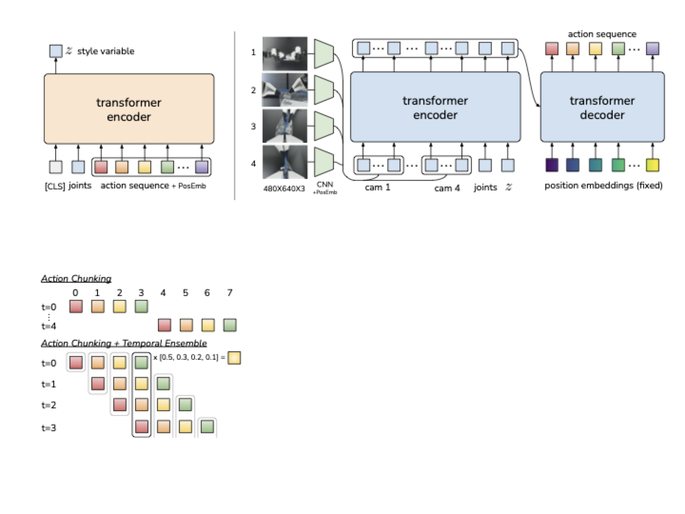
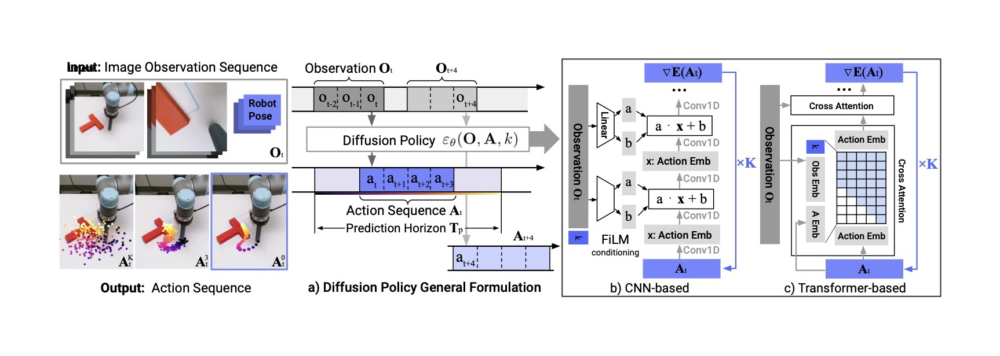
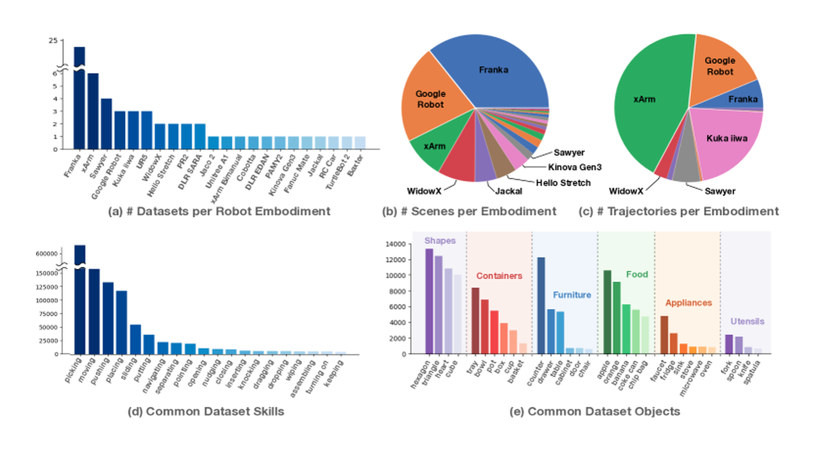

# 从机器人示范到条件动作分布

行为克隆把“在这个观测下专家怎样动作”作为监督目标。它不会直接知道这个动作是否唯一，也不会自动知道模型偏离示范以后该怎样恢复。理解策略学习，要同时追踪训练样本、概率假设与部署时的状态分布。

## 一条轨迹怎样切成训练样本

令轨迹包含观测 \(o_t\)、本体状态 \(q_t\)、语言 \(l\) 和动作 \(a_t\)。窗口样本可以写成

\[
x_t=(o_{t-K+1:t},q_{t-K+1:t},l),\qquad
A_t=(a_t,\ldots,a_{t+H-1}).
\]

输入有 \(K\) 个时刻，标签有 \(H\) 个动作。长度为 10 的轨迹，若 \(K=2,H=3\)，并采用从 0 开始的索引，不补齐时有效起点为 \(t=1,\ldots,7\)，共 7 个样本。末尾补齐则必须用 mask 排除不存在的动作，不能把补零动作训练成“停下”。

图像应来自推理截止前已可获得的传感器记录。动作标签要声明是遥操作请求、经过控制器处理后的命令，还是实际测量；详情见[动作接口](action-representation-and-interfaces.md)。训练与验证先按 episode 或采集场景分组，再切窗口，避免高度相似邻帧泄漏。

## 最大似然为什么变成 MSE

行为克隆最小化

\[
\mathcal L_{\mathrm{BC}}=-\mathbb E_{(x,A)\sim D}\log\pi_\theta(A\mid x).
\]

若每个动作维度在给定输入下采用固定方差的独立高斯，负对数密度为

\[
-\log\pi_\theta(A\mid x)=
\sum_j\frac{(A_j-\mu_j(x))^2}{2\sigma_j^2}
+\sum_j\log\sigma_j+\frac d2\log(2\pi).
\]

只有方差固定且相同，才与普通 MSE 相差一个比例和常数；不同固定方差对应加权 MSE。米制位置和弧度旋转混在一个平方误差中，权重已隐含在单位选择里，所以常先按训练集统计归一化。

构造一个一维动作数据，左绕标签为 −1，右绕为 +1，各一半。确定性预测 \(\mu\) 的期望平方误差为 \(\tfrac12(\mu+1)^2+\tfrac12(\mu-1)^2=\mu^2+1\)，最小值在 0。若中间有障碍，这个统计最优均值恰好不可行。换成更大确定性回归网络不会消除同一输入下真实存在的多峰性。

## 三种生成分布怎样训练

离散 token 方法对量化后的动作做交叉熵；CVAE 先用训练期编码器 \(q_\phi(z\mid A,x)\) 表示示范差异，再用解码器生成动作块。其目标包含重构项与

\[
\beta D_{\mathrm{KL}}(q_\phi(z\mid A,x)\|p(z)).
\]

训练时编码器看到未来动作，部署时看不到，因此推理必须使用先验或约定的 latent，不能调用带真实动作输入的编码器。ACT 原论文使用条件 VAE 训练动作块，推理使用零 latent；复现时应核对具体实现的重构损失与 mask。

{ width="760" }

<small>图源：[Learning Fine-Grained Bimanual Manipulation with Low-Cost Hardware / ACT](https://arxiv.org/abs/2304.13705)，方法图。原图展示 ACT 用 CVAE/Transformer 从多视角图像和关节状态预测动作 chunk，并用 temporal ensembling 平滑执行。读图重点：ACT 的重点不是“Transformer 更强”，而是 chunk 把精细操作从单步回归改成短时序生成。</small>

扩散策略则对归一化动作块加噪。用 \(k\) 表示噪声步，避免与机器人时间 \(t\) 混淆。

\[
A^{(k)}=\sqrt{\bar\alpha_k}A+\sqrt{1-\bar\alpha_k}\epsilon,
\qquad\mathcal L_\epsilon=\mathbb E\|\epsilon-\epsilon_\theta(A^{(k)},k,x)\|^2.
\]

一个标量示例中，\(A=0.5,\bar\alpha_k=0.64,\epsilon=-1\)，带噪值为 \(0.8\times0.5-0.6=-0.2\)。训练目标是恢复噪声 −1，而不是把 −0.2 当实际动作执行。训练通常随机抽一个噪声步；推理从噪声开始多步生成，因此训练一步与推理完整采样的成本不同。

{ width="880" }

<small>图源：[Diffusion Policy: Visuomotor Policy Learning via Action Diffusion](https://diffusion-policy.cs.columbia.edu/)，Figure 2。原图展示模型在视觉条件下通过去噪生成未来动作序列，支持 CNN-based 和 Transformer-based policy。读图重点：扩散策略的价值是建模动作分布，而不是把图像扩散照搬到机器人；它让“左绕”和“右绕”这类多峰动作不必被 MSE 平均成危险中间路径。</small>

这些模型可以表达多种动作模式，但没有结构保证所有样本安全，也没有保证训练数据中的每个模式都被学到。应检查模式覆盖、条件一致性和执行结果。

这里还有一个容易产生的新疑问，动作扩散也使用 MSE，为什么不再次平均成穿过障碍的 0？关键在输入条件增加了当前带噪动作块和噪声水平。低噪声时，当前动作状态已经更靠近左绕或右绕的一种模式，网络预测的是该状态下的噪声条件均值；采样把各个噪声水平的预测串成一个分布过程。直接回归动作的模型只有同一个场景输入，在多峰条件下只能输出一个均值。

这不保证任何训练出的扩散策略都会覆盖两边。需要从同一观察多次抽初始噪声，查看完整动作序列是否分别形成可行模式，而不是只统计第一步左右比例。一次采样应给出内部一致的绕障序列；若每个执行时刻都独立重抽左右模式，又不结合新观察与已有轨迹，仍可能左右摇摆。[动作 chunk](action-chunking-hierarchical-policies-and-latent-skills.md)继续解释时间上的选择。

## 闭环分布为什么变了

专家轨迹访问 \(d^{\pi_E}(s)\)，部署策略访问 \(d^{\pi_\theta}(s)\)。第一次抓偏改变物体位置，下一帧已经不再是原示范中的状态。离线 MSE 低只是在数据分布下的证据。

粗略地，若每一步出现偏离事件的概率为 \(\epsilon\)，长度 \(T\) 的序列至少一次偏离的概率在独立构造下是 \(1-(1-\epsilon)^T\)。\(\epsilon=0.01,T=100\) 时约 63.4%。真实错误并不独立，这个数不是机器人成功率预测；它只说明长序列会放大单步统计的局限。

DAgger 的关键是访问学习器产生的状态，并请专家给这些状态标正确动作后聚合训练。把失败轨迹原来的错误动作直接当正示范，会强化失败；仅收集日志也不等同于 DAgger。

## 多机器人混合数据的采样与接口

{ width="820" }

<small>图源：[Open X-Embodiment / RT-X](https://robotics-transformer-x.github.io/)，数据集总览图。原图展示多机构、多机器人、多任务数据汇聚。读图重点：跨 embodiment 数据的难点不是“样本更多”，而是观测、动作、时间戳、坐标系、gripper 语义和任务标签都要对齐，否则模型学到的是接口噪声。</small>

<small>图示多来源数据的规模与异构性，不意味着原始动作字段已经自动等价。</small>

如果数据集 A 有 900 万帧，B 有 100 万帧，均匀按帧采样时 A 占 90%。若目标是两个机器人同等重要，需要显式指定混合权重；但将小数据集重复采样十倍，也会提高过拟合风险。应同时记录每来源的采样比例、独立 episode 数与验证任务，而不只记录总 batch 数。

语义预训练可提供对象与语言表征，动作监督仍需对齐坐标、时间和控制器。RT-2 与 OpenVLA 的具体训练配方不同，不宜把“VLM 初始化”推断成所有模型均具备同样的操作能力。最终比较应固定任务、执行预算和干预规则，见[评测与数据引擎](benchmarks-and-data-engines.md)。

原始资料包括 [DAgger](https://arxiv.org/abs/1011.0686)、[ACT](https://arxiv.org/abs/2304.13705)、[Diffusion Policy](https://arxiv.org/abs/2303.04137)、[OpenVLA](https://arxiv.org/abs/2406.09246)和 [Open X-Embodiment](https://robotics-transformer-x.github.io/)。
