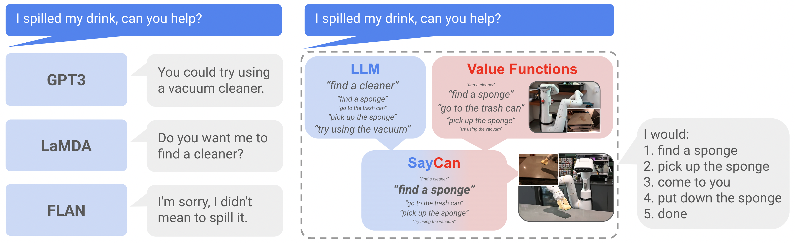

# VLA 部署中的时间、命令与安全边界

部署时，模型输出需要经过解码、坐标转换、约束检查、命令队列和低层控制。任何环节延迟或语义错配，都会让训练中正确的动作在真实系统中失效。理解部署应从一条命令的生命周期开始。

## 以观测年龄定义时效

定义观测年龄为命令执行时刻减去它依据的观测曝光时刻。它包含采集传输、排队、预处理、推理和下发时间。服务器每秒处理十次请求，不意味着机器人每次执行的命令都依据最近 100 毫秒的场景。

教学构造中，采集传输 20 毫秒、排队 30、推理 80、后处理与下发 20，总观测年龄至少 150 毫秒。若目标以 0.2 米每秒移动，在匀速假设下已经移动 3 厘米。空间误差由速度与时间共同决定，所以延迟应和任务容差一起分析。

串行同步系统要在周期内完成所需计算。异步动作块系统可以让推理与执行重叠，但必须管理新旧块交接、过期命令和剩余执行余量；它不要求所有低层控制工作都等待大模型。

## 命令需要明确有效期与取消规则

可用的命令格式至少包含坐标版本、控制模式、产生时刻、有效期限、sequence ID 和动作内容。执行端依次检查协议兼容、时效、顺序与约束。过期命令应按事先定义的退化行为处理，不能默默使用最新姿态重新解释旧位移。

暂停、人工接管或故障恢复时增加执行 epoch，并清空旧队列。即便网络随后送来旧命令，它也会因 epoch 不匹配被拒绝。急停与低层保护应能直接作用于执行系统，不能等待语言模型先输出同意。

继续前面的 150 毫秒观测年龄。若抓取容差只有 1 厘米，而目标以 .2 米每秒移动，单是匀速漂移就已达到容差的三倍。此时把动作速度 clip 小一点可能让到达更晚，不能消除旧目标位置的问题。命令时效检查应该先发现证据过期，再触发重新观察、运动预测或预先定义的安全行为。

假设这条响应恰好在人工暂停后返回，即使它的 TTL 尚未结束，也必须由 epoch 拒绝。TTL回答命令有多旧，epoch回答它是否仍属于当前任务，两者不能互相替代。约束投影则在命令仍然有效时处理瞬时可行性，因此它们沿命令生命周期依次解决不同错误。

## 动作限幅解决哪些问题

若单关节目标速度为 1.2 弧度每秒、上限为 0.5，clip 得到 0.5。这个操作满足速度边界，但不保证多关节组合后末端避开障碍。更一般地，可以求解距原动作最近的可行候选

\[
a^*=\arg\min_a\|a-a_{\mathrm{raw}}\|_W^2
\quad\text{s.t.}\quad g_j(x,a)\le0.
\]

约束可能包含速度、加速度、关节限位和预测碰撞。问题无可行解时需要拒绝或进入定义好的停止模式。即使求解成功，安全结论仍依赖状态估计、动力学近似和约束是否完整；“使用优化器”本身不构成证明。

停止距离也可以先做数量级核算。匀速 \(v\)、响应延迟 \(L\)、随后恒定减速度 \(a_b>0\) 的简化模型给出

\[
d_{\mathrm{stop}}=vL+\frac{v^2}{2a_b}.
\]

取 \(v=0.5\ \mathrm{m/s},L=0.2\ \mathrm{s},a_b=1\ \mathrm{m/s^2}\)，距离为 0.225 米。这个计算忽略制动斜坡、载荷、地面与传感器误差，不能直接拿来设正式安全距离，但能揭示只看推理平均耗时为什么不足。

## 技能可执行性与安全约束不同

{ width="920" }

<small>图源：[Do As I Can, Not As I Say / SayCan](https://arxiv.org/abs/2204.01691)，Figure 1。原图展示语言模型可能给出听起来合理但机器人不能执行的建议，SayCan 用 affordance / value function 约束技能选择。读图重点：VLA 部署不能只问语言上该做什么，还要问当前状态下能不能安全地做。</small>

SayCan 将语言建议与技能可执行性联系起来。技能“很可能完成”不意味着执行过程符合全部安全要求；价值或 affordance 分数不替代限位、碰撞检测、人机保护和风险评估。

运行边界用 operational design domain 描述，包括允许任务、物体、载荷、光照、相机状态、人员共处和硬件配置。超出验证范围后，系统应采取明确的限制行为。边界不必写成泛泛的“室内可用”，而应能由可观察条件判断。

## 影子运行能证明什么

影子模式只生成动作建议，不控制机器人。它能发现协议错误、超时、越界和与实际操作者显著不一致的建议，却不能评估模型承受自己动作后果的能力。因为真实环境仍由别的策略控制，观测分布没有随候选策略变化。

仿真、受限实机和目标环境测试提供逐步增加的执行证据。版本比较要固定控制器、传感器、任务重置与干预规则，否则不能把改善都归于模型。部署日志还需保存安全拒绝与限幅比例，频繁拒绝说明策略与执行边界持续错配。

可以把部署验收排成四个阶段：影子运行检查协议，受限实机检查命令时效和限幅，固定 ODD 检查任务成功与恢复，目标环境检查分布变化和人工接管。每一阶段都保留同一套 request、epoch、观测年龄、原始动作、执行命令和安全事件字段，后面才可以沿时间线比较模型版本。

一个很小但有用的回归是故意让命令变旧。延长排队、暂停推理线程、插入人工接管，再观察旧命令是否被 TTL 或 epoch 拒绝，机器人是否进入预期的保持或制动状态。这个测试不证明完整安全性，却能验证部署协议中最容易被忽略的一条边界。

## 把一条动作写成可以拒绝的消息

模型输出最好先落到一个带版本的协议对象，再交给执行端。下面的字段是教学协议，具体机器人可以有不同命名。

```json
{
  "episode_id": "2026-robot-017",
  "observation_id": "cam-00421",
  "observation_time": 1731200000.120,
  "action_epoch": 8,
  "sequence_id": 31,
  "frame": "base",
  "control_mode": "cartesian_delta",
  "valid_until": 1731200000.270,
  "action": [0.01, 0.00, -0.02, 0.00, 0.00, 0.04]
}
```

执行端至少检查五件事：消息版本能否解析，`action_epoch` 是否属于当前任务，`sequence_id` 是否按预期递增，`valid_until` 是否已经过去，动作在当前状态下是否满足硬约束。任一项失败都应产生可观测的拒绝原因，例如 `STALE_OBSERVATION`、`EPOCH_MISMATCH` 或 `CONSTRAINT_VIOLATION`。静默丢弃会让离线回放无法判断究竟是模型没有输出，还是执行端拒绝了输出。

`observation_id` 和 `sequence_id` 也不能互相替代。前者回答“动作依据哪次观测”，后者回答“它在当前动作流中的顺序”。一个旧观测生成的新序号仍然可能过期；一个新观测生成的旧序号也可能是重复包。

## 动作块长度是延迟和反馈的交换

动作块包含 (H) 个低层控制目标。块越长，模型调用次数和通信开销可能下降，但中途没有新观测的时间变长。若控制频率为 (f)，单个块在理想情况下持续

\[
T_{\mathrm{chunk}}=H/f.
\]

取 (f=10\) Hz、(H=8)，就是 0.8 秒。若执行到第 5 步时杯子已滑落，后 3 步仍可能沿旧计划继续，除非低层反馈或安全层提前截断。把 chunk 设为 2 会更频繁地接收新观测，却增加模型调用和队列交接。

可以把块长实验写成矩阵，而不是只挑一个最好看的数字：

| 控制频率 | 块长 | 理想覆盖时间 | 需要同时报告 |
| ---: | ---: | ---: | --- |
| 10 Hz | 2 | 0.2 s | 成功率、模型调用、接续失败 |
| 10 Hz | 8 | 0.8 s | 过期动作比例、恢复延迟 |
| 20 Hz | 8 | 0.4 s | 带宽、低层跟踪误差 |

这些数只表示时间预算，不构成某个任务的推荐值。玻璃杯接触、人的手靠近和移动物体都可能要求不同的反馈周期。应把“块执行到一半发生异常”作为单独测试，而不是只在每个块结束时注入失败。

## 三种安全层不要混成一个分数

| 层 | 典型操作 | 能解决什么 | 不能证明什么 |
| --- | --- | --- | --- |
| 硬停止 | 急停、速度断开、独立碰撞保护 | 立即阻止危险动作 | 模型为什么提出危险动作 |
| 可行性过滤 | 限幅、投影、轨迹重规划 | 把当前命令限制在约束集合内 | 过滤后任务一定成功 |
| 任务恢复 | 重观测、取消旧块、换策略、人工接管 | 处理任务状态已经改变 | 所有物理风险都已覆盖 |

如果动作先经过 clip，再被执行端判定不可达，日志应同时保留原始动作和最终动作。只保存过滤后的结果，会让策略看起来比实际更安全，也无法知道模型经常提出多大的越界命令。

约束投影可以写成

\[
a_{\mathrm{safe}}=\arg\min_a\|a-a_{\mathrm{raw}}\|_W^2
\quad\text{s.t.}\quad a\in\mathcal C(x).
\]

集合 \(\mathcal C(x)\) 随状态变化，可能包含关节限位、速度、加速度、碰撞距离和工具负载。投影问题无解时要有显式 fallback。把结果截到某个数值范围并不能替代这个无解分支。

## ODD 要能转成测试条件

“室内环境”太宽，无法直接作为验证范围。可以把 ODD 写成可以观测或注入的字段：

```text
lighting: [300, 800] lux
camera_status: synchronized=true, dropped_frames=0
payload_kg: <= 0.5
human_distance_m: >= 1.0
workspace: table_A
object_set: {cup_01, cup_02}
network_rtt_ms: <= 50
```

每一项都要有超出范围后的行为。照度过低时可以请求补光或暂停，网络 RTT 超限时可以停止接受新的大模型动作，人员距离过近时由独立保护层接管。只写“模型在 ODD 外不保证”而没有动作，不能指导部署。

验证矩阵至少覆盖正常条件、边界条件和明确越界条件。边界条件最容易暴露隐含假设，例如照度刚好低于阈值、队列刚好超过 TTL、载荷刚好改变制动距离。测试报告要记录系统采取的是拒绝、降级、重观测还是人工接管。

## 影子运行以后还缺哪一层证据

影子运行可以统计模型建议和当前策略的差异，但候选动作没有改变环境，因此它不能证明闭环安全。更完整的证据可以分层保存：

1. 离线回放检查协议、shape、时间戳和约束判断
2. 仿真检查动作对环境的后果和恢复状态机
3. 受限实机检查传感器延迟、跟踪误差和旧命令取消
4. 目标环境检查分布变化、人工接管和未预期的安全事件

每一层都应使用同一套 `episode_id`、`observation_id`、`action_epoch` 和失败标签。这样才能知道某个改进只在仿真有效，还是也改变了真实闭环结果。

## 用故障注入检查日志是否真的有用

可以故意注入几种不会损坏硬件的失败：延迟一帧图像，丢弃一个动作包，把 epoch 改旧，把目标物体移出 ODD，或让视觉检测器返回“不确定”。验收重点不是系统永远成功，而是它能否在规定时间内识别失败、拒绝旧命令并进入预期状态。

一次回放至少要能回答：最后一帧新鲜观测是什么，模型依据哪个 observation 生成了动作，执行端为什么接受或拒绝，当前 epoch 何时变化，低层控制何时停止，以及恢复后是否重新确认了场景。缺任何一项，日志只能说明结果，不能说明因果顺序。

LeRobot 的 ACT 教程和数据接口可以作为动作块、观测字段和训练/推理循环的工程对照，但它的机器人、数据集和控制频率不自动适用于本站的安全协议。阅读成熟教程时，先抄清字段和调用边界，再按目标设备重写 ODD、TTL、epoch 和停止行为。

## 安全结论的范围

这里给出的是软件接口和控制分析方法，不构成某台机器人符合特定安全标准的认证。工业与协作机器人项目需依据适用的正式标准、硬件与集成环境进行风险评估。[ISO 10218](https://www.iso.org/standard/73933.html)与[ISO/TS 15066](https://www.iso.org/standard/62996.html)是进一步查阅入口，具体适用版本应由项目核对。

相关机制见[动作接口](action-representation-and-interfaces.md)、[闭环恢复](closed-loop-recovery-and-failure-analysis.md)和[具身系统安全案例](../embodied-ai/deployment-patterns-and-safety-cases.md)。

**来源与改编说明**：SayCan 论文用于说明语言建议与 affordance 的职责边界，[LeRobot ACT 教程](https://huggingface.co/docs/lerobot/en/act)用于对照动作块和训练/推理接口，停止距离、命令协议、ODD 字段和故障注入为本站可计算的教学设计；正式安全结论仍需结合适用的 ISO 标准、硬件和集成环境验证。
