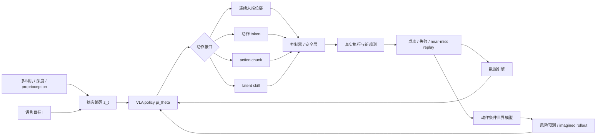

# VLA 专题路线图：从视觉语言到可执行动作

VLA 的名字很直观：Vision-Language-Action。它不是让 VLM “多说几个动作词”，而是让模型在真实或仿真的环境里，根据视觉、语言和机器人状态输出可执行动作。

!!! note "读法定位"
    这页先回答“VLA 专题路线图：从视觉语言到可执行动作”在「VLA」里的位置：它解决什么局部问题，依赖哪些前置，最后会影响哪类工程或研究判断。
    **前置**：先补 VLM/VLA 符号、动作表示和基础评测口径，再看数据与部署细节。 必要时先看本页路线，或回 [基础知识](../foundations/index.md) 或 [术语表](../glossary/index.md)。
    **主线关系**：把视觉语言模型落到动作空间、闭环反馈和安全部署中，理解策略不是只输出文本，而是要驱动真实或仿真环境。

继续用同一个例子：

```text
任务：把红杯从桌边放到托盘上。
VLM：红杯在哪里？
VLA：夹爪现在该怎么移动？
世界模型：如果这样抓，杯子会不会滑落或撞到托盘边？
```

!!! note "初学者先抓住"
    VLA 是一个闭环策略问题。它要有数据、观测、动作表示、控制接口、失败恢复和安全约束。只看模型结构，很容易漏掉真正让机器人成功或失败的部分。

!!! tip "先补符号"
    本页会反复出现 \(o_t\)、\(a_t\)、\(l\)、\(\pi_\theta\)、\(\mathcal{D}\)、\(\mathcal{L}_{\text{BC}}\)。不熟的话先看 [VLM/VLA 符号与最小数学地图](../vlm/vlm-vla-symbols-and-minimal-math.md)。

## 10 分钟最短路径

1. 先读本页，知道 VLA 不是单个模型，而是一条从数据到执行的链。
2. 读 [VLA 数据与策略学习](data-and-policy-learning.md)，理解行为克隆、分布偏移和多峰动作。
3. 读 [动作表示与控制接口](action-representation-and-interfaces.md)，理解动作 token、连续动作、坐标系和 action chunk。
4. 读 [动作分块、层级策略与潜在技能](action-chunking-hierarchical-policies-and-latent-skills.md)，理解为什么机器人常一次输出一小段动作。
5. 读 [闭环恢复与失败分析](closed-loop-recovery-and-failure-analysis.md)，理解抓偏、滑落、遮挡和安全回退怎么记录。

## VLA 最小公式

VLA 常写成语言条件策略：

\[
\pi_\theta(a_t \mid o_{\le t}, l)
\]

| 符号 | 含义 | 红杯例子 |
| --- | --- | --- |
| \(\pi_\theta\) | policy，输出动作的策略模型 | “现在该怎么动”的模型 |
| \(a_t\) | 当前动作 | 末端位姿增量、夹爪开合或动作 token |
| \(o_{\le t}\) | 当前和历史观测 | 多相机图像、深度、关节角、夹爪状态 |
| \(l\) | 语言指令 | “把红杯放到托盘上” |

**读作什么**：给定目前看到的东西和任务语言，策略输出动作。

**这个公式不说明什么**：动作怎么被编码、控制器能不能执行、出错后能不能恢复，都不在这个公式里。

## VLA 的四件事：数据、动作、闭环、前瞻

| 问题 | 初学者理解 | 推荐页面 |
| --- | --- | --- |
| 数据怎么来 | 示范、失败、恢复和多机器人轨迹如何变成训练样本 | [数据与策略学习](data-and-policy-learning.md) |
| 动作怎么表示 | 动作是 token、连续末端位姿、关节角，还是 action chunk | [动作表示与控制接口](action-representation-and-interfaces.md) |
| 执行为什么会失败 | 抓偏、滑落、遮挡、延迟、控制器拒绝如何诊断 | [闭环恢复与失败分析](closed-loop-recovery-and-failure-analysis.md) |
| 世界模型怎么接入 | 用动作后果预测来排序候选动作、发现风险和回流失败 | [VLM/VLA 与世界模型接口](../vlm/vlm-vla-for-efficient-world-model-training.md) |

这四件事缺一环，VLA 都可能只在 demo 里看起来会做，真实执行时不稳定。

## 一张系统图



这张图的重点是：VLA 不止是中间那个 policy。状态编码决定它看见什么，动作接口决定它能怎么做，控制器决定动作能不能落地，失败回放决定下一轮训练是否更聪明，世界模型负责提前想象动作后果。

## 从数据开始：行为克隆是起点，不是终点

最朴素的训练方式是行为克隆：

\[
\mathcal{D}=\{(o_t^{(i)}, l^{(i)}, a_t^{(i)})\}
\]

\[
\mathcal{L}_{\text{BC}} = - \sum_{(o,l,a)\in\mathcal{D}} \log \pi_\theta(a \mid o, l)
\]

| 符号 | 含义 |
| --- | --- |
| \(\mathcal{D}\) | 示范数据集 |
| \(a_t^{(i)}\) | 专家在第 \(i\) 条轨迹、时刻 \(t\) 的动作 |
| \(\mathcal{L}_{\text{BC}}\) | 让策略模仿专家动作的损失 |

**读作什么**：专家在类似观测下这么做，模型也学着这么做。

**红杯例子**：专家示范“从上方接近红杯、闭合夹爪、平稳抬起、移动到托盘、松开”，模型学习这条映射。

**这个公式不说明什么**：部署时模型一旦偏离专家轨迹，后续看到的观测就可能不在训练分布里，错误会越滚越大。

## 动作不是一个词，而是一组控制量

动作可以写成：

\[
a_t = (p_t, r_t, g_t, m_t, f_t)
\]

| 符号 | 含义 | 红杯例子 |
| --- | --- | --- |
| \(p_t\) | 平移或位置 | 向红杯移动 2cm |
| \(r_t\) | 姿态或旋转 | 调整夹爪角度对准杯身 |
| \(g_t\) | 夹爪开合 | 闭合夹爪 |
| \(m_t\) | 模式或技能 | 抓取、放置、对齐 |
| \(f_t\) | 力或阻抗相关量 | 抓握力度或柔顺控制 |

**读作什么**：机器人动作往往是多维控制接口，不是自然语言命令。

**这个公式不说明什么**：这些变量的单位、坐标系、频率和安全范围必须额外定义。否则离线 loss 好看，实机也会抖。

{ width="920" }

<small>图源：[Open X-Embodiment: Robotic Learning Datasets and RT-X Models](https://arxiv.org/abs/2310.08864)，Figure 2。原论文图意：RT-1-X 与 RT-2-X 都以图像和文本指令为输入并输出离散 end-effector actions；RT-2-X 把动作表示成另一种语言 token，与视觉语言数据一起训练。</small>

!!! note "读图：动作 token 是桥，也是约束"
    **先看哪里**：输入仍是图像和文本，输出变成了离散化 end-effector action。  
    **它证明什么**：动作可以被 token 化，接入 Transformer 训练框架。  
    **它不证明什么**：token 化不自动解决精细接触、坐标系漂移和控制平滑。  
    **和红杯例子的关系**：动作 token 可以表示“向前、下降、闭爪”，但真实抓杯还要低层控制器把它变成平滑轨迹。

## 为什么 action chunk 很常见

机器人往往不是每帧只输出一个动作，而是一次输出未来一小段动作：

\[
\hat A_{t:t+H_{\text{hor}}-1} = \pi_\theta(o_{\le t}, l)
\]

| 符号 | 含义 |
| --- | --- |
| \(\hat A_{t:t+H_{\text{hor}}-1}\) | 模型预测的一段未来动作 |
| \(H_{\text{hor}}\) | chunk horizon，动作块长度 |

**读作什么**：策略一次生成未来几步动作，让操作更连贯。

**红杯例子**：一段 chunk 可以包含“接近杯身 -> 对准 -> 闭爪 -> 轻微抬起”，比每 40ms 单独决定一次更平滑。

**这个公式不说明什么**：chunk 越长，越容易在环境变化后继续执行旧动作。高扰动任务需要重新观察、可中断语义和安全回退。

{ width="720" }

<small>图源：[Learning Fine-Grained Bimanual Manipulation with Low-Cost Hardware](https://arxiv.org/abs/2304.13705)，Figure 2。原论文图意：Action Chunking with Transformers (ACT) 用 CVAE 编码动作序列和关节观测，测试时根据多视角图像、关节状态和 latent 生成一段 action sequence，并用 temporal ensembling 平滑执行。</small>

!!! note "读图：ACT 先看哪里"
    **先看哪里**：模型输出 action sequence，而不是单个下一步动作。  
    **它证明什么**：短动作块能保留技能内部时间结构，减少逐帧抖动。  
    **它不证明什么**：action chunk 不是完整长轨迹，执行中仍要重新观察和纠错。  
    **和红杯例子的关系**：抓杯这类短技能适合 chunk；若杯子滑动，系统必须能中途打断。

## 世界模型为什么对 VLA 有用

VLA 主要问“当前动作是什么”。世界模型补上：

\[
p_\theta(z_{t+1:t+H_{\text{hor}}}, r, d \mid z_t, a_{t:t+H_{\text{hor}}-1}, l)
\]

**读作什么**：给定当前状态和候选动作，预测未来状态、进度和是否失败。

**红杯例子**：同样要把杯子放到托盘上，世界模型可以比较“快速侧推”“慢速上方夹取”“先移动障碍物再抓取”三种候选动作的风险。

**这个公式不说明什么**：预测未来不是安全保证。真实部署还需要控制器、安全门禁、失败 replay 和人工接管机制。

{ width="920" }

<small>图源：[DreamZero: World Action Models are Zero-shot Policies](../paper-deep-dives/embodied-ai/dreamzero.md)，Figure 2。原论文图意：展示 DreamZero 同时生成未来视频和动作，并强调预测动作与生成视频在未见任务上保持对齐。</small>

!!! note "读图：VLA 和世界模型的合流"
    **先看哪里**：未来视频和未来动作一起生成。  
    **它证明什么**：动作可以被看作未来世界分叉的条件，而不只是最终输出。  
    **它不证明什么**：视频和动作对齐不等于真实闭环成功。  
    **和红杯例子的关系**：模型不只输出“抓”，还要想象“抓以后杯子是否真的移动到托盘上”。

## 阅读分层

| 分层 | 推荐内容 | 读到什么程度 |
| --- | --- | --- |
| 主线必读 | 数据与策略、动作接口、闭环恢复 | 能解释动作从哪里来、怎么执行、失败如何回流 |
| 工程查阅 | 评测与数据引擎、部署与安全、动作 chunk / latent skill | 有 episode、仿真任务或真机部署时查 |
| 论文扩展 | RT-2、π0.5、SpatialVLA、DreamZero、VPP | 把论文图和表回填到动作 schema、闭环和世界模型接口 |
| 基础补课 | 行为克隆、策略、动作分布、控制接口 | 卡在 BC、chunk 或坐标系时补 |

## 最小验收指标

| 要证明什么 | 最小指标 | 不能替代什么 |
| --- | --- | --- |
| 动作可执行 | 动作 schema、频率、控制器和约束完整 | 自然语言计划 |
| 跨 embodiment 有证据 | 不同机器人、相机、任务桶分开报告 | 单平台成功率 |
| 闭环安全 | success、recovery、intervention、risk case | 离线 imitation loss |
| 世界模型有帮助 | 候选动作排序、near-miss recall、闭环收益 | 好看的未来视频 |

!!! failure "最佳反例"
    离线动作误差下降，但真实机器人因为动作接口、频率、控制器拒绝、接触风险或遮挡记忆失败而任务失败。VLA 的好分数只有经过 closed-loop、failure replay 和 safety gate 后才算进入工程判断。

## 下一站

如果目标是世界模型高效训练，读完 VLA 后立刻接 [VLM/VLA 与世界模型高效训练接口](../vlm/vlm-vla-for-efficient-world-model-training.md)、[WM / WAM / VAM：动作条件建模](../world-models/wm-wam-vam-and-action-conditioned-modeling.md) 和 [世界模型数据引擎与自我改进](../world-models/data-engines-and-self-improvement.md)。VLA 告诉你动作从哪里来，世界模型告诉你动作之后的未来如何被学习和使用。
