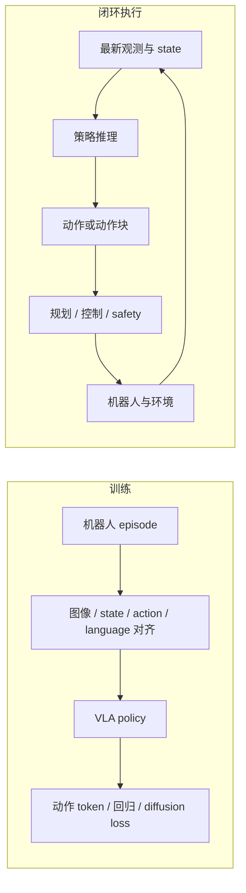

# VLA：从多模态条件到机器人动作策略

Vision-Language-Action 模型把视觉观测、语言任务和机器人状态映射为动作。它可以复用视觉语言模型的表征与语义知识，但最终必须满足机器人动作空间、控制频率、延迟和闭环恢复要求。VLA 是策略接口，不等于完整具身系统，也不自动等于世界模型。

## VLA 的统一接口

VLA 的策略接口常写成：

\[
a_{t:t+H}\sim\pi_\theta(
\,\cdot\mid o_{\le t},s_{\le t},\ell
),
\]

其中 \(o\) 是图像或多模态观测，\(s\) 是本体状态，\(\ell\) 是语言条件，输出可以是单步动作或长度为 \(H\) 的动作块。动作可以表示为：

- 离散 action token；
- 关节位置、速度或增量；
- 末端位姿及夹爪状态；
- 连续动作分布或扩散生成的动作序列；
- 技能 token 与低层控制参数。

动作含义、坐标系、归一化和执行频率共同构成模型接口，详见[动作表示与控制接口](action-representation-and-interfaces.md)。

## 训练与执行是两条链

离线训练的输入来自行为策略采集到的轨迹；部署时模型会访问自己动作导致的新状态。训练分布与闭环状态分布不一致，是行为克隆误差累积的根源之一。真实评测必须让策略承受自己的动作后果。

## 动作表示与策略学习

| 问题 | 入口 |
| --- | --- |
| action token、连续控制和坐标系怎样定义 | [动作表示与控制接口](action-representation-and-interfaces.md) |
| 从示范轨迹到行为克隆、扩散策略和 VLA 怎样连接 | [数据与策略学习](data-and-policy-learning.md) |
| 为什么输出动作块，怎样选择 chunk size | [动作分块、层级策略与潜在技能](action-chunking-hierarchical-policies-and-latent-skills.md) |

语言和视觉预训练可以改善对象、语义和任务泛化，但不会自动解决接触动力学和机器人接口差异。跨 embodiment 训练必须显式处理观测、动作空间、频率、相机布局和标注语义的异构性。

## 闭环、评测与部署

- [评测与数据引擎](benchmarks-and-data-engines.md)：以 episode 和失败阶段组织指标与回流样本。
- [闭环恢复与失败分析](closed-loop-recovery-and-failure-analysis.md)：检测偏离、选择恢复动作并防止重复失败。
- [部署与安全](deployment-and-safety.md)：定义 ODD、延迟预算、安全否决和人工接管。

VLA 评测至少需要报告任务成功、分阶段成功、动作平滑性、推理延迟、恢复次数、安全事件和跨场景泛化。离线 action MSE 只能说明模型接近数据集动作，不能单独证明闭环任务能力。

## 与世界模型的关系

VLA 直接学习策略 \(\pi(a\mid o,\ell)\)；世界模型学习环境转移 \(p(z_{t+1}\mid z_t,a_t)\)。组合方式包括：

1. VLA 产生多个候选动作，world model rollout 后由 planner 选择；
2. world model 在 latent imagination 中生成策略训练数据；
3. 动作条件视频模型为失败场景生成反事实或 hard cases；
4. VLA 与 world model 共享视觉表征，但使用不同输出头和目标。

仅仅让一个模型同时输出动作和视频，不足以证明二者形成有效闭环。需要验证预测是否会改变动作排序、是否改善真实成功率，以及模型误差是否被不确定性或安全门禁约束。系统边界见[VLA、WAM 与世界模型系统图](../embodied-ai/vla-wam-world-model-system-map.md)和[VLA 世界模型全链路](../world-models/vla-world-model-full-chain-case.md)。

## 外部材料

- [RT-1](https://arxiv.org/abs/2212.06817)
- [RT-2](https://arxiv.org/abs/2307.15818)
- [Open X-Embodiment](https://arxiv.org/abs/2310.08864)
- [OpenVLA](https://arxiv.org/abs/2406.09246)
- [π0](https://arxiv.org/abs/2410.24164)
