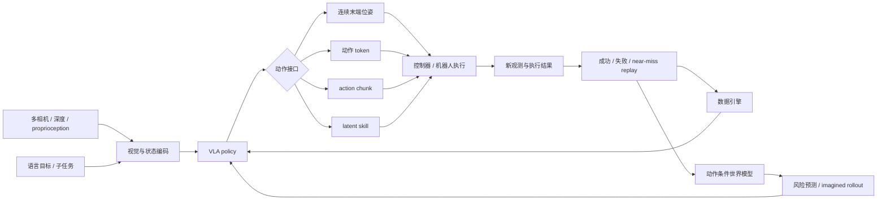

# VLA 专题路线图：从视觉语言到可执行动作

VLA 的核心不是“让 VLM 多输出几个动作 token”，而是把视觉语言状态、机器人数据、动作接口、闭环反馈和安全约束接成一条可执行系统。对世界模型高效训练来说，VLA 还承担一个更关键的角色：它提供动作分布、失败轨迹和闭环验证信号，让世界模型不只学会生成未来画面，而是学会预测**动作之后的后果**。

!!! note "初学者先抓住"
    VLM 主要回答“我看到了什么”，VLA 进一步回答“现在该做什么”。世界模型还会追问“做了以后会发生什么”。读 VLA 时不要只看模型结构，要同时看动作表示、数据来源、闭环恢复和评测指标。

!!! tip "证据与全站矩阵"
    前沿 claim 先查 [全站证据标准](../references/evidence-and-reproducibility-standard.md) 和 [全站效率矩阵](../references/site-efficiency-coverage-matrix.md)。VLA 结论必须区分 behavior cloning benchmark、真实机器人 closed-loop、官方 demo、系统吞吐和本站推断。

## 阅读分层与小地图

| 分层 | 推荐内容 | 读到什么程度 |
| --- | --- | --- |
| 主线必读 | [数据与策略学习](data-and-policy-learning.md)、[动作表示与控制接口](action-representation-and-interfaces.md)、[闭环恢复与失败分析](closed-loop-recovery-and-failure-analysis.md) | 能解释动作从哪里来、怎么执行、失败如何回流 |
| 工程查阅 | 评测与数据引擎、部署与安全、动作 chunk / latent skill | 有真实 episode、仿真任务或真机部署时查 |
| 论文扩展 | RT-2、π0.5、SpatialVLA、DreamZero、VPP | 把论文图和表回填到动作 schema、闭环和世界模型接口 |
| 基础补课 | 行为克隆、策略、动作分布、控制接口 | 卡在 BC、chunk 或坐标系时补 |
| 暂时可跳过 | 纯模型榜单和未接闭环的 demo | 先建立 episode schema 和失败 replay |

本专题解决的是世界模型高效训练里的**动作条件成本和闭环证据来源**。它回答先读哪 3-5 页、读完接哪里：先读数据、动作、恢复；随后接 [VLM/VLA 接口](../vlm/vlm-vla-for-efficient-world-model-training.md)、[WM/WAM/VAM](../world-models/wm-wam-vam-and-action-conditioned-modeling.md) 和 [具身智能](../embodied-ai/index.md)。

## 专题层级

| 层级 | 核心问题 | 推荐页面 | 和世界模型高效训练的关系 |
| --- | --- | --- | --- |
| 数据与策略 | 示范数据如何变成 policy | [VLA 数据与策略学习](data-and-policy-learning.md) | 决定真实交互样本如何被复用，哪些失败能回流 |
| 动作接口 | 动作如何 token 化、归一化和执行 | [动作表示与控制接口](action-representation-and-interfaces.md) | 决定世界模型的 action conditioning 是否有稳定语义 |
| 动作块与技能 | policy 是否输出单步、短轨迹或 latent skill | [动作分块、层级策略与潜在技能](action-chunking-hierarchical-policies-and-latent-skills.md) | 影响 rollout horizon、训练序列长度和规划粒度 |
| 评测与数据引擎 | 成功、失败和恢复如何被记录 | [VLA 评测与数据引擎](benchmarks-and-data-engines.md) | 提供 world model 训练的 hard negatives、near-miss 和反事实样本 |
| 闭环恢复 | 出错后如何重新观察、修正和继续 | [VLA 闭环恢复与失败分析](closed-loop-recovery-and-failure-analysis.md) | 检验世界模型预测是否真的帮助决策，而不是只生成好看视频 |
| 部署与安全 | 动作如何受限、审计和回退 | [VLA 部署与安全](deployment-and-safety.md) | 决定 imagined rollout 能否进入真实机器人闭环 |

## VLA 的三条主线

### 1. 从行为克隆到数据效率

VLA 最朴素的训练方式是行为克隆：给定观测和语言指令，拟合专家动作。但现实问题是，机器人数据贵、分布窄、失败样本少，直接堆数据很快遇到成本墙。

所以 VLA 专题要重点看三类数据效率问题：

1. 如何把 web 图文/视频语义迁移到机器人状态。
2. 如何把多机器人、多任务、多相机数据统一成可训练 schema。
3. 如何把失败、恢复、near-miss 和人工纠错回流成更高价值样本。

对世界模型而言，这些数据不是外围材料，而是决定训练是否高效的燃料。没有动作分布和失败分布，世界模型很容易只学到“看起来合理的未来”，却不对动作敏感。

## 一张 VLA 系统图

这张图把 VLA 从“模型输出动作”改写成闭环系统：状态编码决定模型看见什么，动作接口决定模型能怎么做，控制器决定动作是否可执行，失败回放决定下一轮训练是否有效，世界模型则负责预测动作后果和风险。任何一环薄弱，VLA 都可能在 demo 中看起来会做，在真实任务中却不稳定。

## 一个端到端例子：整理桌面上的杯子

| 阶段 | 系统要做什么 | 常见失败 | 应回到哪页 |
| --- | --- | --- | --- |
| 观察 | 识别杯子、把手、障碍物和目标位置 | 小物体或遮挡漏检 | [VLM 视觉 token](../vlm/visual-tokenizers-and-connectors.md) |
| 决策 | 判断先抓哪个、从哪个角度接近 | 只按语言目标行动，不看可达性 | [VLA 数据与策略学习](data-and-policy-learning.md) |
| 动作 | 输出可执行轨迹或 chunk | 动作抖动、坐标系错、chunk 内无法纠错 | [动作表示与控制接口](action-representation-and-interfaces.md) |
| 预测 | 评估抓取后是否滑落或碰撞 | 未来好看但不对动作敏感 | [世界模型动作条件建模](../world-models/wm-wam-vam-and-action-conditioned-modeling.md) |
| 恢复 | 抓偏后重新观察和修正 | 继续执行原计划 | [闭环恢复与失败分析](closed-loop-recovery-and-failure-analysis.md) |
| 回流 | 把失败变成 hard negative | 只记 `failed`，无法定位原因 | [VLA 评测与数据引擎](benchmarks-and-data-engines.md) |

读者真正要学会的是把一次任务失败拆成模块责任，而不是把所有失败都归因于“VLA 模型不够强”。如果抓取偏了，可能是视觉连接器丢了把手，也可能是动作 chunk 太粗，可能是世界模型低估滑落风险，也可能是控制器执行延迟造成误差。

### 2. 从动作 token 到控制接口

动作可以是离散 token、连续末端位姿、关节控制、轨迹片段、技能 ID 或 flow/diffusion 输出。不同动作接口会改变模型训练难度：

| 动作形式 | 优点 | 风险 |
| --- | --- | --- |
| 离散动作 token | 容易接入 Transformer 和语言数据 | 连续控制被量化，平滑性和精度要补偿 |
| 连续动作头 | 控制精度更自然 | 训练稳定性、归一化和多机器人对齐更难 |
| 动作 chunk | 降低逐步决策频率，动作更连贯 | 错误可能持续多个 step，恢复要更强 |
| latent skill | 适合长时程任务和规划 | 可解释性和安全约束更难 |

世界模型高效训练里，动作接口直接决定 conditioning 成本。动作太细，序列很长；动作太粗，未来预测又不够可控。好的接口要在训练长度、控制精度和规划可用性之间平衡。

### 3. 从开环评测到闭环价值

VLA 不能只看离线动作误差。一个动作在 dataset 里看起来接近专家，执行时仍可能因为接触、遮挡、动力学误差或累积偏差失败。

因此 VLA 专题的评测要分三层：

1. 离线层：动作误差、任务分类、语言 grounding、轨迹相似度。
2. 仿真层：成功率、恢复率、安全约束、扰动鲁棒性。
3. 真实层：人工接管率、失败模式、硬件限制、长时程稳定性。

世界模型的价值也要在这三层里验证：它是否减少真实交互次数，是否提升失败恢复，是否让策略在新场景里更少试错。

## VLA 页面该怎样读深

VLA 专题里有些页面偏数据，有些偏动作，有些偏部署。为了避免读成概念卡片，可以固定问四个问题：

1. **接口是什么**：输入是图像、视频、语言、proprioception，还是结构化状态；输出是动作 token、连续动作、chunk 还是 skill。
2. **成本在哪里**：数据成本、真实机器人时间、rollout 计算、标注成本、低延迟部署，哪一个是主瓶颈。
3. **失败怎么记录**：是否能复现失败前后的观测、动作、预测、风险和恢复选择。
4. **世界模型如何接入**：它是提供动作前模拟、失败 replay、风险头，还是合成数据。

只有这四个问题都能回答，VLA 才从“视觉语言动作模型”变成可工程化的闭环系统。

## 深度标杆页

先把下面 3-5 页读深，再回看其它短页会更容易对齐：

| 标杆页 | 为什么它是标杆 |
| --- | --- |
| [VLA 数据与策略学习](data-and-policy-learning.md) | 建立 VLA 的数据、行为克隆、泛化和分布偏移主线 |
| [动作表示与控制接口](action-representation-and-interfaces.md) | 把动作 token、连续动作、坐标系和执行接口讲到工程层 |
| [VLA 评测与数据引擎](benchmarks-and-data-engines.md) | 把 benchmark、回放、失败回流和数据引擎接起来 |
| [VLA 闭环恢复与失败分析](closed-loop-recovery-and-failure-analysis.md) | 从读者视角最能看出 VLA 是否真的进入真实闭环 |
| [VLM/VLA 与世界模型高效训练接口](../vlm/vlm-vla-for-efficient-world-model-training.md) | 把 VLA 产生的动作、失败和回放信号接到世界模型训练 |

## 下一站

如果目标是世界模型高效训练，建议读完 VLA 后立刻接 [世界模型路线图](../world-models/index.md)、[WM / WAM / VAM：动作条件建模](../world-models/wm-wam-vam-and-action-conditioned-modeling.md) 和 [世界模型数据引擎与自我改进](../world-models/data-engines-and-self-improvement.md)。VLA 告诉你动作从哪里来，世界模型告诉你动作之后的未来如何被学习和使用。
