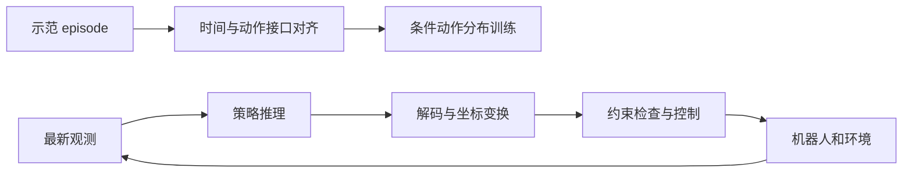

# 视觉语言动作模型

VLA 根据视觉、语言与机器人本体状态生成动作。以“拿起红杯”为例，模型需要把语言绑定到具体对象，再输出某个坐标系中的夹爪目标或动作序列。系统还要把动作转换为硬件命令，并观察物体是否真的被抓起。

## 策略到底输出什么

统一写法为

\[
A_t=(a_t,\ldots,a_{t+H-1})\sim\pi_\theta(\cdot\mid o_{\le t},q_{\le t},l).
\]

这里动作块恰有 \(H\) 步，\(q\) 表示本体状态，\(l\) 表示任务。输出可以是离散 action token，也可以是连续关节目标、末端位姿或技能。动作表示必须同时指定单位、坐标、控制周期和解码方式。

例如同一个数 0.01，如果表示每 100 毫秒移动 0.01 米，理想平均速度为 0.1 米每秒；如果表示速度，则是 0.01 米每秒。模型参数没有变化，接口解释已经相差十倍。理解 VLA 应先能解释这种差异，再比较架构。

## 训练与执行为何需要两条链

训练数据通常来自专家或已有策略，部署时观测来自模型自己的动作后果。两者的闭环状态分布不同，解释了为什么离线动作误差很低仍可能中途失败。重观测、动作块取消和恢复数据都属于这个问题的一部分。

| 需要理解的机制 | 正文 |
| --- | --- |
| 数组如何变成有单位的命令 | [动作表示与控制接口](action-representation-and-interfaces.md) |
| 示范如何形成概率训练目标 | [数据与策略学习](data-and-policy-learning.md) |
| 一段动作如何与实时反馈结合 | [动作块、层级策略与技能](action-chunking-hierarchical-policies-and-latent-skills.md) |
| 偏离后怎样取消旧计划并恢复 | [闭环恢复](closed-loop-recovery-and-failure-analysis.md) |
| 成功率与训练数据如何互相约束 | [评测与数据引擎](benchmarks-and-data-engines.md) |
| 延迟、命令有效期与约束如何执行 | [部署与安全](deployment-and-safety.md) |

假设第一段动作让夹爪比示范偏右 1 厘米，下一帧里杯子相对夹爪的位置已经改变。闭环策略读取新观察后应重新决定动作，不能仅继续比较原示范时间索引下的标签。若数据中没有偏移后的状态，模型可能不知道怎样修正，这就是离线动作误差与闭环成功之间的缺口。

因此动作表示解决“输出什么意思”，chunk 解决“预测和执行多长”，恢复机制解决“状态已经偏离后怎样重新开始”。显式世界模型再增加候选动作后果的预测，它不是建立基本反馈闭环的必要条件。

## 与世界模型组合时新增了什么

策略学习 \(\pi_\theta(a\mid o,l)\)，世界模型学习 \(p(z_{t+1}\mid z_t,a_t)\)。前者提出动作，后者估计后果。若世界模型用于选动作，需要证明它能正确区分候选，而不只是生成流畅视频。只记录实际执行动作的轨迹，也不能提供所有未执行候选的真实未来标签。

系统分工见[VLA、WAM 与世界模型](../embodied-ai/vla-wam-world-model-system-map.md)。推理优化可进一步看[投机推理与闭环验证](../inference/vla-speculative-decoding-0928-1144.md)，但加速结果应与任务成功、取消延迟和观测年龄一起解释。

[RT-2](https://arxiv.org/abs/2307.15818)、[OpenVLA](https://arxiv.org/abs/2406.09246)、[ACT](https://arxiv.org/abs/2304.13705)和 [Diffusion Policy](https://arxiv.org/abs/2303.04137)分别提供不同接口与训练方式的原始材料，不代表一种统一的动作协议。
