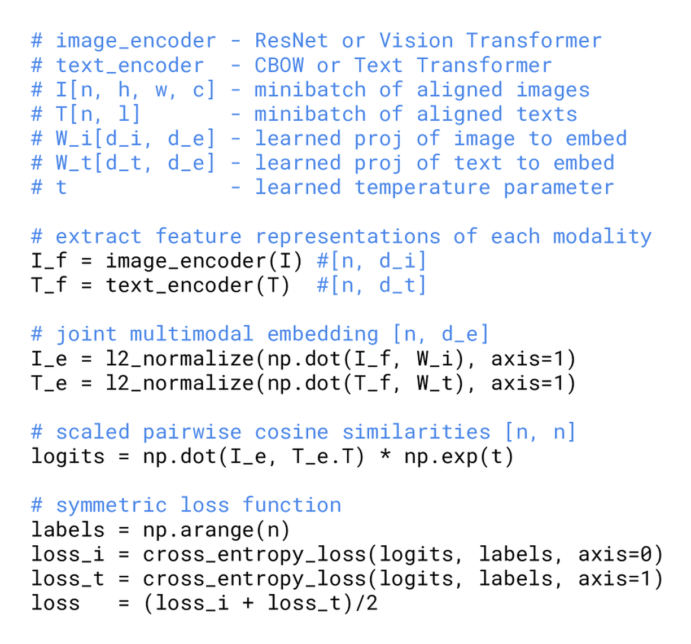

# 视觉表征、连接器与时序状态

这一页只保留 VLM/VLA 主线中真正必要的视觉部分：图像如何变成 token，视觉和语言如何对齐，连接器如何压缩视觉信息，视频表示如何进一步变成世界模型可用的状态。

!!! note "初学者先抓住"
    VLM 的视觉侧不是“给 LLM 插一张图片”。它先把图像变成视觉 token，再通过对齐目标或连接器压成语言模型能消费的表示。若目标是世界模型，还要继续让表示带上时间、运动和可预测性。

## 1. 从像素到视觉 token

若输入图像为 \(I \in \mathbb{R}^{H \times W \times C}\)，把它切成 \(P \times P\) patch 后，patch 数量为：

\[
N = \frac{H}{P}\cdot\frac{W}{P}
\]

每个 patch 展平并投影到隐藏维度 \(d\)：

\[
e_i = W_p \cdot \text{flatten}(I_i) + p_i
\]

视觉编码器得到：

\[
h_v = f_v(e_1, e_2, \dots, e_N)
\]

这一步的核心取舍是分辨率和 token 成本。patch 越小，视觉细节越多，但 attention 和显存成本更高。对世界模型来说，问题还会继续放大：视频 token 同时有空间维和时间维，状态压缩必须更严格。

## 2. 静态图文对齐

{ width="830" }

<small>图源：[Learning Transferable Visual Models From Natural Language Supervision](https://arxiv.org/abs/2103.00020)，Figure 1。原论文图意：用图像编码器和文本编码器把图文对拉到同一表示空间，并把类别文本 prompt 当作 zero-shot 分类器。</small>

CLIP 风格目标把图像向量 \(v\) 和文本向量 \(t\) 放进同一空间：

\[
s(v,t)=\frac{\langle v,t\rangle}{\|v\|\|t\|}
\]

典型 InfoNCE 损失让正确图文对靠近、错误图文对远离。它塑造的是静态语义空间：什么图片和什么句子语义相近。

!!! note "难点解释：静态语义不是动态状态"
    CLIP 表示很适合检索和分类，但它没有显式记忆、动作条件或 rollout 目标。把它接到世界模型时，通常只能作为视觉 encoder 或初始化，而不能直接替代 dynamics model。

{ width="720" }

<small>图源：[Learning Transferable Visual Models From Natural Language Supervision](https://arxiv.org/abs/2103.00020)，Figure 3。原论文图意：展示 CLIP 图像编码器和文本编码器的批内相似度矩阵、对称 cross entropy 目标，以及 zero-shot classifier 的构造方式。</small>

!!! note "图解：InfoNCE 在 VLM 中到底做了什么"
    一个 batch 里有 \(N\) 对图文样本。正确图文对位于相似度矩阵对角线，其他 \(N-1\) 个文本或图像被当作候选负样本。训练目标不是让模型生成句子，而是让正确配对在候选集合里排到最前。它给 VLM 提供静态语义坐标系：图片、类别文本和描述可以比较相似度。但它不会告诉模型“这个动作执行后会怎样”，所以后面必须接视频状态、动作接口和世界模型。

## 3. 连接器：从视觉 token 到语言接口

{ width="920" }

<small>图源：[BLIP-2: Bootstrapping Language-Image Pre-training with Frozen Image Encoders and Large Language Models](https://arxiv.org/abs/2301.12597)，Figure 2。原论文图意：冻结图像编码器，用查询式连接模块抽取视觉信息，并分别服务 image-text contrastive learning、image-grounded text generation 和 image-text matching。</small>

!!! note "图解：连接器决定视觉信息损失在哪里发生"
    Q-Former 用少量 learnable query 从大量视觉 token 中读取信息。它既是桥，也是瓶颈。连接器训练得好，语言模型能收到任务相关视觉证据；连接器太弱，LLM 只能靠语言先验补答案。世界模型也有类似瓶颈：状态 encoder 必须压缩视觉，但不能丢掉对未来预测和动作选择有用的信息。

常见连接方式包括：

| 方式 | 适合什么 | 局限 |
| --- | --- | --- |
| 线性 projector | 快速把视觉特征映射到 LLM embedding | 容易丢局部关系 |
| Q-Former / query connector | 用少量查询提取关键信息 | 查询数量和目标设计决定瓶颈 |
| Cross-attention | 文本动态读取视觉 token | 成本较高，长视频更难 |
| 统一 token 序列 | 图像、文本、动作都放入同一序列 | 训练和推理成本高 |

## 4. 视频时序状态

静态 VLM 看的是一张图或少量帧；世界模型需要的是随时间更新的状态。视频状态至少要保留：

- 对象持续性：同一个物体在不同帧中还是同一个物体。
- 运动线索：速度、方向、接触和遮挡关系。
- 历史记忆：刚刚发生过什么，哪些信息当前不可见但仍然重要。
- 可预测性：状态能否支持未来 rollout，而不只是当前分类。

{ width="920" }

<small>图源：[V-JEPA: Latent Video Prediction for Visual Representation Learning](../paper-deep-dives/world-models/v-jepa.md)，Figure 3。原论文图意：context encoder 只处理 masked video 中未遮挡 token，predictor 用 context output 和 mask tokens 预测 target encoder 对完整视频产生的 masked token representations。</small>

!!! note "图解：为什么预测 latent 而不是像素"
    V-JEPA 的训练目标不是补出每个像素，而是预测 target encoder 的 latent representation。这样可以少关注纹理和光照细节，多关注对象、运动和上下文结构。对世界模型来说，这更接近“学状态”而不是“学画图”。但它仍缺动作条件，所以只是世界模型前置表征，而不是完整 dynamics。

## 5. 从视觉状态到动作条件

VLM/VLA 与世界模型的关键差别可以写成两条式子：

\[
\pi_\theta(a_t \mid z_t, l)
\]

\[
p_\theta(z_{t+1} \mid z_t, a_t, l)
\]

第一条是策略：根据视觉状态和语言指令输出动作。第二条是 dynamics：预测动作之后状态如何变化。真正的世界模型需要第二条，甚至还要预测 reward、termination、risk 和 uncertainty。

!!! example "有趣例子：杯子在桌边"
    VLM 状态告诉你“杯子在桌边”。VLA 策略可能输出“夹爪向杯子移动”。世界模型还要预测：如果从右侧推，杯子是否会掉；如果先从上方夹取，是否更安全。只有第三种能力才真正进入动作后果建模。

## 6. 检查点

读完这页后，应能回答：

| 问题 | 合格理解 |
| --- | --- |
| 图像 token 是什么 | patch 或视觉特征被投影成可被 Transformer 消费的序列 |
| CLIP 解决什么 | 静态图文语义对齐，不解决动作后果 |
| Q-Former 解决什么 | 从大量视觉 token 中抽取少量语言可用证据 |
| 视频 latent 为什么重要 | 世界模型需要时序状态，而不是单帧 caption |
| VLA 和世界模型差在哪 | VLA 输出动作，世界模型预测动作后的状态变化 |
