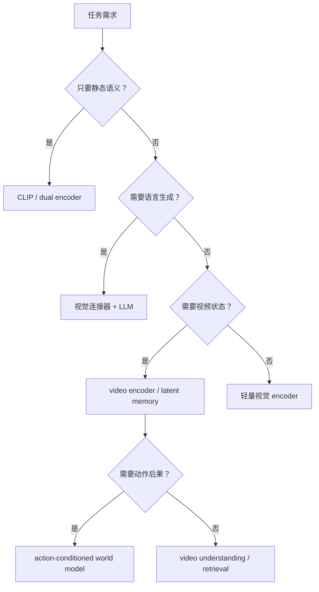

# VLM 架构：视觉表征、连接器与记忆

VLM 的第一件事不是“让 LLM 看到图片”，而是把图片变成一串模型能处理的 token，再把这些 token 和语言对齐。若继续走向 VLA 和世界模型，这些 token 还要保留动作、接触、遮挡和时间变化。

!!! note "初学者先抓住"
    一张图片进入 VLM，通常会经历四步：像素切成 patch，patch 变成视觉 token，视觉 token 通过连接器进入语言模型，多帧视觉再被压成带记忆的状态。读公式前先把这四步放进脑子里。

!!! tip "符号入口"
    本页公式使用的 \(I, H_{\text{img}}, W_{\text{img}}, C, P, N, d, x_v, x_t, z_t, a_t\) 都可以在 [符号与最小数学地图](vlm-vla-symbols-and-minimal-math.md) 里查。

## 1. 从像素到视觉 token

先把图像写成一个数组：

\[
I \in \mathbb{R}^{H_{\text{img}} \times W_{\text{img}} \times C}
\]

| 符号 | 含义 | 红杯例子 |
| --- | --- | --- |
| \(I\) | 输入图像 | 桌面相机拍到的画面 |
| \(H_{\text{img}}, W_{\text{img}}\) | 图像高度和宽度 | 例如 \(224\times224\) 或 \(640\times480\) |
| \(C\) | 通道数 | RGB 通常是 3 |

把图像切成 \(P\times P\) patch 后，patch 数量是：

\[
N = \frac{H_{\text{img}}}{P}\cdot\frac{W_{\text{img}}}{P}
\]

| 符号 | 含义 |
| --- | --- |
| \(P\) | patch 边长 |
| \(N\) | patch token 数 |

**读作什么**：图像越大、patch 越小，视觉 token 越多。

**红杯例子**：\(224\times224\) 图像用 \(16\times16\) patch，会得到 \(14\times14=196\) 个视觉 token。若是 4 路相机、16 帧历史，就会变成 \(4\times16\times196=12544\) 个视觉 token。

**这个公式不说明什么**：token 多只表示输入更细，不代表模型一定保留了杯沿、夹爪接触点和遮挡前位置。

每个 patch 会被展平并投影到隐藏维度：

\[
e_i = W_p \cdot \text{flatten}(I_i) + p_i
\]

| 符号 | 含义 |
| --- | --- |
| \(I_i\) | 第 \(i\) 个图像 patch |
| \(W_p\) | patch 投影矩阵 |
| \(p_i\) | 位置编码，让模型知道 patch 在图像中的位置 |
| \(e_i\) | 第 \(i\) 个视觉 token embedding |

视觉 encoder 再处理整个 token 序列：

\[
h_v = f_v(e_1, e_2, \dots, e_N)
\]

**读作什么**：视觉 encoder 把一组 patch token 变成更高层的视觉特征 \(h_v\)。

## 2. CLIP：建立静态图文语义空间

{ width="830" }

<small>图源：[Learning Transferable Visual Models From Natural Language Supervision](https://arxiv.org/abs/2103.00020)，Figure 1。原论文图意：用图像编码器和文本编码器把图文对拉到同一表示空间，并把类别文本 prompt 当作 zero-shot 分类器。</small>

!!! note "读图：CLIP 先看哪里"
    **先看哪里**：左边一批图像和一批文本分别进入两个 encoder，中间比较所有图文对的相似度。  
    **它证明什么**：图像和文本可以被放进同一个 embedding 空间，正确图文对更接近。  
    **它不证明什么**：它不学习动作、接触、时间记忆和动作后果。  
    **和红杯例子的关系**：CLIP 可以帮模型知道“red mug”和红杯图片相似，但不会告诉机械臂如何抓杯子。

CLIP 常用余弦相似度比较图像向量 \(v\) 和文本向量 \(t\)：

\[
s(v,t)=\frac{\langle v,t\rangle}{\|v\|\|t\|}
\]

| 符号 | 含义 |
| --- | --- |
| \(v\) | 图像 encoder 输出的向量 |
| \(t\) | 文本 encoder 输出的向量 |
| \(\langle v,t\rangle\) | 向量内积 |
| \(\|v\|,\|t\|\) | 向量长度 |
| \(s(v,t)\) | 图文相似度 |

**读作什么**：两个向量方向越接近，相似度越高。

**这个公式不说明什么**：相似度高只说明语义匹配，不说明空间位置、可达性和物理风险。

{ width="720" }

<small>图源：[Learning Transferable Visual Models From Natural Language Supervision](https://arxiv.org/abs/2103.00020)，Figure 3。原论文图意：展示 CLIP 图像编码器和文本编码器的批内相似度矩阵、对称 cross entropy 目标，以及 zero-shot classifier 的构造方式。</small>

!!! note "读图：InfoNCE 在这里做什么"
    **先看哪里**：相似度矩阵的对角线。一个 batch 里正确图文对在对角线上，其余位置是负样本。  
    **它证明什么**：训练目标让正确图文对排名靠前，让错误配对靠后。  
    **它不证明什么**：这个目标不要求模型生成回答，更不要求模型控制机器人。  
    **和后续关系**：它提供静态语义坐标系，后面还要接连接器、视频状态和动作接口。

## 3. BLIP-2：连接器是视觉信息瓶颈

{ width="920" }

<small>图源：[BLIP-2: Bootstrapping Language-Image Pre-training with Frozen Image Encoders and Large Language Models](https://arxiv.org/abs/2301.12597)，Figure 2。原论文图意：冻结图像编码器，用查询式连接模块抽取视觉信息，并分别服务 image-text contrastive learning、image-grounded text generation 和 image-text matching。</small>

!!! note "读图：Q-Former 先看哪里"
    **先看哪里**：中间的 learnable query。它们像少量问题，主动从大量视觉 token 里读取信息。  
    **它证明什么**：连接器可以把视觉信息压成较少 token，再交给语言模型。  
    **它不证明什么**：为图文问答压缩出的信息，不必然保留抓取点、接触边界和动作后果。  
    **和红杯例子的关系**：如果 query 只记住“这是红杯”，却丢掉杯沿位置和夹爪距离，VQA 可能没问题，VLA 会抓偏。

常见连接器可以抽象成：

\[
c = g_\theta(h_v, q)
\]

| 符号 | 含义 |
| --- | --- |
| \(h_v\) | 视觉 encoder 输出的视觉特征 |
| \(q\) | learnable query 或文本侧查询 |
| \(g_\theta\) | 连接器，例如 projector、Q-Former、resampler 或 cross-attention |
| \(c\) | 交给 LLM、policy 或 world model 的压缩视觉 token |

**读作什么**：连接器从大量视觉特征里抽取后续模型最需要的信息。

**这个公式不说明什么**：它没有定义“最需要”到底是什么。VLM 需要回答问题，VLA 需要动作可执行，世界模型需要未来可预测，这三者的信息需求不同。

| 连接方式 | 初学者理解 | 常见风险 |
| --- | --- | --- |
| 线性 projector | 把视觉特征映射到 LLM embedding 空间 | 简单但选择信息能力弱 |
| Q-Former / resampler | 用少量查询主动抽取视觉证据 | 查询数量和训练目标决定瓶颈 |
| Cross-attention | 文本或策略 token 按需读取视觉 memory | 成本更高，长视频更难 |
| 统一 token 序列 | 图像、文本、动作都放进同一序列 | 训练和推理成本高 |

## 4. 视频状态：从静态语义走向时间记忆

静态 VLM 解决“这张图里有什么”。VLA 和世界模型还要知道“刚刚发生了什么”和“动作后会怎样”。

可以把状态编码写成：

\[
z_t = f_\theta(o_{\le t})
\]

| 符号 | 含义 |
| --- | --- |
| \(o_{\le t}\) | 到当前为止的观测历史 |
| \(z_t\) | 压缩后的 latent state |
| \(f_\theta\) | 视频或状态 encoder |

**读作什么**：模型把历史观测压成当前状态。

**红杯例子**：红杯被机械臂拿起后短暂被夹爪遮挡，\(z_t\) 应该仍保留“红杯已在夹爪里”的状态。

**这个公式不说明什么**：它没有保证 latent 真的记住了关键物体，也没有保证对不同动作敏感。

{ width="920" }

<small>图源：[V-JEPA: Latent Video Prediction for Visual Representation Learning](../paper-deep-dives/world-models/v-jepa.md)，Figure 3。原论文图意：context encoder 只处理 masked video 中未遮挡 token，predictor 用 context output 和 mask tokens 预测 target encoder 对完整视频产生的 masked token representations。</small>

!!! note "读图：V-JEPA 为什么预测 latent"
    **先看哪里**：context encoder 只看可见区域，predictor 预测被遮挡区域的 latent 表示。  
    **它证明什么**：视频表征可以学习对象、运动和上下文，而不是逐像素复读纹理。  
    **它不证明什么**：它缺少动作条件、奖励、风险和 planner 接口，所以还不是完整世界模型。  
    **和红杯例子的关系**：它能帮助模型理解红杯在视频中如何持续存在，但还需要动作条件才能预测“抓快了会不会滑”。

## 5. 从 VLM 到 VLA，再到世界模型

VLA 和世界模型常被两条式子区分：

\[
\pi_\theta(a_t \mid z_t, l)
\]

\[
p_\theta(z_{t+1} \mid z_t, a_t, l)
\]

| 公式 | 读作什么 | 红杯例子 |
| --- | --- | --- |
| \(\pi_\theta(a_t \mid z_t, l)\) | 策略根据状态和语言输出动作 | “现在夹爪向红杯移动” |
| \(p_\theta(z_{t+1} \mid z_t, a_t, l)\) | dynamics 预测动作后的下一状态 | “这样抓会让杯子抬起或滑落” |

**关键差别**：VLA 主要回答“现在做什么”，世界模型回答“做了以后会怎样”。

!!! example "红杯在桌边"
    VLM 能说红杯在桌边。VLA 能输出接近红杯的动作。世界模型还要比较：从侧面推可能把杯子推下桌，从上方夹取更稳。只有第三种能力才进入动作后果建模。

## 6. 架构选择图

这张图可以当成选型入口。静态检索不必上复杂 VLA；语言生成需要 connector；视频理解需要 temporal state；只有当系统要比较动作后果时，才真正进入世界模型接口。

## 7. 检查点

读完这页后，应能回答：

| 问题 | 合格理解 |
| --- | --- |
| 图像 token 是什么 | patch 或视觉特征被投影成 Transformer 可消费的序列 |
| CLIP 解决什么 | 静态图文语义对齐，不解决动作后果 |
| Q-Former 解决什么 | 从大量视觉 token 中抽取少量语言可用证据 |
| 视频 latent 为什么重要 | VLA 和世界模型需要时序状态，而不是单帧 caption |
| VLA 和世界模型差在哪 | VLA 输出动作，世界模型预测动作后的状态变化 |
