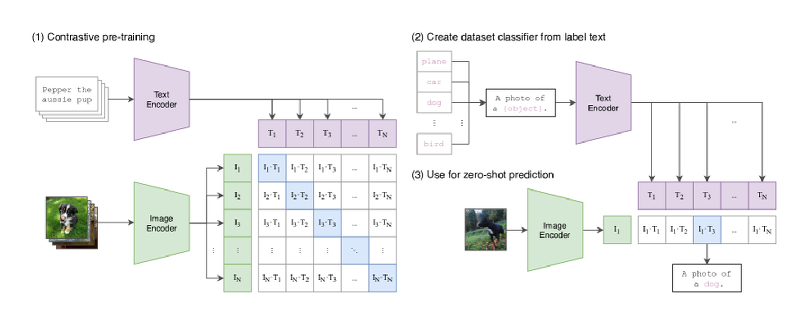
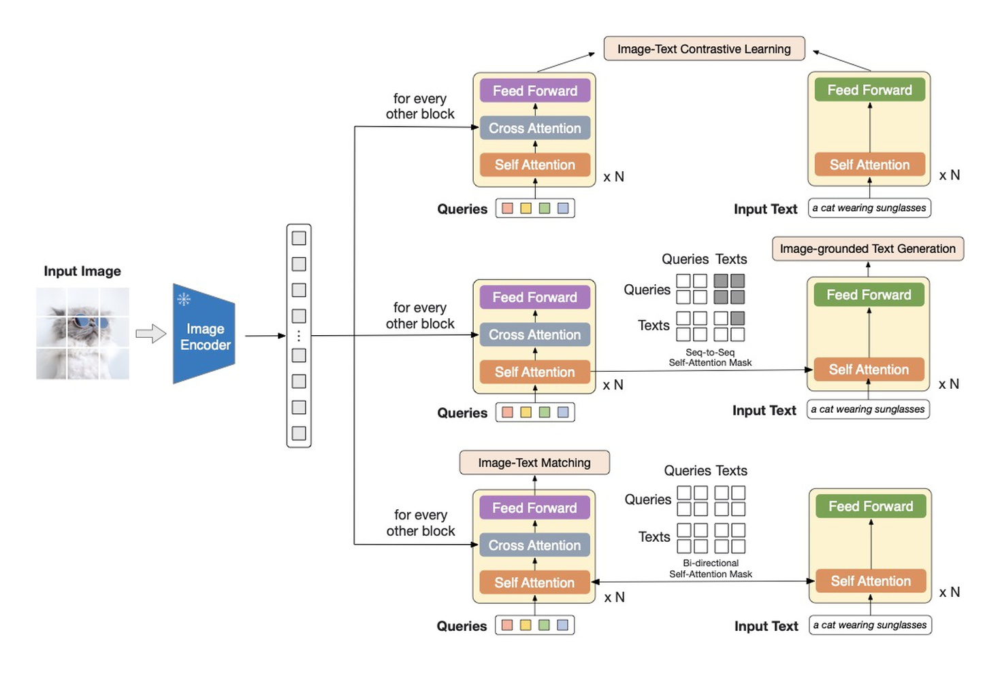
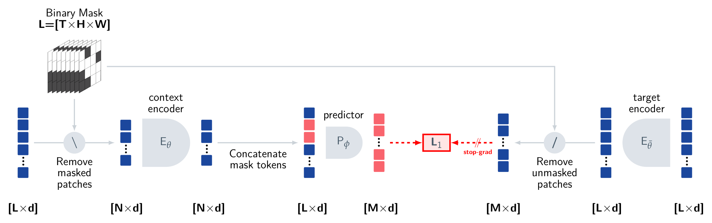

# VLM 怎样把视觉证据接进语言生成

给一张桌面图和一句“杯子是什么颜色”，模型最终输出文字。这个任务至少需要完成两次转换。像素先变成能够表达物体和局部关系的特征，视觉特征再进入预测下一个文字 token 的计算。理解 VLM 的结构，可以沿一条回答追踪这两个转换，以及回答错误时究竟丢失了哪部分信息。

## 图文匹配与看图回答需要不同的输出

图文检索可以只输出一个匹配分数。设图像编码器得到向量 \(v\)，文本编码器得到向量 \(u\)，归一化后用点积计算相似度。一个 batch 含 \(B\) 对图文，得到分数矩阵

\[
S_{ij}=\frac{\bar v_i^\top\bar u_j}{T},
\qquad \bar v_i=\frac{v_i}{\|v_i\|_2}.
\]

\(T>0\) 是温度，行表示图像，列表示文本，已配对的数据位于对角线上。图像到文本方向的损失是

\[
\mathcal L_{I\to T}=-\frac1B\sum_i
\log\frac{\exp S_{ii}}{\sum_j\exp S_{ij}}.
\]

[CLIP](https://arxiv.org/abs/2103.00020)同时使用图像到文本、文本到图像的对比目标。若某行两个分数是 `[2,0]`，正确文本的概率约为 0.881，负对数概率约为 0.127。提高正确配对分数、降低竞争配对分数都会减小这一项；batch 中的其他文本构成了当前比较集合。错误标注和实际上也适合该图的“负样本”会影响这项监督。

{ width="860" }

<small>图源为 [CLIP](https://arxiv.org/abs/2103.00020) Figure 1。左边对角线对应正确图文配对；右边将类别写进文本提示，与图像向量比较。这个流程生成匹配分数，图中没有逐词输出回答的语言解码过程。</small>

看图回答还需要一个文字生成器。它在图像和问题条件下定义

\[
p_\theta(y\mid I,q)=\prod_{t=1}^{M}
p_\theta(y_t\mid I,q,y_{<t}).
\]

这里 \(I\) 是图像，\(q\) 是问题，\(y\) 是由 \(M\) 个 token 组成的回答。检索分数说明某段文字与图像是否匹配；这个条件分布才规定回答如何逐步形成。二者可以共享视觉预训练，但不能由一个输出接口直接推断另一个接口的能力。

回到“红杯在什么位置”这个问题。CLIP 可以比较图片与“杯子在左侧”“杯子在右侧”两个候选描述的相似度，但这些候选需要预先给出，它没有在这个接口中逐字产生解释。若希望模型回答“红杯在盘子左侧，杯柄朝右”，就需要把视觉证据交给一个能够条件生成文本的解码器。

连接器承担这次接口变化。视觉编码器给出每个图像区域的特征，连接器把它转换成语言模型能够消费的向量。语言模型每生成一个回答 token，都可通过注意力读取这些视觉向量。训练标签也随之从“哪条 caption 配这张图”改为“在图像、问题和前面回答 token 条件下，下一个 token 应是什么”。因此结构与 loss 必须一起改变，仅把 CLIP 相似度换个输出名字并不能获得看图问答。

## 从像素到语言模型的输入形状

用一张 \(224\times224\) 的 RGB 图说明一种常见接法。取 \(16\times16\) patch，得到 196 个位置，每个原始 patch 有 \(16\times16\times3=768\) 个数。线性投影和视觉 Transformer 把这些位置变成 \(H_v\in\mathbb R^{196\times d_v}\)。视觉编码器可以使用位置编码和全图注意力，因此输出向量已经能够包含其他区域的信息，不再只是原始 patch 的颜色。

假设语言模型隐藏宽度是 \(d_l\)，最简单连接器为

\[
Z_v=H_vW+b,\qquad W\in\mathbb R^{d_v\times d_l}.
\]

它把特征宽度变成 \(d_l\)，输出仍有 196 个视觉 token。接上 20 个问题 token、10 个回答 token，训练序列就有 226 个位置，未计模板和其他特殊 token。投影层只改变宽度，不自动减少位置数量；如果视觉编码器已经丢掉小字，调宽这个矩阵也不能唯一恢复原来的字符。

[视觉 Tokenizer 与连接器](visual-tokenizers-and-connectors.md)进一步计算 patch、resampler 和 cross-attention 的区别。这里先把最终视觉向量看作语言模型能够接收的一段前缀，注意它们通常是连续向量，并不需要变成文本词表中的整数 ID。

## 注意力可见范围和监督位置分别解决什么

训练序列可以组织为 `[视觉前缀，问题，答案]`。回答第一个 token 时能读取视觉前缀和问题，回答后续 token 时还可以读取前面已经出现的答案。具体视觉前缀内部是双向可见还是沿用因果掩码，由架构决定。

注意力 mask 限定信息可见范围，loss mask 限定哪些位置接受输出监督。常见问答微调只对答案位置计算

\[
\mathcal L_{\mathrm{answer}}
=-\frac1{\sum_t m_t}\sum_t m_t
\log p_\theta(y_t\mid I,q,y_{<t}),
\]

其中答案位置 \(m_t=1\)，图像占位、问题和 padding 等不计分的位置为 0。把问题从 loss 中排除，并不阻止答案读取问题。反过来，若只遮掉 loss，却让当前答案通过注意力看到未来答案，模型仍可利用泄漏信息，训练损失会失去预期含义。

例如答案两个 token 的真值概率为 0.8 和 0.5，平均负对数似然为 \(-[\log0.8+\log0.5]/2\approx0.4581\)。附加十个不计分的 padding 后，分母仍应按这两个有效 token 计算。若除以整个序列长度，就会因为 padding 多少改变同一回答的训练权重。

## 冻结语言模型以后，连接器怎样收到梯度

冻结参数只意味着不更新这些参数，不意味着整条计算不能传播梯度。若语言模型记为 \(f_\psi\)、连接器为 \(g_\phi\)，有

\[
\frac{\partial\mathcal L}{\partial\phi}
=\frac{\partial\mathcal L}{\partial f_\psi}
\frac{\partial f_\psi}{\partial Z_v}
\frac{\partial g_\phi}{\partial\phi}.
\]

即使 \(\psi\) 不更新，损失仍需通过语言模型对输入 \(Z_v\) 的导数传回连接器。把整个语言模型前向包进 `no_grad()`，会切断这条路径。固定视觉编码器且无需对输入图像求梯度时，它的特征通常可以在不保留参数计算图的情况下提取；但是否缓存，还取决于数据增强、分辨率和编码器是否真正固定。

一种训练安排先学习连接器，再训练连接器与语言模型，另一种会同时调整视觉编码器。阶段选择改变可更新参数、优化难度与保留原模型能力的程度，不能只看总参数量判断成本。

## 少量查询如何读取视觉信息

[BLIP-2](https://arxiv.org/abs/2301.12597)使用可学习 query 从冻结的图像特征中抽取信息，再接到冻结语言模型。Query 的数量决定接口序列长度，训练目标决定它们被鼓励保留哪些信息。

{ width="900" }

<small>图源为 [BLIP-2](https://arxiv.org/abs/2301.12597) Figure 2。图中图像特征通过 cross-attention 被 query 读取；三种图文目标对应不同的 query/text 可见关系。掩码决定是否以及怎样交换信息，不能把三种训练目标当成一次完全相同的前向。</small>

[Flamingo](https://arxiv.org/abs/2204.14198)用 Perceiver Resampler 形成有限数量的视觉 latent，并通过语言层里的 gated cross-attention 读取；[LLaVA](https://arxiv.org/abs/2304.08485)展示视觉投影与指令微调的接法。前者的视觉 memory 与文字流可以在多个层中交互，后者将视觉向量接入语言序列。它们都可能丢失信息，不能在没有受控比较时断言某种连接器天然更懂几何。

## 回答正确也可能没有使用图像

当问题带有强语言先验时，模型可能只看文字就给出常见答案。训练集里“香蕉是什么颜色”大多对应黄色，单纯回答正确并不能证明视觉条件被使用。可以固定问题，换成绿色香蕉或灰度图，观察输出；也可以遮掉相关区域、交换图像而保持文字不变，比较变化。

这种对照也帮助定位错误。若不同裁剪下答案变化很大，先检查输入分辨率和视觉证据；若视觉特征能区分类别，但生成器仍坚持语言先验，则要检查连接器、训练数据和答案目标。注意力热图可辅助排查，却不足以独立证明因果使用了某个区域。

从回答到行动还增加了新的接口。语言里的“杯子在右边”没有指定机器人基座坐标、米制距离、控制周期与限幅，不能直接发送给机械臂。相关计算见[动作表示与控制接口](../vla/action-representation-and-interfaces.md)，时间证据如何进入状态见[视频表征与记忆](video-representation-and-memory.md)。

## 资料与实现对照

- [CLIP](https://arxiv.org/abs/2103.00020)给出图文对比目标和零样本分类流程。
- [BLIP-2](https://arxiv.org/abs/2301.12597)、[Flamingo](https://arxiv.org/abs/2204.14198)分别说明 query 与 resampler/cross-attention 接口。
- [LLaVA](https://arxiv.org/abs/2304.08485)说明视觉指令微调的结构与训练安排。
- [多模态评测](multimodal-evaluation-and-failure-modes.md)讨论怎样区分视觉识别、定位、语言生成与闭环行为。

## 视频表征是另一个训练接口

{ width="760" }

<small>图源：[V-JEPA](https://arxiv.org/abs/2404.08471)，Figure 3。context encoder 从可见视频块提取特征，predictor 预测 target encoder 对被遮挡块产生的表示。</small>

这个目标学习视频表示，不直接训练语言答案。将它接到语言生成或机器人系统时，仍需另外设计连接器、语言或动作监督。具体的 mask、停止梯度和状态记忆见[视频表征与记忆](video-representation-and-memory.md)。
