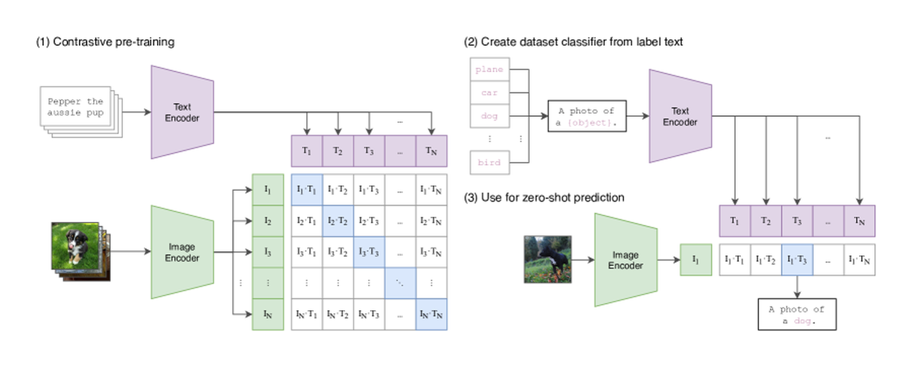
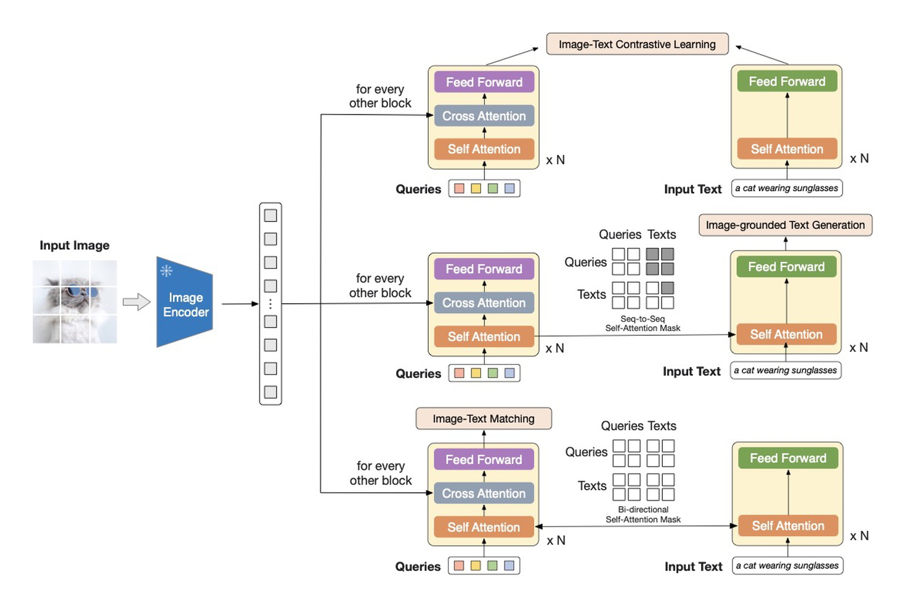
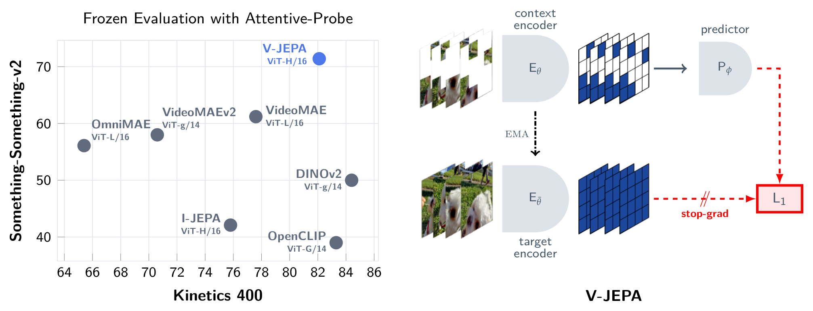
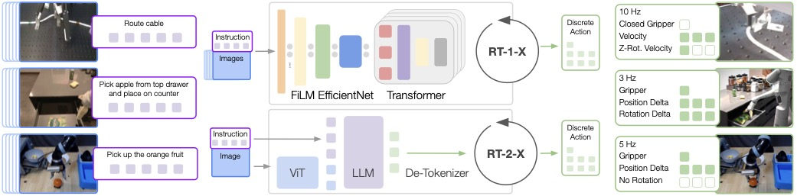
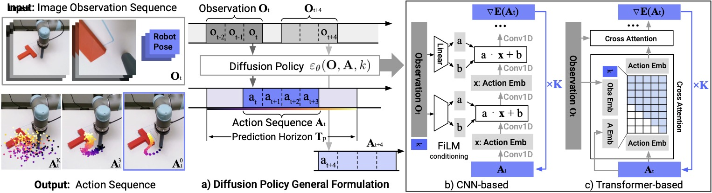
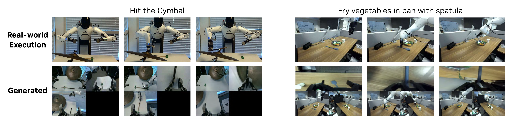

# VLM/VLA 路线图：从看懂到行动

这章先不从模型名字开始，而从一个初学者最容易想清楚的任务开始：

<!-- [补充] -->
| 读者 | 建议读法 | 工程落点 |
| --- | --- | --- |
| 初学者 | 先抓“VLM/VLA 路线图：从看懂到行动”要解决的问题、关键术语和最小例子；公式只看变量方向。 | 能说清输入、输出和常见失败信号。 |
| 工程师 | 直接对照结构、指标、成本和边界条件，必要时回到前置页补概念。 | 落到数据、算力、延迟、显存、评测和回滚检查。 |


!!! note "读法定位"
    这页先回答“VLM/VLA 路线图：从看懂到行动”在「VLM/VLA」里的位置：它解决什么局部问题，依赖哪些前置，最后会影响哪类工程或研究判断。
    **前置**：先分清 token、embedding、attention 和评测指标；动作相关问题可跳到 VLA 专题。 必要时先看本页路线，或回 [基础知识](../foundations/index.md) 或 [术语表](../glossary/index.md)。
    **主线关系**：把视觉表征、语言模型接口、视频记忆和动作策略连起来，看多模态系统怎样从“看懂”走向“可行动”。

```text
机器人看到桌边有一个红杯。
人说：把红杯放到托盘上。
机器人需要看懂红杯在哪里，决定怎么抓，预测会不会滑落，然后执行并纠错。
```

这条链可以拆成四个问题：

```text
看图回答问题 -> 机器人执行动作 -> 预测动作后果 -> 用真实反馈继续修正
```

VLM、VLA、world model 和 WAM 的区别，就藏在这四个问题里。

!!! note "合并提示"
    **note · 初学者先抓住**

    VLM 主要回答“我看到了什么”。VLA 进一步回答“现在该怎么动”。世界模型追问“这样动以后会怎样”。WAM 则把未来视觉和动作一起生成，让动作和想象出的未来相互约束。

    **tip · 数学符号卡片**

    如果公式里的 \(x_v\)、\(o_t\)、\(z_t\)、\(a_t\)、\(\pi_\theta\)、\(p_\theta\) 看着混乱，先打开 [VLM/VLA 符号与最小数学地图](vlm-vla-symbols-and-minimal-math.md)。这章后面所有公式都按那页的约定来读。

## 10 分钟最短路径

如果你今天只想建立主线，不必一次读完整个专题：

1. 先读本页，分清 VLM、VLA、world model、WAM。
2. 读 [VLM 架构](architecture-and-training.md)，知道图像如何变成 token，CLIP 和 BLIP-2 在解决什么。
3. 读 [视觉 Tokenizer 与连接器](visual-tokenizers-and-connectors.md)，知道为什么视觉信息必须压缩。
4. 读 [VLA 数据与策略学习](../vla/data-and-policy-learning.md)，知道行为克隆为什么会滚雪球式出错。
5. 读 [动作表示与控制接口](../vla/action-representation-and-interfaces.md)，知道 action token、连续动作和 action chunk 的差别。

读完后你应该能用自己的话说清楚：模型看懂图片，和机器人真的把杯子放好，是两件难度完全不同的事。

## 一张小地图：四类模型到底差在哪

| 类型 | 它回答的问题 | 最小公式 | 红杯到托盘例子 | 它还缺什么 |
| --- | --- | --- | --- | --- |
| VLM | 当前画面和文字怎么对应 | \(p_\theta(y \mid x_v, x_t)\) | 回答“红杯在桌边” | 不输出可执行动作 |
| VLA | 当前该执行什么动作 | \(\pi_\theta(a_t \mid o_{\le t}, l)\) | 输出“接近红杯、闭合夹爪、抬起” | 不一定预测滑落、碰撞或失败 |
| World Model | 执行动作后未来会怎样 | \(p_\theta(z_{t+1:t+H_{\text{hor}}}\mid z_t,a_{t:t+H_{\text{hor}}-1})\) | 比较快抓和慢抓哪个更可能滑落 | 预测还要被策略和安全层使用 |
| WAM | 未来视觉和动作如何一起生成 | \(p_\theta(o_{t+1:t+H_{\text{hor}}},a_{t:t+H_{\text{hor}}}\mid history,goal)\) | 同时生成“机械臂移动视频”和动作块 | 真实闭环、安全和失败恢复仍要验证 |

!!! warning "最常见误解"
    VLM 分数高，不等于 VLA 会控制机器人。离线动作误差低，也不等于真机闭环成功。未来视频好看，也不等于世界模型对不同动作足够敏感。

## VLM：先学会“看图和文字对上”

VLM 可以先理解成一个条件生成或条件判断模型：

\[
p_\theta(y \mid x_v, x_t)
\]

<!-- [补充：符号说明] -->
| 符号 | 含义 | 取值范围 / 常见值 |
| --- | --- | --- |
| \(\theta\) | 模型或策略参数 | 实值张量，形状由模型结构决定 |
| \(p\) | 概率、转移分布或预测量 | 概率分布或任务定义的张量 |
| \(y\) | 公式中的变量或中间量 | 按上下文定义 |
| \(x_v\) | 样本、状态或 latent 变量 | 张量空间，形状由数据表示决定 |
| \(x_t\) | 样本、状态或 latent 变量 | 张量空间，形状由数据表示决定 |


**读作什么**：给定一张图和一句话，模型输出一个答案。

**红杯例子**：输入桌面图片和“红杯在哪里”，输出“红杯在桌边，靠近托盘左侧”。

**这个公式不说明什么**：它没有动作、时间和执行反馈。模型能回答红杯在哪里，不代表它能安全抓起红杯。

{ width="830" }

<small>图源：[Learning Transferable Visual Models From Natural Language Supervision](https://arxiv.org/abs/2103.00020)，Figure 1。原论文图意：用图像编码器和文本编码器把图文对拉到同一表示空间，并把类别文本 prompt 当作 zero-shot 分类器。</small>

!!! note "读图：CLIP 先看哪里"
    **先看哪里**：左边的 image encoder 和 text encoder，以及中间图文相似度矩阵。  
    **它证明什么**：图像和文本可以被拉到同一个 embedding 空间里，做检索、分类和语义对齐。  
    **它不证明什么**：CLIP 不知道机械臂怎么动，也不预测动作后果。  
    **和本章的关系**：它是 VLM/VLA 的静态语义起点，但还不是机器人策略。

## 连接器：把视觉变成 LLM 能吃的 token

图像通常先被切成 patch token，再由视觉 encoder 变成特征。若图像为：

\[
I \in \mathbb{R}^{H_{\text{img}}\times W_{\text{img}}\times C}
\]

<!-- [补充：符号说明] -->
| 符号 | 含义 | 取值范围 / 常见值 |
| --- | --- | --- |
| \(I\) | 时间步、索引或计数 | 整数索引或归一化时间区间，见正文 |
| \(H_{}\) | 公式中的变量或中间量 | 按上下文定义 |
| \(W_{}\) | 公式中的变量或中间量 | 按上下文定义 |
| \(C\) | 公式中的变量或中间量 | 按上下文定义 |


patch 大小为 \(P\times P\)，则 patch token 数为：

\[
N = \frac{H_{\text{img}}}{P}\cdot\frac{W_{\text{img}}}{P}
\]

<!-- [补充：符号说明] -->
| 符号 | 含义 | 取值范围 / 常见值 |
| --- | --- | --- |
| \(N\) | 时间步、索引或计数 | 整数索引或归一化时间区间，见正文 |
| \(H_{}\) | 公式中的变量或中间量 | 按上下文定义 |
| \(P\) | 概率、转移分布或预测量 | 概率分布或任务定义的张量 |
| \(W_{}\) | 公式中的变量或中间量 | 按上下文定义 |


**读作什么**：图像越大、patch 越小，视觉 token 越多。

**红杯例子**：要看清杯沿和夹爪接触点，patch 不能太粗；但多相机、多帧视频又会让 token 数爆炸。

**这个公式不说明什么**：token 多不等于状态好。世界模型需要保留会影响动作后果的信息，而不是保留所有像素。

{ width="920" }

<small>图源：[BLIP-2: Bootstrapping Language-Image Pre-training with Frozen Image Encoders and Large Language Models](https://arxiv.org/abs/2301.12597)，Figure 2。原论文图意：冻结图像编码器，用查询式连接模块抽取视觉信息，并分别服务 image-text contrastive learning、image-grounded text generation 和 image-text matching。</small>

!!! note "读图：BLIP-2 Q-Former 先看哪里"
    **先看哪里**：中间的 learnable query，它们从冻结图像 encoder 的视觉特征里读取信息。  
    **它证明什么**：LLM 不必直接吞下所有图像 patch，可以通过连接器抽取少量视觉证据。  
    **它不证明什么**：为问答压缩出来的信息，不一定足够支撑抓取、接触和未来预测。  
    **和本章的关系**：连接器是 VLM 到 VLA、world model 的第一个信息瓶颈。

## 视频表征：从“看见一张图”到“记住状态”

机器人不是看一张图就结束。红杯被夹起后可能被遮挡，杯子是否已经移动、夹爪是否已经接触，都需要状态记忆。

可以把视觉状态写成：

\[
z_t = f_\theta(o_{\le t})
\]

<!-- [补充：符号说明] -->
| 符号 | 含义 | 取值范围 / 常见值 |
| --- | --- | --- |
| \(\theta\) | 模型或策略参数 | 实值张量，形状由模型结构决定 |
| \(z_t\) | 样本、状态或 latent 变量 | 张量空间，形状由数据表示决定 |
| \(f\) | 公式中的变量或中间量 | 按上下文定义 |
| \(o_{t}\) | 公式中的变量或中间量 | 按上下文定义 |


**读作什么**：把历史观测压成当前可用状态。

**红杯例子**：即使当前画面看不到红杯，\(z_t\) 也应该记得它刚被放到托盘边缘，而不是把它“忘回”桌边。

**这个公式不说明什么**：\(z_t\) 是不是好状态，要靠遮挡、接触、动作敏感性和长时任务验证。

{ width="920" }

<small>图源：[V-JEPA: Latent Video Prediction for Visual Representation Learning](../paper-deep-dives/world-models/v-jepa.md)，Figure 1。原论文图意：V-JEPA 在视频 latent space 中预测 masked spatio-temporal regions 的目标表示，用 frozen evaluation 验证 motion-based 与 appearance-based 任务。</small>

!!! note "读图：V-JEPA 先看哪里"
    **先看哪里**：被遮挡的视频区域和 latent prediction，而不是像素重建。  
    **它证明什么**：视频表征可以优先学习对象、运动和上下文结构。  
    **它不证明什么**：V-JEPA 本身没有动作条件、奖励或安全接口。  
    **和本章的关系**：它解释了为什么世界模型需要“状态”，而不只是图片 caption。

## VLA：从视觉语言状态到动作

VLA 的核心公式是策略：

\[
\pi_\theta(a_t \mid o_{\le t}, l)
\]

<!-- [补充：符号说明] -->
| 符号 | 含义 | 取值范围 / 常见值 |
| --- | --- | --- |
| \(\pi_\theta\) | 模型或策略参数 | 实值张量，形状由模型结构决定 |
| \(a_t\) | 动作、优势或系数 | 动作空间/实数标量，依上下文而定 |
| \(o_{t}\) | 公式中的变量或中间量 | 按上下文定义 |
| \(l\) | 损失或目标函数 | 实数标量，训练时按 batch 聚合 |


**读作什么**：根据看见的历史和语言目标，决定现在执行什么动作。

**红杯例子**：策略输出一段动作：向红杯靠近、对准杯身、闭合夹爪、抬起并移向托盘。

**这个公式不说明什么**：动作能否被底层控制器执行，是否会碰撞、滑落或越界，还需要动作接口、控制器和安全层。

{ width="920" }

<small>图源：[Open X-Embodiment: Robotic Learning Datasets and RT-X Models](https://arxiv.org/abs/2310.08864)，Figure 2。原论文图意：RT-1-X 与 RT-2-X 都以图像和文本指令为输入并输出离散 end-effector actions；RT-2-X 把动作表示成另一种语言 token，与视觉语言数据一起训练。</small>

!!! note "读图：RT-X 先看哪里"
    **先看哪里**：输入仍是图像和指令，输出从文字变成了 end-effector action。  
    **它证明什么**：动作可以被离散化成 token，接入 Transformer 的序列建模框架。  
    **它不证明什么**：动作 token 化不自动解决精细控制、坐标系、动作平滑和安全停止。  
    **和本章的关系**：这是 VLM 走向 VLA 的关键接口：输出不再只是语言，而是能交给机器人执行的动作。

## 行为克隆：VLA 最常见的起点

很多 VLA 先从示范数据学起：

\[
\mathcal{D}=\{(o_t^{(i)}, l^{(i)}, a_t^{(i)})\}
\]

<!-- [补充：符号说明] -->
| 符号 | 含义 | 取值范围 / 常见值 |
| --- | --- | --- |
| \(o_t^{(i)}\) | 公式中的变量或中间量 | 按上下文定义 |
| \(l^{(i)}\) | 损失或目标函数 | 实数标量，训练时按 batch 聚合 |
| \(a_t^{(i)}\) | 动作、优势或系数 | 动作空间/实数标量，依上下文而定 |


\[
\mathcal{L}_{\text{BC}} = - \sum_{(o,l,a)\in\mathcal{D}} \log \pi_\theta(a \mid o, l)
\]

<!-- [补充：符号说明] -->
| 符号 | 含义 | 取值范围 / 常见值 |
| --- | --- | --- |
| \(\pi_\theta\) | 模型或策略参数 | 实值张量，形状由模型结构决定 |
| \(o\) | 公式中的变量或中间量 | 按上下文定义 |
| \(l\) | 损失或目标函数 | 实数标量，训练时按 batch 聚合 |
| \(a\) | 动作、优势或系数 | 动作空间/实数标量，依上下文而定 |


**读作什么**：专家在这个观测下这么做，模型也学着这么做。

**红杯例子**：专家总是先从上方接近红杯，再闭合夹爪，模型就学习这个映射。

**这个公式不说明什么**：行为克隆没有天然的失败恢复能力。测试时如果第一步偏了 2 厘米，后续观测就离训练分布越来越远，错误会滚雪球。

{ width="920" }

<small>图源：[Diffusion Policy: Visuomotor Policy Learning via Action Diffusion](https://arxiv.org/abs/2303.04137)，Figure 2。原论文图意：展示 Diffusion Policy 如何在视觉观察条件下，通过多步去噪生成未来动作序列，并支持 CNN-based 和 Transformer-based 两类策略结构。</small>

!!! note "读图：Diffusion Policy 先看哪里"
    **先看哪里**：模型不是只回归一个动作，而是在视觉条件下生成一段未来动作序列。  
    **它证明什么**：动作分布可能有多种合理解，生成式策略比简单均值回归更适合复杂操作。  
    **它不证明什么**：生成一段动作不代表可以长时间开环执行。真实系统仍要重新观察和纠错。  
    **和本章的关系**：它是理解 action chunk 和多峰动作分布的好入口。

## 世界模型：动作之后会发生什么

VLA 输出动作，世界模型预测动作后果：

\[
p_\theta(z_{t+1:t+H_{\text{hor}}}, r, d \mid z_t, a_{t:t+H_{\text{hor}}-1}, l)
\]

<!-- [补充：符号说明] -->
| 符号 | 含义 | 取值范围 / 常见值 |
| --- | --- | --- |
| \(\theta\) | 模型或策略参数 | 实值张量，形状由模型结构决定 |
| \(p\) | 概率、转移分布或预测量 | 概率分布或任务定义的张量 |
| \(z_{t+1:t+H_{}\) | 样本、状态或 latent 变量 | 张量空间，形状由数据表示决定 |
| \(r\) | 奖励、回报或时间索引相关量 | 实数标量或上下文定义的索引范围 |
| \(d\) | 公式中的变量或中间量 | 按上下文定义 |
| \(z_t\) | 样本、状态或 latent 变量 | 张量空间，形状由数据表示决定 |


**读作什么**：如果从当前状态执行这段动作，未来状态、进度和风险会怎样。

**红杯例子**：同样是移动红杯，快速侧推可能预测滑落风险高；从上方慢速夹取可能预测成功率更高。

**这个公式不说明什么**：预测未来不是目的本身。它必须被 policy、planner、risk head 或数据引擎消费，才会变成闭环价值。

{ width="920" }

<small>图源：[DreamZero: World Action Models are Zero-shot Policies](../paper-deep-dives/embodied-ai/dreamzero.md)，Figure 2。原论文图意：展示 DreamZero 同时生成未来视频和动作，并强调预测动作与生成视频在未见任务上保持对齐。</small>

!!! note "读图：DreamZero 先看哪里"
    **先看哪里**：未来视频和未来动作是一起生成的，而不是两个互不相干的输出。  
    **它证明什么**：动作可以不只是 policy 输出，也可以作为未来世界分叉的一部分来建模。  
    **它不证明什么**：未来视频与动作对齐，不等于真实机器人必然安全成功。  
    **和本章的关系**：它展示了 VLA 与世界模型合流的方向，也提醒我们必须看闭环评测。

## 贯穿例子：红杯到托盘

| 环节 | 系统要做什么 | 对应页面 |
| --- | --- | --- |
| 看懂红杯 | 识别红杯、托盘、桌边和障碍物 | [VLM 架构](architecture-and-training.md) |
| 压缩视觉 | 保留杯沿、夹爪、遮挡、托盘位置 | [视觉 Tokenizer 与连接器](visual-tokenizers-and-connectors.md) |
| 记住状态 | 红杯被遮挡后仍记得最后位置 | [视频表征与长时记忆](video-representation-and-memory.md) |
| 学动作 | 从示范中学习靠近、抓取、移动、释放 | [VLA 数据与策略学习](../vla/data-and-policy-learning.md) |
| 定义动作接口 | 决定输出动作 token、连续末端位姿还是 action chunk | [动作表示与控制接口](../vla/action-representation-and-interfaces.md) |
| 预测后果 | 比较不同抓取方式的滑落、碰撞和成功概率 | [VLM/VLA 与世界模型接口](vlm-vla-for-efficient-world-model-training.md) |
| 闭环恢复 | 抓偏或杯子滑动后重新观察和修正 | [VLA 闭环恢复与失败分析](../vla/closed-loop-recovery-and-failure-analysis.md) |

## 继续阅读

如果目标是理解世界模型高效训练，建议按这条线读：

1. [VLM/VLA 符号与最小数学地图](vlm-vla-symbols-and-minimal-math.md)：先统一符号。
2. [VLM 架构：视觉表征、连接器与记忆](architecture-and-training.md)：理解图像 token、CLIP、BLIP-2、视频状态。
3. [视觉 Tokenizer、连接器与信息瓶颈](visual-tokenizers-and-connectors.md)：理解视觉压缩为什么决定训练成本和动作可用性。
4. [视频表征、状态记忆与长时序压缩](video-representation-and-memory.md)：理解视频不是多张图片，而是状态随时间变化。
5. [VLA 专题路线图](../vla/index.md)：理解 VLA 是数据、动作接口、闭环反馈共同组成的系统。
6. [VLA 数据与策略学习](../vla/data-and-policy-learning.md)：理解行为克隆、分布偏移和多峰动作。
7. [动作表示与控制接口](../vla/action-representation-and-interfaces.md)：理解 action token、连续动作、坐标系和 action chunk。
8. [VLM/VLA 与世界模型高效训练接口](vlm-vla-for-efficient-world-model-training.md)：把状态、动作、失败回流和 rollout 验证接起来。

## 工程判断：不要把三种分数混在一起

| 分数或现象 | 能说明什么 | 不能说明什么 |
| --- | --- | --- |
| VQA / caption 分数高 | 静态图文理解较好 | 动作可执行、接触稳定、失败可恢复 |
| 离线 BC loss 低 | 模型拟合示范动作 | 部署时不会分布偏移 |
| 仿真成功率高 | 在该仿真设置下闭环较好 | 真机标定、摩擦、延迟和安全都可靠 |
| 未来视频好看 | 模型有视觉生成能力 | 对不同动作足够敏感 |
| token 压缩率高 | 训练或推理可能更省 | 小物体、接触和遮挡状态仍被保留 |

!!! failure "最佳反例"
    一个 VLM 在静态图文 benchmark 上更强，却没有改善遮挡、接触、动作敏感性和长时记忆。它可以是好视觉先验，但不能直接写成“VLA 或世界模型闭环能力更强”。

## 检查标准

读完本章后，至少能回答：

1. VLM 和 VLA 的输出有什么本质区别？
2. 为什么视觉 token 不是越多越好？
3. 行为克隆为什么会在部署时滚雪球式出错？
4. action token、连续动作和 action chunk 各自牺牲了什么？
5. 为什么世界模型必须对动作敏感，而不只是生成好看的未来？

如果这些问题能答清，就可以继续进入 [世界模型路线图](../world-models/index.md) 和 [具身智能从零路线](../embodied-ai/beginner-learning-path.md)。

!!! tip "下一站"
    - 按导航顺序继续：[VLM/VLA 符号与最小数学地图](vlm-vla-symbols-and-minimal-math.md)。
    - 概念或符号卡住时，先查 [术语表](../glossary/index.md)，再回到当前页。
