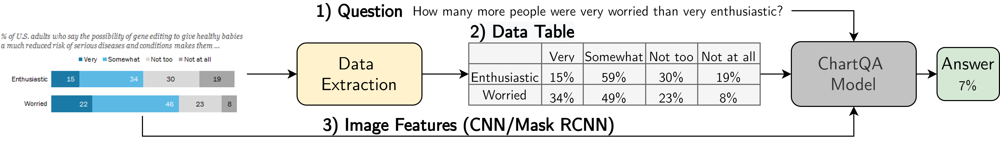

# 多模态评测怎样区分看见、推理与执行

模型答错“蓝色柱子比红色高多少”，可能没有读对坐标轴，也可能算错减法。如果只记一个错误标签，下一轮增加算术训练未必有效。评测的作用是把结论绑定到可观察的能力，再把失败定位到可干预的环节。

<small>图源：[ChartQA](https://arxiv.org/abs/2203.10244)。图表问答需要连接图像、文字、表格数值与问题。这类静态图表证据不覆盖机器人控制和视频记忆。</small>

## 先确定一个样本代表什么

以下数字均为教学构造。某模型在 100 个独立场景中答对 80 个，样本准确率为 0.8。若一个场景问十个相似问题，不能把一千条答案当成一千个独立场景；同一图像的 OCR 错误可能让十个答案一起失败。训练与测试也应按来源文档、视频或 episode 分组切分，避免邻帧进入两边。

对独立二项试验，95% Wilson 区间可写为

\[
\frac{\hat p+z^2/(2n)\ \pm\ z\sqrt{\hat p(1-\hat p)/n+z^2/(4n^2)}}{1+z^2/n},\qquad z=1.96.
\]

代入 \(n=100,\hat p=0.8\)，得到约 \([0.711,0.867]\)。80% 是当前样本估计，不是下一批场景的保证。场景内部强相关时应按场景重采样，例如 cluster bootstrap，而不是直接使用这个独立假设。

## 用中间证据定位图表问答失败

假设红柱为 12，蓝柱为 17，问题要求差值，正确答案是 5。一次诊断可以保存三层输出。

| 层 | 可检查结果 | 构造失败 |
| --- | --- | --- |
| 读取 | 红色对应 12，蓝色对应 17 | 把 17 读成 11 |
| 关系 | 蓝减红 | 运算方向反了 |
| 计算 | 17−12=5 | 输入正确但计算错误 |

实际模型未必显式输出这些中间量。可以通过受控输入分别测试，例如直接提供正确表格，观察错误是否消失；这只能说明在该干预下视觉读取是瓶颈，不能证明所有错误都来自视觉。对“模型是否使用图像”，交换图像并保持问题不变比单纯看回答流畅更有信息。

定位任务还要声明坐标口径。像素误差、归一化坐标误差和三维米制误差不能混用。原图裁剪或缩放后，预测框应先变回同一坐标系再比较。

对“12 增长到 17，增加多少”这个例子，还可以逐步替换输入以定位错误。保留原问题但直接提供已读出的两个数字，若答案变正确，视觉读取或数字绑定值得优先检查；保留数字图像并把问题简化成“右边数字是多少”，可以单独查看定位；若输入已经明确写成 17−12 仍算错，则推理或输出更可疑。

这些替换不是完全无混淆的因果实验，输入形式变化本身也可能改变模型行为，但比把所有错误都记成“视觉理解失败”更具体。每个测试仍应回到同一原图与同一问题，记录哪一步证据发生变化。还需保留端到端结果，因为局部步骤单独正确不保证组合时能维持正确的对象对应。

## 比较模型应保留同一场景上的成对结果

模型 A 与 B 都做 100 个相同场景。若 A 对 B 错有 8 个，A 错 B 对有 12 个，B 的净提升是 4 个百分点。真正区分两者的是这 20 个不一致场景，不能只比较两个总成功率。保存它们的输入、输出和标签，可以检查提升是否集中于某一类对象，或是否用更多延迟换来。

延迟也不能只看平均值。一次请求的总耗时包含读取、视觉编码、预填充、逐 token 解码和输出处理；机器人还包含命令等待与执行反馈。P95 应声明分位数算法和样本量，小样本极值不稳定。吞吐量高并不意味着单次闭环反应快。

## 风险概率需要校准

假设四次动作的预测碰撞风险为 \([0.1,0.2,0.7,0.8]\)，真实碰撞标记为 \([0,1,1,1]\)。分为低风险和高风险两个桶，则

\[
\mathrm{ECE}=\sum_b\frac{n_b}{n}|\bar p_b-\bar y_b|
=\tfrac12|0.15-0.5|+\tfrac12|0.75-1|=0.30.
\]

低风险桶实际有一半碰撞，说明这些预测明显过于乐观。这个四样本例子只演示计算；实际 ECE 对分桶和样本量敏感，需要同时给可靠性图、置信范围和各桶数量。零 ECE 也不表示预测能区分危险状态，恒定输出总体发生率也可能平均校准。

若风险用于拒绝执行，还需报告阈值下的漏报、误报和覆盖率。把难例全部拒绝后，已执行任务的成功率可以提高，却不能据此宣称整体能力提高。

## 世界模型要预测正确的动作后果

从同一状态输入左移与右移，两个未来不同，只证明输出依赖动作。输出可能随机改变背景颜色。更强的检验需要真实或可信仿真的动作后果，比较对象位移方向、接触事件和候选动作排序是否正确。

日志通常只有实际执行动作的结果。未执行候选的未来没有自动获得真值；它需要可重置仿真、匹配试验或明确的模型估计。不能把模型自己的预测再次当作“真实反事实”评分。

## 恢复率和失败回放的分母

构造 100 次任务，其中 70 次直接成功，30 次遇到预定义扰动，18 次恢复成功。扰动后的恢复率是 \(18/30=60\%\)，含恢复的总体成功率是 \(88/100=88\%\)。两者回答不同问题。若系统只对最容易的 10 个失败启动恢复，不能把恢复成功数除以 10 来代表全部失败的可恢复程度。

一条有用回放至少包含原始观测时间、推理输入截止时间、模型原始动作、过滤后命令、执行反馈和终止条件。假设杯子滑落后策略仍继续搬运，应先检查滑落是否进入了输入，再检查策略是否改变动作，最后检查新动作是否被旧队列覆盖。把这一切直接归类为“模型不够强”，会掩盖接口故障。

论文中的 VQA 分数、离线动作误差、仿真成功率和真实闭环成功率各有边界。沿[视觉状态接口](vlm-vla-for-efficient-world-model-training.md)继续追踪数据，或看[VLA 恢复诊断](../vla/closed-loop-recovery-and-failure-analysis.md)。[ChartQA 原文](https://arxiv.org/abs/2203.10244)提供具体图表评测任务，不能替代上述跨任务实验设计。
