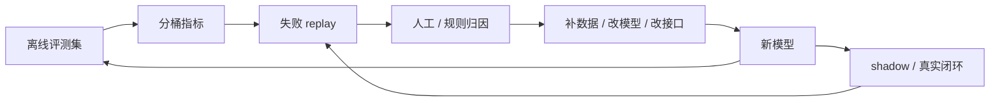

# 多模态评测与失败模式

VLM/VLA 的评测不能只看一个总分。静态图文问答、视频理解、动作执行、闭环恢复和世界模型预测，其实对应完全不同的失败方式。一个系统可能看图说得很好，却在坐标、时序、动作和安全上不可靠。

## 评测层级

| 层级 | 评测对象 | 常见指标 | 典型风险 |
| --- | --- | --- | --- |
| 静态 VLM | 图片、图表、屏幕、OCR | VQA、OCR、grounding、图表问答 | 看懂但定位不准 |
| 视频理解 | 多帧、长视频、事件 | temporal QA、事件顺序、跨帧一致性 | 会描述片段但丢长时依赖 |
| VLA 策略 | 观测到动作 | action accuracy、success rate、恢复率 | 离线动作像，闭环执行差 |
| 世界模型 | 动作条件未来 | rollout consistency、action sensitivity、risk calibration | 未来好看但不受动作影响 |
| 系统部署 | 端到端任务 | P95/P99、接管率、失败回放、成本 | 平均指标好，长尾不可控 |

## 高频失败模式

### 1. 视觉细节失败

包括小字、表格、图例、按钮、边界、遮挡物和抓取点识别错误。它们对普通聊天影响有限，但对屏幕 agent、机器人抓取和自动驾驶非常关键。

### 2. 坐标与方向失败

常见表现是左右混淆、前后不稳、相对位置判断错、相机坐标和机器人坐标没有对齐。VLA 中这会直接变成错误动作。

### 3. 时序失败

模型能理解单帧，却不知道前一帧发生了什么；能复述视频，却无法判断因果顺序；能短 horizon 预测，却在长 horizon 漂移。

### 4. 动作敏感性不足

这是世界模型最关键的失败之一：给不同动作，模型生成的未来差不多。表面上视频合理，实际上不能用于规划。

### 5. 闭环恢复失败

动作偏了一点后，模型继续按原计划执行，而不是重新观察、识别失败、调整策略。真实机器人任务里，恢复能力往往比单步成功率更重要。

## 评测集应该怎么设计

一个有用的 VLM/VLA 评测集，最好按“能力轴 + 场景桶 + 成本桶”组织：

| 维度 | 要覆盖什么 |
| --- | --- |
| 能力轴 | OCR、grounding、时序、动作、恢复、安全 |
| 场景桶 | 桌面操作、导航、抓取、屏幕、长视频、多人/多物体 |
| 成本桶 | 短输入、长上下文、长输出、多轮 agent、多模态输入 |
| 风险桶 | 高价值任务、安全约束、不可逆动作、隐私信息 |

这样做的好处是，量化、上下文压缩、连接器替换、动作接口调整和世界模型蒸馏，都能在同一套桶里比较，而不是各测各的。

## 面向世界模型的专项指标

| 指标 | 问什么 | 为什么重要 |
| --- | --- | --- |
| Action sensitivity | 动作变了，未来是否合理分叉 | 判断模型是否真正条件化在动作上 |
| Temporal consistency | 物体、状态、约束是否跨帧保持 | 判断 rollout 是否可用 |
| Risk calibration | 失败概率是否被低估 | 决定能否用于安全规划 |
| Recovery usefulness | 预测是否帮助 policy 修正 | 判断世界模型是否改善闭环 |
| Cost per successful rollout | 每个成功 rollout 花多少 GPU / 真实交互 | 直接对应高效训练目标 |

## 一个验收建议

每次 VLM/VLA 改动都要保留失败回放：输入图像/视频、语言指令、模型动作、环境反馈、是否恢复、失败原因和对应 trace。没有失败回放，评测只会告诉你“分数掉了”，不会告诉你“为什么掉、该补数据还是改模型”。

## 一个失败 replay：量杯抓取偏移

失败回放应该能让人复现“模型当时为什么错”，而不是只记录 `failed=true`。下面是一条可用于训练回流的简化 replay：

```yaml
episode_id: table_pick_red_measuring_cup_2026_05_12_0142
task: pick red measuring cup and place into gray bin
robot: 7dof_arm_parallel_gripper
camera_set: [wrist_rgbd, left_rgb, right_rgb, overhead_rgb]
policy_version: vla_policy_wm_042
world_model_version: wm_video_latent_019
result: failed
failure_type: grasp_point_shift_after_occlusion
```

关键 trace 要按时间展开：

| 时间 | 观测 | policy 动作 | world model 预测 | 真实结果 |
| --- | --- | --- | --- | --- |
| \(t=12.4s\) | 量杯把手被夹爪遮挡 40% | 向右前方接近 3cm | 杯把仍在可抓区域中心 | 实际杯把中心被遮挡后向左估计错 2.8cm |
| \(t=13.1s\) | wrist 相机看到杯沿高光 | 闭合夹爪 | 成功接触杯把 | 夹爪碰到杯沿外侧 |
| \(t=13.8s\) | 杯子旋转并滑动 | 上提 5cm | 杯子随夹爪上移 | 杯子掉落并撞到灰箱 |
| \(t=15.0s\) | 目标物已偏离初始位置 | 继续执行放置 chunk | 仍预测正在搬运 | policy 没触发恢复 |

这条 replay 至少能切出四个训练/评测样本：

| 样本 | 训练目标 | 用途 |
| --- | --- | --- |
| 遮挡前后 grounding | 杯把中心和可抓区域坐标 | 验证视觉 tokenizer 是否保留小结构 |
| action sensitivity pair | 原接近动作 vs 左移修正动作的未来差异 | 验证世界模型是否对动作分叉敏感 |
| risk label | `slip_or_collision_probability=high` | 训练风险头，不让好看视频掩盖失败 |
| recovery target | 重新观察、后退、换抓取点 | 训练闭环恢复而不是硬执行原 chunk |

回放的价值在于它把一次失败拆成“看错、想错、做错、没恢复”四层。量化、token 压缩、动作接口替换或世界模型蒸馏之后，都可以用同一条 replay 检查到底是哪一层退化。

## 评测闭环图



多模态评测的成熟形态不是“分数表”，而是能把失败送回训练和系统设计。比如同样是 VLA 失败，视觉定位错要补视觉 token 和 grounding，动作抖动要看 action head，风险低估要看 risk calibration，恢复失败要补 replay 和 recovery policy。

## 发布门禁示例

| 门禁 | 阈值例子 | 阻断原因 |
| --- | --- | --- |
| OCR / 数字一致性 | 财务字段错误率不得上升 | 高价值业务风险 |
| Grounding | 坐标误差 P95 不得明显变大 | UI / 机器人动作会偏 |
| Action sensitivity | 反事实动作排序不能翻转 | 世界模型会误导规划 |
| Risk calibration | near-miss recall 不得下降 | 安全相关假阴性 |
| Recovery | 失败后恢复率不得下降 | 闭环系统最关键能力 |

下一步可接 [VLM/VLA 与世界模型高效训练接口](vlm-vla-for-efficient-world-model-training.md)，把评测结果转成训练样本、反事实数据和 rollout 验收。
