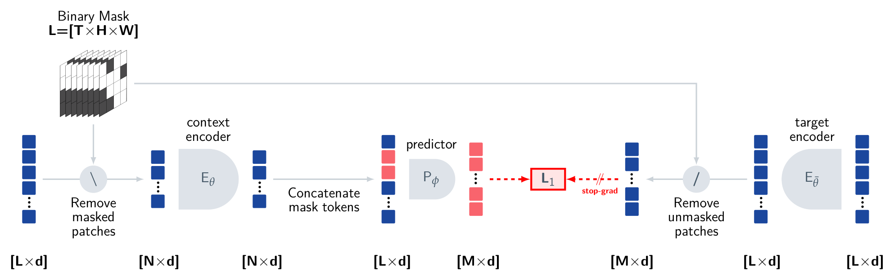

# 视频怎样变成可持续更新的状态

一张照片可以证明杯子当前可见，却通常不能告诉我们它正在向哪边运动、是否握在夹爪里、刚才被谁移动。视频增加了时间证据，但抽帧、压缩和遮挡仍会丢失这些变量。理解视频模型，应该从“哪些不同的真实状态会产生相同观测”开始。

## 速度来自两次观测，也受采样约束

以下是教学构造。相机在相隔 \(\Delta t=0.1\) 秒的两帧中，观察到物体沿同一世界坐标轴从 \(0.30\) 米移动到 \(0.32\) 米。在坐标标定正确、对应同一物体的条件下，平均速度是

\[
\bar v=\frac{0.32-0.30}{0.1}=0.2\ \mathrm{m/s}.
\]

如果第二帧时间戳实际上相隔 0.2 秒，速度就变成 0.1 米每秒。只给帧序号而不给实际间隔，会把丢帧误学成运动变慢。相机自身移动时，像素位置变化还混合了相机运动，不能直接套这个世界坐标计算。

抽帧也会丢掉接触事件。一个持续 30 毫秒的夹爪接触，可能完全落在两次相隔 100 毫秒的曝光之间；之后看到杯子移动，不能据此恢复具体接触时刻。提高分辨率解决不了这个时间缺口。时间采样率、曝光时长和多相机同步应分别记录。

## 窗口表示与隐状态

用最近 \(K\) 帧建立表示，可写为

\[
z_t=f_\theta(o_{t-K+1},\ldots,o_t).
\]

窗口确实包含 \(K\) 个观测。它能表达窗口中的相对运动，却无法直接访问更早被遮挡的物体。把模型换成更大 Transformer，也不会自动找回从未输入的证据。

部分可观测系统用信念状态表示对真实状态的分布。若 \(s_t\) 是真实状态，\(b_t(s_t)\) 是根据历史得到的信念，则贝叶斯更新为

\[
b_t(s_t)\propto p(o_t\mid s_t)
\int p(s_t\mid s_{t-1},a_{t-1})b_{t-1}(s_{t-1})\,ds_{t-1}.
\]

积分先用上一动作预测可能的新状态，观测似然再排除与当前证据不符的情况。神经网络的递归记忆 \(m_t=u_\theta(m_{t-1},o_t,a_{t-1})\) 可以近似这类更新，但普通 latent 向量未必是校准的概率分布。

以杯子进入箱后为例，“最后见于箱后”和“当前确切位于箱后”含义不同。若随后有人可能移动杯子，旧位置的可信度应随时间降低。假设一次观测后位置方差为 \(4\ \mathrm{cm}^2\)，简化随机游走每秒增加 \(1\ \mathrm{cm}^2\)，三秒后方差是 7，标准差约 2.65 厘米。这个构造只演示不确定性传播，真实传播需要速度、接触和移动模型。

现在把速度与信念更新接回同一只杯子。最后看到的位置为 .32 米，估计速度 .2 米每秒，遮挡 .5 秒后，在匀速模型下预测均值为 .42 米。假设预测位置方差为 4 平方厘米，重新出现时测得 .40 米，测量方差为 1 平方厘米。在线性高斯的一维例子中，增益为 \(K=4/(4+1)=.8\)，更新位置为

\[
.42+.8(.40-.42)=.404\ \mathrm m,
\qquad P_{\mathrm{new}}=(1-.8)4=.8\ \mathrm{cm}^2.
\]

新观察越可靠，修正越靠近 .40 米；观察越不可靠，越保留运动预测。但如果重现的是另一只杯子，这个高斯更新再准确也会融合错对象。身份关联必须先成立，强遮挡或多峰位置假设还可能需要分布更复杂的表示。一个视觉 latent 是否保存了这些信息，要通过对应状态与下游任务检查。

## V-JEPA 学的是哪些缺失信息

{ width="760" }

<small>图源：[V-JEPA](https://arxiv.org/abs/2404.08471)，Figure 3。可见时空块进入 context encoder，predictor 结合 mask 位置预测被遮挡位置的目标表示；目标来自完整视频的 target encoder。</small>

令可见块集合为 \(C\)，被遮挡块集合为 \(M\)。简化的 latent 预测目标是

\[
\mathcal L=\frac{1}{|M|}\sum_{i\in M}
\left\|h_\theta(f_\theta(x_C),i)-\operatorname{sg}(f_{\bar\theta}(x)_i)\right\|_1.
\]

\(\operatorname{sg}\) 表示停止梯度，目标编码器参数 \(\bar\theta\) 由在线参数的指数移动平均更新。模型预测的是特征而非每个像素。这个选择改变了训练目标和计算分配，但不能仅凭目标名称断言它一定保留物体身份、速度或力学规律；这些变量需要下游探针与任务评测。

这里的 mask 可以位于输入视频的不同空间和时间位置。看到前后文后补中间片段，与仅根据过去预测未来，是不同的信息条件。原始视频表征训练也没有自动提供机器人动作条件 \(a_t\)。要做规划，需要进一步验证改变动作时，预测是否沿真实动力学方向改变。

## 记忆写什么，何时覆盖

把全部视频常驻上下文需要随时长增长的 token。实用系统常保留高保真短窗口，再保留少量对象状态、任务阶段和检索索引。自然语言摘要、结构化字段、学习到的 memory token 都可用；选择取决于后续消费者需要什么精度。

下面是明确的教学事件格式，不是实机日志。

```yaml
object_id: cup_1
last_observed_at_s: 4.2
last_pose_frame: robot_base
last_position_m: [0.42, -0.18, 0.09]
visibility: occluded
evidence_frame: camera_a/42
status: last_observation_only
```

这里故意没有填写未经校准的 `confidence: 0.9`。一个数字只有在定义了对应事件、校准方法和验证集后，才能解释成概率。检索到旧事件时，还应检查对象身份、坐标版本和时间是否匹配当前任务；检索得很准确，也可能准确地取出已经失效的信息。

更新策略需处理冲突。当前观测看到另一只外观相近杯子，不能直接覆盖原对象；对象匹配要结合轨迹、外观与几何。任务结束后，临时抓取状态应失效，但固定相机标定可以跨任务保留。完整图像仍留在回放库中，便于检查记忆写入是否误读了证据。

## 怎么知道压缩没有丢掉关键状态

采用同一组带遮挡的轨迹，对比完整历史、短窗口、短窗口加记忆。按遮挡持续时间分别测身份保持、重现位置误差和任务恢复率。若短窗口加记忆只在无遮挡片段提高问答准确率，尚不能说明它解决了长期记忆。

还应做两类干预。删除早期关键事件，检查后续回答或动作是否随证据改变；给记忆注入过期位置，检查系统是否通过新观测纠正。前者检测模型是否使用记忆，后者检测它是否盲信记忆。单纯让模型复述“我记得杯子在哪里”无法区分两者。

相关机制见[视觉 token 压缩](visual-tokenizers-and-connectors.md)、[多模态评测](multimodal-evaluation-and-failure-modes.md)和[动作条件世界模型接口](vlm-vla-for-efficient-world-model-training.md)。原始材料可对照 [V-JEPA](https://arxiv.org/abs/2404.08471) 与像素重建路线 [VideoMAE](https://arxiv.org/abs/2203.12602)；[MemGPT](https://arxiv.org/abs/2310.08560)提供另一种上下文与外部记忆管理思路，不是视觉状态估计的直接证据。
