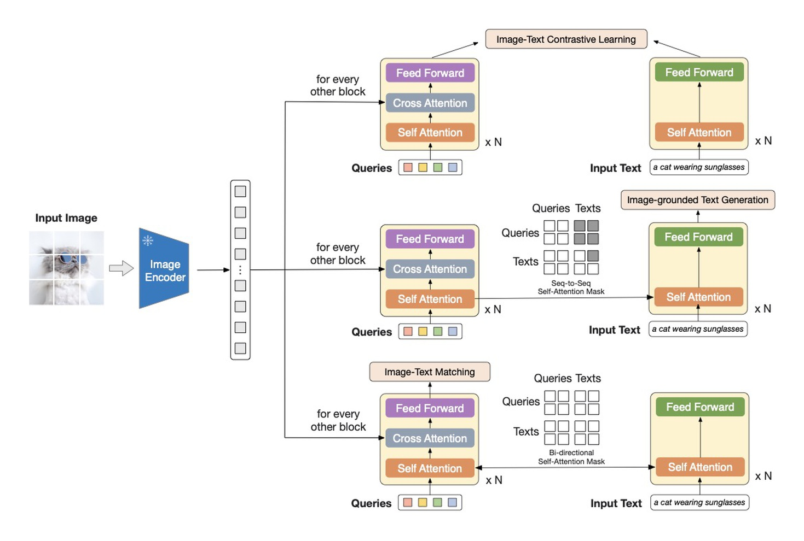

# 视觉 token 怎样形成与压缩

把高清文档、几秒视频或多路相机输入语言模型之前，首先要决定视觉信息怎样表示。增加分辨率可以保留小字和边缘，也会增加序列长度。连接器承担的是一个具体接口问题，怎样把视觉编码器输出的网格变成下游能够计算、仍然有用的向量。

## Patch embedding 实际做了一次矩阵乘法

设输入图像高宽为 \(H,W\)，有 3 个通道，采用边长 \(P\) 的非重叠 patch，并假定高宽都能被 \(P\) 整除。得到

\[
N=(H/P)(W/P),\qquad X_p\in\mathbb R^{N\times3P^2}.
\]

每一行存一个 patch 的所有像素，乘以 \(W_E\in\mathbb R^{3P^2\times d_v}\) 后得到 \(N\) 个 \(d_v\) 维向量。这个映射等价于 kernel、stride 都为 \(P\) 的相应卷积实现，具体排列由代码决定。

以 \(224\times224,P=16\) 为例，\(N=196\)，每个原始 patch 含 768 个数。若分辨率改成 \(448\times448\)，patch 数变为 784，增长 4 倍。视觉 Transformer 的全注意力配对数随 \(N^2\) 增长，这部分增长 16 倍；投影与前馈计算通常随 \(N\) 线性增长，实际时间还受到 kernel 和内存影响。

Patch 是局部输入区域，经过多层注意力以后，该位置的向量可以汇总全图信息。因此用最后一层 patch token 做定位时，仍需学习位置与目标的对应，不能把它直接等同于“这个格子里的唯一物体”。特殊分类 token、动态裁剪和后续合并会改变实际序列长度。

## 只变宽度的 projector 不会减少 token 数

假设视觉特征 \(H_v\) 为 \([196,768]\)，语言模型隐藏宽度为 4096。线性连接器

\[
Z=H_vW+b,\qquad W\in\mathbb R^{768\times4096}
\]

输出 \([196,4096]\)，仍是 196 个位置。多层 MLP 可以增加非线性表达，但只要独立处理每个位置，序列长度也不变。

这个计算需要区分两个预算。特征宽度从 768 增至 4096 后，送入语言模型的激活更多；序列位置数保持不变，后续上下文还要容纳文字、答案与特殊符号。若声称连接器“压缩了视觉输入”，应说明压缩的是位置、通道、精度，还是只换了表示空间。

设这张 196 个 patch 的图片是一只杯子，杯身还有两个很小的字。投影层把每个 patch 从 768 维变成语言模型的 4096 维，只改变表达坐标和容量，196 个位置仍然都在。若小字在视觉编码器阶段已经分辨不清，增加投影宽度也不会恢复原来的像素证据。

接下来若为了控制上下文长度，只保留 32 个视觉向量，就必须决定怎样汇总原来的位置。简单平均把所有位置混成一个向量，容易同时丢掉布局与局部差异；学习查询则可以让不同输出位置读取不同组合。它们没有自动获得“一个 query 专门读小字”的职责，只有当训练目标依赖这段文字，相关信息才有动力被保留下来。下面的 resampler 公式描述的正是这次有损汇总。

## Query resampler 怎样把很多位置变成少量位置

让 \(K\) 个可学习查询读取 \(N\) 个视觉位置。省略 batch 和多头细节，一次 cross-attention 为

\[
Q\in\mathbb R^{K\times d},\quad
K_v\in\mathbb R^{N\times d},\quad
V_v\in\mathbb R^{N\times d},
\]

\[
Z=\operatorname{softmax}\left(\frac{QK_v^\top}{\sqrt d}\right)V_v.
\]

注意力权重矩阵大小为 \(K\times N\)，每一行对视觉位置归一化，结果为 \(K\) 个向量。若一个查询对四个位置的权重为 `[0.1,0.6,0.2,0.1]`，相应 value 的某个分量是 `[1,3,5,7]`，输出该分量为 \(0.1+1.8+1+0.7=3.6\)。真实网络还有学习到的投影、残差和多层处理，这个计算只展示证据怎样被加权汇总。

Query 可以是固定可学习向量，也可以依赖文本或策略状态。固定 query 在训练中学到常用提取方式，不等同于每次由用户问题动态生成查询。用少量向量传递信息形成了容量限制，但信息丢失多少还由特征维度、网络、数据和目标共同决定。

{ width="900" }

<small>图源为 [BLIP-2](https://arxiv.org/abs/2301.12597) Figure 2。彩色 query 通过 cross-attention 读取视觉 encoder 输出，并在不同掩码下参与图文对比、生成与匹配目标。图中的 query 数量是示意，实际配置应读论文与代码。</small>

## 多相机历史的长度怎样计算

如果有 4 路相机、每路 16 帧历史、每帧 196 个视觉 token，总输入是

\[
N_{\mathrm{raw}}=4\times16\times196=12544.
\]

若每个相机每帧各自压成 32 个 query token，输出为 \(4\times16\times32=2048\) 个位置。位置数减少 6.125 倍。仅比较下游视觉部分的全注意力配对数，有

\[
12544^2=157351936,\qquad2048^2=4194304,
\]

约减少 37.52 倍。这个比值不包含前端视觉编码、resampler 自身、语言 token、前馈层和数据搬运，不能直接报告为系统加速倍数。

若所有相机与帧共同压成 32 个 token，预算又小得多，但要由这 32 个向量表达整段多视角历史。两种系统都可能写“32 query”，所以必须说明 query 是每帧、每视角还是每段共享。

## 压缩怎样产生可观察的错误

假设一个按钮在原始 448 像素图中宽 12 像素，先缩到 224 后只剩约 6 像素。如果插值和视觉 encoder 已经把字符细节抹掉，后续 resampler 再增加 query 也无法唯一恢复原文字。需要提高输入细节、局部裁剪或改变编码方式。

另一种情况是视觉特征仍含细节，query 没有把它传给下游。可以固定视觉 encoder，比较直接投影、不同 query 数量、局部目标优先的提取方式。固定其余训练条件，分别测 OCR、目标定位和任务结果，才能把“输入看不到”与“接口没传过去”区分开。

这里的按钮尺寸是教学构造，说明错误发生的位置。不能仅凭模型答错，就断定 connector 丢失信息，更不能由一次注意力图推导出真实因果关系。原始页面中没有实测依据的厘米级偏差不应作为真实案例引用。

## 各种接法怎样改变计算位置

| 接法 | 下游实际读取什么 | 位置数怎样变化 |
| --- | --- | --- |
| Linear/MLP projector | 映射后的视觉序列 | 通常保持原位置数 |
| Q-Former/resampler | 查询汇总后的序列 | 由查询数量决定 |
| 层内 cross-attention | 可重复访问的视觉 memory | 视觉 memory 可独立于文字序列保存 |
| 动态裁剪与局部高分辨率 | 全图与局部视图的组合 | 由裁剪数量、尺寸和合并规则决定 |

[Flamingo](https://arxiv.org/abs/2204.14198)把 resampler 与 gated cross-attention 组合，[LLaVA](https://arxiv.org/abs/2304.08485)使用视觉投影接入语言模型。表中的类别也可以组合，不能用某个模块名称直接预测其问答或机器人性能。

对动作系统，控制需要的可观测变量值得单独检查。物体类别足以回答“桌上有什么”，抓取还需要相对位置、深度、接触和不确定性。特征能在一个任务上被线性读出，并不保证另一个动作头已经学会使用它；监督数据与动作接口同样重要。

## 从 token 预算到可验证的选择

比较两种压缩方案时，先固定输入、采帧率和任务，再记录编码时间、下游上下文长度与显存。随后在相同样本上比较语义、细节与位置。比如采用一组预先固定的遮挡前后图像，检查目标 ID 是否保持、定位误差是否增加；对机器人再测闭环恢复，而不是把 VQA 总分当成行动指标。

如果更小的接口使 OCR 下降但全局分类不变，得到的是任务相关的信息取舍。可以把预算分给局部高分辨率区域，也可以保留近期细节而压缩远期历史。后一种方案如何写入、更新和验证记忆，见[视频表征与长时记忆](video-representation-and-memory.md)。完整训练过程见[VLM 架构与训练](architecture-and-training.md)。

## 参考资料

- [Vision Transformer](https://arxiv.org/abs/2010.11929)说明图像 patch 序列与 Transformer。
- [Perceiver](https://arxiv.org/abs/2103.03206)与[TokenLearner](https://arxiv.org/abs/2106.11297)讨论高维输入的 latent/token 提取。
- [BLIP-2](https://arxiv.org/abs/2301.12597)、[Flamingo](https://arxiv.org/abs/2204.14198)、[LLaVA](https://arxiv.org/abs/2304.08485)提供不同视觉连接方式的具体实例。
