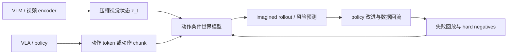

# VLM/VLA 与世界模型高效训练接口

如果主线是**世界模型的高效训练技术**，VLM/VLA 不应只是前置知识，而应该被看成世界模型训练的数据接口、状态接口和验证接口。它们分别回答：视觉语言状态怎么来，动作怎么来，失败怎么回流，闭环收益怎么验证。

<!-- [补充] -->
| 读者 | 建议读法 | 工程落点 |
| --- | --- | --- |
| 初学者 | 先抓“VLM/VLA 与世界模型高效训练接口”要解决的问题、关键术语和最小例子；公式只看变量方向。 | 能说清输入、输出和常见失败信号。 |
| 工程师 | 直接对照结构、指标、成本和边界条件，必要时回到前置页补概念。 | 落到数据、算力、延迟、显存、评测和回滚检查。 |


!!! note "合并提示"
    **note · 读法定位**

    这页先回答“VLM/VLA 与世界模型高效训练接口”在「VLM/VLA」里的位置：它解决什么局部问题，依赖哪些前置，最后会影响哪类工程或研究判断。
    **前置**：先分清 token、embedding、attention 和评测指标；动作相关问题可跳到 VLA 专题。 必要时先回 [VLM/VLA 入口](index.md)、[基础知识](../foundations/index.md) 或 [术语表](../glossary/index.md)。
    **主线关系**：把视觉表征、语言模型接口、视频记忆和动作策略连起来，看多模态系统怎样从“看懂”走向“可行动”。

    **note · 初学者先抓住**

    世界模型不是单独训练一个会生成未来的视频模型。它需要 VLM/VLA 提供语义状态、动作条件、失败样本和闭环评测。否则模型可能生成好看的未来，却不能帮策略更省数据、更少试错、更安全地行动。

## 四个接口

| 接口 | VLM/VLA 提供什么 | 世界模型用来做什么 | 高效训练收益 |
| --- | --- | --- | --- |
| 状态接口 | 视觉 token、视频 latent、3D / 深度状态 | 建立 \(z_t\) 和记忆 | 降低像素级训练成本 |
| 动作接口 | action token、连续动作、动作 chunk、skill | 做 action-conditioned rollout | 让未来预测对动作敏感 |
| 数据接口 | 示范、失败、恢复、near-miss、人工纠错 | 采样高价值训练片段 | 减少真实交互浪费 |
| 验证接口 | 闭环成功率、接管率、恢复率、风险标签 | 判断预测是否帮助决策 | 避免只优化视频观感 |

## 硬证据模块：接口页要能接上实验日志

VLM/VLA 与世界模型的接口不能只写“提供状态和动作”。每个接口都应有可复算证据，证明它确实降低了世界模型训练或验证成本。

| 接口 | 本页解决哪项成本 | 最小可复算例子 | 失败案例 | 验收指标 |
| --- | --- | --- | --- | --- |
| 状态接口 | 降低视频 token 和长时记忆成本 | raw patch token -> resampler token -> memory token 统计 | 目标物遮挡后身份丢失 | object permanence、latent drift、token compression ratio |
| 动作接口 | 降低 rollout 候选和动作监督长度 | 同一历史下 3 个 action chunk 的未来分叉 | 不同动作未来几乎一样 | action sensitivity、candidate ranking agreement |
| 数据接口 | 降低真实交互和人工排查成本 | failure replay 带 `failure_type`、risk、真实事件 | 只有成功/失败，不能定位原因 | hard-negative yield、recovery improvement |
| 验证接口 | 降低无效 demo 和线上试错 | 离线 rollout + 闭环小桶对照 | 视频好看但闭环选错动作 | success rate、near-miss recall、cost per success |

本仓库的 `world-model-mini-chain` fixture 是接口证据的最小形态：`episodes.jsonl` 记录多相机 token 和任务结果，`rollouts.jsonl` 记录候选动作的预测/真实事件，脚本输出 token 压缩、动作敏感、risk ECE 和失败 replay。真实项目里可以把它替换成 Rerun 日志、训练配置和固定 checkpoint，但字段关系不应变。

## Claim Ledger

| Claim | Source | Evidence Type | Can Support | Cannot Prove |
| --- | --- | --- | --- | --- |
| VLM/VLA 可为世界模型提供状态、动作、数据和验证接口 | 本页接口分解 | Site Inference | 能把视觉 token、动作 chunk、失败回流和闭环评测放进统一 schema | VLM/VLA 本身就是完整世界模型 |
| 视觉 tokenizer / resampler 可降低视频 token 和长时记忆成本 | [视觉 Tokenizer 与连接器](visual-tokenizers-and-connectors.md) | Ablation | 压缩视觉输入是世界模型训练常见瓶颈治理手段 | 压缩后必然保留接触、风险和对象身份 |
| VLA 动作数据能提供 action-conditioned rollout 的监督 | [动作表示与控制接口](../vla/action-representation-and-interfaces.md) | Paper Result | 动作 token、连续动作和 chunk 是世界模型输入接口 | 动作数据对齐错误不会影响未来预测 |
| mini-chain schema 可作为接口证据最小格式 | [端到端案例](../world-models/action-conditioned-video-world-model-training-case.md) | Toy Fixture | 说明 episode、rollout、risk 和 failure replay 字段如何接起来 | 不能证明真实系统已经降低训练成本 |

## 高效训练的核心问题

世界模型训练昂贵，通常不是因为缺一个模型名，而是因为以下成本同时存在：

1. 真实交互贵：机器人、自动驾驶和复杂 agent 的失败样本很难收集。
2. 视频 token 贵：多帧高分辨率输入会拉长序列。
3. 长 horizon 贵：未来越长，attention、记忆和误差累积越难。
4. 动作条件贵：动作必须被准确记录和对齐，否则预测不对动作敏感。
5. 验证贵：生成未来是否“有用”，需要闭环或高质量回放验证。

VLM/VLA 的意义，是把这些成本拆开治理，而不是让世界模型从原始像素和杂乱日志里硬学全部内容。

## 一条推荐训练链路



这条链路里，VLM 负责状态压缩，VLA 负责动作分布和执行反馈，世界模型负责未来预测，数据引擎负责把失败和反事实样本重新喂回训练。

## 一个最小 episode schema

世界模型训练最怕“日志里什么都有，但对不上”。一个可用的 episode 至少要把观测、动作、状态、预测、结果和失败原因对齐到同一条时间轴。

```yaml
episode:
  id: kitchen_counter_pick_000731
  task: "pick the red mug and place it on the drying rack"
  split: train_hard_negative
  robot:
    embodiment: mobile_manipulator_v2
    control_rate_hz: 10
    action_space: delta_ee_pose_gripper
  sensors:
    cameras:
      - {name: wrist_rgbd, fps: 20, resolution: [640, 480]}
      - {name: left_rgb, fps: 10, resolution: [1280, 720]}
      - {name: overhead_rgb, fps: 10, resolution: [1280, 720]}
    proprioception: [joint_pos, joint_vel, gripper_width, base_pose]
  timeline:
    - t: 0.0
      observation_refs: [wrist_000000.png, left_000000.png, overhead_000000.png]
      state_labels:
        target_object: red_mug
        target_pose_base: [0.54, -0.21, 0.13]
        occlusion: none
      action:
        type: chunk
        horizon_steps: 8
        delta_ee_pose_gripper:
          - [0.01, -0.02, 0.00, 0.0, 0.0, 0.02, 0.00]
      wm_prediction:
        future_latent_ref: wm_pred_000000.npz
        risk: {collision: 0.04, slip: 0.08, lost_object: 0.03}
      reward: {success: 0, progress: 0.18, safety_violation: 0}
  result:
    success: false
    failure_type: grasp_slip_after_partial_occlusion
    recovery_used: false
```

这个 schema 里的字段服务不同接口：`observation_refs` 给 VLM/视频 encoder 复算视觉状态，`action` 给动作条件世界模型做分叉预测，`wm_prediction.risk` 给风险头做校准，`result.failure_type` 给数据引擎决定是否作为 hard negative 回流。没有这些对齐字段，训练只能看到“视频和动作”，很难知道哪一步该补模型、补数据还是补评测。

## 多相机数据如何进入 world model

多相机不是“把四张图拼起来”这么简单。世界模型要用多相机数据，需要先把不同视角对齐到同一条动作时间轴，再决定哪些信息进入当前状态、哪些写入长时记忆、哪些只作为失败诊断证据。

```mermaid
flowchart LR
    A["wrist / front / overhead cameras"] --> B["timestamp sync"]
    B --> C["intrinsics / extrinsics"]
    C --> D["per-view encoder"]
    D --> E["view tokens"]
    E --> F["geometry-aware fusion"]
    F --> G["world state z_t"]
    G --> H["action-conditioned rollout"]
    H --> I["risk / reward / event heads"]
    I --> J["failure replay bucket"]
```



一个更完整的多相机 frame 记录可以写成：

```yaml
multi_camera_frame:
  t: 12.40
  clock:
    robot_time_ns: 902441203355
    max_camera_skew_ms: 7.8
  cameras:
    wrist_rgbd:
      image_ref: wrist/000248.png
      depth_ref: wrist/000248_depth.exr
      fps: 20
      intrinsics_ref: calib/wrist_intrinsics.json
      extrinsics_ref: calib/wrist_to_ee.json
      latency_ms: 18
      role: contact_local
    front_rgb:
      image_ref: front/000124.png
      fps: 10
      intrinsics_ref: calib/front_intrinsics.json
      extrinsics_ref: calib/front_to_base.json
      latency_ms: 42
      role: scene_global
    overhead_rgb:
      image_ref: overhead/000124.png
      fps: 10
      intrinsics_ref: calib/overhead_intrinsics.json
      extrinsics_ref: calib/overhead_to_base.json
      latency_ms: 35
      role: object_layout
  proprioception:
    joint_pos_ref: state/joint_pos_001240.npy
    gripper_width: 0.031
    base_pose_xyyaw: [1.42, -0.18, 1.57]
  action_window:
    starts_at: 12.40
    horizon_steps: 8
    control_rate_hz: 10
    action_ref: actions/chunk_001240.npy
  wm_features:
    per_view_token_refs:
      wrist_rgbd: tokens/wrist_000248.npz
      front_rgb: tokens/front_000124.npz
      overhead_rgb: tokens/overhead_000124.npz
    fused_state_ref: latents/z_001240.npz
    memory_write:
      object_ids: [red_mug, drying_rack]
      occlusion_state: partial
      contact_state: pre_grasp
```

这里有三条工程原则：

| 问题 | 推荐做法 | 如果省略会怎样 |
| --- | --- | --- |
| 相机不同步 | 记录每路相机时间戳和最大 skew，训练时按动作时刻重采样 | 世界模型会把“视觉延迟”误学成动力学延迟 |
| 标定不稳定 | 内参、外参和版本号进入 episode schema | 多视角 token 融合后空间关系漂移，抓取点和风险头不可信 |
| 视角角色不同 | 腕部看接触，前视看导航，俯视看布局，分别设 token budget | 所有相机平均压缩，关键接触帧被背景 token 挤掉 |
| 历史记忆过长 | 当前窗口保高精，远期布局和对象状态写低频 memory | 长 horizon 成本爆炸，或者远期对象被遗忘 |
| 失败 replay | 保存原始图、融合 latent、动作 chunk、risk 和结果 | 事后无法判断失败来自感知、动作、世界模型还是控制器 |

对 world model 来说，推荐把多相机处理分成两层：第一层是 per-view encoder，尽量保留每个视角独特信息；第二层才是融合状态 \(z_t\)，供动作条件 rollout 使用。不要过早把多相机拼成一张大图，否则模型难以知道哪一块来自腕部接触视角，哪一块来自全局布局视角。

## 动作接口如何改变训练成本

动作接口不是纯建模品味，它会直接改变 token 长度、rollout 成本和误差形态。假设机器人以 10Hz 控制，一个训练样本使用 6 秒 horizon，也就是 60 个控制步；每步动作是 7 维 `delta pose + gripper`。

| 动作接口 | 训练目标长度 | 一轮 10 万条样本的动作监督量 | 优点 | 代价 |
| --- | ---: | ---: | --- | --- |
| 逐步连续动作 | \(60\times7=420\) 个标量 | 4,200 万标量 | 最贴近控制 | 序列长，闭环误差逐步累积 |
| 离散 action token | \(60\times7\) 个 token 或更少 | 约 4,200 万 token | 可接 LLM next-token 训练 | 量化桶太粗会抖，太细 vocab 变大 |
| 8-step action chunk | \(8\) 个 chunk 覆盖 64 步 | 80 万 chunk | 序列短，训练便宜 | chunk 内纠错慢，失败恢复滞后 |
| latent skill | 6-12 个 skill token | 60-120 万 token | 长任务便宜 | 需要额外 skill decoder，语义漂移难查 |
| diffusion / flow action head | 每个状态采样 8-32 条候选轨迹 | 训练量看采样数放大 | 多峰动作更自然 | rollout 和筛选成本高 |

这张表里的单位故意不一样，因为动作接口改变的是“监督对象”。逐步连续动作是 \(100,000\times60\times7=42,000,000\) 个标量；离散 action token 如果每个维度单独量化，数量级仍是 \(100,000\times60\times7\) 个 token；8-step chunk 则是每条样本 \(\lceil60/8\rceil=8\) 个 chunk，所以一轮是 `80` 万 chunk。latent skill 更短，但它把成本转移给 skill tokenizer / decoder：如果 skill 边界切错，世界模型看到的 action token 会很省，却不再对应真实可执行动作。

如果世界模型每个起点要评估 16 个候选动作序列，逐步连续接口要预测 \(16\times60=960\) 个未来控制步；8-step chunk 只需比较 \(16\times8=128\) 个 chunk。训练和 rollout 会便宜很多，但风险是：一旦第 2 个 chunk 已经偏离，系统要等 chunk 结束才纠正。对高接触任务，chunk 省下的成本可能被失败恢复成本吃回去。

一个实用折中是双接口：高层 policy 输出 0.5-1 秒 chunk，低层控制器或 action expert 在 chunk 内保留连续高频修正；世界模型评估 chunk 级后果，同时对接触瞬间保留更高时间分辨率。

## 内容阅读对齐

| 训练问题 | 应读页面 | 读完要能回答 |
| --- | --- | --- |
| 视觉 token 太多怎么办 | [视觉 Tokenizer、连接器与信息瓶颈](visual-tokenizers-and-connectors.md) | 哪些视觉信息值得进入状态 |
| 视频状态如何保持时间一致 | [视频表征、状态记忆与长时序压缩](video-representation-and-memory.md) | 如何避免把视频当作独立图片 |
| VLA 动作如何接到未来预测 | [VLA 专题路线图](../vla/index.md)、[动作表示与控制接口](../vla/action-representation-and-interfaces.md) | 动作粒度如何影响 rollout 训练 |
| 失败如何变成训练信号 | [VLA 评测与数据引擎](../vla/benchmarks-and-data-engines.md) | near-miss、恢复和人工纠错如何回流 |
| 世界模型是否真的有用 | [多模态评测与失败模式](multimodal-evaluation-and-failure-modes.md)、[世界模型评测与失效模式](../world-models/evaluation-and-failure-modes.md) | 如何验证预测改善了闭环决策 |
| 一条训练链路如何跑通 | [动作条件视频世界模型端到端训练案例](../world-models/action-conditioned-video-world-model-training-case.md) | 如何把状态、动作、训练系统、rollout 和评测连成案例 |

## 深度标杆页

这个接口页建议和下面几页一起作为 VLM/VLA 专题的深度标杆：

1. [VLM 架构：视觉表征、连接器与记忆](architecture-and-training.md)
2. [视觉 Tokenizer、连接器与信息瓶颈](visual-tokenizers-and-connectors.md)
3. [视频表征、状态记忆与长时序压缩](video-representation-and-memory.md)
4. [VLA 数据与策略学习](../vla/data-and-policy-learning.md)
5. [VLA 闭环恢复与失败分析](../vla/closed-loop-recovery-and-failure-analysis.md)

这些页面共同回答一个问题：如何用更少真实交互、更少视频 token、更短训练链路，得到更可用于决策的世界模型。

!!! tip "下一站"
    - 回到本专题入口：[VLM/VLA](index.md)，确认这页在整条路线中的位置。
    - 按导航顺序继续：[index](../quantization/index.md)。
    - 概念或符号卡住时，先查 [术语表](../glossary/index.md)，再回到当前页。
