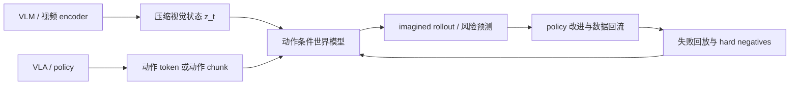

# VLM/VLA 与世界模型高效训练接口

如果主线是**世界模型的高效训练技术**，VLM/VLA 不应只是前置知识，而应该被看成世界模型训练的数据接口、状态接口和验证接口。它们分别回答：视觉语言状态怎么来，动作怎么来，失败怎么回流，闭环收益怎么验证。

!!! note "初学者先抓住"
    世界模型不是单独训练一个会生成未来的视频模型。它需要 VLM/VLA 提供语义状态、动作条件、失败样本和闭环评测。否则模型可能生成好看的未来，却不能帮策略更省数据、更少试错、更安全地行动。

## 四个接口

| 接口 | VLM/VLA 提供什么 | 世界模型用来做什么 | 高效训练收益 |
| --- | --- | --- | --- |
| 状态接口 | 视觉 token、视频 latent、3D / 深度状态 | 建立 \(z_t\) 和记忆 | 降低像素级训练成本 |
| 动作接口 | action token、连续动作、动作 chunk、skill | 做 action-conditioned rollout | 让未来预测对动作敏感 |
| 数据接口 | 示范、失败、恢复、near-miss、人工纠错 | 采样高价值训练片段 | 减少真实交互浪费 |
| 验证接口 | 闭环成功率、接管率、恢复率、风险标签 | 判断预测是否帮助决策 | 避免只优化视频观感 |

## 高效训练的核心问题

世界模型训练昂贵，通常不是因为缺一个模型名，而是因为以下成本同时存在：

1. 真实交互贵：机器人、自动驾驶和复杂 agent 的失败样本很难收集。
2. 视频 token 贵：多帧高分辨率输入会拉长序列。
3. 长 horizon 贵：未来越长，attention、记忆和误差累积越难。
4. 动作条件贵：动作必须被准确记录和对齐，否则预测不对动作敏感。
5. 验证贵：生成未来是否“有用”，需要闭环或高质量回放验证。

VLM/VLA 的意义，是把这些成本拆开治理，而不是让世界模型从原始像素和杂乱日志里硬学全部内容。

## 一条推荐训练链路

这条链路里，VLM 负责状态压缩，VLA 负责动作分布和执行反馈，世界模型负责未来预测，数据引擎负责把失败和反事实样本重新喂回训练。

## 内容阅读对齐

| 训练问题 | 应读页面 | 读完要能回答 |
| --- | --- | --- |
| 视觉 token 太多怎么办 | [视觉 Tokenizer、连接器与信息瓶颈](visual-tokenizers-and-connectors.md) | 哪些视觉信息值得进入状态 |
| 视频状态如何保持时间一致 | [视频表征、状态记忆与长时序压缩](video-representation-and-memory.md) | 如何避免把视频当作独立图片 |
| VLA 动作如何接到未来预测 | [VLA 专题路线图](../vla/index.md)、[动作表示与控制接口](../vla/action-representation-and-interfaces.md) | 动作粒度如何影响 rollout 训练 |
| 失败如何变成训练信号 | [VLA 评测与数据引擎](../vla/benchmarks-and-data-engines.md) | near-miss、恢复和人工纠错如何回流 |
| 世界模型是否真的有用 | [多模态评测与失败模式](multimodal-evaluation-and-failure-modes.md)、[世界模型评测与失效模式](../world-models/evaluation-and-failure-modes.md) | 如何验证预测改善了闭环决策 |

## 深度标杆页

这个接口页建议和下面几页一起作为 VLM/VLA 专题的深度标杆：

1. [VLM 架构：视觉表征、连接器与记忆](architecture-and-training.md)
2. [视觉 Tokenizer、连接器与信息瓶颈](visual-tokenizers-and-connectors.md)
3. [视频表征、状态记忆与长时序压缩](video-representation-and-memory.md)
4. [VLA 数据与策略学习](../vla/data-and-policy-learning.md)
5. [VLA 闭环恢复与失败分析](../vla/closed-loop-recovery-and-failure-analysis.md)

这些页面共同回答一个问题：如何用更少真实交互、更少视频 token、更短训练链路，得到更可用于决策的世界模型。
