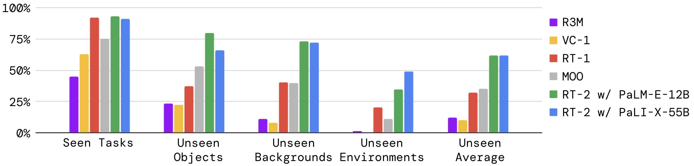

# 把视觉状态、动作与世界模型接成一条训练链

世界模型学习的是给定状态和动作后会发生什么。VLM 可以提供视觉语义表示，VLA 可以产生候选动作，但这两个模块的输出只有在坐标、时间和执行含义一致时，才构成可训练的转移样本。

{ width="900" }

<small>图源：[RT-2](https://arxiv.org/abs/2307.15818)。图展示视觉语言知识与机器人动作学习的联系。这里借它定位动作生成端；RT-2 的动作生成本身不等于显式学习未来状态转移。</small>

## 从日志建立一个转移样本

令 \(z_t=f(o_{\le t})\)，一阶潜在动力学模型拟合

\[
p_\psi(z_{t+1}\mid z_t,a_t),\qquad
\mathcal L_{\mathrm{dyn}}=-\log p_\psi(z_{t+1}\mid z_t,a_t).
\]

这是建模假设。若 \(z_t\) 丢掉物体速度或遮挡历史，未来可能不能只由当前 \(z_t,a_t\) 确定，需要历史记忆或随机转移分布。把特征命名为 state 不会自动使它满足 Markov 性。

构造一个以 10 Hz 执行的样本。相机在 1.00 秒曝光，模型在 1.08 秒完成推理，命令在 1.10 秒开始执行，1.20 秒结束。若标签使用 1.10 到 1.20 秒的结果，输入应说明它仍基于 1.00 秒图像。1.15 秒才拍到的图像不能偷偷进入在线策略输入，否则离线训练使用了部署时尚不存在的未来信息。

```yaml
sample_type: teaching_example
observation_capture_s: 1.00
inference_finished_s: 1.08
command_interval_s: [1.10, 1.20]
action_frame: robot_base
action_unit: m
commanded_dx: 0.02
filtered_dx: 0.01
measured_dx: 0.008
```

这里三种动作不可混淆。策略请求 2 厘米，限幅后命令 1 厘米，机器人实际移动 0.8 厘米。若模型接口条件化于发出的命令，应以 `filtered_dx` 为输入，并把控制误差包含在转移中；若接口条件化于实际位移，可用 `measured_dx`，但它在执行前尚未知，规划时必须另有执行预测。训练和规划使用不同口径会造成系统性错配。

## 压缩视觉输入，算清成本发生在哪里

四台相机各保留 16 帧，每帧 196 个 patch，共 \(4\times16\times196=12544\) 个视觉 token。若每帧压成 32 个，得到 2048 个。只比较稠密自注意力的 token 对数量，比例约为

\[
\frac{12544^2}{2048^2}=37.52.
\]

这不是整模型加速倍数。视觉编码器仍可能处理原始 patch，连接器也有成本，投影与 MLP 对长度的依赖不同，硬件访存和实际 attention 实现也影响运行时间。若缓存 encoder 特征，只有冻结 encoder、固定预处理时，缓存才与当前训练目标一致。

状态压缩的代价也要通过任务测量。把背景压掉可能有利，把夹爪间隙压掉会伤害接触预测。比较压缩前后，应同时记录 token、峰值显存、每步耗时，以及相同接触和遮挡测试上的误差；单一压缩比不能证明收益。

## 分块不会凭空减少动作标量

仍以 10 Hz、6 秒、每步 7 维为例，原始轨迹含 \(60\times7=420\) 个标量。按 8 步一块装载，需要 \(\lceil60/8\rceil=8\) 块；若最后一块补齐，总张量是 \(8\times8\times7=448\) 个标量，其中 28 个应被 padding mask 排除。

所以 420 个标量与 8 个 chunk 不能直接比较为“监督量下降”。块只是容器。真正可能减少的是自回归生成轮数，或者由技能编码器把整段动作压成少量离散码；后者另有编码、重构和控制误差。

16 条候选、每条 60 步，仍含 960 个未来控制步。若世界模型每次直接预测 8 步后的状态，模型调用可以接近每条 8 次，但它跳过中间接触，需要验证块内风险；若模型在每块内部仍逐步展开，就没有这项调用减少。训练扩散动作头也通常随机采一个噪声时间训练，与推理时多次去噪、多候选采样是不同成本。

假设机器人在第 15 步轻碰杯子，杯子随后滑动。若动作压缩只保存 8 个 chunk 的平均位移，就可能把接触前后的动作边界混掉；即使解码后总位移相近，世界模型也无法准确知道接触发生在哪一帧。更少的输入向量减少计算，却改变了可识别的动力学信息。

因此比较压缩方法时，可保持同一条轨迹、相同物理时长与控制频率，分别检查接触时刻、动作方向和未来状态。只报告预测 MSE 与 token 数，会漏掉关键事件是否保留。若模型对左右动作给出不同视频，还需检查这种差异与真实动作后果相符，不能把“用了动作条件”直接等同于“反事实正确”。

## 联合目标的权重要看单位和梯度

状态预测、事件分类和风险预测可以联合训练，例如

\[
\mathcal L=\lambda_z\mathcal L_{\mathrm{dyn}}+
\lambda_e\mathcal L_{\mathrm{event}}+\lambda_r\mathcal L_{\mathrm{risk}}.
\]

不能只按三个 loss 的名字设相同权重。一个状态向量有上千维，事件只有几个类别；sum 与 mean 的选择会改变数值规模。先声明各项归一化方式，再看共享编码器收到的梯度和任务验证结果。单独调低某项 loss 的数值不等于降低它对共享表示的影响。

训练数据里的未执行候选不能直接形成真实转移标签。可用于监督的通常是实际轨迹；其他候选需要受控仿真、实机重置实验，或明确标为模型生成数据，并承认模型误差会随自训练积累。

## 仓库里的最小接口示例

仓库提供[示例说明](../assets/examples/world-model-mini-chain/README.txt)、[episode 数据](../assets/examples/world-model-mini-chain/episodes.jsonl)、[候选 rollout](../assets/examples/world-model-mini-chain/rollouts.jsonl)与[计算脚本](../assets/examples/world-model-mini-chain/eval_mini_chain.py)。在仓库根目录执行

```bash
python3 files/assets/examples/world-model-mini-chain/eval_mini_chain.py
```

这是人工构造的四个 episode fixture，用来验证字段和指标计算，不是训练完成的机器人实验。脚本的动作敏感检查使用 latent 差异阈值；通过它只说明超过了示例阈值，不能证明动作效果方向正确。风险 ECE 和候选排名也来自 fixture 中预填的数据，不能作为实际模型质量结论。

进入真实实验时，先固定同一组任务、训练预算与评测种子，再比较压缩状态、动作接口或世界模型是否改善任务成功率和总成本。需要保留[视频记忆](video-representation-and-memory.md)、[动作表示](../vla/action-representation-and-interfaces.md)和[失败回放](multimodal-evaluation-and-failure-modes.md)的原始证据，才能解释收益来自哪一个环节。完整链路可对照[动作条件世界模型案例](../world-models/action-conditioned-video-world-model-training-case.md)。
