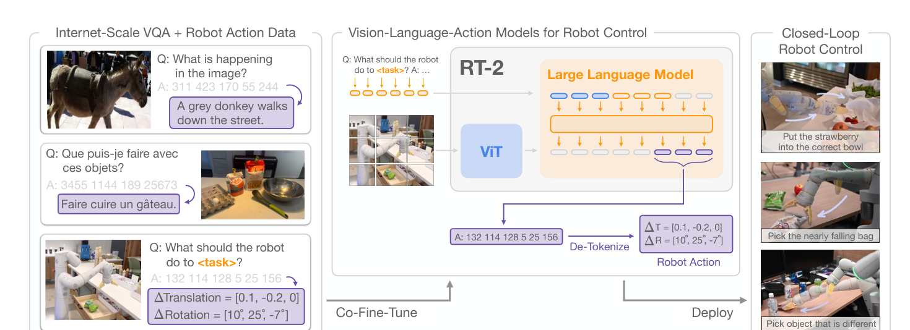

# 用概率、坐标和时间读懂 VLM 与 VLA

同一张桌面图可以用来回答颜色，也可以用来决定夹爪移动，还可以用来预测动作后果。三类系统都可能接收图像和语言，但输出变量不同，训练目标与验证方式也随之改变。下面用一个抓取问题把公式中的对象落实到数值。

## 条件概率中的竖线把什么固定下来

视觉问答写成 \(p_\theta(y\mid I,q)\)，表示给定图像 \(I\) 和问题 \(q\)，输出回答 \(y\) 的分布。参数 \(\theta\) 决定模型的预测规律，条件后的量是当前已知输入。

策略写成 \(\pi_\theta(a_t\mid o_{\le t},l)\)。这里 \(a_t\) 是要执行的动作，\(o_{\le t}\) 是截至当前的观测历史，\(l\) 是任务指令。动作可以是一个离散编号，也可以是带单位的连续向量。写成一个概率分布，只说明模型怎样选择，不自动附带可达性或安全保证。

世界模型则预测 \(p_\phi(z_{t+1}\mid z_t,a_t)\)。当前表示 \(z_t\) 与候选动作已知，下一表示未知。规划器可以对几个候选动作分别调用它，再选择预测结果较好的动作；最后仍要回到真实环境验证。

{ width="900" }

<small>图源为 [RT-2](https://arxiv.org/abs/2307.15818) Figure 1。图中网络输出 token，经去 token 化变成平移、旋转等机器人动作；右侧显示执行中的闭环观测。token 到动作的转换是部署接口的一部分，不能直接把语言回答送给电机。</small>

连续动作的密度还携带单位。设沿 x 轴位移的高斯标准差为 .01 米，均值附近的密度约为 \(1/(\sqrt{2\pi}\,.01)=39.89\) 每米，大于 1 并不矛盾。落在均值附近 1 毫米窄区间的概率约为密度乘宽度，即 .0399；精确值需积分。把米改成厘米，数值密度会相应缩放，区间概率保持不变。

夹爪的“开/闭”则通常是离散事件，概率可以直接表示两种状态的质量。将这个分类概率与位置密度混在同一张 confidence 表里会失去共同含义。一个混合动作头可以分别建模两者，NLL 也由离散 log-probability 与连续 log-density 组成；执行前还必须恢复各维物理单位。

## 一条轨迹要同时写清时间与执行区间

设控制频率为 10 Hz，动作 \(a_t\) 在区间 \([t\Delta,(t+1)\Delta)\) 执行，其中 \(\Delta=0.1\) 秒。日志中的 \(o_t\) 应说明是这个区间开始前的可用观测，还是区间结束后的结果。若相机数据晚了 80 ms，接收时间为 \(t\Delta\) 的图像，其实际采集时刻可能是 \(t\Delta-0.08\)。

数据可以记为 \((o_t,l,a_t,o_{t+1})\)，但仅有这些符号不足以保证对齐。训练输入必须使用部署时可获得的信息。把执行后才能收到的图像错放到当前输入，会让离线模型利用未来信息；部署时这条信息不存在。

一次预测 \(H\) 个动作写成 \(A_t=(a_t,\ldots,a_{t+H-1})\)。若 \(H=8\)，预测覆盖 0.8 秒；实际每次只执行前两个动作，重新观测周期为 0.2 秒。预测范围和开环执行范围需要分开，动作 chunk 不必全部执行到底。

## 最大似然怎样变成动作损失

离散动作的行为克隆可以直接使用负对数似然

\[
\mathcal L=-\frac1M\sum_{i=1}^M
\log\pi_\theta(a^{(i)}\mid o^{(i)},l^{(i)}).
\]

假设两个样本的专家动作概率是 0.8 和 0.5，平均损失约为 0.4581。优化会提高数据中动作的条件概率，但相同观测下未被记录的可行动作不一定得到同等监督。

连续动作没有“精确取到某个实数”的非零概率，模型使用概率密度。例如一维高斯策略

\[
\pi(a\mid o)=\frac1{\sqrt{2\pi}\sigma}
\exp\left[-\frac{(a-\mu_\theta(o))^2}{2\sigma^2}\right]
\]

的负对数密度为

\[
-\log\pi(a\mid o)=
\frac{(a-\mu_\theta(o))^2}{2\sigma^2}+\log\sigma+\tfrac12\log(2\pi).
\]

当所有样本使用同一个固定 \(\sigma\) 时，最小化它等价于最小化平方误差。若不同动作维度具有不同固定方差，对应的是加权平方误差；若方差也由模型学习，\(\log\sigma\) 项不能丢掉。

取专家位移 0.02 m，预测 0.01 m，固定 \(\sigma=0.01\) m，残差平方项为 0.5。若把米换成毫米却没同步改 \(\sigma\)，这个损失的尺度和含义都会改变。负对数密度也可能为负，因为密度不是离散概率，不能用“loss小于零”直接判定实现错误。

## 单个均值为什么会穿过障碍物

假设两条示范绕过障碍物，某一步横向动作分别是 -1 和 +1，概率各为一半。预测一个确定值 \(m\)，期望平方误差为

\[
\tfrac12(-1-m)^2+\tfrac12(1-m)^2=1+m^2.
\]

最优值是 \(m=0\)。如果中间恰好有障碍物，这个平均动作可能不可执行。这是条件多峰分布与单均值回归的冲突。离散分布、混合分布、扩散或 Flow 动作生成可以表达多个候选，但还需要任务数据和实际控制约束，表达多峰本身不保证安全。

## 坐标向量的分量怎样对应物理量

一个常见末端增量动作可以写成

\[
a_t=[\Delta x,\Delta y,\Delta z,
\Delta\phi,\Delta\theta,\Delta\psi,g].
\]

前三个分量是位置变化，后三个是旋转参数，\(g\) 表示夹爪命令。位置用米还是毫米，旋转用弧度还是角度，增量相对基座还是工具坐标，\(g=1\) 是开还是关，全部属于接口定义。旋转还必须说明采用欧拉角顺序、旋转向量还是其他表示，不能把三个数无条件相加当作一般旋转复合。

归一化是另一层映射。若某位置维度按均值 0.01 m、尺度 0.02 m 标准化，原动作 0.03 m 对应归一化值 1。模型输出 1 后需要恢复为 \(0.01+0.02\times1=0.03\) m，再由控制层限幅或转换。训练数据的统计量、动作模式和控制周期必须与部署对应。

## 观测、状态和表示各自承担什么

观测 \(o_t\) 是传感器读数，真实状态 \(s_t\) 包含决定环境演化所需的信息，latent \(z_t\) 是模型压缩后的表示。一张静止图像可以对应“杯子正在向左滑”或“正在向右滑”两种状态，因此只用单帧未必足以预测下一帧。历史图像、触觉、关节速度等可以减少歧义。

一个状态编码 \(z_t=f(o_{\le t},a_{<t})\) 可能保留动作历史，但不保证它就是精确的 Markov 状态。判断其是否够用，要看同一 \(z_t,a_t\) 条件下是否仍有未解释的未来差异，以及这种差异会不会改变决策。

沿这个区分，语言回答正确、离线动作误差小、预测画面清晰、真实任务成功分别检验不同对象。它们可以相互补充，不能互相替代。具体训练见[VLA数据与策略学习](../vla/data-and-policy-learning.md)，实际单位与变换见[动作接口](../vla/action-representation-and-interfaces.md)，视觉侧计算见[连接器](visual-tokenizers-and-connectors.md)。

## 参考资料

- [RT-2](https://arxiv.org/abs/2307.15818)给出动作作为 token 的具体系统。
- [Diffusion Policy](https://arxiv.org/abs/2303.04137)讨论连续动作序列的扩散建模与滚动执行。
- [VLM 架构与训练](architecture-and-training.md)展开条件语言生成的训练目标。
