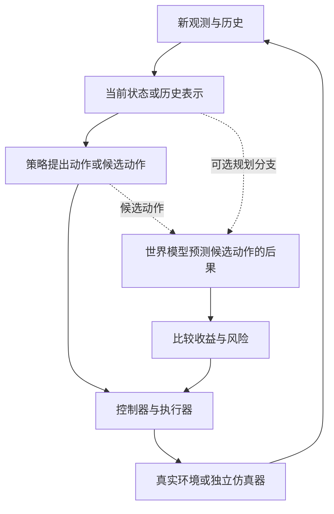

# 多模态、世界模型与具身系统

机器人看见桌上的杯子，先要理解观测，再决定动作，并通过新观测判断动作是否生效。VLM、世界模型、VLA和控制器可以参与这条过程，但它们的输出并不相同。

## 先区分每个模块产生什么

| 输入与问题 | 模块可能输出 | 入口 |
| --- | --- | --- |
| 图像和问题，杯子在哪里 | 文本、区域或视觉表示 | [VLM](../vlm/index.md) |
| 历史观测，当前运动状态是什么 | 位置、速度或belief/latent | [世界模型基础](../world-models/beginner-world-models-primer.md) |
| 当前状态与候选动作，下一步会怎样 | 未来观测、状态、奖励或风险 | [动力学与规划](../world-models/rssm-dreamer-and-planning.md) |
| 观测与语言目标，下一段该怎样动 | 连续动作或动作token | [VLA](../vla/index.md) |
| 期望动作与实时反馈，执行器怎样响应 | 底层控制命令 | [具身系统](../embodied-ai/index.md) |

这些不是强制的一套架构。有的策略直接从观测输出动作，有的加入显式规划，有的将多个功能放进同一网络。判断方法时应追踪实际接口，不因模型名字包含“world”或“action”就推断具备所有能力。

实线外环用执行后的新观测纠正动作。虚线分支表示一种可选的模型规划方式，并非所有 VLA 都包含它。世界模型生成的未来应回到动作选择环节接受检验；仅展示预测画面，还没有走完外环。

## 用抓杯过程连接表示与动作

单帧能看到杯子的位置，却不一定知道它是否滑动；历史或额外传感器可以补速度和接触信息。候选动作还要声明坐标、单位、时长和控制模式。模型预测“向左”有用之前，系统必须知道左是相机坐标还是机器人坐标。

执行后，夹爪没抓住或物体滑落，需要根据新观测调整。离线动作MSE、视频重建质量和闭环成功率分别覆盖不同环节。一个模块的高分不能代替整条过程的验证。

## 哪些知识应在问题出现时补上

视觉细节丢失时，看[视觉编码与连接器](../vlm/visual-tokenizers-and-connectors.md)；对象对应正确但位置仍偏时，看[几何与相机](../prerequisite-math/geometry-vision-and-3d.md)；预测未来逐渐漂移时，看[不确定性与风险](../world-models/uncertainty-and-risk-aware-planning.md)；动作发出但执行不同步时，看[VLA动作接口](../vla/action-representation-and-interfaces.md)与[部署](../vla/deployment-and-safety.md)。

[视频生成](../diffusion/video-and-multimodal-diffusion.md)提供时空表示和生成机制，但若要用于决策，还需动作条件、任务变量和控制评价。[强化学习](../reinforcement-learning/index.md)说明如何用交互结果优化策略，[控制数学](../prerequisite-math/dynamic-systems-and-control.md)则用最小例子解释反馈和重规划。

## 阅读具体方法时保留证据边界

预测自然的视频支持生成质量判断，动作改变后预测相应变化支持动作敏感性，独立环境中的闭环任务结果才进一步支持控制用途。Smoke代码只验证执行链条，手工fixture只验证指定计算。先明确当前证据覆盖哪一步，再讨论方法适用于什么系统。
