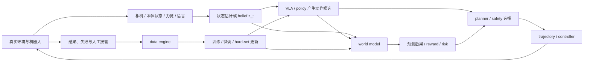

# 世界模型与具身智能：从预测环境到闭环行动

世界模型解决“环境在不同动作下会怎样变化”，具身智能解决“一个受传感器、控制频率、动力学和安全约束限制的系统怎样持续行动”。VLA、规划器、控制器、仿真器和数据引擎处在两者之间：它们分别承担动作生成、候选评估、物理执行、可控试验和失败回流。

## 世界模型与具身智能是什么关系

世界模型可以抽象为带动作的状态转移：

\[
z_t = e_\phi(h_t),\qquad
\hat z_{t+1}\sim p_\theta(z_{t+1}\mid z_t,a_t),
\]

其中 \(h_t\) 是截至当前的观测与动作历史，\(z_t\) 是用于预测或决策的内部状态，\(a_t\) 是动作。模型还可以预测观测、奖励、终止事件、接触或风险：

\[
p_\theta(o_{t+1},r_t,d_t\mid z_t,a_t).
\]

具身系统则必须把动作真正送进环境，并在新观测到来后重新估计状态。它关心的不只是预测误差，还关心坐标系、动作频率、延迟、碰撞、接触、恢复和运行边界。

二者不是包含关系：

- 没有显式世界模型的行为克隆或 VLA，也可以直接从观测输出动作；
- 世界模型可以只服务视频预测、仿真或表征学习，不直接控制机器人；
- 当世界模型被用于候选动作比较、MPC、策略训练或数据生成时，它才进入具身决策闭环。

## 一条从观测到行动再到学习的闭环

这张图区分五层接口：

1. **观测与状态层**把异步、多视角、多频率传感器整理成决策可消费的状态。
2. **策略层**根据任务条件提出动作、动作块或技能。
3. **预测与规划层**比较动作后果、收益和风险。
4. **控制与安全层**把高层动作变成满足动力学和运行边界的执行命令。
5. **数据与评测层**记录结果、形成失败桶，并决定下一轮训练数据。

任何模型都不能替代其上下游协议。VLA 输出末端增量，不代表底层控制器能按时实现；世界模型生成清晰视频，不代表动作差异在预测中可辨；仿真成功也不代表真实传感器与接触分布已经覆盖。

## 世界模型技术脉络

| 路线 | 主要学习对象 | 典型消费方 | 入口 |
| --- | --- | --- | --- |
| 潜变量动力学 | belief、latent transition、reward/continuation | MPC、actor-critic、latent imagination | [世界模型基础](../world-models/beginner-world-models-primer.md)、[RSSM 与 Dreamer](../world-models/rssm-dreamer-and-planning.md) |
| 预测式表征 | 被遮挡或未来片段的目标表示 | 表征预训练、物理推理、动作条件规划 | [Masked / JEPA](../world-models/masked-jepa-and-latent-prediction.md) |
| 生成式世界模拟 | 未来帧、视频 latent、可交互环境 | 仿真、agent 训练、合成 rollout | [生成式模拟与视频世界模型](../world-models/generative-simulation-and-video.md) |
| 动作条件建模 | 动作与未来状态/观测的联合或条件关系 | 反事实比较、WAM/VAM、规划 | [WM / WAM / VAM](../world-models/wm-wam-vam-and-action-conditioned-modeling.md) |
| 风险与不确定性 | 未来分布、ensemble disagreement、尾部风险 | 风险敏感规划与拒绝机制 | [不确定性与风险规划](../world-models/uncertainty-and-risk-aware-planning.md) |

PlaNet 和 Dreamer 展示了 latent dynamics 如何直接进入规划或策略学习；V-JEPA 类路线强调预测表示而非逐像素重建；Genie 类系统把动作条件视频生成扩展成可交互环境。它们共享“学习环境变化”的目标，但训练信号和下游消费方不同，不能只按“是否能预测视频”判断是不是同一种世界模型。

## 具身智能系统脉络

| 系统层 | 关键问题 | 入口 |
| --- | --- | --- |
| 任务与运行边界 | 成功状态、失败状态、ODD 和恢复条件怎样定义 | [具身智能基础](../embodied-ai/beginner-learning-path.md)、[任务谱系与评测](../embodied-ai/task-taxonomy-and-benchmarks.md) |
| 感知与三维状态 | 图像、深度、相机标定、物体位姿和场景状态怎样对齐 | [几何、视觉与三维空间](../prerequisite-math/geometry-vision-and-3d.md)、[相机、深度与机器人视觉](../embodied-ai/cameras-depth-and-robot-vision.md) |
| 坐标变换与手眼协调 | 旋转矩阵、齐次变换、坐标链、手眼标定以及局部/世界坐标增量怎样连接感知与动作 | [坐标变换与手眼协调](../embodied-ai/coordinate-transforms-and-hand-eye-calibration.md) |
| 机器人运动学 | 关节状态怎样通过正运动学和 DH 参数变成末端位姿，FK、IK 与机器人模型怎样分工 | [机器人运动学与 DH 参数](../embodied-ai/robot-kinematics-and-dh-parameters.md) |
| 数据协议 | episode、state、action、时间戳和 embodiment 怎样记录 | [机器人 State / Action 数据](../embodied-ai/state-action-robot-datasets.md) |
| 策略与动作 | VLA、行为克隆、扩散策略和动作块怎样输出控制目标 | [VLA 专题](../vla/index.md) |
| 规划与控制 | 候选动作怎样经过轨迹、控制与安全投影 | [规划、控制与安全](../embodied-ai/planning-control-and-safety.md) |
| 仿真与数据闭环 | 真实失败怎样进入仿真、hard set 和下一轮数据 | [Sim2Real 与数据引擎](../embodied-ai/sim2real-and-data-engines.md) |
| 部署 | 延迟、接管、监控和安全案例怎样形成上线证据 | [VLA 部署与安全](../vla/deployment-and-safety.md) |

坐标变换负责把相机、物体、末端与机器人基座表达在同一条可检查的空间链中；运动学负责把关节状态映射成链上的末端位姿。两者共同决定视觉目标能否正确变成规划和控制输入。完整公式、数值验证与工程边界分别见[坐标变换与手眼协调](../embodied-ai/coordinate-transforms-and-hand-eye-calibration.md)和[机器人运动学与 DH 参数](../embodied-ai/robot-kinematics-and-dh-parameters.md)。

具身智能的基本评测单位是 episode：系统在扰动、误差累积和动作后果反馈下，是否完成任务、保持安全并能从失败恢复。

## VLA 作为策略接口

VLA 通常实现：

\[
\pi_\psi(a_{t:t+H}\mid o_{\le t},\ell),
\]

其中 \(\ell\) 是语言或任务条件，输出可以是单步动作、动作块、离散 action token 或连续动作分布。VLA 把视觉与语言知识接到机器人动作，但它本身不自动提供：

- 对多个候选动作的长期后果模拟；
- 满足碰撞、关节限位和接触约束的轨迹；
- 高频、稳定的关节或力矩控制；
- 失败检测、恢复状态机和安全否决；
- 跨机器人动作空间的无损对齐。

世界模型可以作为 VLA 的预测器、规划器或数据生成器；VLA 也可以为世界模型提供候选动作。两者组合时必须明确谁输出动作、谁预测后果、谁选择、谁执行，避免把“能生成未来”和“能安全行动”写成同一个接口。

## 按问题进入

| 问题 | 建议阅读 |
| --- | --- |
| 世界模型至少需要哪些变量，和普通视频预测差在哪里 | [世界模型基础](../world-models/beginner-world-models-primer.md) |
| RSSM 为什么同时维护确定性记忆和随机状态 | [RSSM、Dreamer 与规划](../world-models/rssm-dreamer-and-planning.md) |
| JEPA 不生成像素，为什么仍能服务世界建模 | [Masked / JEPA](../world-models/masked-jepa-and-latent-prediction.md) |
| 生成视频什么时候才能被称为可交互环境 | [生成式模拟与视频世界模型](../world-models/generative-simulation-and-video.md) |
| 一个机器人闭环究竟经过哪些系统层 | [具身智能基础](../embodied-ai/beginner-learning-path.md) → [闭环任务拆解](../embodied-ai/closed-loop-task-walkthrough.md) |
| 数据里的 state 和 action 怎样判断语义 | [机器人 State / Action 数据](../embodied-ai/state-action-robot-datasets.md) |
| VLA 的 action token、动作块和连续策略怎样比较 | [动作表示与控制接口](../vla/action-representation-and-interfaces.md) |
| 世界模型如何真正影响动作选择 | [VLA 到世界模型全链路](../world-models/vla-world-model-full-chain-case.md) |
| 离线指标正常但真实机器人不断失败时查什么 | [VLA 闭环恢复](../vla/closed-loop-recovery-and-failure-analysis.md) → [世界模型评测](../world-models/evaluation-and-failure-modes.md) |
| 仿真数据什么时候有帮助，什么时候放大偏差 | [Sim2Real 与数据引擎](../embodied-ai/sim2real-and-data-engines.md) |

## 外部材料

- [PlaNet](https://arxiv.org/abs/1811.04551)
- [Dreamer](https://arxiv.org/abs/1912.01603)
- [V-JEPA](https://arxiv.org/abs/2404.08471)
- [Genie](https://arxiv.org/abs/2402.15391)
- [Open X-Embodiment](https://arxiv.org/abs/2310.08864)
- [OpenVLA](https://arxiv.org/abs/2406.09246)
- [π0](https://arxiv.org/abs/2410.24164)
